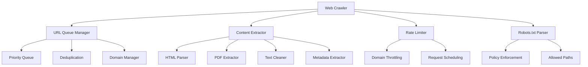

# Web Crawling API

The Web Crawling API provides comprehensive web content extraction and crawling capabilities for academic research, enabling automated discovery and processing of scholarly content from various web sources.

## Overview

The Web Crawling API offers intelligent web scraping with respect for robots.txt, rate limiting, content extraction, and academic content recognition. It supports both single page extraction and systematic crawling of academic websites.



## Core Functionality

### URL Management

```python
from studyassistant.external.web_crawling import WebCrawler

# Initialize crawler
crawler = WebCrawler(
    concurrent_requests=5,
    delay_between_requests=1.0,
    respect_robots_txt=True,
    user_agent="StudyAssistant Academic Crawler 1.0"
)

# Add URLs to crawl queue
urls = [
    "https://scholar.google.com/citations?user=ABC123",
    "https://research.university.edu/publications",
    "https://arxiv.org/list/cs.AI/recent"
]

for url in urls:
    await crawler.add_url(
        url=url,
        priority=1,
        max_depth=3,
        allowed_domains=["scholar.google.com", "research.university.edu"]
    )
```

### Content Extraction

```python
# Extract single page
result = await crawler.extract_page(
    url="https://research.university.edu/paper123",
    extract_links=True,
    extract_citations=True,
    extract_metadata=True
)

print(f"Title: {result.title}")
print(f"Authors: {result.authors}")
print(f"Abstract: {result.abstract}")
print(f"Content: {result.content[:500]}...")
print(f"Citations: {len(result.citations)}")
print(f"Related Links: {len(result.links)}")
```

### Batch Crawling

```python
# Start batch crawling
crawl_session = await crawler.start_crawl(
    seed_urls=urls,
    max_pages=1000,
    content_types=["text/html", "application/pdf"],
    academic_content_only=True,
    filters={
        "min_word_count": 100,
        "require_citations": True,
        "academic_domains_only": True
    }
)

# Monitor progress
async for update in crawler.monitor_crawl(crawl_session.id):
    print(f"Progress: {update.pages_crawled}/{update.total_discovered}")
    print(f"Queue size: {update.queue_size}")
    print(f"Errors: {update.error_count}")
```

## API Reference

### WebCrawler Class

#### Constructor

```python
WebCrawler(
    concurrent_requests: int = 5,
    delay_between_requests: float = 1.0,
    timeout: float = 30.0,
    max_retries: int = 3,
    respect_robots_txt: bool = True,
    user_agent: str = "StudyAssistant Crawler",
    headers: Dict[str, str] = None,
    proxy_config: ProxyConfig = None
)
```

**Parameters:**
- `concurrent_requests`: Maximum concurrent HTTP requests
- `delay_between_requests`: Minimum delay between requests to same domain
- `timeout`: Request timeout in seconds
- `max_retries`: Maximum retry attempts for failed requests
- `respect_robots_txt`: Whether to respect robots.txt files
- `user_agent`: User agent string for requests
- `headers`: Additional HTTP headers
- `proxy_config`: Proxy configuration for requests

#### Methods

##### add_url()

```python
async def add_url(
    url: str,
    priority: int = 1,
    max_depth: int = 0,
    allowed_domains: List[str] = None,
    metadata: Dict[str, Any] = None
) -> bool
```

Add URL to crawling queue.

**Parameters:**
- `url`: Target URL to crawl
- `priority`: Crawling priority (1-10, higher = more priority)
- `max_depth`: Maximum crawling depth from this URL
- `allowed_domains`: Domains allowed for following links
- `metadata`: Additional metadata to associate with URL

**Returns:** `bool` - Success status

##### extract_page()

```python
async def extract_page(
    url: str,
    extract_links: bool = False,
    extract_citations: bool = False,
    extract_metadata: bool = True,
    content_filter: ContentFilter = None
) -> PageContent
```

Extract content from a single page.

**Parameters:**
- `url`: Target URL to extract
- `extract_links`: Whether to extract outbound links
- `extract_citations`: Whether to extract academic citations
- `extract_metadata`: Whether to extract page metadata
- `content_filter`: Filter for content extraction

**Returns:** `PageContent` object with extracted data

##### start_crawl()

```python
async def start_crawl(
    seed_urls: List[str],
    max_pages: int = 100,
    max_depth: int = 3,
    content_types: List[str] = None,
    academic_content_only: bool = False,
    filters: CrawlFilters = None,
    output_format: str = "json"
) -> CrawlSession
```

Start a batch crawling session.

**Parameters:**
- `seed_urls`: Initial URLs to start crawling
- `max_pages`: Maximum pages to crawl
- `max_depth`: Maximum crawling depth
- `content_types`: Allowed content types
- `academic_content_only`: Filter for academic content only
- `filters`: Content filtering options
- `output_format`: Output format (json, csv, xml)

**Returns:** `CrawlSession` object

### Content Models

#### PageContent

```python
class PageContent:
    url: str
    title: str
    authors: List[str]
    abstract: str
    content: str
    metadata: Dict[str, Any]
    citations: List[Citation]
    links: List[Link]
    extracted_at: datetime
    content_type: str
    language: str
    word_count: int
    academic_score: float
```

#### Citation

```python
class Citation:
    text: str
    authors: List[str]
    title: str
    journal: str
    year: int
    doi: str
    url: str
    citation_type: str  # "direct", "indirect", "reference"
```

#### CrawlSession

```python
class CrawlSession:
    id: str
    status: str  # "running", "completed", "paused", "failed"
    start_time: datetime
    end_time: datetime
    pages_crawled: int
    pages_discovered: int
    errors: List[CrawlError]
    statistics: CrawlStatistics
```

## Advanced Features

### Academic Content Recognition

```python
# Configure academic content detection
academic_detector = AcademicContentDetector(
    min_citation_count=5,
    academic_keywords=["research", "study", "analysis", "methodology"],
    required_sections=["abstract", "introduction", "conclusion"],
    doi_pattern_matching=True,
    journal_database_lookup=True
)

crawler.set_content_detector(academic_detector)

# Extract with academic scoring
result = await crawler.extract_page(
    url="https://research.example.com/paper",
    academic_scoring=True
)

print(f"Academic Score: {result.academic_score}/10")
print(f"Detected Type: {result.content_classification}")
```

### Custom Content Filters

```python
# Define custom content filter
class ResearchPaperFilter(ContentFilter):
    def should_extract(self, page_info: PageInfo) -> bool:
        # Check if page contains research content
        return (
            self.has_academic_keywords(page_info.title) and
            self.has_author_section(page_info.content) and
            self.has_references_section(page_info.content)
        )
    
    def extract_metadata(self, content: str) -> Dict[str, Any]:
        return {
            "research_area": self.detect_research_area(content),
            "methodology": self.extract_methodology(content),
            "dataset_size": self.extract_dataset_info(content)
        }

# Apply custom filter
crawler.add_content_filter(ResearchPaperFilter())
```

### Distributed Crawling

```python
# Configure distributed crawling
from studyassistant.external.web_crawling.distributed import DistributedCrawler

distributed_crawler = DistributedCrawler(
    redis_url="redis://localhost:6379",
    worker_count=4,
    coordination_strategy="round_robin"
)

# Start distributed crawl
await distributed_crawler.start_crawl(
    seed_urls=large_url_list,
    max_pages=10000,
    worker_distribution="auto"
)
```

## Content Processing Pipeline

### Text Processing

```python
# Configure text processing pipeline
text_processor = TextProcessor(
    clean_html=True,
    extract_main_content=True,
    remove_boilerplate=True,
    normalize_whitespace=True,
    extract_structured_data=True
)

crawler.set_text_processor(text_processor)

# Process with custom cleaning
result = await crawler.extract_page(
    url="https://example.com/research",
    processing_options={
        "extract_tables": True,
        "extract_figures": True,
        "preserve_formatting": False,
        "extract_equations": True
    }
)
```

### PDF Processing

```python
# Configure PDF extraction
pdf_processor = PDFProcessor(
    extract_text=True,
    extract_figures=True,
    extract_tables=True,
    ocr_enabled=True,
    preserve_layout=False
)

# Extract PDF content
pdf_result = await crawler.extract_pdf(
    url="https://example.com/paper.pdf",
    processor=pdf_processor
)

print(f"Pages: {pdf_result.page_count}")
print(f"Figures: {len(pdf_result.figures)}")
print(f"Tables: {len(pdf_result.tables)}")
```

## Rate Limiting and Throttling

### Domain-Based Throttling

```python
# Configure per-domain rate limits
rate_limiter = DomainRateLimiter({
    "arxiv.org": {"requests_per_second": 0.5, "burst_size": 2},
    "scholar.google.com": {"requests_per_second": 0.2, "burst_size": 1},
    "*.edu": {"requests_per_second": 1.0, "burst_size": 3},
    "default": {"requests_per_second": 2.0, "burst_size": 5}
})

crawler.set_rate_limiter(rate_limiter)
```

### Adaptive Throttling

```python
# Enable adaptive rate limiting
adaptive_limiter = AdaptiveRateLimiter(
    initial_rate=1.0,
    max_rate=5.0,
    min_rate=0.1,
    adjustment_factor=1.5,
    error_threshold=0.1
)

# Rate adjusts based on server responses
crawler.set_rate_limiter(adaptive_limiter)
```

## Robots.txt Compliance

### Robots.txt Parser

```python
# Check robots.txt compliance
robots_parser = RobotsParser(
    user_agent="StudyAssistant",
    cache_duration=3600,
    respect_crawl_delay=True
)

# Verify URL access
is_allowed = await robots_parser.can_fetch(
    url="https://example.com/research",
    user_agent="StudyAssistant"
)

crawl_delay = await robots_parser.get_crawl_delay(
    domain="example.com",
    user_agent="StudyAssistant"
)
```

## Error Handling and Recovery

### Retry Configuration

```python
# Configure retry strategies
retry_config = RetryConfig(
    max_attempts=3,
    backoff_strategy="exponential",
    base_delay=1.0,
    max_delay=30.0,
    jitter=True,
    retry_on_status=[429, 500, 502, 503, 504]
)

crawler.set_retry_config(retry_config)
```

### Error Recovery

```python
# Handle crawl errors
@crawler.on_error
async def handle_crawl_error(error: CrawlError):
    if error.error_type == "rate_limit":
        # Increase delay for this domain
        await crawler.increase_domain_delay(error.domain, factor=2.0)
    elif error.error_type == "timeout":
        # Retry with longer timeout
        await crawler.retry_with_timeout(error.url, timeout=60.0)
    elif error.error_type == "blocked":
        # Skip domain temporarily
        await crawler.block_domain_temporarily(error.domain, duration=3600)
```

## Monitoring and Analytics

### Crawl Statistics

```python
# Get crawl statistics
stats = await crawler.get_statistics(session_id="crawl_123")

print(f"Pages crawled: {stats.pages_crawled}")
print(f"Success rate: {stats.success_rate:.2%}")
print(f"Average response time: {stats.avg_response_time:.2f}s")
print(f"Data extracted: {stats.total_content_size_mb:.1f} MB")
print(f"Unique domains: {stats.unique_domains}")
```

### Real-time Monitoring

```python
# Monitor crawl progress
async def monitor_crawl_progress(session_id: str):
    async for update in crawler.stream_progress(session_id):
        print(f"Status: {update.status}")
        print(f"Progress: {update.completion_percentage:.1f}%")
        print(f"Rate: {update.pages_per_minute:.1f} pages/min")
        print(f"Errors: {update.error_rate:.2%}")
        
        if update.status == "completed":
            break
```

## Configuration Examples

### Basic Academic Crawler

```python
# Configuration for academic content crawling
config = {
    "crawler": {
        "concurrent_requests": 3,
        "delay_between_requests": 2.0,
        "respect_robots_txt": True,
        "user_agent": "StudyAssistant Academic Research Bot"
    },
    "content_detection": {
        "academic_only": True,
        "min_academic_score": 7.0,
        "required_sections": ["abstract", "references"],
        "citation_extraction": True
    },
    "rate_limiting": {
        "default_rate": 0.5,
        "academic_domains": 0.2,
        "adaptive_throttling": True
    },
    "output": {
        "format": "json",
        "include_metadata": True,
        "include_citations": True,
        "content_cleaning": True
    }
}

crawler = WebCrawler.from_config(config)
```

### Research Portal Crawler

```python
# Specialized crawler for research portals
research_crawler = WebCrawler(
    concurrent_requests=2,
    delay_between_requests=3.0,
    academic_content_only=True,
    content_filters=[
        AcademicPaperFilter(),
        ConferenceProceedingsFilter(),
        ThesisFilter()
    ],
    extraction_rules={
        "author_patterns": [
            r"Authors?:\s*(.+)",
            r"By:\s*(.+)",
            r'<meta name="citation_author" content="([^"]+)"'
        ],
        "abstract_selectors": [
            ".abstract",
            "#abstract",
            "[data-abstract]"
        ]
    }
)
```

## Best Practices

### Ethical Crawling

```python
# Implement ethical crawling practices
ethical_crawler = EthicalWebCrawler(
    respect_robots_txt=True,
    max_requests_per_domain_per_hour=100,
    identify_as_academic_research=True,
    provide_contact_info=True,
    avoid_peak_hours=True,
    cache_responses=True,
    minimize_server_load=True
)
```

### Content Quality Assurance

```python
# Ensure high-quality content extraction
quality_filter = ContentQualityFilter(
    min_word_count=500,
    max_word_count=50000,
    min_academic_score=6.0,
    require_complete_sentences=True,
    filter_duplicate_content=True,
    validate_academic_structure=True
)

crawler.add_quality_filter(quality_filter)
```

## Integration Examples

### JavaScript/Node.js

```javascript
const { WebCrawler } = require('@studyassistant/web-crawling');

// Initialize crawler
const crawler = new WebCrawler({
    concurrentRequests: 5,
    delayBetweenRequests: 1000,
    respectRobotsTxt: true,
    userAgent: 'StudyAssistant Academic Crawler'
});

// Extract single page
const result = await crawler.extractPage({
    url: 'https://research.example.com/paper',
    extractLinks: true,
    extractCitations: true,
    extractMetadata: true
});

console.log(`Title: ${result.title}`);
console.log(`Authors: ${result.authors.join(', ')}`);
console.log(`Citations: ${result.citations.length}`);

// Start batch crawl
const session = await crawler.startCrawl({
    seedUrls: [
        'https://scholar.google.com/citations?user=ABC123',
        'https://research.university.edu/publications'
    ],
    maxPages: 1000,
    academicContentOnly: true,
    filters: {
        minWordCount: 100,
        requireCitations: true
    }
});

// Monitor progress
for await (const update of crawler.monitorCrawl(session.id)) {
    console.log(`Progress: ${update.pagesCrawled}/${update.totalDiscovered}`);
    if (update.status === 'completed') break;
}
```

## Error Codes

| Code | Description | Resolution |
|------|-------------|------------|
| `ROBOTS_BLOCKED` | URL blocked by robots.txt | Respect robots.txt or request permission |
| `RATE_LIMITED` | Too many requests to domain | Increase delay between requests |
| `CONTENT_NOT_FOUND` | No extractable content found | Check URL validity and content type |
| `PARSING_ERROR` | Error parsing page content | Review HTML structure or PDF format |
| `NETWORK_TIMEOUT` | Request timed out | Increase timeout or check network |
| `ACCESS_DENIED` | Server returned 403/401 | Check authentication or permissions |
| `ACADEMIC_FILTER_FAILED` | Content doesn't meet academic criteria | Review academic detection settings |

## Performance Optimization

### Concurrent Processing

```python
# Optimize for high-throughput crawling
high_performance_crawler = WebCrawler(
    concurrent_requests=20,
    connection_pool_size=50,
    keep_alive_timeout=30,
    dns_cache_enabled=True,
    compression_enabled=True,
    persistent_connections=True
)
```

### Memory Management

```python
# Configure memory-efficient crawling
memory_config = MemoryConfig(
    max_page_cache_size=1000,
    content_streaming=True,
    lazy_content_loading=True,
    garbage_collection_threshold=0.8
)

crawler.set_memory_config(memory_config)
```

The Web Crawling API provides a comprehensive solution for academic web content extraction with built-in respect for web standards, ethical crawling practices, and sophisticated content recognition capabilities specifically designed for research workflows.
