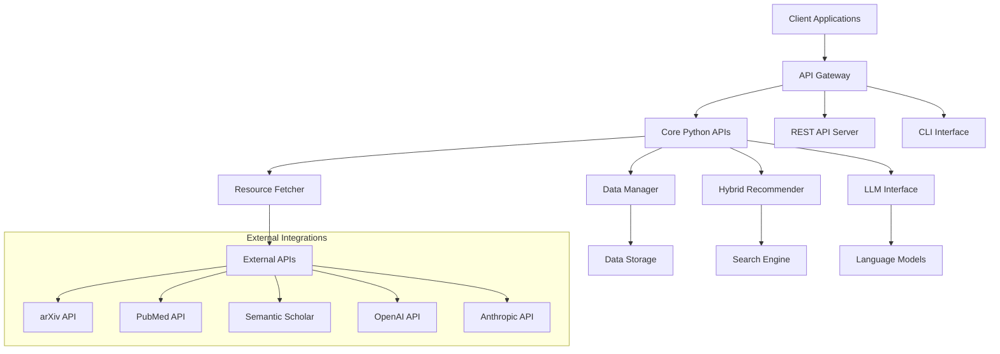

# API Overview

StudyAssistant provides a comprehensive API ecosystem that includes Python APIs, REST endpoints, CLI commands, and integration interfaces. This overview describes the architecture and organization of all API components.

## API Architecture



## Core Python APIs

### StudyAssistant Main Class

The primary interface for all StudyAssistant functionality:

```python
from studyassistant import StudyAssistant
from typing import List, Dict, Optional

class StudyAssistant:
    """Main StudyAssistant interface for research operations"""
    
    def __init__(self, config_path: Optional[str] = None):
        """Initialize StudyAssistant with optional configuration"""
        pass
    
    async def search(self, 
                    query: str,
                    max_results: int = 20,
                    sources: Optional[List[str]] = None,
                    filters: Optional[Dict] = None) -> List[Dict]:
        """Search academic literature"""
        pass
    
    async def semantic_search(self,
                             query: str,
                             similarity_threshold: float = 0.7,
                             max_results: int = 20) -> List[Dict]:
        """Perform semantic similarity search"""
        pass
    
    def add_document(self, 
                    file_path: str,
                    metadata: Optional[Dict] = None) -> str:
        """Add document to local collection"""
        pass
    
    def get_document(self, document_id: str) -> Optional[Dict]:
        """Retrieve document by ID"""
        pass
    
    async def summarize(self, 
                       document_id: str,
                       summary_type: str = "abstract") -> str:
        """Generate document summary"""
        pass
    
    async def compare_documents(self, 
                               doc_ids: List[str]) -> Dict:
        """Compare multiple documents"""
        pass
    
    def get_citations(self, document_id: str) -> List[Dict]:
        """Get citation information for document"""
        pass
    
    def export_results(self, 
                      results: List[Dict],
                      format: str = "json",
                      output_path: str = None) -> str:
        """Export search results to various formats"""
        pass
```

### Configuration Management

```python
from studyassistant.config import ConfigManager

class ConfigManager:
    """Manage StudyAssistant configuration"""
    
    def __init__(self, config_path: str = "~/.studyassistant/config.yaml"):
        self.config_path = config_path
        self.config = self._load_config()
    
    def get(self, key: str, default=None):
        """Get configuration value"""
        keys = key.split('.')
        value = self.config
        for k in keys:
            value = value.get(k, {})
        return value if value != {} else default
    
    def set(self, key: str, value):
        """Set configuration value"""
        keys = key.split('.')
        config = self.config
        for k in keys[:-1]:
            config = config.setdefault(k, {})
        config[keys[-1]] = value
        self._save_config()
    
    def validate(self) -> List[str]:
        """Validate configuration and return errors"""
        pass
    
    def reset(self, section: str = None):
        """Reset configuration to defaults"""
        pass
```

## REST API Server

### Server Setup

```python
from fastapi import FastAPI, HTTPException, Depends
from fastapi.security import HTTPBearer
from pydantic import BaseModel
from typing import List, Optional

app = FastAPI(
    title="StudyAssistant API",
    description="Academic research assistance API",
    version="1.0.0"
)

security = HTTPBearer()

class SearchRequest(BaseModel):
    query: str
    max_results: int = 20
    sources: Optional[List[str]] = None
    filters: Optional[Dict] = None

class SearchResponse(BaseModel):
    query: str
    total_results: int
    results: List[Dict]
    execution_time: float

@app.post("/api/v1/search", response_model=SearchResponse)
async def search_literature(request: SearchRequest, token: str = Depends(security)):
    """Search academic literature"""
    try:
        sa = StudyAssistant()
        results = await sa.search(
            query=request.query,
            max_results=request.max_results,
            sources=request.sources,
            filters=request.filters
        )
        
        return SearchResponse(
            query=request.query,
            total_results=len(results),
            results=results,
            execution_time=0.0  # Calculate actual time
        )
    except Exception as e:
        raise HTTPException(status_code=500, detail=str(e))
```

### API Endpoints

#### Search Endpoints

```python
@app.get("/api/v1/search/status")
async def get_search_status():
    """Get search system status"""
    pass

@app.post("/api/v1/search/semantic")
async def semantic_search(request: SemanticSearchRequest):
    """Perform semantic search"""
    pass

@app.post("/api/v1/search/batch")
async def batch_search(requests: List[SearchRequest]):
    """Execute multiple searches in batch"""
    pass
```

#### Document Management Endpoints

```python
@app.post("/api/v1/documents")
async def upload_document(file: UploadFile):
    """Upload and process document"""
    pass

@app.get("/api/v1/documents/{document_id}")
async def get_document(document_id: str):
    """Retrieve document details"""
    pass

@app.delete("/api/v1/documents/{document_id}")
async def delete_document(document_id: str):
    """Delete document from collection"""
    pass

@app.get("/api/v1/documents/{document_id}/summary")
async def get_document_summary(document_id: str, summary_type: str = "abstract"):
    """Get document summary"""
    pass
```

#### Analysis Endpoints

```python
@app.post("/api/v1/analysis/compare")
async def compare_documents(request: CompareRequest):
    """Compare multiple documents"""
    pass

@app.post("/api/v1/analysis/citations")
async def analyze_citations(request: CitationRequest):
    """Analyze citation networks"""
    pass

@app.post("/api/v1/analysis/trends")
async def analyze_trends(request: TrendRequest):
    """Analyze research trends"""
    pass
```

## Authentication and Authorization

### API Key Management

```python
from passlib.context import CryptContext
import jwt
from datetime import datetime, timedelta

class AuthManager:
    def __init__(self, secret_key: str):
        self.secret_key = secret_key
        self.pwd_context = CryptContext(schemes=["bcrypt"], deprecated="auto")
    
    def create_api_key(self, user_id: str, permissions: List[str]) -> str:
        """Create API key for user"""
        payload = {
            "user_id": user_id,
            "permissions": permissions,
            "created_at": datetime.utcnow().isoformat(),
            "expires_at": (datetime.utcnow() + timedelta(days=365)).isoformat()
        }
        return jwt.encode(payload, self.secret_key, algorithm="HS256")
    
    def validate_api_key(self, token: str) -> Dict:
        """Validate API key and return user info"""
        try:
            payload = jwt.decode(token, self.secret_key, algorithms=["HS256"])
            
            # Check expiration
            expires_at = datetime.fromisoformat(payload["expires_at"])
            if datetime.utcnow() > expires_at:
                raise ValueError("API key expired")
            
            return payload
        except jwt.InvalidTokenError:
            raise ValueError("Invalid API key")

# Dependency for protected endpoints
async def get_current_user(token: str = Depends(security)):
    auth_manager = AuthManager(settings.SECRET_KEY)
    try:
        user_info = auth_manager.validate_api_key(token.credentials)
        return user_info
    except ValueError as e:
        raise HTTPException(status_code=401, detail=str(e))
```

## Rate Limiting and Quotas

```python
from slowapi import Limiter, _rate_limit_exceeded_handler
from slowapi.util import get_remote_address
from slowapi.errors import RateLimitExceeded

limiter = Limiter(key_func=get_remote_address)
app.state.limiter = limiter
app.add_exception_handler(RateLimitExceeded, _rate_limit_exceeded_handler)

@app.post("/api/v1/search")
@limiter.limit("100/minute")
async def search_with_rate_limit(request: Request, search_request: SearchRequest):
    """Search with rate limiting"""
    pass

class QuotaManager:
    def __init__(self, redis_client):
        self.redis = redis_client
    
    def check_quota(self, user_id: str, operation: str) -> bool:
        """Check if user has quota for operation"""
        key = f"quota:{user_id}:{operation}"
        current_usage = self.redis.get(key) or 0
        
        # Get user's quota limit
        quota_limit = self.get_user_quota(user_id, operation)
        
        return int(current_usage) < quota_limit
    
    def increment_usage(self, user_id: str, operation: str):
        """Increment usage counter"""
        key = f"quota:{user_id}:{operation}"
        pipe = self.redis.pipeline()
        pipe.incr(key)
        pipe.expire(key, 86400)  # 24 hours
        pipe.execute()
```

## Error Handling

```python
from enum import Enum
from pydantic import BaseModel

class ErrorCode(Enum):
    INVALID_QUERY = "INVALID_QUERY"
    SOURCE_UNAVAILABLE = "SOURCE_UNAVAILABLE"
    QUOTA_EXCEEDED = "QUOTA_EXCEEDED"
    PROCESSING_ERROR = "PROCESSING_ERROR"
    INVALID_DOCUMENT = "INVALID_DOCUMENT"

class APIError(BaseModel):
    error_code: ErrorCode
    message: str
    details: Optional[Dict] = None
    timestamp: str
    request_id: str

@app.exception_handler(ValueError)
async def value_error_handler(request: Request, exc: ValueError):
    return JSONResponse(
        status_code=400,
        content=APIError(
            error_code=ErrorCode.INVALID_QUERY,
            message=str(exc),
            timestamp=datetime.utcnow().isoformat(),
            request_id=str(uuid.uuid4())
        ).dict()
    )

@app.exception_handler(HTTPException)
async def http_exception_handler(request: Request, exc: HTTPException):
    return JSONResponse(
        status_code=exc.status_code,
        content=APIError(
            error_code=ErrorCode.PROCESSING_ERROR,
            message=exc.detail,
            timestamp=datetime.utcnow().isoformat(),
            request_id=str(uuid.uuid4())
        ).dict()
    )
```

## Response Formats

### Standard Response Structure

```python
class StandardResponse(BaseModel):
    success: bool
    data: Optional[Any] = None
    error: Optional[APIError] = None
    metadata: Optional[Dict] = None

class PaginatedResponse(StandardResponse):
    data: List[Any]
    pagination: Dict = {
        "page": 1,
        "per_page": 20,
        "total": 0,
        "pages": 0
    }

# Example usage
@app.get("/api/v1/documents", response_model=PaginatedResponse)
async def list_documents(page: int = 1, per_page: int = 20):
    """List documents with pagination"""
    pass
```

### Content Negotiation

```python
from fastapi.responses import JSONResponse, PlainTextResponse
from fastapi import Request

@app.get("/api/v1/documents/{document_id}/export")
async def export_document(document_id: str, format: str = "json", request: Request = None):
    """Export document in various formats"""
    
    document = await get_document(document_id)
    
    if format == "json":
        return JSONResponse(document)
    elif format == "bibtex":
        bibtex_content = convert_to_bibtex(document)
        return PlainTextResponse(bibtex_content, media_type="application/x-bibtex")
    elif format == "ris":
        ris_content = convert_to_ris(document)
        return PlainTextResponse(ris_content, media_type="application/x-research-info-systems")
    else:
        raise HTTPException(status_code=400, detail="Unsupported format")
```

## API Documentation

### OpenAPI Schema

```python
from fastapi.openapi.utils import get_openapi

def custom_openapi():
    if app.openapi_schema:
        return app.openapi_schema
    
    openapi_schema = get_openapi(
        title="StudyAssistant API",
        version="1.0.0",
        description="Comprehensive API for academic research assistance",
        routes=app.routes,
    )
    
    # Add custom schema elements
    openapi_schema["info"]["x-logo"] = {
        "url": "https://studyassistant.ai/logo.png"
    }
    
    # Add authentication schemes
    openapi_schema["components"]["securitySchemes"] = {
        "ApiKeyAuth": {
            "type": "http",
            "scheme": "bearer",
            "bearerFormat": "JWT"
        }
    }
    
    app.openapi_schema = openapi_schema
    return app.openapi_schema

app.openapi = custom_openapi
```

### Example Requests and Responses

```python
# Example search request
search_example = {
    "query": "machine learning in healthcare",
    "max_results": 50,
    "sources": ["arxiv", "pubmed"],
    "filters": {
        "year_range": [2020, 2024],
        "min_citations": 10
    }
}

# Example search response
search_response_example = {
    "query": "machine learning in healthcare",
    "total_results": 25,
    "results": [
        {
            "id": "arxiv:2301.00001",
            "title": "Machine Learning Applications in Healthcare",
            "authors": ["Smith, J.", "Doe, A."],
            "abstract": "This paper reviews...",
            "url": "https://arxiv.org/abs/2301.00001",
            "published": "2023-01-01",
            "citations": 42,
            "relevance_score": 0.95
        }
    ],
    "execution_time": 1.23
}
```

## Client SDKs

### Python SDK

```python
import requests
from typing import List, Dict, Optional

class StudyAssistantClient:
    def __init__(self, api_key: str, base_url: str = "https://api.studyassistant.ai"):
        self.api_key = api_key
        self.base_url = base_url
        self.session = requests.Session()
        self.session.headers.update({
            "Authorization": f"Bearer {api_key}",
            "Content-Type": "application/json"
        })
    
    def search(self, query: str, **kwargs) -> Dict:
        """Search academic literature"""
        response = self.session.post(
            f"{self.base_url}/api/v1/search",
            json={"query": query, **kwargs}
        )
        response.raise_for_status()
        return response.json()
    
    def get_document(self, document_id: str) -> Dict:
        """Get document details"""
        response = self.session.get(
            f"{self.base_url}/api/v1/documents/{document_id}"
        )
        response.raise_for_status()
        return response.json()
    
    def upload_document(self, file_path: str, metadata: Optional[Dict] = None) -> Dict:
        """Upload document"""
        with open(file_path, 'rb') as f:
            files = {'file': f}
            data = {'metadata': json.dumps(metadata)} if metadata else {}
            response = self.session.post(
                f"{self.base_url}/api/v1/documents",
                files=files,
                data=data
            )
        response.raise_for_status()
        return response.json()

# Usage example
client = StudyAssistantClient(api_key="your-api-key")
results = client.search("neural networks", max_results=50)
```

### JavaScript SDK

```javascript
class StudyAssistantClient {
    constructor(apiKey, baseUrl = 'https://api.studyassistant.ai') {
        this.apiKey = apiKey;
        this.baseUrl = baseUrl;
    }
    
    async search(query, options = {}) {
        const response = await fetch(`${this.baseUrl}/api/v1/search`, {
            method: 'POST',
            headers: {
                'Authorization': `Bearer ${this.apiKey}`,
                'Content-Type': 'application/json'
            },
            body: JSON.stringify({ query, ...options })
        });
        
        if (!response.ok) {
            throw new Error(`Search failed: ${response.statusText}`);
        }
        
        return response.json();
    }
    
    async getDocument(documentId) {
        const response = await fetch(`${this.baseUrl}/api/v1/documents/${documentId}`, {
            headers: {
                'Authorization': `Bearer ${this.apiKey}`
            }
        });
        
        if (!response.ok) {
            throw new Error(`Failed to get document: ${response.statusText}`);
        }
        
        return response.json();
    }
}

// Usage
const client = new StudyAssistantClient('your-api-key');
const results = await client.search('machine learning', { maxResults: 50 });
```

## API Versioning

```python
from fastapi import APIRouter

# Version 1 router
v1_router = APIRouter(prefix="/api/v1")

@v1_router.post("/search")
async def search_v1(request: SearchRequestV1):
    """Version 1 search endpoint"""
    pass

# Version 2 router with enhanced features
v2_router = APIRouter(prefix="/api/v2")

@v2_router.post("/search")
async def search_v2(request: SearchRequestV2):
    """Version 2 search endpoint with enhanced capabilities"""
    pass

# Include routers in main app
app.include_router(v1_router)
app.include_router(v2_router)

# Version negotiation middleware
@app.middleware("http")
async def version_negotiation(request: Request, call_next):
    # Check Accept header for version preference
    accept_header = request.headers.get("Accept", "")
    if "application/vnd.studyassistant.v2+json" in accept_header:
        request.state.api_version = "v2"
    else:
        request.state.api_version = "v1"
    
    response = await call_next(request)
    return response
```

## Next Steps

- Explore [Core APIs](core-apis.md) for detailed Python API documentation
- Learn about [CLI Commands](cli/commands.md) for command-line interface
- Review [External Integrations](external/integrations.md) for third-party APIs
- Check [Authentication](authentication.md) for security implementation
