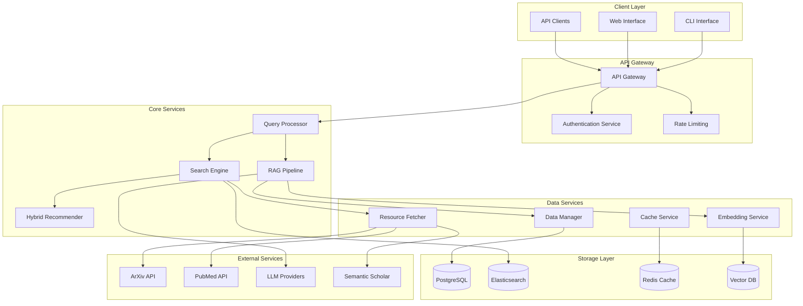

# Component Overview

The StudyAssistant system is built using a modular, microservices-based architecture that promotes scalability, maintainability, and extensibility. This document provides a comprehensive overview of all system components, their responsibilities, interactions, and implementation details.

## System Architecture

### High-Level Component Diagram



## Core Components

### 1. Query Processor

**Purpose**: Central orchestrator for all user queries, managing the complete request lifecycle from input parsing to response generation.

**Responsibilities**:
- Query parsing and intent classification
- Request routing to appropriate services
- Response aggregation and formatting
- Error handling and user feedback

**Implementation**:
```python
class QueryProcessor:
    def __init__(self):
        self.intent_classifier = IntentClassifier()
        self.query_expander = QueryExpander()
        self.response_formatter = ResponseFormatter()
    
    async def process_query(self, query: UserQuery) -> QueryResponse:
        # Parse and classify the query
        parsed_query = await self.parse_query(query)
        intent = await self.intent_classifier.classify(parsed_query)
        
        # Route to appropriate handler
        if intent == QueryIntent.SEARCH:
            return await self.handle_search_query(parsed_query)
        elif intent == QueryIntent.RECOMMENDATION:
            return await self.handle_recommendation_query(parsed_query)
        elif intent == QueryIntent.SUMMARY:
            return await self.handle_summary_query(parsed_query)
        
        return await self.handle_general_query(parsed_query)
```

**Key Features**:
- Multi-modal query understanding
- Async processing pipeline
- Configurable timeout handling
- Comprehensive logging and monitoring

### 2. Search Engine

**Purpose**: High-performance search system combining multiple retrieval strategies for optimal academic document discovery.

**Responsibilities**:
- Multi-modal search execution (lexical, semantic, hybrid)
- Result ranking and fusion
- Search optimization and caching
- Performance monitoring

**Architecture**:
```python
class SearchEngine:
    def __init__(self):
        self.lexical_search = BM25SearchEngine()
        self.semantic_search = VectorSearchEngine()
        self.hybrid_ranker = HybridRanker()
        self.result_cache = SearchCache()
    
    async def search(self, query: SearchQuery) -> SearchResults:
        # Parallel execution of different search strategies
        lexical_results = await self.lexical_search.search(query)
        semantic_results = await self.semantic_search.search(query)
        
        # Combine and rank results
        combined_results = await self.hybrid_ranker.rank(
            lexical_results, semantic_results, query
        )
        
        # Cache results for future queries
        await self.result_cache.store(query, combined_results)
        
        return combined_results
```

**Search Strategies**:
- **Lexical Search**: Traditional keyword matching with academic term weighting
- **Semantic Search**: Vector similarity using scientific embeddings
- **Citation Search**: Reference network traversal
- **Metadata Search**: Structured field queries
- **Temporal Search**: Time-based relevance scoring

### 3. RAG Pipeline

**Purpose**: Retrieval-Augmented Generation system that provides context-aware, accurate answers to academic queries.

**Responsibilities**:
- Document retrieval and context assembly
- LLM integration and prompt engineering
- Response generation and fact-checking
- Citation management and attribution

**Pipeline Architecture**:
```python
class RAGPipeline:
    def __init__(self):
        self.retriever = DocumentRetriever()
        self.context_assembler = ContextAssembler()
        self.llm_interface = LLMInterface()
        self.fact_checker = FactChecker()
    
    async def generate_answer(self, query: str) -> RAGResponse:
        # Retrieve relevant documents
        documents = await self.retriever.retrieve(query, top_k=20)
        
        # Assemble context for LLM
        context = await self.context_assembler.assemble(query, documents)
        
        # Generate response using LLM
        response = await self.llm_interface.generate(
            query=query,
            context=context,
            temperature=0.1
        )
        
        # Fact-check and add citations
        verified_response = await self.fact_checker.verify(response, documents)
        
        return RAGResponse(
            answer=verified_response.text,
            citations=verified_response.citations,
            confidence=verified_response.confidence
        )
```

### 4. Hybrid Recommender

**Purpose**: Intelligent recommendation system that suggests relevant papers, authors, and research directions based on user behavior and content analysis.

**Responsibilities**:
- Content-based filtering using document features
- Collaborative filtering based on user interactions
- Hybrid model combining multiple recommendation strategies
- Real-time personalization and adaptation

**Recommendation Strategies**:
```python
class HybridRecommender:
    def __init__(self):
        self.content_recommender = ContentBasedRecommender()
        self.collaborative_recommender = CollaborativeRecommender()
        self.neural_recommender = NeuralRecommender()
        self.ensemble_model = EnsembleRecommender()
    
    async def recommend(self, user_profile: UserProfile, context: RecommendationContext) -> Recommendations:
        # Generate recommendations from different strategies
        content_recs = await self.content_recommender.recommend(user_profile)
        collab_recs = await self.collaborative_recommender.recommend(user_profile)
        neural_recs = await self.neural_recommender.recommend(user_profile, context)
        
        # Combine using ensemble model
        final_recommendations = await self.ensemble_model.combine([
            content_recs, collab_recs, neural_recs
        ])
        
        return final_recommendations
```

## Data Services

### 5. Resource Fetcher

**Purpose**: Comprehensive data acquisition system that collects academic content from multiple sources with robust error handling and rate limiting.

**Responsibilities**:
- API integration with academic databases
- Web crawling and content extraction
- Data validation and quality assurance
- Batch processing and scheduling

**Multi-Source Architecture**:
```python
class ResourceFetcher:
    def __init__(self):
        self.arxiv_client = ArxivAPIClient()
        self.pubmed_client = PubMedAPIClient()
        self.semantic_scholar_client = SemanticScholarClient()
        self.web_crawler = AcademicWebCrawler()
        self.scheduler = TaskScheduler()
    
    async def fetch_resources(self, fetch_request: FetchRequest) -> FetchResult:
        tasks = []
        
        if fetch_request.sources.arxiv:
            tasks.append(self.arxiv_client.fetch(fetch_request.arxiv_params))
        
        if fetch_request.sources.pubmed:
            tasks.append(self.pubmed_client.fetch(fetch_request.pubmed_params))
        
        if fetch_request.sources.semantic_scholar:
            tasks.append(self.semantic_scholar_client.fetch(fetch_request.ss_params))
        
        # Execute all fetch operations concurrently
        results = await asyncio.gather(*tasks, return_exceptions=True)
        
        return self.aggregate_results(results)
```

### 6. Data Manager

**Purpose**: Central data management system handling storage, indexing, and lifecycle management of academic documents and metadata.

**Responsibilities**:
- Document storage and versioning
- Metadata management and enrichment
- Index maintenance and optimization
- Data cleanup and archival

**Storage Management**:
```python
class DataManager:
    def __init__(self):
        self.document_store = DocumentStore()
        self.metadata_store = MetadataStore()
        self.index_manager = IndexManager()
        self.version_control = VersionControl()
    
    async def store_document(self, document: Document) -> DocumentID:
        # Store document content
        doc_id = await self.document_store.store(document)
        
        # Store metadata
        await self.metadata_store.store(doc_id, document.metadata)
        
        # Update search indices
        await self.index_manager.update_indices(doc_id, document)
        
        # Create version record
        await self.version_control.create_version(doc_id, document)
        
        return doc_id
```

### 7. Embedding Service

**Purpose**: Specialized service for generating, managing, and serving vector embeddings for semantic search and similarity calculations.

**Responsibilities**:
- Multi-model embedding generation
- Vector storage and indexing
- Similarity search optimization
- Embedding model versioning

**Multi-Model Architecture**:
```python
class EmbeddingService:
    def __init__(self):
        self.text_encoder = SentenceTransformer('all-MiniLM-L6-v2')
        self.scientific_encoder = SciBERT()
        self.multilingual_encoder = MultilingualEncoder()
        self.vector_store = VectorStore()
    
    async def generate_embeddings(self, document: Document) -> DocumentEmbeddings:
        embeddings = DocumentEmbeddings()
        
        # Generate different types of embeddings
        embeddings.title = await self.text_encoder.encode(document.title)
        embeddings.abstract = await self.scientific_encoder.encode(document.abstract)
        
        # Chunk-based embeddings for long content
        chunks = self.chunk_document(document.content)
        embeddings.content_chunks = []
        
        for chunk in chunks:
            chunk_embedding = await self.scientific_encoder.encode(chunk.text)
            embeddings.content_chunks.append(ChunkEmbedding(
                text=chunk.text,
                vector=chunk_embedding,
                position=chunk.position
            ))
        
        return embeddings
```

## Infrastructure Components

### 8. API Gateway

**Purpose**: Central entry point for all client requests, providing authentication, authorization, rate limiting, and request routing.

**Features**:
- Request/response transformation
- Load balancing and circuit breaking
- API versioning and backward compatibility
- Comprehensive logging and monitoring

```python
class APIGateway:
    def __init__(self):
        self.auth_service = AuthenticationService()
        self.rate_limiter = RateLimiter()
        self.load_balancer = LoadBalancer()
        self.request_logger = RequestLogger()
    
    async def handle_request(self, request: HTTPRequest) -> HTTPResponse:
        # Log incoming request
        await self.request_logger.log_request(request)
        
        # Authenticate user
        user = await self.auth_service.authenticate(request)
        
        # Check rate limits
        await self.rate_limiter.check_limits(user, request)
        
        # Route to appropriate service
        service = self.load_balancer.select_service(request.path)
        response = await service.handle_request(request)
        
        # Log response
        await self.request_logger.log_response(response)
        
        return response
```

### 9. Cache Service

**Purpose**: High-performance caching layer for frequently accessed data, query results, and computed values.

**Caching Strategies**:
- **Query Result Caching**: Store search results and recommendations
- **Document Caching**: Cache frequently accessed documents
- **Embedding Caching**: Store computed vector embeddings
- **Session Caching**: User session and preference data

```python
class CacheService:
    def __init__(self):
        self.redis_client = redis.Redis()
        self.local_cache = LRUCache(maxsize=10000)
        self.cache_stats = CacheStatistics()
    
    async def get_cached_result(self, key: str) -> Optional[Any]:
        # Try local cache first
        result = self.local_cache.get(key)
        if result:
            self.cache_stats.record_hit('local')
            return result
        
        # Try Redis cache
        result = await self.redis_client.get(key)
        if result:
            self.cache_stats.record_hit('redis')
            # Store in local cache for faster access
            self.local_cache[key] = result
            return result
        
        self.cache_stats.record_miss()
        return None
```

## Component Interactions

### Service Communication

Components communicate through well-defined interfaces:

1. **Synchronous Communication**: HTTP/REST APIs for real-time operations
2. **Asynchronous Communication**: Message queues for background processing
3. **Event-Driven Architecture**: Event bus for loose coupling
4. **Service Discovery**: Automatic service registration and discovery

### Data Flow Patterns

```python
class ServiceOrchestrator:
    async def handle_complex_query(self, query: ComplexQuery) -> ComplexResponse:
        # Step 1: Process and expand query
        processed_query = await self.query_processor.process(query)
        
        # Step 2: Fetch relevant documents
        documents = await self.resource_fetcher.fetch_relevant(processed_query)
        
        # Step 3: Generate embeddings if needed
        if processed_query.requires_semantic_search:
            embeddings = await self.embedding_service.generate(documents)
            await self.embedding_service.store(embeddings)
        
        # Step 4: Perform search
        search_results = await self.search_engine.search(processed_query)
        
        # Step 5: Generate recommendations
        recommendations = await self.recommender.recommend(
            user_profile=query.user_profile,
            context=search_results
        )
        
        # Step 6: Generate RAG response if needed
        rag_response = None
        if processed_query.requires_generation:
            rag_response = await self.rag_pipeline.generate(processed_query)
        
        return ComplexResponse(
            search_results=search_results,
            recommendations=recommendations,
            generated_answer=rag_response
        )
```

## Monitoring and Observability

### Health Monitoring

Each component implements health check endpoints:

```python
class ComponentHealthMonitor:
    def __init__(self, component_name: str):
        self.component_name = component_name
        self.metrics_collector = MetricsCollector()
        self.alert_manager = AlertManager()
    
    async def check_health(self) -> HealthStatus:
        checks = {
            'database_connectivity': await self.check_database(),
            'external_apis': await self.check_external_apis(),
            'memory_usage': await self.check_memory(),
            'processing_queue': await self.check_queue_health()
        }
        
        overall_status = self.evaluate_health(checks)
        
        if overall_status == HealthStatus.UNHEALTHY:
            await self.alert_manager.send_alert(
                f"{self.component_name} is unhealthy",
                checks
            )
        
        return overall_status
```

### Performance Metrics

Key performance indicators are tracked across all components:

- **Latency**: Request processing time percentiles
- **Throughput**: Requests per second and document processing rates
- **Error Rates**: Success/failure ratios by operation type
- **Resource Utilization**: CPU, memory, and storage usage
- **Cache Performance**: Hit rates and eviction patterns

## Security Architecture

### Security Layers

1. **Network Security**: TLS encryption and VPN access
2. **Authentication**: JWT tokens with refresh mechanisms
3. **Authorization**: Role-based access control (RBAC)
4. **Data Protection**: Encryption at rest and in transit
5. **Audit Logging**: Comprehensive operation tracking

```python
class SecurityManager:
    def __init__(self):
        self.auth_provider = JWTAuthProvider()
        self.rbac_manager = RBACManager()
        self.encryption_service = EncryptionService()
        self.audit_logger = AuditLogger()
    
    async def secure_operation(self, operation: SecureOperation) -> OperationResult:
        # Verify authentication
        user = await self.auth_provider.verify_token(operation.token)
        
        # Check authorization
        if not await self.rbac_manager.check_permission(user, operation.permission):
            raise UnauthorizedError()
        
        # Log operation attempt
        await self.audit_logger.log_operation_attempt(user, operation)
        
        # Execute operation
        result = await operation.execute()
        
        # Log operation result
        await self.audit_logger.log_operation_result(user, operation, result)
        
        return result
```

## Deployment Architecture

### Container-Based Deployment

Each component is containerized for consistent deployment:

```dockerfile
# Example Dockerfile for Query Processor
FROM python:3.11-slim

WORKDIR /app

COPY requirements.txt .
RUN pip install --no-cache-dir -r requirements.txt

COPY src/ ./src/
COPY config/ ./config/

EXPOSE 8000

CMD ["uvicorn", "src.query_processor.main:app", "--host", "0.0.0.0", "--port", "8000"]
```

### Orchestration

Kubernetes orchestrates container deployment and scaling:

```yaml
apiVersion: apps/v1
kind: Deployment
metadata:
  name: query-processor
spec:
  replicas: 3
  selector:
    matchLabels:
      app: query-processor
  template:
    metadata:
      labels:
        app: query-processor
    spec:
      containers:
      - name: query-processor
        image: studyassistant/query-processor:latest
        ports:
        - containerPort: 8000
        env:
        - name: DATABASE_URL
          valueFrom:
            secretKeyRef:
              name: db-credentials
              key: url
        resources:
          requests:
            memory: "512Mi"
            cpu: "250m"
          limits:
            memory: "1Gi"
            cpu: "500m"
```

This component architecture provides a robust, scalable foundation for the StudyAssistant system, enabling efficient academic research assistance through well-designed, loosely-coupled services.
