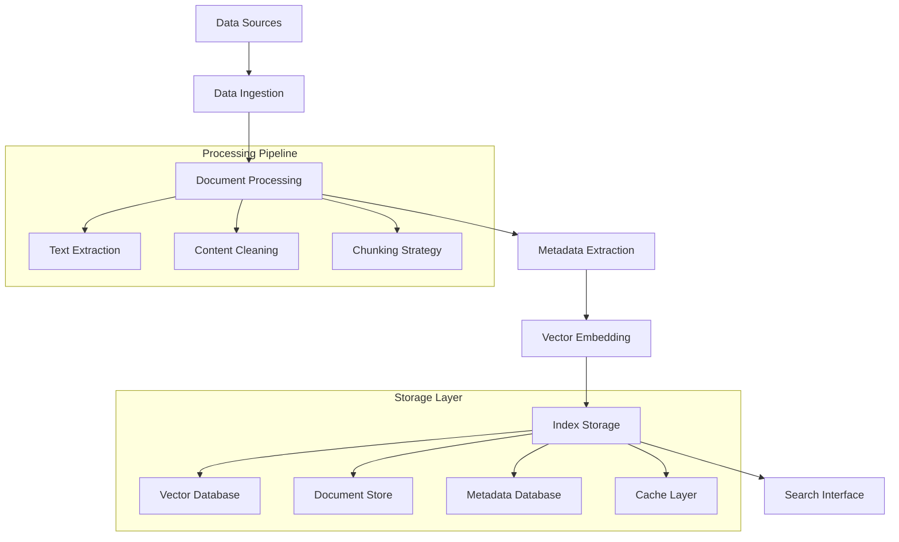

# Data Management Architecture

StudyAssistant's data management system handles the ingestion, processing, storage, and retrieval of research documents and metadata with high efficiency and reliability.

## Data Flow Architecture



## Core Components

### 1. Data Ingestion System

Handles multiple data sources and formats with robust error handling and validation.

**Supported Formats:**
- PDF documents (academic papers, reports)
- Text files (markdown, plain text)
- Web pages (HTML extraction)
- Structured data (JSON, CSV)
- Research databases (PubMed, arXiv APIs)

**Ingestion Process:**
```python
class DataIngestionManager:
    def __init__(self):
        self.processors = {
            '.pdf': PDFProcessor(),
            '.txt': TextProcessor(),
            '.html': HTMLProcessor(),
            '.json': JSONProcessor()
        }
    
    async def ingest_document(self, source: DataSource) -> ProcessedDocument:
        """Ingest and process a single document"""
        try:
            # Validate source accessibility
            await self.validate_source(source)
            
            # Download/load document
            raw_content = await self.fetch_content(source)
            
            # Process based on format
            processor = self.get_processor(source.format)
            processed = await processor.process(raw_content)
            
            # Extract metadata
            metadata = await self.extract_metadata(processed)
            
            return ProcessedDocument(
                content=processed.text,
                metadata=metadata,
                source=source
            )
            
        except Exception as e:
            logger.error(f"Ingestion failed for {source.url}: {e}")
            raise IngestionError(f"Failed to ingest {source.url}")
```

### 2. Document Processing Pipeline

Transforms raw documents into structured, searchable content.

**Processing Steps:**

#### Text Extraction
- **PDF Processing**: Uses PyMuPDF for accurate text extraction
- **HTML Processing**: BeautifulSoup with content area detection
- **OCR Integration**: Tesseract for scanned documents
- **Language Detection**: Automatic language identification

#### Content Cleaning
```python
class ContentCleaner:
    def clean_text(self, text: str) -> str:
        """Clean and normalize document text"""
        # Remove excessive whitespace
        text = re.sub(r'\s+', ' ', text)
        
        # Fix common PDF artifacts
        text = self.fix_pdf_artifacts(text)
        
        # Normalize unicode characters
        text = unicodedata.normalize('NFKC', text)
        
        # Remove headers/footers
        text = self.remove_boilerplate(text)
        
        return text.strip()
    
    def fix_pdf_artifacts(self, text: str) -> str:
        """Fix common PDF extraction issues"""
        # Fix broken hyphenated words
        text = re.sub(r'(\w+)-\s+(\w+)', r'\1\2', text)
        
        # Fix broken sentences
        text = re.sub(r'([a-z])\s+([A-Z])', r'\1. \2', text)
        
        return text
```

#### Chunking Strategy
Intelligent document segmentation for optimal retrieval:

```python
class DocumentChunker:
    def __init__(self, chunk_size: int = 512, overlap: int = 50):
        self.chunk_size = chunk_size
        self.overlap = overlap
        self.sentence_splitter = SentenceSplitter()
    
    def chunk_document(self, document: ProcessedDocument) -> List[DocumentChunk]:
        """Split document into overlapping chunks"""
        sentences = self.sentence_splitter.split(document.content)
        chunks = []
        
        for i in range(0, len(sentences), self.chunk_size - self.overlap):
            chunk_sentences = sentences[i:i + self.chunk_size]
            chunk_text = ' '.join(chunk_sentences)
            
            chunks.append(DocumentChunk(
                id=f"{document.id}_{i}",
                text=chunk_text,
                document_id=document.id,
                start_index=i,
                metadata=document.metadata
            ))
        
        return chunks
```

### 3. Metadata Extraction

Automated extraction of structured metadata from documents.

**Extracted Metadata:**
- **Bibliographic**: Title, authors, publication date, journal
- **Content**: Abstract, keywords, subject categories
- **Technical**: Language, document type, processing stats
- **Custom**: User-defined tags and annotations

```python
class MetadataExtractor:
    def __init__(self):
        self.nlp = spacy.load("en_core_web_sm")
        self.citation_parser = CitationParser()
    
    def extract_metadata(self, document: ProcessedDocument) -> DocumentMetadata:
        """Extract comprehensive metadata from document"""
        metadata = DocumentMetadata()
        
        # Extract title (first significant heading or filename)
        metadata.title = self.extract_title(document)
        
        # Extract authors using NER and pattern matching
        metadata.authors = self.extract_authors(document)
        
        # Extract publication date
        metadata.date = self.extract_date(document)
        
        # Extract abstract/summary
        metadata.abstract = self.extract_abstract(document)
        
        # Extract keywords using TF-IDF and NER
        metadata.keywords = self.extract_keywords(document)
        
        # Extract citations and references
        metadata.references = self.citation_parser.extract_citations(document)
        
        return metadata
```

### 4. Vector Embedding System

Generates high-quality embeddings for semantic search.

**Embedding Models:**
- **General Purpose**: sentence-transformers/all-MiniLM-L6-v2
- **Scientific**: allenai/specter (for research papers)
- **Multilingual**: sentence-transformers/paraphrase-multilingual-MiniLM-L12-v2

**Embedding Pipeline:**
```python
class EmbeddingGenerator:
    def __init__(self, model_name: str = "all-MiniLM-L6-v2"):
        self.model = SentenceTransformer(model_name)
        self.batch_size = 32
        
    async def generate_embeddings(self, chunks: List[DocumentChunk]) -> List[np.ndarray]:
        """Generate embeddings for document chunks"""
        texts = [chunk.text for chunk in chunks]
        
        # Process in batches for memory efficiency
        embeddings = []
        for i in range(0, len(texts), self.batch_size):
            batch = texts[i:i + self.batch_size]
            batch_embeddings = self.model.encode(batch, convert_to_numpy=True)
            embeddings.extend(batch_embeddings)
        
        return embeddings
```

### 5. Storage Architecture

Multi-layered storage system optimized for different access patterns.

#### Vector Database (Pinecone/Weaviate)
```python
class VectorStore:
    def __init__(self, index_name: str):
        self.index = pinecone.Index(index_name)
    
    async def store_embeddings(self, chunks: List[DocumentChunk], embeddings: List[np.ndarray]):
        """Store document chunks with their embeddings"""
        vectors = []
        
        for chunk, embedding in zip(chunks, embeddings):
            vectors.append({
                "id": chunk.id,
                "values": embedding.tolist(),
                "metadata": {
                    "text": chunk.text,
                    "document_id": chunk.document_id,
                    "title": chunk.metadata.title,
                    "authors": chunk.metadata.authors
                }
            })
        
        # Batch upsert for efficiency
        await self.index.upsert(vectors=vectors)
```

#### Document Store (MongoDB)
```python
class DocumentStore:
    def __init__(self, connection_string: str):
        self.client = AsyncIOMotorClient(connection_string)
        self.db = self.client.studyassistant
        self.collection = self.db.documents
    
    async def store_document(self, document: ProcessedDocument):
        """Store processed document with metadata"""
        doc_data = {
            "_id": document.id,
            "content": document.content,
            "metadata": document.metadata.dict(),
            "source": document.source.dict(),
            "processed_at": datetime.utcnow(),
            "version": document.version
        }
        
        await self.collection.replace_one(
            {"_id": document.id}, 
            doc_data, 
            upsert=True
        )
```

#### Cache Layer (Redis)
```python
class CacheManager:
    def __init__(self, redis_url: str):
        self.redis = redis.from_url(redis_url)
    
    async def cache_search_results(self, query_hash: str, results: List[Document], ttl: int = 300):
        """Cache search results for faster repeated queries"""
        cache_key = f"search:{query_hash}"
        serialized_results = pickle.dumps(results)
        
        await self.redis.setex(cache_key, ttl, serialized_results)
    
    async def get_cached_results(self, query_hash: str) -> Optional[List[Document]]:
        """Retrieve cached search results"""
        cache_key = f"search:{query_hash}"
        cached_data = await self.redis.get(cache_key)
        
        if cached_data:
            return pickle.loads(cached_data)
        return None
```

## Data Quality Assurance

### Validation Pipeline
```python
class DataValidator:
    def validate_document(self, document: ProcessedDocument) -> ValidationResult:
        """Comprehensive document validation"""
        issues = []
        
        # Check content quality
        if len(document.content) < 100:
            issues.append("Document too short")
        
        # Check language detection confidence
        if document.metadata.language_confidence < 0.8:
            issues.append("Uncertain language detection")
        
        # Check for duplicate content
        if self.is_duplicate(document):
            issues.append("Duplicate content detected")
        
        # Check metadata completeness
        if not document.metadata.title:
            issues.append("Missing title")
        
        return ValidationResult(
            is_valid=len(issues) == 0,
            issues=issues
        )
```

### Deduplication System
```python
class DeduplicationManager:
    def __init__(self):
        self.similarity_threshold = 0.95
        self.hasher = HashingVectorizer()
    
    def detect_duplicates(self, document: ProcessedDocument) -> List[str]:
        """Detect potential duplicate documents"""
        # Create content hash
        content_hash = self.create_content_hash(document.content)
        
        # Find similar documents
        similar_docs = self.find_similar_documents(content_hash)
        
        # Calculate text similarity for candidates
        duplicates = []
        for candidate in similar_docs:
            similarity = self.calculate_similarity(document.content, candidate.content)
            if similarity > self.similarity_threshold:
                duplicates.append(candidate.id)
        
        return duplicates
```

## Performance Optimization

### Batch Processing
- **Document Ingestion**: Process multiple documents in parallel
- **Embedding Generation**: Batch embedding creation for efficiency
- **Database Operations**: Bulk insert/update operations

### Monitoring and Metrics
```python
class DataMetrics:
    def __init__(self):
        self.metrics = {
            'documents_processed': Counter(),
            'processing_time': Histogram(),
            'storage_size': Gauge(),
            'error_rate': Rate()
        }
    
    def record_processing_time(self, duration: float):
        """Record document processing time"""
        self.metrics['processing_time'].observe(duration)
    
    def increment_error_count(self, error_type: str):
        """Track processing errors"""
        self.metrics['error_rate'].increment(tags={'error_type': error_type})
```

## Configuration Options

```yaml
data_management:
  ingestion:
    batch_size: 10
    max_concurrent: 5
    retry_attempts: 3
    timeout_seconds: 30
  
  processing:
    chunk_size: 512
    chunk_overlap: 50
    max_document_size: 10485760  # 10MB
    
  storage:
    vector_db:
      provider: "pinecone"
      dimension: 384
      metric: "cosine"
    
    document_store:
      provider: "mongodb"
      database: "studyassistant"
      collection: "documents"
    
    cache:
      provider: "redis"
      ttl: 300
      max_memory: "1gb"
```

## Next Steps

- [NLP Processing →](../nlp/text-processing.md)
- [Search Implementation →](../components/search-engine.md)
- [Performance Monitoring →](../../development/monitoring.md)
