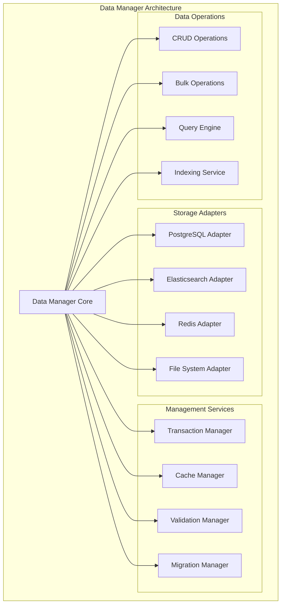

# Data Manager

The Data Manager is a critical component responsible for orchestrating data storage, retrieval, and lifecycle management across multiple storage systems. It provides a unified interface for data operations while optimizing performance and ensuring data consistency.

## Overview

The Data Manager serves as the central hub for all data operations, managing interactions between PostgreSQL, Elasticsearch, Redis, and local file systems. It implements sophisticated caching strategies, data validation, and transaction management.



## Core Components

### Storage Adapters

#### PostgreSQL Adapter
Manages relational data operations with ACID compliance:

```python
class PostgreSQLAdapter:
    """PostgreSQL database adapter with connection pooling."""
    
    def __init__(self, config: DatabaseConfig):
        self.pool = create_connection_pool(config)
        self.query_optimizer = QueryOptimizer()
        self.transaction_manager = TransactionManager()
    
    async def execute_query(
        self,
        query: str,
        params: Optional[Dict] = None,
        transaction: Optional[Transaction] = None
    ) -> QueryResult:
        """Execute SQL query with optimization."""
        optimized_query = self.query_optimizer.optimize(query)
        
        async with self.get_connection(transaction) as conn:
            result = await conn.execute(optimized_query, params)
            return QueryResult.from_raw(result)
    
    async def bulk_insert(
        self,
        table: str,
        data: List[Dict],
        batch_size: int = 1000
    ) -> BulkResult:
        """Optimized bulk insert operations."""
        batches = chunk_data(data, batch_size)
        results = []
        
        for batch in batches:
            result = await self._insert_batch(table, batch)
            results.append(result)
        
        return BulkResult.aggregate(results)
```

#### Elasticsearch Adapter
Handles full-text search and document indexing:

```python
class ElasticsearchAdapter:
    """Elasticsearch adapter for search operations."""
    
    def __init__(self, config: ElasticsearchConfig):
        self.client = AsyncElasticsearch(config.hosts)
        self.index_manager = IndexManager()
        self.query_builder = QueryBuilder()
    
    async def index_document(
        self,
        index: str,
        doc_id: str,
        document: Dict,
        refresh: bool = False
    ) -> IndexResult:
        """Index a document with metadata."""
        processed_doc = self._preprocess_document(document)
        
        result = await self.client.index(
            index=index,
            id=doc_id,
            document=processed_doc,
            refresh=refresh
        )
        
        return IndexResult.from_response(result)
    
    async def search(
        self,
        query: SearchQuery,
        filters: Optional[List[Filter]] = None
    ) -> SearchResult:
        """Execute complex search queries."""
        es_query = self.query_builder.build(query, filters)
        
        response = await self.client.search(
            index=query.indices,
            body=es_query,
            size=query.size,
            from_=query.offset
        )
        
        return SearchResult.from_response(response)
```

### Transaction Management

The Data Manager implements distributed transaction management across multiple storage systems:

```python
class TransactionManager:
    """Manages distributed transactions across storage systems."""
    
    def __init__(self):
        self.active_transactions = {}
        self.coordinator = TwoPhaseCommitCoordinator()
    
    async def begin_transaction(
        self,
        participants: List[str],
        isolation_level: IsolationLevel = IsolationLevel.READ_COMMITTED
    ) -> Transaction:
        """Begin a distributed transaction."""
        transaction_id = generate_transaction_id()
        
        transaction = Transaction(
            id=transaction_id,
            participants=participants,
            isolation_level=isolation_level,
            state=TransactionState.ACTIVE
        )
        
        # Initialize transaction on all participants
        for participant in participants:
            await self._init_participant_transaction(participant, transaction)
        
        self.active_transactions[transaction_id] = transaction
        return transaction
    
    async def commit_transaction(self, transaction_id: str) -> CommitResult:
        """Commit transaction using two-phase commit."""
        transaction = self.active_transactions.get(transaction_id)
        if not transaction:
            raise TransactionNotFoundError(transaction_id)
        
        return await self.coordinator.commit(transaction)
```

### Cache Management

Implements intelligent caching across Redis and in-memory storage:

```python
class CacheManager:
    """Multi-tier caching system."""
    
    def __init__(self, config: CacheConfig):
        self.l1_cache = LRUCache(config.l1_size)  # In-memory
        self.l2_cache = RedisCache(config.redis_config)  # Redis
        self.cache_stats = CacheStatistics()
        self.eviction_policy = EvictionPolicy(config.policy)
    
    async def get(self, key: str) -> Optional[CacheEntry]:
        """Retrieve from cache with tier promotion."""
        # Check L1 cache first
        entry = self.l1_cache.get(key)
        if entry:
            self.cache_stats.record_hit('l1')
            return entry
        
        # Check L2 cache
        entry = await self.l2_cache.get(key)
        if entry:
            self.cache_stats.record_hit('l2')
            # Promote to L1
            self.l1_cache.set(key, entry)
            return entry
        
        self.cache_stats.record_miss()
        return None
    
    async def set(
        self,
        key: str,
        value: Any,
        ttl: Optional[int] = None,
        tier: CacheTier = CacheTier.BOTH
    ) -> None:
        """Store in cache with tier selection."""
        entry = CacheEntry(value=value, ttl=ttl, created_at=time.time())
        
        if tier in [CacheTier.L1, CacheTier.BOTH]:
            self.l1_cache.set(key, entry)
        
        if tier in [CacheTier.L2, CacheTier.BOTH]:
            await self.l2_cache.set(key, entry, ttl)
```

## Data Operations

### CRUD Operations

The Data Manager provides high-level CRUD operations that abstract storage complexities:

```python
class DataManager:
    """Central data management orchestrator."""
    
    async def create_document(
        self,
        document: Document,
        metadata: Optional[Dict] = None
    ) -> CreateResult:
        """Create a new document across storage systems."""
        async with self.transaction_manager.begin_transaction(
            participants=['postgresql', 'elasticsearch']
        ) as tx:
            # Store structured data in PostgreSQL
            pg_result = await self.pg_adapter.insert(
                table='documents',
                data=document.to_dict(),
                transaction=tx
            )
            
            # Index for search in Elasticsearch
            es_result = await self.es_adapter.index_document(
                index='documents',
                doc_id=document.id,
                document=document.to_search_doc()
            )
            
            # Cache frequently accessed documents
            await self.cache_manager.set(
                key=f"doc:{document.id}",
                value=document,
                ttl=3600
            )
            
            await tx.commit()
            
        return CreateResult(
            document_id=document.id,
            pg_result=pg_result,
            es_result=es_result
        )
    
    async def get_document(
        self,
        document_id: str,
        include_embedding: bool = False
    ) -> Optional[Document]:
        """Retrieve document with intelligent caching."""
        cache_key = f"doc:{document_id}"
        
        # Check cache first
        cached_doc = await self.cache_manager.get(cache_key)
        if cached_doc:
            return cached_doc.value
        
        # Fetch from primary storage
        doc_data = await self.pg_adapter.get_by_id(
            table='documents',
            id=document_id
        )
        
        if not doc_data:
            return None
        
        document = Document.from_dict(doc_data)
        
        # Load embedding if requested
        if include_embedding:
            document.embedding = await self._get_document_embedding(document_id)
        
        # Cache for future requests
        await self.cache_manager.set(cache_key, document, ttl=1800)
        
        return document
```

### Bulk Operations

Optimized bulk operations for high-throughput scenarios:

```python
async def bulk_import_documents(
    self,
    documents: List[Document],
    batch_size: int = 100,
    parallel_batches: int = 4
) -> BulkImportResult:
    """Import documents in optimized batches."""
    batches = chunk_list(documents, batch_size)
    semaphore = asyncio.Semaphore(parallel_batches)
    
    async def process_batch(batch: List[Document]) -> BatchResult:
        async with semaphore:
            return await self._process_document_batch(batch)
    
    # Process batches concurrently
    tasks = [process_batch(batch) for batch in batches]
    batch_results = await asyncio.gather(*tasks, return_exceptions=True)
    
    return BulkImportResult.aggregate(batch_results)

async def _process_document_batch(
    self,
    documents: List[Document]
) -> BatchResult:
    """Process a batch of documents atomically."""
    async with self.transaction_manager.begin_transaction(
        participants=['postgresql', 'elasticsearch']
    ) as tx:
        # Bulk insert to PostgreSQL
        pg_data = [doc.to_dict() for doc in documents]
        pg_result = await self.pg_adapter.bulk_insert(
            table='documents',
            data=pg_data,
            transaction=tx
        )
        
        # Bulk index to Elasticsearch
        es_docs = [
            {
                '_index': 'documents',
                '_id': doc.id,
                '_source': doc.to_search_doc()
            }
            for doc in documents
        ]
        es_result = await self.es_adapter.bulk_index(es_docs)
        
        await tx.commit()
        
    return BatchResult(
        processed_count=len(documents),
        pg_result=pg_result,
        es_result=es_result
    )
```

## Data Validation

Comprehensive validation framework ensuring data integrity:

```python
class ValidationManager:
    """Data validation and integrity management."""
    
    def __init__(self):
        self.schema_registry = SchemaRegistry()
        self.validators = self._init_validators()
    
    async def validate_document(
        self,
        document: Document,
        schema_version: Optional[str] = None
    ) -> ValidationResult:
        """Validate document against schema and business rules."""
        schema = await self.schema_registry.get_schema(
            document.type,
            version=schema_version
        )
        
        validation_result = ValidationResult()
        
        # Schema validation
        schema_errors = self._validate_schema(document, schema)
        validation_result.add_errors('schema', schema_errors)
        
        # Business rule validation
        business_errors = await self._validate_business_rules(document)
        validation_result.add_errors('business', business_errors)
        
        # Data quality validation
        quality_errors = await self._validate_data_quality(document)
        validation_result.add_errors('quality', quality_errors)
        
        return validation_result
    
    def _validate_schema(
        self,
        document: Document,
        schema: Schema
    ) -> List[ValidationError]:
        """Validate document against JSON schema."""
        try:
            jsonschema.validate(document.to_dict(), schema.definition)
            return []
        except jsonschema.ValidationError as e:
            return [ValidationError.from_jsonschema_error(e)]
    
    async def _validate_business_rules(
        self,
        document: Document
    ) -> List[ValidationError]:
        """Apply business rule validation."""
        errors = []
        
        for rule in self.validators.get(document.type, []):
            try:
                await rule.validate(document)
            except ValidationError as e:
                errors.append(e)
        
        return errors
```

## Performance Optimization

### Query Optimization

```python
class QueryOptimizer:
    """Optimizes queries across storage systems."""
    
    def optimize_postgresql_query(self, query: str) -> OptimizedQuery:
        """Optimize PostgreSQL queries."""
        # Analyze query plan
        plan = self._analyze_query_plan(query)
        
        # Apply optimizations
        optimizations = []
        
        if plan.has_sequential_scan:
            optimizations.append(self._suggest_index_optimization(plan))
        
        if plan.has_nested_loops:
            optimizations.append(self._optimize_join_order(plan))
        
        return OptimizedQuery(
            original=query,
            optimized=self._apply_optimizations(query, optimizations),
            suggestions=optimizations
        )
    
    def optimize_elasticsearch_query(
        self,
        query: Dict
    ) -> OptimizedElasticsearchQuery:
        """Optimize Elasticsearch queries."""
        optimizations = []
        
        # Use filters instead of queries when possible
        if self._can_use_filter(query):
            optimizations.append(FilterOptimization())
        
        # Optimize aggregations
        if 'aggs' in query:
            optimizations.append(self._optimize_aggregations(query['aggs']))
        
        return OptimizedElasticsearchQuery(
            original=query,
            optimized=self._apply_es_optimizations(query, optimizations)
        )
```

### Connection Management

```python
class ConnectionPoolManager:
    """Manages connection pools across storage systems."""
    
    def __init__(self, config: ConnectionConfig):
        self.pools = {}
        self.health_checker = HealthChecker()
        self.load_balancer = LoadBalancer()
    
    async def get_connection(
        self,
        storage_type: str,
        preference: ConnectionPreference = None
    ) -> Connection:
        """Get optimal connection from pool."""
        pool = self.pools[storage_type]
        
        if preference == ConnectionPreference.READ_REPLICA:
            return await pool.get_read_connection()
        elif preference == ConnectionPreference.WRITE_PRIMARY:
            return await pool.get_write_connection()
        else:
            return await pool.get_balanced_connection()
    
    async def health_check(self) -> HealthStatus:
        """Check health of all connections."""
        statuses = {}
        
        for storage_type, pool in self.pools.items():
            status = await self.health_checker.check_pool(pool)
            statuses[storage_type] = status
        
        return HealthStatus.aggregate(statuses)
```

## Configuration

```yaml
# data_manager.yaml
data_manager:
  storage:
    postgresql:
      host: localhost
      port: 5432
      database: studyassistant
      pool_size: 20
      max_connections: 100
      query_timeout: 30
    
    elasticsearch:
      hosts:
        - localhost:9200
      timeout: 30
      max_retries: 3
      retry_on_timeout: true
    
    redis:
      host: localhost
      port: 6379
      database: 0
      pool_size: 10
      socket_timeout: 5
  
  caching:
    l1_cache:
      size: 1000
      ttl: 1800
    l2_cache:
      ttl: 3600
      max_memory: "256MB"
    
    eviction_policy: "lru"
    cache_warming: true
  
  transactions:
    timeout: 300
    max_retries: 3
    isolation_level: "read_committed"
  
  performance:
    bulk_batch_size: 100
    parallel_batches: 4
    connection_timeout: 10
    query_timeout: 30
```

## Monitoring and Metrics

```python
class DataManagerMetrics:
    """Metrics collection for data operations."""
    
    def __init__(self):
        self.operation_counter = Counter('data_operations_total')
        self.operation_duration = Histogram('data_operation_duration_seconds')
        self.cache_hits = Counter('cache_hits_total')
        self.cache_misses = Counter('cache_misses_total')
        self.transaction_counter = Counter('transactions_total')
    
    def record_operation(
        self,
        operation: str,
        storage_type: str,
        duration: float,
        success: bool
    ):
        """Record data operation metrics."""
        labels = {
            'operation': operation,
            'storage_type': storage_type,
            'status': 'success' if success else 'error'
        }
        
        self.operation_counter.inc(labels)
        self.operation_duration.observe(duration, labels)
    
    def record_cache_event(self, event_type: str, tier: str):
        """Record cache hit/miss events."""
        labels = {'tier': tier}
        
        if event_type == 'hit':
            self.cache_hits.inc(labels)
        else:
            self.cache_misses.inc(labels)
```

## Error Handling

The Data Manager implements comprehensive error handling and recovery:

```python
class DataManagerErrorHandler:
    """Centralized error handling for data operations."""
    
    async def handle_storage_error(
        self,
        error: Exception,
        operation: str,
        retry_config: RetryConfig
    ) -> ErrorHandlingResult:
        """Handle storage-related errors with retry logic."""
        if isinstance(error, ConnectionError):
            return await self._handle_connection_error(error, retry_config)
        elif isinstance(error, TimeoutError):
            return await self._handle_timeout_error(error, retry_config)
        elif isinstance(error, IntegrityError):
            return await self._handle_integrity_error(error)
        else:
            return await self._handle_generic_error(error)
    
    async def _handle_connection_error(
        self,
        error: ConnectionError,
        retry_config: RetryConfig
    ) -> ErrorHandlingResult:
        """Handle connection failures with exponential backoff."""
        if retry_config.attempts < retry_config.max_retries:
            delay = min(
                retry_config.base_delay * (2 ** retry_config.attempts),
                retry_config.max_delay
            )
            
            await asyncio.sleep(delay)
            
            return ErrorHandlingResult(
                action=ErrorAction.RETRY,
                delay=delay,
                message=f"Retrying after connection error: {error}"
            )
        
        return ErrorHandlingResult(
            action=ErrorAction.FAIL,
            message=f"Max retries exceeded for connection error: {error}"
        )
```

## Best Practices

1. **Connection Pooling**: Always use connection pools for database connections
2. **Transaction Management**: Use transactions for operations spanning multiple storage systems
3. **Caching Strategy**: Implement intelligent multi-tier caching
4. **Error Handling**: Implement comprehensive error handling with retry logic
5. **Monitoring**: Track all data operations and performance metrics
6. **Schema Evolution**: Use schema versioning for data migration
7. **Data Validation**: Validate all data before storage operations
8. **Performance Optimization**: Regularly analyze and optimize queries

## See Also

- [Component Overview](../component-overview.md)
- [Configuration API](../../api/configuration.md)
- [Database Schema](../database-schema.md)
- [Performance Optimization](../../development/performance-optimization.md)
