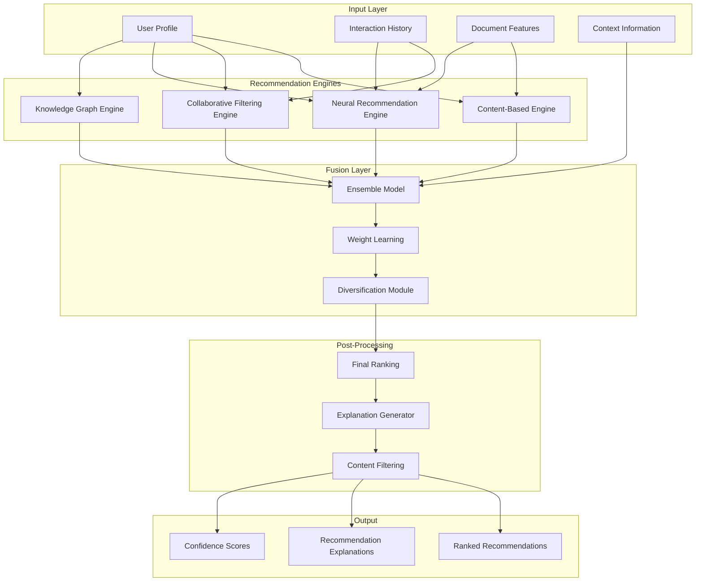

# Hybrid Recommender System

The Hybrid Recommender is a sophisticated machine learning component that provides personalized academic paper recommendations by combining multiple recommendation strategies. This document details its architecture, algorithms, and implementation.

## Overview

The Hybrid Recommender integrates content-based filtering, collaborative filtering, and deep learning approaches to deliver highly relevant paper recommendations tailored to individual researchers' interests and reading patterns.

### Key Features

- **Multi-Strategy Fusion**: Combines content-based, collaborative, and neural approaches
- **Real-time Personalization**: Adapts to user behavior and preferences
- **Cold Start Handling**: Effective recommendations for new users
- **Explainable Recommendations**: Provides reasoning for suggestions
- **Scalable Architecture**: Handles large user bases and document collections
- **Continuous Learning**: Updates models based on user interactions

## Architecture Design

### System Architecture



### Core Implementation

```python
class HybridRecommender:
    """
    Main hybrid recommendation system combining multiple strategies
    """
    
    def __init__(self, config: RecommenderConfig):
        self.config = config
        
        # Initialize recommendation engines
        self.content_engine = ContentBasedEngine(config.content_based)
        self.collaborative_engine = CollaborativeFilteringEngine(config.collaborative)
        self.neural_engine = NeuralRecommendationEngine(config.neural)
        self.knowledge_engine = KnowledgeGraphEngine(config.knowledge_graph)
        
        # Fusion and post-processing
        self.ensemble_model = EnsembleModel(config.ensemble)
        self.diversification = DiversificationModule(config.diversification)
        self.explanation_generator = ExplanationGenerator()
        
        # Metrics and monitoring
        self.metrics = RecommenderMetrics()
        self.ab_tester = ABTester(config.ab_testing)
        
    async def recommend(self, 
                       user_profile: UserProfile, 
                       context: RecommendationContext,
                       num_recommendations: int = 20) -> RecommendationResult:
        """Generate hybrid recommendations for a user"""
        
        recommendation_id = self.metrics.start_recommendation(user_profile.user_id)
        
        try:
            # Generate recommendations from each engine
            engine_results = await self._generate_engine_recommendations(
                user_profile, context, num_recommendations * 3  # Over-generate for diversity
            )
            
            # Fuse recommendations using ensemble model
            fused_recommendations = await self.ensemble_model.fuse_recommendations(
                engine_results, user_profile, context
            )
            
            # Apply diversification
            diversified_recommendations = await self.diversification.diversify(
                fused_recommendations, user_profile, num_recommendations
            )
            
            # Generate explanations
            explanations = await self.explanation_generator.generate_explanations(
                diversified_recommendations, engine_results, user_profile
            )
            
            # Create final result
            result = RecommendationResult(
                recommendations=diversified_recommendations[:num_recommendations],
                explanations=explanations,
                confidence_scores=self._calculate_confidence_scores(diversified_recommendations),
                recommendation_id=recommendation_id,
                engines_used=list(engine_results.keys()),
                personalization_score=self._calculate_personalization_score(user_profile),
                timestamp=datetime.utcnow()
            )
            
            # Record metrics
            self.metrics.record_recommendation_success(recommendation_id, result)
            
            return result
            
        except Exception as e:
            self.metrics.record_recommendation_failure(recommendation_id, e)
            raise
    
    async def _generate_engine_recommendations(self, 
                                             user_profile: UserProfile,
                                             context: RecommendationContext,
                                             num_candidates: int) -> Dict[str, List[Recommendation]]:
        """Generate recommendations from all engines in parallel"""
        
        tasks = {
            'content_based': self.content_engine.recommend(user_profile, context, num_candidates),
            'collaborative': self.collaborative_engine.recommend(user_profile, context, num_candidates),
            'neural': self.neural_engine.recommend(user_profile, context, num_candidates),
            'knowledge_graph': self.knowledge_engine.recommend(user_profile, context, num_candidates)
        }
        
        results = await asyncio.gather(*[
            task for task in tasks.values()
        ], return_exceptions=True)
        
        # Handle exceptions and filter successful results
        engine_results = {}
        for engine_name, result in zip(tasks.keys(), results):
            if not isinstance(result, Exception):
                engine_results[engine_name] = result
            else:
                logger.warning(f"Engine {engine_name} failed: {result}")
        
        return engine_results
```

## Recommendation Engines

### Content-Based Engine

```python
class ContentBasedEngine:
    """
    Content-based recommendation using document and user features
    """
    
    def __init__(self, config: ContentBasedConfig):
        self.feature_extractor = DocumentFeatureExtractor()
        self.user_profiler = UserProfiler()
        self.similarity_calculator = SimilarityCalculator()
        self.tfidf_vectorizer = TfidfVectorizer(
            max_features=config.max_features,
            stop_words='english',
            ngram_range=(1, 3)
        )
        
    async def recommend(self, 
                       user_profile: UserProfile,
                       context: RecommendationContext,
                       num_recommendations: int) -> List[Recommendation]:
        """Generate content-based recommendations"""
        
        # Extract user content preferences
        user_content_profile = await self.user_profiler.build_content_profile(user_profile)
        
        # Get candidate documents
        candidate_documents = await self._get_candidate_documents(user_profile, context)
        
        # Calculate content similarities
        similarities = await self._calculate_content_similarities(
            user_content_profile, candidate_documents
        )
        
        # Rank and filter recommendations
        recommendations = self._rank_by_similarity(candidate_documents, similarities)
        
        return recommendations[:num_recommendations]
    
    async def _calculate_content_similarities(self, 
                                            user_profile: UserContentProfile,
                                            documents: List[Document]) -> List[float]:
        """Calculate content-based similarities"""
        
        # Combine user's reading history into a profile vector
        user_content = " ".join([
            doc.title + " " + doc.abstract 
            for doc in user_profile.read_documents
        ])
        
        # Document content vectors
        document_contents = [
            doc.title + " " + doc.abstract + " " + " ".join(doc.keywords or [])
            for doc in documents
        ]
        
        # Create TF-IDF vectors
        all_contents = [user_content] + document_contents
        tfidf_matrix = self.tfidf_vectorizer.fit_transform(all_contents)
        
        user_vector = tfidf_matrix[0]
        document_vectors = tfidf_matrix[1:]
        
        # Calculate cosine similarities
        similarities = cosine_similarity(user_vector, document_vectors).flatten()
        
        # Apply additional content-based features
        enhanced_similarities = []
        for i, (doc, base_similarity) in enumerate(zip(documents, similarities)):
            enhanced_similarity = self._enhance_similarity_with_features(
                doc, user_profile, base_similarity
            )
            enhanced_similarities.append(enhanced_similarity)
        
        return enhanced_similarities
    
    def _enhance_similarity_with_features(self, 
                                        document: Document,
                                        user_profile: UserContentProfile,
                                        base_similarity: float) -> float:
        """Enhance similarity with additional features"""
        
        # Author preference boost
        author_boost = 0.0
        if document.authors:
            for author in document.authors:
                if author.name in user_profile.preferred_authors:
                    author_boost += 0.1
        
        # Journal/venue preference boost
        venue_boost = 0.0
        if document.source_metadata.get('journal') in user_profile.preferred_venues:
            venue_boost = 0.1
        
        # Recency boost for recent papers
        recency_boost = 0.0
        if document.published_date:
            days_old = (datetime.utcnow() - document.published_date).days
            if days_old <= 30:  # Recent papers
                recency_boost = 0.05
        
        # Citation impact boost
        citation_boost = 0.0
        citation_count = document.source_metadata.get('citation_count', 0)
        if citation_count > user_profile.avg_citation_count:
            citation_boost = min(0.1, citation_count / user_profile.avg_citation_count * 0.05)
        
        # Combine all factors
        enhanced_similarity = base_similarity + author_boost + venue_boost + recency_boost + citation_boost
        
        return min(1.0, enhanced_similarity)  # Cap at 1.0
```

### Collaborative Filtering Engine

```python
class CollaborativeFilteringEngine:
    """
    Collaborative filtering using user-item interactions
    """
    
    def __init__(self, config: CollaborativeConfig):
        self.user_similarity_calculator = UserSimilarityCalculator()
        self.item_similarity_calculator = ItemSimilarityCalculator()
        self.matrix_factorization = MatrixFactorizationModel(
            n_factors=config.n_factors,
            learning_rate=config.learning_rate,
            regularization=config.regularization
        )
        self.neighborhood_size = config.neighborhood_size
        
    async def recommend(self, 
                       user_profile: UserProfile,
                       context: RecommendationContext,
                       num_recommendations: int) -> List[Recommendation]:
        """Generate collaborative filtering recommendations"""
        
        # Get user-item interaction matrix
        interaction_matrix = await self._build_interaction_matrix(user_profile)
        
        # Generate recommendations using multiple CF approaches
        user_based_recs = await self._user_based_cf(user_profile, interaction_matrix)
        item_based_recs = await self._item_based_cf(user_profile, interaction_matrix)
        mf_recs = await self._matrix_factorization_cf(user_profile, interaction_matrix)
        
        # Combine CF approaches
        combined_recs = self._combine_cf_results([
            user_based_recs, item_based_recs, mf_recs
        ])
        
        return combined_recs[:num_recommendations]
    
    async def _user_based_cf(self, 
                           user_profile: UserProfile,
                           interaction_matrix: sp.sparse.csr_matrix) -> List[Recommendation]:
        """User-based collaborative filtering"""
        
        # Find similar users
        user_similarities = await self.user_similarity_calculator.calculate_similarities(
            user_profile.user_id, interaction_matrix
        )
        
        # Get top similar users
        similar_users = sorted(user_similarities.items(), 
                              key=lambda x: x[1], 
                              reverse=True)[:self.neighborhood_size]
        
        # Generate recommendations based on similar users' preferences
        recommendations = {}
        
        for similar_user_id, similarity in similar_users:
            similar_user_items = await self._get_user_items(similar_user_id)
            user_items = set(user_profile.interacted_documents)
            
            # Find items the similar user liked but current user hasn't seen
            new_items = similar_user_items - user_items
            
            for item_id in new_items:
                if item_id not in recommendations:
                    recommendations[item_id] = 0.0
                
                # Weight by user similarity and item rating
                item_rating = await self._get_user_item_rating(similar_user_id, item_id)
                recommendations[item_id] += similarity * item_rating
        
        # Normalize and convert to Recommendation objects
        return self._convert_to_recommendations(recommendations, 'user_based_cf')
    
    async def _matrix_factorization_cf(self, 
                                     user_profile: UserProfile,
                                     interaction_matrix: sp.sparse.csr_matrix) -> List[Recommendation]:
        """Matrix factorization collaborative filtering"""
        
        # Train matrix factorization model
        await self.matrix_factorization.fit(interaction_matrix)
        
        # Generate predictions for all items
        user_idx = await self._get_user_index(user_profile.user_id)
        all_item_predictions = await self.matrix_factorization.predict_for_user(user_idx)
        
        # Filter out already interacted items
        interacted_items = set(user_profile.interacted_documents)
        new_item_predictions = {
            item_id: score for item_id, score in all_item_predictions.items()
            if item_id not in interacted_items
        }
        
        # Sort by predicted rating
        sorted_predictions = sorted(new_item_predictions.items(), 
                                  key=lambda x: x[1], 
                                  reverse=True)
        
        return [
            Recommendation(
                document_id=item_id,
                score=score,
                source='matrix_factorization_cf',
                confidence=min(1.0, score / 5.0)  # Assuming 5-point scale
            )
            for item_id, score in sorted_predictions
        ]
```

### Neural Recommendation Engine

```python
class NeuralRecommendationEngine:
    """
    Deep learning-based recommendation using neural networks
    """
    
    def __init__(self, config: NeuralConfig):
        self.model_architecture = config.architecture
        self.embedding_dim = config.embedding_dim
        self.model = self._build_model()
        self.feature_encoder = NeuralFeatureEncoder()
        self.session_encoder = SessionEncoder()
        
    def _build_model(self) -> tf.keras.Model:
        """Build neural recommendation model"""
        
        # Input layers
        user_input = tf.keras.layers.Input(shape=(self.embedding_dim,), name='user_features')
        item_input = tf.keras.layers.Input(shape=(self.embedding_dim,), name='item_features')
        context_input = tf.keras.layers.Input(shape=(50,), name='context_features')
        
        # User and item embeddings
        user_embedding = tf.keras.layers.Dense(128, activation='relu')(user_input)
        user_embedding = tf.keras.layers.Dropout(0.2)(user_embedding)
        user_embedding = tf.keras.layers.Dense(64, activation='relu')(user_embedding)
        
        item_embedding = tf.keras.layers.Dense(128, activation='relu')(item_input)
        item_embedding = tf.keras.layers.Dropout(0.2)(item_embedding)
        item_embedding = tf.keras.layers.Dense(64, activation='relu')(item_embedding)
        
        # Context processing
        context_embedding = tf.keras.layers.Dense(32, activation='relu')(context_input)
        
        # Combine all features
        combined = tf.keras.layers.concatenate([
            user_embedding, item_embedding, context_embedding
        ])
        
        # Deep layers
        hidden = tf.keras.layers.Dense(256, activation='relu')(combined)
        hidden = tf.keras.layers.Dropout(0.3)(hidden)
        hidden = tf.keras.layers.Dense(128, activation='relu')(hidden)
        hidden = tf.keras.layers.Dropout(0.2)(hidden)
        hidden = tf.keras.layers.Dense(64, activation='relu')(hidden)
        
        # Output layer
        output = tf.keras.layers.Dense(1, activation='sigmoid', name='recommendation_score')(hidden)
        
        model = tf.keras.Model(
            inputs=[user_input, item_input, context_input],
            outputs=output
        )
        
        model.compile(
            optimizer='adam',
            loss='binary_crossentropy',
            metrics=['accuracy', 'precision', 'recall']
        )
        
        return model
    
    async def recommend(self, 
                       user_profile: UserProfile,
                       context: RecommendationContext,
                       num_recommendations: int) -> List[Recommendation]:
        """Generate neural network-based recommendations"""
        
        # Encode user features
        user_features = await self.feature_encoder.encode_user(user_profile)
        
        # Get candidate items
        candidate_items = await self._get_candidate_items(user_profile, context)
        
        # Encode item features
        item_features = await self.feature_encoder.encode_items(candidate_items)
        
        # Encode context features
        context_features = await self.feature_encoder.encode_context(context)
        
        # Prepare model inputs
        user_features_batch = np.repeat([user_features], len(candidate_items), axis=0)
        context_features_batch = np.repeat([context_features], len(candidate_items), axis=0)
        
        # Generate predictions
        predictions = self.model.predict([
            user_features_batch,
            item_features,
            context_features_batch
        ])
        
        # Create recommendations
        recommendations = []
        for i, (item, score) in enumerate(zip(candidate_items, predictions.flatten())):
            recommendations.append(Recommendation(
                document_id=item.id,
                score=float(score),
                source='neural_engine',
                confidence=float(score),
                features={
                    'user_item_interaction_strength': self._calculate_interaction_strength(
                        user_profile, item
                    ),
                    'content_similarity': await self._calculate_content_similarity(
                        user_profile, item
                    ),
                    'temporal_relevance': self._calculate_temporal_relevance(item)
                }
            ))
        
        # Sort by score and return top recommendations
        recommendations.sort(key=lambda x: x.score, reverse=True)
        return recommendations[:num_recommendations]
```

## Ensemble and Fusion

### Ensemble Model

```python
class EnsembleModel:
    """
    Ensemble model for combining recommendations from multiple engines
    """
    
    def __init__(self, config: EnsembleConfig):
        self.fusion_strategy = config.fusion_strategy
        self.weight_learner = WeightLearner(config.weight_learning)
        self.context_weights = ContextualWeights()
        
    async def fuse_recommendations(self, 
                                 engine_results: Dict[str, List[Recommendation]],
                                 user_profile: UserProfile,
                                 context: RecommendationContext) -> List[Recommendation]:
        """Fuse recommendations from multiple engines"""
        
        if self.fusion_strategy == 'weighted_average':
            return await self._weighted_average_fusion(engine_results, user_profile, context)
        elif self.fusion_strategy == 'rank_fusion':
            return await self._rank_fusion(engine_results)
        elif self.fusion_strategy == 'learned_ensemble':
            return await self._learned_ensemble_fusion(engine_results, user_profile, context)
        else:
            return await self._hybrid_fusion(engine_results, user_profile, context)
    
    async def _weighted_average_fusion(self, 
                                     engine_results: Dict[str, List[Recommendation]],
                                     user_profile: UserProfile,
                                     context: RecommendationContext) -> List[Recommendation]:
        """Weighted average fusion of recommendation scores"""
        
        # Learn context-specific weights
        weights = await self.context_weights.get_weights(user_profile, context)
        
        # Normalize weights
        total_weight = sum(weights.values())
        normalized_weights = {
            engine: weight / total_weight 
            for engine, weight in weights.items()
        }
        
        # Combine recommendations
        combined_scores = {}
        
        for engine_name, recommendations in engine_results.items():
            if engine_name not in normalized_weights:
                continue
                
            weight = normalized_weights[engine_name]
            
            for rec in recommendations:
                if rec.document_id not in combined_scores:
                    combined_scores[rec.document_id] = {
                        'score': 0.0,
                        'engines': [],
                        'original_scores': {},
                        'confidence': 0.0
                    }
                
                combined_scores[rec.document_id]['score'] += rec.score * weight
                combined_scores[rec.document_id]['engines'].append(engine_name)
                combined_scores[rec.document_id]['original_scores'][engine_name] = rec.score
                combined_scores[rec.document_id]['confidence'] += rec.confidence * weight
        
        # Convert to Recommendation objects
        fused_recommendations = []
        for doc_id, data in combined_scores.items():
            fused_recommendations.append(Recommendation(
                document_id=doc_id,
                score=data['score'],
                source='ensemble_weighted',
                confidence=data['confidence'],
                engines=data['engines'],
                original_scores=data['original_scores']
            ))
        
        # Sort by combined score
        fused_recommendations.sort(key=lambda x: x.score, reverse=True)
        
        return fused_recommendations
    
    async def _learned_ensemble_fusion(self, 
                                     engine_results: Dict[str, List[Recommendation]],
                                     user_profile: UserProfile,
                                     context: RecommendationContext) -> List[Recommendation]:
        """Use learned ensemble model for fusion"""
        
        # Prepare features for ensemble model
        features = await self._prepare_ensemble_features(
            engine_results, user_profile, context
        )
        
        # Predict ensemble weights
        ensemble_weights = await self.weight_learner.predict_weights(features)
        
        # Apply learned weights
        return await self._apply_learned_weights(engine_results, ensemble_weights)
```

### Diversification Module

```python
class DiversificationModule:
    """
    Diversify recommendations to avoid redundancy and increase coverage
    """
    
    def __init__(self, config: DiversificationConfig):
        self.diversity_strategy = config.strategy
        self.diversity_weight = config.diversity_weight
        self.topic_classifier = TopicClassifier()
        self.similarity_calculator = SimilarityCalculator()
        
    async def diversify(self, 
                       recommendations: List[Recommendation],
                       user_profile: UserProfile,
                       num_final: int) -> List[Recommendation]:
        """Apply diversification to recommendation list"""
        
        if self.diversity_strategy == 'mmr':
            return await self._maximal_marginal_relevance(recommendations, num_final)
        elif self.diversity_strategy == 'topic_based':
            return await self._topic_based_diversification(recommendations, num_final)
        elif self.diversity_strategy == 'author_diversification':
            return await self._author_diversification(recommendations, num_final)
        else:
            return await self._hybrid_diversification(recommendations, num_final)
    
    async def _maximal_marginal_relevance(self, 
                                        recommendations: List[Recommendation],
                                        num_final: int) -> List[Recommendation]:
        """Maximal Marginal Relevance diversification"""
        
        if len(recommendations) <= num_final:
            return recommendations
        
        # Initialize with highest scored recommendation
        selected = [recommendations[0]]
        remaining = recommendations[1:]
        
        while len(selected) < num_final and remaining:
            best_idx = -1
            best_mmr_score = -1
            
            for i, candidate in enumerate(remaining):
                # Calculate relevance score
                relevance = candidate.score
                
                # Calculate maximum similarity to already selected items
                max_similarity = 0
                for selected_rec in selected:
                    similarity = await self._calculate_recommendation_similarity(
                        candidate, selected_rec
                    )
                    max_similarity = max(max_similarity, similarity)
                
                # Calculate MMR score
                mmr_score = (self.diversity_weight * relevance - 
                           (1 - self.diversity_weight) * max_similarity)
                
                if mmr_score > best_mmr_score:
                    best_mmr_score = mmr_score
                    best_idx = i
            
            # Add best candidate to selected list
            if best_idx >= 0:
                selected.append(remaining.pop(best_idx))
        
        return selected
    
    async def _topic_based_diversification(self, 
                                         recommendations: List[Recommendation],
                                         num_final: int) -> List[Recommendation]:
        """Diversify recommendations across different topics"""
        
        # Classify topics for all recommendations
        topics = {}
        for rec in recommendations:
            doc_topics = await self.topic_classifier.classify_document(rec.document_id)
            topics[rec.document_id] = doc_topics
        
        # Group recommendations by primary topic
        topic_groups = {}
        for rec in recommendations:
            primary_topic = topics[rec.document_id][0] if topics[rec.document_id] else 'unknown'
            
            if primary_topic not in topic_groups:
                topic_groups[primary_topic] = []
            
            topic_groups[primary_topic].append(rec)
        
        # Select recommendations to ensure topic diversity
        diversified = []
        topic_selections = {topic: 0 for topic in topic_groups.keys()}
        max_per_topic = max(1, num_final // len(topic_groups))
        
        # Sort all recommendations by score
        all_sorted = sorted(recommendations, key=lambda x: x.score, reverse=True)
        
        for rec in all_sorted:
            if len(diversified) >= num_final:
                break
                
            primary_topic = topics[rec.document_id][0] if topics[rec.document_id] else 'unknown'
            
            # Check if we can add more from this topic
            if topic_selections[primary_topic] < max_per_topic:
                diversified.append(rec)
                topic_selections[primary_topic] += 1
        
        # Fill remaining slots with highest scored items
        if len(diversified) < num_final:
            remaining_slots = num_final - len(diversified)
            selected_ids = {rec.document_id for rec in diversified}
            
            for rec in all_sorted:
                if remaining_slots <= 0:
                    break
                if rec.document_id not in selected_ids:
                    diversified.append(rec)
                    remaining_slots -= 1
        
        return diversified
```

## Performance Optimization

### Caching Strategy

```python
class RecommendationCache:
    """
    Multi-level caching for recommendation system
    """
    
    def __init__(self, config: CacheConfig):
        self.redis_client = redis.Redis(**config.redis)
        self.local_cache = LRUCache(maxsize=config.local_cache_size)
        self.cache_ttl = config.cache_ttl
        
    async def get_cached_recommendations(self, 
                                       cache_key: str) -> Optional[List[Recommendation]]:
        """Get cached recommendations if available"""
        
        # Try local cache first
        cached_result = self.local_cache.get(cache_key)
        if cached_result:
            return cached_result
        
        # Try Redis cache
        cached_data = await self.redis_client.get(cache_key)
        if cached_data:
            recommendations = pickle.loads(cached_data)
            # Store in local cache for faster access
            self.local_cache[cache_key] = recommendations
            return recommendations
        
        return None
    
    async def cache_recommendations(self, 
                                  cache_key: str,
                                  recommendations: List[Recommendation]):
        """Cache recommendations at multiple levels"""
        
        # Store in local cache
        self.local_cache[cache_key] = recommendations
        
        # Store in Redis with TTL
        serialized_data = pickle.dumps(recommendations)
        await self.redis_client.setex(cache_key, self.cache_ttl, serialized_data)
```

### Performance Monitoring

```python
class RecommenderMetrics:
    """
    Comprehensive metrics and monitoring for the recommendation system
    """
    
    def __init__(self):
        self.recommendation_latency = Histogram(
            'recommendation_latency_seconds',
            'Time to generate recommendations',
            buckets=[0.1, 0.5, 1.0, 2.0, 5.0, 10.0]
        )
        
        self.recommendation_quality = Histogram(
            'recommendation_quality_score',
            'Quality metrics for recommendations',
            ['metric_type']
        )
        
        self.cache_performance = Counter(
            'recommendation_cache_hits_total',
            'Cache hit/miss statistics',
            ['cache_level', 'hit_type']
        )
    
    def record_recommendation_metrics(self, result: RecommendationResult):
        """Record comprehensive recommendation metrics"""
        
        # Record latency
        self.recommendation_latency.observe(result.generation_time)
        
        # Record quality metrics
        self.recommendation_quality.labels(metric_type='diversity').observe(
            result.diversity_score
        )
        self.recommendation_quality.labels(metric_type='novelty').observe(
            result.novelty_score
        )
        self.recommendation_quality.labels(metric_type='coverage').observe(
            result.coverage_score
        )
```

This Hybrid Recommender System provides sophisticated, scalable recommendations with comprehensive monitoring and optimization capabilities, ensuring high-quality personalized suggestions for academic researchers.
