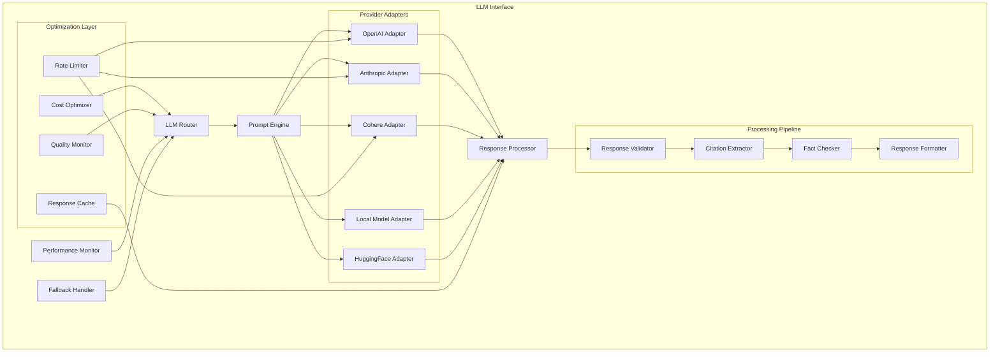

# LLM Interface Architecture

The LLM Interface is a critical component that manages interactions with Large Language Models (LLMs) for the StudyAssistant's Retrieval-Augmented Generation (RAG) capabilities. This document provides comprehensive details about its architecture, implementation, and operational aspects.

## Overview

The LLM Interface serves as an abstraction layer that enables seamless integration with multiple LLM providers while ensuring optimal performance, cost efficiency, and reliability. It handles prompt engineering, response processing, and provider management.

### Key Responsibilities

- **Multi-Provider Support**: Integration with OpenAI, Anthropic, Cohere, and local models
- **Prompt Engineering**: Context-aware prompt optimization for academic queries
- **Response Processing**: Output validation, citation extraction, and fact verification
- **Load Balancing**: Intelligent routing across multiple LLM endpoints
- **Cost Optimization**: Token usage monitoring and cost-effective provider selection
- **Quality Assurance**: Response quality assessment and improvement
- **Rate Limiting**: Respect API limits and implement backoff strategies

## Architecture Design

### Component Architecture



### Core Implementation

```python
class LLMInterface:
    """
    Main interface for LLM interactions with multi-provider support
    """
    
    def __init__(self, config: LLMConfig):
        self.config = config
        
        # Initialize provider adapters
        self.providers = self._initialize_providers()
        
        # Core components
        self.router = LLMRouter(config.routing, self.providers)
        self.prompt_engine = PromptEngine(config.prompt_engineering)
        self.response_processor = ResponseProcessor(config.response_processing)
        
        # Optimization and monitoring
        self.cost_optimizer = CostOptimizer(config.cost_optimization)
        self.quality_monitor = QualityMonitor(config.quality_monitoring)
        self.rate_limiter = RateLimiter(config.rate_limiting)
        self.cache = LLMCache(config.caching)
        
        # Metrics
        self.metrics = LLMMetrics()
        
    def _initialize_providers(self) -> Dict[str, LLMProvider]:
        """Initialize all configured LLM providers"""
        providers = {}
        
        if self.config.openai.enabled:
            providers['openai'] = OpenAIAdapter(self.config.openai)
        
        if self.config.anthropic.enabled:
            providers['anthropic'] = AnthropicAdapter(self.config.anthropic)
        
        if self.config.cohere.enabled:
            providers['cohere'] = CohereAdapter(self.config.cohere)
        
        if self.config.local_models.enabled:
            providers['local'] = LocalModelAdapter(self.config.local_models)
        
        if self.config.huggingface.enabled:
            providers['huggingface'] = HuggingFaceAdapter(self.config.huggingface)
        
        return providers
    
    async def generate_response(self, 
                              query: str,
                              context: str,
                              generation_config: GenerationConfig) -> LLMResponse:
        """Generate response using optimal LLM provider"""
        
        request_id = self.metrics.start_request()
        
        try:
            # Check cache first
            cache_key = self._generate_cache_key(query, context, generation_config)
            cached_response = await self.cache.get(cache_key)
            
            if cached_response:
                self.metrics.record_cache_hit(request_id)
                return cached_response
            
            # Select optimal provider
            selected_provider = await self.router.select_provider(
                query, context, generation_config
            )
            
            # Generate prompt
            optimized_prompt = await self.prompt_engine.generate_prompt(
                query=query,
                context=context,
                provider=selected_provider,
                config=generation_config
            )
            
            # Apply rate limiting
            await self.rate_limiter.acquire(selected_provider.name)
            
            # Generate response
            raw_response = await selected_provider.generate(
                prompt=optimized_prompt,
                config=generation_config
            )
            
            # Process response
            processed_response = await self.response_processor.process(
                raw_response, query, context
            )
            
            # Cache the response
            await self.cache.set(cache_key, processed_response)
            
            # Record metrics
            self.metrics.record_successful_request(
                request_id, selected_provider.name, processed_response
            )
            
            return processed_response
            
        except Exception as e:
            # Handle fallback
            fallback_response = await self._handle_fallback(
                query, context, generation_config, e
            )
            
            self.metrics.record_failed_request(request_id, str(e))
            
            if fallback_response:
                return fallback_response
            else:
                raise LLMInterfaceError(f"Failed to generate response: {e}")
    
    async def _handle_fallback(self, 
                             query: str,
                             context: str,
                             generation_config: GenerationConfig,
                             original_error: Exception) -> Optional[LLMResponse]:
        """Handle failures with fallback providers"""
        
        logger.warning(f"Primary LLM failed: {original_error}. Attempting fallback.")
        
        # Get fallback provider
        fallback_provider = await self.router.get_fallback_provider()
        
        if not fallback_provider:
            return None
        
        try:
            # Generate fallback prompt
            fallback_prompt = await self.prompt_engine.generate_fallback_prompt(
                query, context, generation_config
            )
            
            # Generate response with fallback
            fallback_response = await fallback_provider.generate(
                prompt=fallback_prompt,
                config=generation_config
            )
            
            # Process fallback response
            return await self.response_processor.process(
                fallback_response, query, context, is_fallback=True
            )
            
        except Exception as fallback_error:
            logger.error(f"Fallback also failed: {fallback_error}")
            return None
```

## Provider Adapters

### OpenAI Adapter

```python
class OpenAIAdapter(LLMProvider):
    """
    OpenAI API integration with advanced features
    """
    
    def __init__(self, config: OpenAIConfig):
        self.client = AsyncOpenAI(
            api_key=config.api_key,
            organization=config.organization,
            timeout=config.timeout
        )
        self.config = config
        self.model_capabilities = self._load_model_capabilities()
        
    async def generate(self, 
                      prompt: str,
                      config: GenerationConfig) -> RawLLMResponse:
        """Generate response using OpenAI API"""
        
        # Select appropriate model based on requirements
        model = self._select_model(config)
        
        # Prepare messages
        messages = self._prepare_messages(prompt, config)
        
        # Configure generation parameters
        generation_params = {
            'model': model,
            'messages': messages,
            'temperature': config.temperature,
            'max_tokens': config.max_tokens,
            'top_p': config.top_p,
            'frequency_penalty': config.frequency_penalty,
            'presence_penalty': config.presence_penalty,
            'stop': config.stop_sequences
        }
        
        # Add function calling if specified
        if config.use_function_calling:
            generation_params['functions'] = self._get_academic_functions()
            generation_params['function_call'] = 'auto'
        
        try:
            # Make API call
            response = await self.client.chat.completions.create(**generation_params)
            
            # Extract response data
            choice = response.choices[0]
            
            return RawLLMResponse(
                text=choice.message.content,
                provider='openai',
                model=model,
                finish_reason=choice.finish_reason,
                usage=TokenUsage(
                    prompt_tokens=response.usage.prompt_tokens,
                    completion_tokens=response.usage.completion_tokens,
                    total_tokens=response.usage.total_tokens
                ),
                function_call=choice.message.function_call if hasattr(choice.message, 'function_call') else None,
                metadata={
                    'response_id': response.id,
                    'created': response.created,
                    'system_fingerprint': response.system_fingerprint
                }
            )
            
        except Exception as e:
            raise OpenAIError(f"OpenAI API error: {e}")
    
    def _select_model(self, config: GenerationConfig) -> str:
        """Select appropriate OpenAI model based on requirements"""
        
        # For academic tasks, prefer models with better reasoning
        if config.task_type == 'academic_analysis':
            return self.config.models.get('analysis', 'gpt-4-turbo-preview')
        elif config.task_type == 'summarization':
            return self.config.models.get('summary', 'gpt-3.5-turbo')
        elif config.task_type == 'question_answering':
            return self.config.models.get('qa', 'gpt-4-turbo-preview')
        else:
            return self.config.default_model
    
    def _prepare_messages(self, prompt: str, config: GenerationConfig) -> List[Dict]:
        """Prepare message format for OpenAI API"""
        
        messages = []
        
        # System message for academic context
        system_message = self._get_academic_system_message(config.task_type)
        messages.append({
            'role': 'system',
            'content': system_message
        })
        
        # User message with the actual prompt
        messages.append({
            'role': 'user',
            'content': prompt
        })
        
        return messages
    
    def _get_academic_system_message(self, task_type: str) -> str:
        """Get system message optimized for academic tasks"""
        
        base_message = """You are an expert academic research assistant with deep knowledge across multiple disciplines. You provide accurate, well-reasoned responses based on scholarly evidence."""
        
        task_specific_instructions = {
            'academic_analysis': """
            Focus on:
            - Critical analysis of research findings
            - Identification of methodological strengths and limitations
            - Contextualization within the broader literature
            - Objective evaluation of evidence quality
            """,
            'summarization': """
            Focus on:
            - Capturing key findings and contributions
            - Highlighting novel insights and methodologies
            - Maintaining academic precision and terminology
            - Preserving important citations and references
            """,
            'question_answering': """
            Focus on:
            - Providing evidence-based answers
            - Citing specific sources when possible
            - Acknowledging uncertainty when evidence is limited
            - Suggesting areas for further investigation
            """
        }
        
        specific_instruction = task_specific_instructions.get(task_type, "")
        
        return f"{base_message}\n\n{specific_instruction}"
    
    def _get_academic_functions(self) -> List[Dict]:
        """Define function calling schemas for academic tasks"""
        
        return [
            {
                'name': 'extract_citations',
                'description': 'Extract and format citations from academic text',
                'parameters': {
                    'type': 'object',
                    'properties': {
                        'citations': {
                            'type': 'array',
                            'items': {
                                'type': 'object',
                                'properties': {
                                    'authors': {'type': 'string'},
                                    'title': {'type': 'string'},
                                    'journal': {'type': 'string'},
                                    'year': {'type': 'integer'},
                                    'doi': {'type': 'string'}
                                }
                            }
                        }
                    },
                    'required': ['citations']
                }
            },
            {
                'name': 'identify_key_concepts',
                'description': 'Identify key academic concepts and their relationships',
                'parameters': {
                    'type': 'object',
                    'properties': {
                        'concepts': {
                            'type': 'array',
                            'items': {
                                'type': 'object',
                                'properties': {
                                    'concept': {'type': 'string'},
                                    'definition': {'type': 'string'},
                                    'importance': {'type': 'string'},
                                    'related_concepts': {
                                        'type': 'array',
                                        'items': {'type': 'string'}
                                    }
                                }
                            }
                        }
                    },
                    'required': ['concepts']
                }
            }
        ]
```

### Anthropic Adapter

```python
class AnthropicAdapter(LLMProvider):
    """
    Anthropic Claude API integration with Constitutional AI features
    """
    
    def __init__(self, config: AnthropicConfig):
        self.client = anthropic.AsyncAnthropic(
            api_key=config.api_key,
            timeout=config.timeout
        )
        self.config = config
        
    async def generate(self, 
                      prompt: str,
                      config: GenerationConfig) -> RawLLMResponse:
        """Generate response using Anthropic Claude"""
        
        # Select appropriate Claude model
        model = self._select_claude_model(config)
        
        # Prepare Claude-specific prompt format
        formatted_prompt = self._format_claude_prompt(prompt, config)
        
        try:
            response = await self.client.completions.create(
                model=model,
                prompt=formatted_prompt,
                max_tokens_to_sample=config.max_tokens,
                temperature=config.temperature,
                top_p=config.top_p,
                stop_sequences=config.stop_sequences or [anthropic.HUMAN_PROMPT]
            )
            
            return RawLLMResponse(
                text=response.completion,
                provider='anthropic',
                model=model,
                finish_reason='stop' if response.stop_reason == 'stop_sequence' else response.stop_reason,
                usage=TokenUsage(
                    prompt_tokens=self._estimate_prompt_tokens(formatted_prompt),
                    completion_tokens=self._estimate_completion_tokens(response.completion),
                    total_tokens=None  # Anthropic doesn't provide exact counts
                ),
                metadata={
                    'response_id': getattr(response, 'id', None),
                    'stop_reason': response.stop_reason
                }
            )
            
        except Exception as e:
            raise AnthropicError(f"Anthropic API error: {e}")
    
    def _format_claude_prompt(self, prompt: str, config: GenerationConfig) -> str:
        """Format prompt for Claude's conversational format"""
        
        # Claude uses Human/Assistant format
        system_context = self._get_claude_system_context(config.task_type)
        
        formatted_prompt = f"""{anthropic.HUMAN_PROMPT} {system_context}

{prompt}

{anthropic.AI_PROMPT} I'll help you with this academic query. Let me analyze the information and provide a comprehensive response."""
        
        return formatted_prompt
    
    def _get_claude_system_context(self, task_type: str) -> str:
        """Get system context optimized for Claude"""
        
        base_context = """You are Claude, an AI assistant created by Anthropic to be helpful, harmless, and honest. You're particularly skilled at academic research and analysis."""
        
        task_contexts = {
            'academic_analysis': """You excel at critical analysis of academic literature, identifying methodological strengths and weaknesses, and placing research in broader scholarly context.""",
            'summarization': """You're expert at creating concise, accurate summaries that capture essential findings while maintaining scholarly precision.""",
            'question_answering': """You provide evidence-based answers to academic questions, clearly citing sources and acknowledging limitations in current knowledge."""
        }
        
        specific_context = task_contexts.get(task_type, "")
        
        return f"{base_context} {specific_context}"
```

### Local Model Adapter

```python
class LocalModelAdapter(LLMProvider):
    """
    Adapter for locally hosted language models using various frameworks
    """
    
    def __init__(self, config: LocalModelConfig):
        self.config = config
        self.model_framework = config.framework  # 'transformers', 'vllm', 'ollama', etc.
        self.model = None
        self.tokenizer = None
        
        asyncio.create_task(self._initialize_model())
    
    async def _initialize_model(self):
        """Initialize the local model based on framework"""
        
        if self.model_framework == 'transformers':
            await self._initialize_transformers_model()
        elif self.model_framework == 'vllm':
            await self._initialize_vllm_model()
        elif self.model_framework == 'ollama':
            await self._initialize_ollama_model()
        else:
            raise ValueError(f"Unsupported framework: {self.model_framework}")
    
    async def _initialize_transformers_model(self):
        """Initialize model using HuggingFace Transformers"""
        
        from transformers import AutoModelForCausalLM, AutoTokenizer
        import torch
        
        self.tokenizer = AutoTokenizer.from_pretrained(
            self.config.model_name,
            trust_remote_code=True
        )
        
        # Configure model loading parameters
        model_kwargs = {
            'torch_dtype': torch.float16 if self.config.use_fp16 else torch.float32,
            'device_map': 'auto' if self.config.use_device_map else None,
            'trust_remote_code': True
        }
        
        if self.config.load_in_8bit:
            model_kwargs['load_in_8bit'] = True
        elif self.config.load_in_4bit:
            model_kwargs['load_in_4bit'] = True
        
        self.model = AutoModelForCausalLM.from_pretrained(
            self.config.model_name,
            **model_kwargs
        )
        
        # Set pad token if not present
        if self.tokenizer.pad_token is None:
            self.tokenizer.pad_token = self.tokenizer.eos_token
    
    async def generate(self, 
                      prompt: str,
                      config: GenerationConfig) -> RawLLMResponse:
        """Generate response using local model"""
        
        if self.model_framework == 'transformers':
            return await self._generate_with_transformers(prompt, config)
        elif self.model_framework == 'vllm':
            return await self._generate_with_vllm(prompt, config)
        elif self.model_framework == 'ollama':
            return await self._generate_with_ollama(prompt, config)
    
    async def _generate_with_transformers(self, 
                                        prompt: str,
                                        config: GenerationConfig) -> RawLLMResponse:
        """Generate using HuggingFace Transformers"""
        
        # Tokenize input
        inputs = self.tokenizer(
            prompt,
            return_tensors='pt',
            truncation=True,
            max_length=self.config.max_input_length
        )
        
        # Move to appropriate device
        if torch.cuda.is_available():
            inputs = {k: v.cuda() for k, v in inputs.items()}
        
        # Generation parameters
        generation_kwargs = {
            'max_new_tokens': config.max_tokens,
            'temperature': config.temperature,
            'top_p': config.top_p,
            'do_sample': config.temperature > 0,
            'pad_token_id': self.tokenizer.eos_token_id,
            'eos_token_id': self.tokenizer.eos_token_id
        }
        
        # Add repetition penalty if specified
        if hasattr(config, 'repetition_penalty'):
            generation_kwargs['repetition_penalty'] = config.repetition_penalty
        
        # Generate response
        with torch.no_grad():
            outputs = self.model.generate(
                input_ids=inputs['input_ids'],
                attention_mask=inputs['attention_mask'],
                **generation_kwargs
            )
        
        # Decode response
        generated_tokens = outputs[0][inputs['input_ids'].shape[1]:]
        response_text = self.tokenizer.decode(
            generated_tokens,
            skip_special_tokens=True
        )
        
        return RawLLMResponse(
            text=response_text.strip(),
            provider='local_transformers',
            model=self.config.model_name,
            finish_reason='length' if len(generated_tokens) >= config.max_tokens else 'stop',
            usage=TokenUsage(
                prompt_tokens=inputs['input_ids'].shape[1],
                completion_tokens=len(generated_tokens),
                total_tokens=inputs['input_ids'].shape[1] + len(generated_tokens)
            ),
            metadata={
                'framework': 'transformers',
                'device': str(outputs.device) if hasattr(outputs, 'device') else 'unknown'
            }
        )
```

## Prompt Engineering

### Prompt Engine

```python
class PromptEngine:
    """
    Advanced prompt engineering for academic queries
    """
    
    def __init__(self, config: PromptConfig):
        self.config = config
        self.template_manager = PromptTemplateManager()
        self.context_optimizer = ContextOptimizer()
        self.few_shot_manager = FewShotExampleManager()
        
    async def generate_prompt(self, 
                            query: str,
                            context: str,
                            provider: LLMProvider,
                            config: GenerationConfig) -> str:
        """Generate optimized prompt for academic queries"""
        
        # Determine prompt strategy based on query type
        query_type = await self._classify_query_type(query)
        
        # Select appropriate template
        template = await self.template_manager.get_template(
            query_type=query_type,
            provider=provider.name,
            task_type=config.task_type
        )
        
        # Optimize context length and relevance
        optimized_context = await self.context_optimizer.optimize(
            context=context,
            query=query,
            max_tokens=config.max_context_tokens or 3000
        )
        
        # Add few-shot examples if beneficial
        few_shot_examples = await self.few_shot_manager.get_examples(
            query_type=query_type,
            num_examples=config.num_few_shot_examples or 0
        )
        
        # Generate final prompt
        prompt_variables = {
            'query': query,
            'context': optimized_context,
            'few_shot_examples': few_shot_examples,
            'instructions': self._get_task_instructions(config.task_type),
            'output_format': self._get_output_format(config.output_format),
            'constraints': self._get_constraints(config.constraints)
        }
        
        final_prompt = template.render(**prompt_variables)
        
        # Validate prompt length
        if await self._estimate_token_count(final_prompt) > config.max_total_tokens:
            # Recursively optimize if too long
            return await self._optimize_prompt_length(
                final_prompt, config.max_total_tokens
            )
        
        return final_prompt
    
    async def _classify_query_type(self, query: str) -> str:
        """Classify the type of academic query"""
        
        query_patterns = {
            'definition': r'\b(what is|define|definition of|meaning of)\b',
            'comparison': r'\b(compare|contrast|difference|versus|vs)\b',
            'explanation': r'\b(how|why|explain|describe)\b',
            'analysis': r'\b(analyze|analysis|evaluate|assessment)\b',
            'synthesis': r'\b(synthesize|combine|integrate|relationship)\b',
            'factual': r'\b(when|where|who|which)\b',
            'procedural': r'\b(steps|process|method|procedure)\b',
            'opinion': r'\b(opinion|view|perspective|think)\b'
        }
        
        for query_type, pattern in query_patterns.items():
            if re.search(pattern, query.lower()):
                return query_type
        
        return 'general'
    
    def _get_task_instructions(self, task_type: str) -> str:
        """Get specific instructions based on task type"""
        
        instructions = {
            'academic_analysis': """
            Provide a comprehensive academic analysis that includes:
            1. Critical evaluation of the research methodology
            2. Assessment of findings and their significance
            3. Identification of limitations and biases
            4. Contextualization within existing literature
            5. Implications for future research
            """,
            'summarization': """
            Create a structured summary that includes:
            1. Main research question and objectives
            2. Key methodology and approach
            3. Primary findings and results
            4. Significant contributions to the field
            5. Limitations and future directions
            """,
            'question_answering': """
            Provide a clear, evidence-based answer that:
            1. Directly addresses the question asked
            2. Cites specific sources and evidence
            3. Acknowledges uncertainty where appropriate
            4. Suggests areas for further investigation
            5. Maintains academic objectivity
            """
        }
        
        return instructions.get(task_type, "Provide a helpful and accurate response.")
    
    def _get_output_format(self, output_format: str) -> str:
        """Define expected output format"""
        
        formats = {
            'structured': """
            Format your response with clear sections:
            - **Summary**: Brief overview
            - **Analysis**: Detailed examination
            - **Evidence**: Supporting citations
            - **Conclusions**: Key takeaways
            - **References**: Cited sources
            """,
            'bullet_points': """
            Use bullet points for clarity:
            • Main points clearly separated
            • Sub-points indented appropriately
            • Citations in [Author, Year] format
            """,
            'narrative': """
            Provide a flowing narrative response that:
            - Maintains logical progression
            - Integrates citations naturally
            - Uses clear transitions between ideas
            """
        }
        
        return formats.get(output_format, "")
```

## Response Processing

### Response Processor

```python
class ResponseProcessor:
    """
    Process and enhance LLM responses for academic use
    """
    
    def __init__(self, config: ResponseProcessingConfig):
        self.config = config
        self.validator = ResponseValidator()
        self.citation_extractor = CitationExtractor()
        self.fact_checker = FactChecker()
        self.formatter = ResponseFormatter()
        self.quality_assessor = QualityAssessor()
        
    async def process(self, 
                     raw_response: RawLLMResponse,
                     original_query: str,
                     context: str,
                     is_fallback: bool = False) -> LLMResponse:
        """Process raw LLM response into structured academic response"""
        
        processing_start = time.time()
        
        # Validate response quality
        validation_result = await self.validator.validate(
            raw_response.text, original_query, context
        )
        
        if not validation_result.is_valid and not is_fallback:
            raise ResponseValidationError(
                f"Response validation failed: {validation_result.issues}"
            )
        
        # Extract citations and references
        citations = await self.citation_extractor.extract(
            raw_response.text, context
        )
        
        # Fact-check claims against provided context
        fact_check_result = await self.fact_checker.check(
            raw_response.text, context, citations
        )
        
        # Format response for academic presentation
        formatted_response = await self.formatter.format(
            text=raw_response.text,
            citations=citations,
            formatting_style=self.config.formatting_style
        )
        
        # Assess overall quality
        quality_score = await self.quality_assessor.assess(
            response=formatted_response,
            query=original_query,
            context=context,
            validation_result=validation_result,
            fact_check_result=fact_check_result
        )
        
        # Create processed response
        processed_response = LLMResponse(
            text=formatted_response.text,
            citations=citations,
            quality_score=quality_score,
            confidence_score=self._calculate_confidence(
                raw_response, validation_result, fact_check_result
            ),
            provider=raw_response.provider,
            model=raw_response.model,
            usage=raw_response.usage,
            processing_time=time.time() - processing_start,
            validation_result=validation_result,
            fact_check_result=fact_check_result,
            is_fallback=is_fallback,
            metadata={
                **raw_response.metadata,
                'processing_version': self.config.version,
                'quality_threshold_met': quality_score >= self.config.min_quality_score
            }
        )
        
        return processed_response
    
    def _calculate_confidence(self, 
                            raw_response: RawLLMResponse,
                            validation_result: ValidationResult,
                            fact_check_result: FactCheckResult) -> float:
        """Calculate confidence score for the response"""
        
        # Base confidence from response characteristics
        base_confidence = 0.5
        
        # Adjust based on finish reason
        if raw_response.finish_reason == 'stop':
            base_confidence += 0.2
        elif raw_response.finish_reason == 'length':
            base_confidence -= 0.1
        
        # Adjust based on validation
        validation_adjustment = validation_result.score * 0.3
        
        # Adjust based on fact-checking
        fact_check_adjustment = fact_check_result.accuracy_score * 0.3
        
        # Combine all factors
        final_confidence = min(1.0, max(0.0, 
            base_confidence + validation_adjustment + fact_check_adjustment
        ))
        
        return final_confidence
```

### Citation Extractor

```python
class CitationExtractor:
    """
    Extract and validate citations from LLM responses
    """
    
    def __init__(self):
        self.citation_patterns = self._compile_citation_patterns()
        self.reference_matcher = ReferenceMatcher()
        
    def _compile_citation_patterns(self) -> Dict[str, re.Pattern]:
        """Compile regex patterns for different citation formats"""
        
        return {
            'author_year': re.compile(r'\[([A-Za-z\s,]+),?\s*(\d{4})\]'),
            'numbered': re.compile(r'\[(\d+)\]'),
            'author_year_paren': re.compile(r'\(([A-Za-z\s,]+),?\s*(\d{4})\)'),
            'doi': re.compile(r'doi:\s*([^\s]+)'),
            'url': re.compile(r'https?://[^\s]+'),
            'arxiv': re.compile(r'arXiv:(\d{4}\.\d{4,5})'),
            'pmid': re.compile(r'PMID:\s*(\d+)')
        }
    
    async def extract(self, response_text: str, context: str) -> List[Citation]:
        """Extract citations from response text"""
        
        citations = []
        
        # Extract different citation formats
        for format_name, pattern in self.citation_patterns.items():
            matches = pattern.findall(response_text)
            
            for match in matches:
                citation = await self._process_citation_match(
                    match, format_name, context
                )
                if citation:
                    citations.append(citation)
        
        # Deduplicate citations
        unique_citations = self._deduplicate_citations(citations)
        
        # Validate citations against context
        validated_citations = await self._validate_citations(
            unique_citations, context
        )
        
        return validated_citations
    
    async def _validate_citations(self, 
                                citations: List[Citation],
                                context: str) -> List[Citation]:
        """Validate citations against provided context"""
        
        validated = []
        
        for citation in citations:
            # Check if citation appears in context
            if await self.reference_matcher.find_in_context(citation, context):
                citation.validation_status = 'validated'
                citation.confidence = 0.9
            else:
                citation.validation_status = 'unverified'
                citation.confidence = 0.3
            
            validated.append(citation)
        
        return validated
```

## Performance Optimization

### LLM Router

```python
class LLMRouter:
    """
    Intelligent routing of requests to optimal LLM providers
    """
    
    def __init__(self, config: RoutingConfig, providers: Dict[str, LLMProvider]):
        self.config = config
        self.providers = providers
        self.performance_tracker = PerformanceTracker()
        self.cost_calculator = CostCalculator()
        self.load_balancer = LoadBalancer()
        
    async def select_provider(self, 
                            query: str,
                            context: str,
                            generation_config: GenerationConfig) -> LLMProvider:
        """Select optimal provider based on multiple criteria"""
        
        # Calculate requirements for this request
        requirements = await self._calculate_requirements(
            query, context, generation_config
        )
        
        # Get provider scores
        provider_scores = {}
        
        for name, provider in self.providers.items():
            if not await self._is_provider_available(provider):
                continue
            
            score = await self._calculate_provider_score(
                provider, requirements
            )
            provider_scores[name] = score
        
        # Select best provider
        if not provider_scores:
            raise NoAvailableProviderError("No providers available")
        
        best_provider_name = max(provider_scores.items(), key=lambda x: x[1])[0]
        return self.providers[best_provider_name]
    
    async def _calculate_provider_score(self, 
                                      provider: LLMProvider,
                                      requirements: RequestRequirements) -> float:
        """Calculate score for provider based on requirements"""
        
        # Performance score (latency, reliability)
        performance_metrics = await self.performance_tracker.get_metrics(provider.name)
        performance_score = self._score_performance(performance_metrics, requirements)
        
        # Cost score
        estimated_cost = await self.cost_calculator.estimate_cost(
            provider, requirements.estimated_tokens
        )
        cost_score = self._score_cost(estimated_cost, requirements.cost_sensitivity)
        
        # Quality score
        quality_metrics = await self.performance_tracker.get_quality_metrics(provider.name)
        quality_score = self._score_quality(quality_metrics, requirements.quality_requirements)
        
        # Load balancing factor
        load_factor = await self.load_balancer.get_load_factor(provider.name)
        
        # Combine scores with weights
        weights = self.config.scoring_weights
        total_score = (
            performance_score * weights.performance +
            cost_score * weights.cost +
            quality_score * weights.quality +
            load_factor * weights.load_balancing
        )
        
        return total_score
```

This LLM Interface architecture provides robust, scalable integration with multiple language model providers while ensuring optimal performance, cost efficiency, and response quality for academic research assistance.
