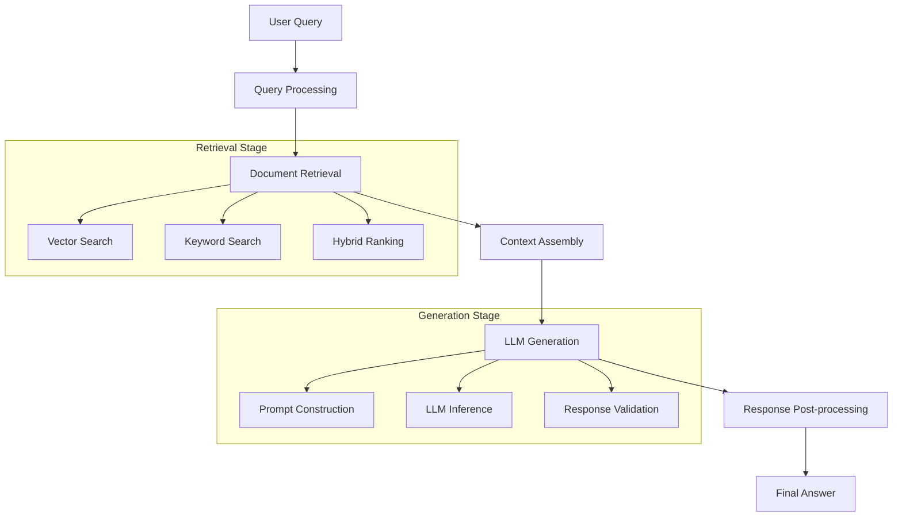

# RAG Pipeline Architecture

The Retrieval Augmented Generation (RAG) pipeline is the core engine of StudyAssistant, combining powerful information retrieval with advanced language generation to provide contextually relevant research assistance.

## Pipeline Overview



## Core Components

### 1. Query Processor

The query processor prepares user input for optimal retrieval performance.

**Key Functions:**
- Query expansion and reformulation
- Entity extraction and normalization  
- Intent classification
- Language detection and processing

**Implementation:**
```python
class QueryProcessor:
    def process_query(self, query: str) -> ProcessedQuery:
        # Expand query with synonyms and related terms
        expanded_query = self.expand_query(query)
        
        # Extract key entities and concepts
        entities = self.extract_entities(query)
        
        # Classify query intent (factual, analytical, comparative)
        intent = self.classify_intent(query)
        
        return ProcessedQuery(
            original=query,
            expanded=expanded_query,
            entities=entities,
            intent=intent
        )
```

### 2. Document Retriever

The retriever component implements hybrid search combining vector similarity and keyword matching.

**Search Strategies:**
- **Vector Search**: Semantic similarity using embeddings
- **BM25 Search**: Traditional keyword-based ranking
- **Hybrid Fusion**: Combines both approaches with learned weights

**Retrieval Process:**
1. Generate query embeddings using sentence transformers
2. Perform approximate nearest neighbor search in vector space
3. Execute BM25 keyword search on indexed documents
4. Merge and re-rank results using reciprocal rank fusion

### 3. Context Assembler

Constructs optimal context for the language model from retrieved documents.

**Key Features:**
- **Context Ranking**: Orders retrieved documents by relevance
- **Passage Selection**: Identifies most relevant text segments
- **Context Windowing**: Manages token limits effectively
- **Deduplication**: Removes redundant information

**Context Assembly Algorithm:**
```python
def assemble_context(self, query: str, documents: List[Document]) -> Context:
    # Rank documents by relevance score
    ranked_docs = self.rank_documents(query, documents)
    
    # Extract relevant passages from top documents
    passages = []
    total_tokens = 0
    
    for doc in ranked_docs:
        relevant_passages = self.extract_passages(query, doc)
        
        for passage in relevant_passages:
            if total_tokens + passage.token_count <= self.max_context_tokens:
                passages.append(passage)
                total_tokens += passage.token_count
            else:
                break
    
    return Context(passages=passages, total_tokens=total_tokens)
```

### 4. Response Generator

Generates coherent, contextually-aware responses using large language models.

**Generation Strategy:**
- **Prompt Engineering**: Carefully crafted prompts for optimal output
- **Few-shot Learning**: Examples to guide response format
- **Temperature Control**: Balances creativity and factual accuracy
- **Token Management**: Optimizes response length and quality

### 5. Response Validator

Ensures response quality and accuracy through multiple validation layers.

**Validation Checks:**
- **Factual Consistency**: Verifies claims against source documents
- **Relevance Scoring**: Measures response alignment with query
- **Completeness Assessment**: Ensures comprehensive coverage
- **Citation Accuracy**: Validates source attributions

## Performance Optimization

### Caching Strategy

StudyAssistant implements multi-level caching to improve response times:

```python
@cached(ttl=3600)  # 1 hour cache
def retrieve_documents(self, query_hash: str) -> List[Document]:
    """Cache document retrieval results"""
    pass

@cached(ttl=300)   # 5 minute cache
def generate_embeddings(self, text: str) -> np.ndarray:
    """Cache embedding generation"""
    pass
```

### Batch Processing

For efficiency, the pipeline supports batch processing:

- **Query Batching**: Process multiple queries simultaneously
- **Embedding Batching**: Generate embeddings in batches
- **Parallel Retrieval**: Concurrent document retrieval operations

### Memory Management

Efficient memory usage through:
- **Streaming Processing**: Process large documents in chunks
- **Memory Pools**: Reuse allocated memory structures
- **Garbage Collection**: Proactive cleanup of temporary objects

## Error Handling

The RAG pipeline includes comprehensive error handling:

```python
class RAGPipeline:
    def process_query(self, query: str) -> RAGResponse:
        try:
            # Main processing logic
            processed_query = self.query_processor.process(query)
            documents = self.retriever.retrieve(processed_query)
            context = self.assembler.assemble_context(query, documents)
            response = self.generator.generate(query, context)
            
            return self.validator.validate_response(response)
            
        except RetrievalError as e:
            return self.handle_retrieval_error(e)
        except GenerationError as e:
            return self.handle_generation_error(e)
        except Exception as e:
            return self.handle_unexpected_error(e)
```

## Configuration Options

The RAG pipeline is highly configurable:

```yaml
rag_pipeline:
  retrieval:
    vector_search:
      model: "sentence-transformers/all-MiniLM-L6-v2"
      top_k: 100
      similarity_threshold: 0.7
    
    keyword_search:
      algorithm: "bm25"
      top_k: 100
      boost_fields: ["title", "abstract"]
    
    hybrid_fusion:
      vector_weight: 0.7
      keyword_weight: 0.3
      
  generation:
    model: "gpt-3.5-turbo"
    max_tokens: 1000
    temperature: 0.1
    top_p: 0.9
    
  context:
    max_tokens: 4000
    passage_overlap: 100
    min_passage_length: 50
```

## Monitoring and Metrics

The pipeline provides comprehensive monitoring:

- **Latency Metrics**: End-to-end and component-level timing
- **Quality Metrics**: Response relevance and accuracy scores  
- **Usage Analytics**: Query patterns and performance trends
- **Error Tracking**: Detailed error logs and recovery statistics

## Next Steps

- [Data Management →](../data-management.md)
- [NLP Processing →](../nlp/text-processing.md)
- [Performance Tuning →](../../development/performance.md)
