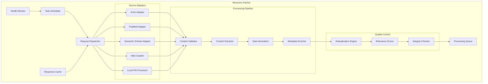

# Resource Fetcher Architecture

The Resource Fetcher is a critical component of the StudyAssistant system responsible for acquiring academic content from multiple heterogeneous sources. This document provides comprehensive technical details about its architecture, implementation, and operational characteristics.

## Overview

The Resource Fetcher serves as the primary data ingestion pipeline, handling the complex task of collecting, validating, and normalizing academic content from various sources including APIs, web crawling, and local file processing.

### Key Responsibilities

- **Multi-Source Integration**: Connect to academic databases and APIs
- **Content Extraction**: Parse and extract structured data from various formats
- **Quality Assurance**: Validate and filter content for academic relevance
- **Rate Limiting**: Respect API limits and implement backoff strategies
- **Error Handling**: Robust recovery from transient and permanent failures
- **Batch Processing**: Efficient bulk data operations
- **Real-time Updates**: Continuous monitoring for new content

## Architecture Design

### Component Architecture



### Core Implementation

```python
class ResourceFetcher:
    """
    Main orchestrator for academic resource acquisition
    """
    
    def __init__(self, config: FetcherConfig):
        self.config = config
        self.scheduler = TaskScheduler(config.scheduler)
        self.source_adapters = self._initialize_adapters()
        self.processing_pipeline = ProcessingPipeline(config.pipeline)
        self.quality_control = QualityController(config.quality)
        self.metrics = FetcherMetrics()
        
    def _initialize_adapters(self) -> Dict[str, SourceAdapter]:
        """Initialize all source adapters"""
        return {
            'arxiv': ArxivAdapter(self.config.arxiv),
            'pubmed': PubMedAdapter(self.config.pubmed),
            'semantic_scholar': SemanticScholarAdapter(self.config.semantic_scholar),
            'web_crawler': WebCrawlerAdapter(self.config.web_crawler),
            'local_files': LocalFileAdapter(self.config.local_files)
        }
    
    async def fetch_batch(self, fetch_request: BatchFetchRequest) -> BatchFetchResult:
        """Execute batch fetch operation across multiple sources"""
        
        # Start monitoring
        operation_id = self.metrics.start_operation('batch_fetch')
        
        try:
            # Dispatch requests to appropriate adapters
            tasks = []
            for source, params in fetch_request.sources.items():
                if source in self.source_adapters:
                    adapter = self.source_adapters[source]
                    task = self._fetch_from_source(adapter, params)
                    tasks.append(task)
            
            # Execute all fetch operations concurrently
            raw_results = await asyncio.gather(*tasks, return_exceptions=True)
            
            # Process results through quality pipeline
            processed_results = await self._process_results(raw_results)
            
            # Generate batch result
            result = BatchFetchResult(
                operation_id=operation_id,
                total_fetched=sum(len(r.documents) for r in processed_results),
                sources_processed=len(processed_results),
                quality_metrics=self.quality_control.get_metrics(operation_id),
                processing_time=self.metrics.get_operation_time(operation_id)
            )
            
            self.metrics.record_success(operation_id, result)
            return result
            
        except Exception as e:
            self.metrics.record_failure(operation_id, e)
            raise
```

## Source Adapters

### ArXiv Adapter

**Purpose**: Fetch papers from the ArXiv preprint repository with advanced query capabilities.

```python
class ArxivAdapter(SourceAdapter):
    """
    ArXiv API integration with rate limiting and error handling
    """
    
    def __init__(self, config: ArxivConfig):
        self.api_client = ArxivAPIClient(
            base_url=config.api_url,
            rate_limit=config.rate_limit,
            timeout=config.timeout
        )
        self.query_builder = ArxivQueryBuilder()
        self.rate_limiter = RateLimiter(
            requests_per_second=config.rate_limit,
            burst_size=config.burst_limit
        )
    
    async def fetch(self, params: ArxivFetchParams) -> FetchResult:
        """Fetch papers from ArXiv based on search parameters"""
        
        # Build ArXiv query
        query = self.query_builder.build_query(
            keywords=params.keywords,
            categories=params.categories,
            date_range=params.date_range,
            max_results=params.max_results
        )
        
        # Rate limiting
        await self.rate_limiter.acquire()
        
        try:
            # Execute API request
            response = await self.api_client.search(
                query=query,
                start=params.start_index or 0,
                max_results=params.max_results or 100,
                sort_by=params.sort_by or 'relevance'
            )
            
            # Parse response
            papers = self._parse_arxiv_response(response)
            
            return FetchResult(
                source='arxiv',
                documents=papers,
                total_count=response.get('total_results', len(papers)),
                query_info=query,
                timestamp=datetime.utcnow()
            )
            
        except ArxivAPIError as e:
            self._handle_api_error(e)
            raise FetchError(f"ArXiv API error: {e.message}", source='arxiv')
    
    def _parse_arxiv_response(self, response: Dict) -> List[Document]:
        """Parse ArXiv API response into Document objects"""
        documents = []
        
        for entry in response.get('entries', []):
            doc = Document(
                id=self._extract_arxiv_id(entry['id']),
                title=entry.get('title', '').strip(),
                abstract=entry.get('summary', '').strip(),
                authors=self._parse_authors(entry.get('authors', [])),
                published_date=self._parse_date(entry.get('published')),
                updated_date=self._parse_date(entry.get('updated')),
                categories=entry.get('categories', []),
                pdf_url=self._extract_pdf_url(entry.get('links', [])),
                source_metadata={
                    'arxiv_id': self._extract_arxiv_id(entry['id']),
                    'comment': entry.get('comment'),
                    'journal_ref': entry.get('journal_ref'),
                    'doi': entry.get('doi'),
                    'primary_category': entry.get('primary_category')
                }
            )
            documents.append(doc)
        
        return documents
```

### PubMed Adapter

**Purpose**: Integration with PubMed E-utilities for medical and life sciences literature.

```python
class PubMedAdapter(SourceAdapter):
    """
    PubMed E-utilities integration for biomedical literature
    """
    
    def __init__(self, config: PubMedConfig):
        self.eutils_client = EUtilsClient(
            api_key=config.api_key,
            email=config.email,
            tool=config.tool_name
        )
        self.rate_limiter = RateLimiter(
            # NCBI rate limits: 10/second with API key, 3/second without
            requests_per_second=10 if config.api_key else 3
        )
    
    async def fetch(self, params: PubMedFetchParams) -> FetchResult:
        """Fetch articles from PubMed"""
        
        # Step 1: Search for PMIDs
        await self.rate_limiter.acquire()
        search_result = await self.eutils_client.esearch(
            db='pubmed',
            term=params.search_term,
            retmax=params.max_results,
            datetype='pdat',
            mindate=params.date_range.start if params.date_range else None,
            maxdate=params.date_range.end if params.date_range else None,
            sort=params.sort_by or 'relevance'
        )
        
        pmids = search_result.get('idlist', [])
        if not pmids:
            return FetchResult(source='pubmed', documents=[], total_count=0)
        
        # Step 2: Fetch detailed records
        await self.rate_limiter.acquire()
        fetch_result = await self.eutils_client.efetch(
            db='pubmed',
            id=','.join(pmids),
            rettype='xml',
            retmode='xml'
        )
        
        # Parse XML response
        documents = self._parse_pubmed_xml(fetch_result)
        
        return FetchResult(
            source='pubmed',
            documents=documents,
            total_count=search_result.get('count', len(documents)),
            query_info=params.search_term,
            timestamp=datetime.utcnow()
        )
    
    def _parse_pubmed_xml(self, xml_content: str) -> List[Document]:
        """Parse PubMed XML response"""
        documents = []
        root = ET.fromstring(xml_content)
        
        for article in root.findall('.//PubmedArticle'):
            doc = self._extract_article_data(article)
            if doc:
                documents.append(doc)
        
        return documents
    
    def _extract_article_data(self, article_xml) -> Optional[Document]:
        """Extract data from a single PubMed article XML"""
        try:
            # Extract basic information
            pmid = article_xml.find('.//PMID').text
            
            medline_citation = article_xml.find('.//MedlineCitation')
            article_data = medline_citation.find('.//Article')
            
            title_elem = article_data.find('.//ArticleTitle')
            title = title_elem.text if title_elem is not None else ''
            
            abstract_elem = article_data.find('.//Abstract/AbstractText')
            abstract = abstract_elem.text if abstract_elem is not None else ''
            
            # Extract authors
            authors = self._extract_pubmed_authors(article_data)
            
            # Extract publication info
            journal_info = self._extract_journal_info(article_data)
            
            # Extract MeSH terms
            mesh_terms = self._extract_mesh_terms(medline_citation)
            
            return Document(
                id=f"pubmed:{pmid}",
                title=title,
                abstract=abstract,
                authors=authors,
                published_date=journal_info.get('pub_date'),
                source_metadata={
                    'pmid': pmid,
                    'journal': journal_info.get('journal_title'),
                    'volume': journal_info.get('volume'),
                    'issue': journal_info.get('issue'),
                    'pages': journal_info.get('pages'),
                    'doi': journal_info.get('doi'),
                    'mesh_terms': mesh_terms,
                    'publication_types': self._extract_publication_types(article_data)
                }
            )
            
        except Exception as e:
            logger.error(f"Error parsing PubMed article: {e}")
            return None
```

### Web Crawler Adapter

**Purpose**: Intelligent web crawling for academic websites and institutional repositories.

```python
class WebCrawlerAdapter(SourceAdapter):
    """
    Academic web crawler with content extraction and filtering
    """
    
    def __init__(self, config: WebCrawlerConfig):
        self.crawler_engine = ScrapyEngine(config.scrapy_settings)
        self.content_extractor = AcademicContentExtractor()
        self.url_filter = AcademicURLFilter(config.allowed_domains)
        self.robots_cache = RobotsCache()
        
    async def fetch(self, params: WebCrawlParams) -> FetchResult:
        """Crawl academic websites for papers and publications"""
        
        # Validate URLs and check robots.txt
        valid_urls = await self._validate_urls(params.start_urls)
        
        if not valid_urls:
            return FetchResult(source='web_crawler', documents=[], total_count=0)
        
        # Configure crawl settings
        crawl_settings = CrawlSettings(
            max_depth=params.max_depth or 3,
            max_pages=params.max_pages or 1000,
            delay=params.crawl_delay or 1.0,
            concurrent_requests=params.concurrent_requests or 8,
            respect_robots_txt=True,
            user_agent='StudyAssistant-Bot/1.0'
        )
        
        # Execute crawl
        crawl_result = await self.crawler_engine.crawl(
            start_urls=valid_urls,
            settings=crawl_settings,
            callback=self._parse_academic_page
        )
        
        # Extract documents from crawl results
        documents = []
        for page_result in crawl_result.pages:
            if page_result.is_academic_content:
                doc = await self.content_extractor.extract_document(page_result)
                if doc and self._is_valid_academic_document(doc):
                    documents.append(doc)
        
        return FetchResult(
            source='web_crawler',
            documents=documents,
            total_count=len(documents),
            crawl_statistics=crawl_result.statistics,
            timestamp=datetime.utcnow()
        )
    
    async def _parse_academic_page(self, response) -> PageResult:
        """Parse an academic webpage for document content"""
        
        # Detect content type
        content_type = self._detect_content_type(response)
        
        if content_type == 'pdf':
            return await self._extract_pdf_content(response)
        elif content_type == 'html_paper':
            return await self._extract_html_paper(response)
        elif content_type == 'publication_list':
            return await self._extract_publication_links(response)
        else:
            return PageResult(url=response.url, is_academic_content=False)
```

## Processing Pipeline

### Content Validation

```python
class ContentValidator:
    """
    Validates fetched content for academic relevance and quality
    """
    
    def __init__(self, config: ValidationConfig):
        self.academic_classifier = AcademicClassifier(config.model_path)
        self.language_detector = LanguageDetector()
        self.quality_scorer = ContentQualityScorer()
        
    async def validate(self, document: Document) -> ValidationResult:
        """Validate a document for academic relevance and quality"""
        
        validation_checks = {
            'is_academic': await self._check_academic_relevance(document),
            'language_supported': await self._check_language(document),
            'content_quality': await self._check_quality(document),
            'completeness': await self._check_completeness(document),
            'duplication': await self._check_duplication(document)
        }
        
        # Calculate overall validation score
        weights = {
            'is_academic': 0.3,
            'language_supported': 0.1,
            'content_quality': 0.3,
            'completeness': 0.2,
            'duplication': 0.1
        }
        
        overall_score = sum(
            validation_checks[check] * weights[check]
            for check in validation_checks
        )
        
        return ValidationResult(
            document_id=document.id,
            is_valid=overall_score >= self.config.min_score,
            score=overall_score,
            checks=validation_checks,
            recommendations=self._generate_recommendations(validation_checks)
        )
    
    async def _check_academic_relevance(self, document: Document) -> float:
        """Check if content is academically relevant"""
        
        # Use trained classifier
        features = self._extract_academic_features(document)
        relevance_score = await self.academic_classifier.predict(features)
        
        # Additional heuristics
        heuristic_score = self._calculate_heuristic_score(document)
        
        # Combine scores
        return 0.7 * relevance_score + 0.3 * heuristic_score
    
    def _extract_academic_features(self, document: Document) -> Dict:
        """Extract features for academic classification"""
        return {
            'title_academic_terms': self._count_academic_terms(document.title),
            'abstract_length': len(document.abstract.split()) if document.abstract else 0,
            'reference_count': len(document.references) if document.references else 0,
            'author_count': len(document.authors),
            'has_doi': bool(document.source_metadata.get('doi')),
            'has_arxiv_id': 'arxiv' in document.id.lower(),
            'publication_venue_academic': self._is_academic_venue(
                document.source_metadata.get('journal', '')
            )
        }
```

### Metadata Enrichment

```python
class MetadataEnricher:
    """
    Enriches document metadata with additional information
    """
    
    def __init__(self, config: EnrichmentConfig):
        self.citation_resolver = CitationResolver()
        self.author_disambiguator = AuthorDisambiguator()
        self.topic_classifier = TopicClassifier()
        self.impact_calculator = ImpactCalculator()
        
    async def enrich(self, document: Document) -> EnrichedDocument:
        """Enrich document with additional metadata"""
        
        enrichment_tasks = [
            self._resolve_citations(document),
            self._disambiguate_authors(document),
            self._classify_topics(document),
            self._calculate_impact_metrics(document),
            self._extract_entities(document)
        ]
        
        enrichment_results = await asyncio.gather(*enrichment_tasks)
        
        enriched_metadata = {
            'citations': enrichment_results[0],
            'author_profiles': enrichment_results[1],
            'topics': enrichment_results[2],
            'impact_metrics': enrichment_results[3],
            'entities': enrichment_results[4],
            'enrichment_timestamp': datetime.utcnow().isoformat()
        }
        
        return EnrichedDocument(
            **document.dict(),
            enriched_metadata=enriched_metadata
        )
    
    async def _resolve_citations(self, document: Document) -> List[Citation]:
        """Resolve and validate document citations"""
        if not document.references:
            return []
        
        citations = []
        for ref in document.references:
            try:
                citation = await self.citation_resolver.resolve(ref)
                if citation:
                    citations.append(citation)
            except Exception as e:
                logger.warning(f"Failed to resolve citation: {ref[:100]}... Error: {e}")
        
        return citations
```

## Quality Control

### Deduplication Engine

```python
class DeduplicationEngine:
    """
    Identifies and handles duplicate documents across sources
    """
    
    def __init__(self, config: DeduplicationConfig):
        self.similarity_calculator = DocumentSimilarityCalculator()
        self.duplicate_store = DuplicateStore()
        self.merge_strategy = DocumentMergeStrategy(config.merge_rules)
        
    async def deduplicate_batch(self, documents: List[Document]) -> DeduplicationResult:
        """Identify and handle duplicates in a batch of documents"""
        
        # Calculate pairwise similarities
        similarity_matrix = await self._calculate_similarities(documents)
        
        # Identify duplicate clusters
        duplicate_clusters = self._find_duplicate_clusters(
            documents, 
            similarity_matrix, 
            threshold=self.config.similarity_threshold
        )
        
        # Merge duplicates
        merged_documents = []
        duplicate_info = []
        
        for cluster in duplicate_clusters:
            if len(cluster) > 1:
                # Multiple documents - merge them
                primary_doc = self._select_primary_document(cluster)
                merged_doc = await self.merge_strategy.merge_documents(cluster, primary_doc)
                merged_documents.append(merged_doc)
                
                duplicate_info.append(DuplicateCluster(
                    primary_id=primary_doc.id,
                    duplicate_ids=[doc.id for doc in cluster if doc.id != primary_doc.id],
                    similarity_scores=[similarity_matrix[i][j] for i, j in cluster_pairs]
                ))
            else:
                # Single document - no duplicates
                merged_documents.append(cluster[0])
        
        return DeduplicationResult(
            original_count=len(documents),
            deduplicated_count=len(merged_documents),
            duplicate_clusters=duplicate_info,
            documents=merged_documents
        )
    
    async def _calculate_similarities(self, documents: List[Document]) -> np.ndarray:
        """Calculate pairwise document similarities"""
        n = len(documents)
        similarity_matrix = np.zeros((n, n))
        
        # Calculate embeddings for all documents
        embeddings = await self.similarity_calculator.batch_encode([
            f"{doc.title} {doc.abstract}" for doc in documents
        ])
        
        # Calculate cosine similarities
        for i in range(n):
            for j in range(i + 1, n):
                similarity = cosine_similarity(
                    embeddings[i].reshape(1, -1),
                    embeddings[j].reshape(1, -1)
                )[0][0]
                similarity_matrix[i][j] = similarity
                similarity_matrix[j][i] = similarity
        
        return similarity_matrix
```

## Performance and Monitoring

### Metrics Collection

```python
class FetcherMetrics:
    """
    Comprehensive metrics collection for the Resource Fetcher
    """
    
    def __init__(self):
        self.prometheus_client = PrometheusClient()
        self.operation_tracker = OperationTracker()
        
        # Define metrics
        self.fetch_requests = Counter(
            'resource_fetcher_requests_total',
            'Total number of fetch requests',
            ['source', 'status']
        )
        
        self.fetch_duration = Histogram(
            'resource_fetcher_duration_seconds',
            'Time spent on fetch operations',
            ['source']
        )
        
        self.documents_processed = Counter(
            'resource_fetcher_documents_total',
            'Total number of documents processed',
            ['source', 'validation_status']
        )
    
    def record_fetch_request(self, source: str, status: str, duration: float):
        """Record a fetch request metric"""
        self.fetch_requests.labels(source=source, status=status).inc()
        self.fetch_duration.labels(source=source).observe(duration)
    
    def record_document_processed(self, source: str, validation_status: str):
        """Record a document processing metric"""
        self.documents_processed.labels(
            source=source, 
            validation_status=validation_status
        ).inc()
```

### Health Monitoring

```python
class FetcherHealthMonitor:
    """
    Health monitoring for Resource Fetcher components
    """
    
    async def check_health(self) -> HealthReport:
        """Comprehensive health check"""
        
        checks = {
            'api_connectivity': await self._check_api_connectivity(),
            'processing_queue': await self._check_processing_queue(),
            'storage_health': await self._check_storage_health(),
            'resource_usage': await self._check_resource_usage(),
            'error_rates': await self._check_error_rates()
        }
        
        overall_status = self._evaluate_overall_health(checks)
        
        return HealthReport(
            status=overall_status,
            checks=checks,
            timestamp=datetime.utcnow(),
            recommendations=self._generate_health_recommendations(checks)
        )
    
    async def _check_api_connectivity(self) -> HealthCheck:
        """Check connectivity to external APIs"""
        api_checks = {}
        
        for api_name, client in self.api_clients.items():
            try:
                start_time = time.time()
                await client.health_check()
                response_time = time.time() - start_time
                
                api_checks[api_name] = {
                    'status': 'healthy',
                    'response_time': response_time,
                    'last_success': datetime.utcnow()
                }
            except Exception as e:
                api_checks[api_name] = {
                    'status': 'unhealthy',
                    'error': str(e),
                    'last_failure': datetime.utcnow()
                }
        
        return HealthCheck(
            name='api_connectivity',
            status='healthy' if all(
                check['status'] == 'healthy' 
                for check in api_checks.values()
            ) else 'unhealthy',
            details=api_checks
        )
```

This Resource Fetcher architecture provides a robust, scalable solution for academic content acquisition with comprehensive error handling, quality control, and monitoring capabilities.
