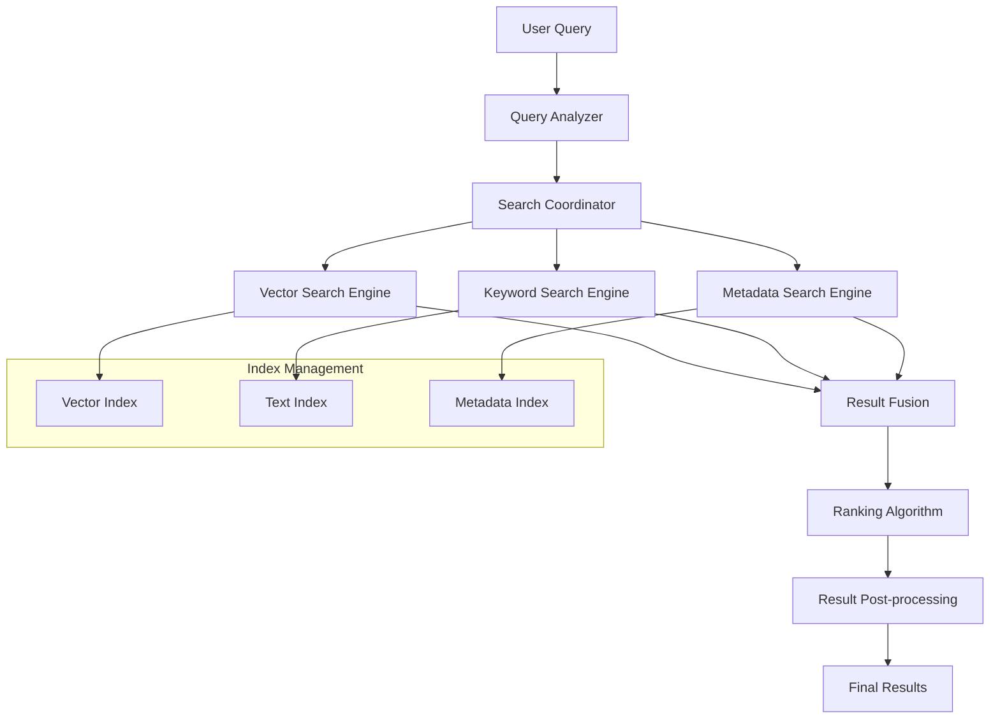

# Search Engine Architecture

StudyAssistant's search engine combines multiple retrieval strategies to provide highly relevant results for research queries, implementing both traditional keyword search and modern semantic search techniques.

## Search Architecture Overview



## Core Search Components

### 1. Query Analyzer

Prepares and optimizes user queries for maximum retrieval effectiveness.

```python
class QueryAnalyzer:
    def __init__(self):
        self.nlp = spacy.load("en_core_web_sm")
        self.query_expander = QueryExpander()
        self.entity_extractor = EntityExtractor()
    
    def analyze_query(self, query: str) -> AnalyzedQuery:
        """Comprehensive query analysis and preparation"""
        # Basic preprocessing
        cleaned_query = self.clean_query(query)
        
        # Extract entities (people, organizations, concepts)
        entities = self.entity_extractor.extract(cleaned_query)
        
        # Determine query intent and type
        intent = self.classify_intent(cleaned_query)
        query_type = self.classify_type(cleaned_query)
        
        # Expand query with synonyms and related terms
        expanded_terms = self.query_expander.expand(cleaned_query)
        
        # Extract key concepts and topics
        concepts = self.extract_concepts(cleaned_query)
        
        return AnalyzedQuery(
            original=query,
            cleaned=cleaned_query,
            entities=entities,
            intent=intent,
            type=query_type,
            expanded_terms=expanded_terms,
            concepts=concepts
        )
    
    def classify_intent(self, query: str) -> QueryIntent:
        """Classify user intent for query optimization"""
        # Factual questions
        if any(word in query.lower() for word in ['what', 'who', 'when', 'where']):
            return QueryIntent.FACTUAL
        
        # Analytical questions
        if any(word in query.lower() for word in ['why', 'how', 'analyze', 'explain']):
            return QueryIntent.ANALYTICAL
        
        # Comparative questions
        if any(word in query.lower() for word in ['compare', 'versus', 'difference']):
            return QueryIntent.COMPARATIVE
        
        # Exploratory questions
        if any(word in query.lower() for word in ['overview', 'survey', 'review']):
            return QueryIntent.EXPLORATORY
        
        return QueryIntent.GENERAL
```

### 2. Vector Search Engine

Implements semantic search using dense vector representations.

```python
class VectorSearchEngine:
    def __init__(self, index_name: str, model_name: str = "all-MiniLM-L6-v2"):
        self.index = self.initialize_index(index_name)
        self.encoder = SentenceTransformer(model_name)
        self.cache = SearchCache()
    
    async def search(self, analyzed_query: AnalyzedQuery, top_k: int = 100) -> SearchResults:
        """Perform semantic vector search"""
        try:
            # Generate query embedding
            query_embedding = await self.encode_query(analyzed_query)
            
            # Check cache first
            cache_key = self.generate_cache_key(analyzed_query, top_k)
            cached_results = await self.cache.get(cache_key)
            if cached_results:
                return cached_results
            
            # Search vector index
            search_results = await self.index.query(
                vector=query_embedding.tolist(),
                top_k=top_k,
                include_metadata=True,
                filter=self.build_metadata_filter(analyzed_query)
            )
            
            # Convert to SearchResults format
            results = self.convert_to_search_results(search_results)
            
            # Cache results
            await self.cache.set(cache_key, results, ttl=300)
            
            return results
            
        except Exception as e:
            logger.error(f"Vector search failed: {e}")
            raise SearchException(f"Vector search error: {e}")
    
    async def encode_query(self, analyzed_query: AnalyzedQuery) -> np.ndarray:
        """Generate optimized query embedding"""
        # Combine original query with expanded terms
        query_text = analyzed_query.cleaned
        
        # Add important entities with boosting
        if analyzed_query.entities:
            entity_text = " ".join([e.text for e in analyzed_query.entities if e.confidence > 0.8])
            query_text = f"{query_text} {entity_text}"
        
        # Add expanded terms
        if analyzed_query.expanded_terms:
            expanded_text = " ".join(analyzed_query.expanded_terms[:5])  # Top 5 terms
            query_text = f"{query_text} {expanded_text}"
        
        # Generate embedding
        embedding = self.encoder.encode(query_text, convert_to_numpy=True)
        return embedding
```

### 3. Keyword Search Engine

Traditional text-based search using BM25 algorithm with enhancements.

```python
class KeywordSearchEngine:
    def __init__(self, index_path: str):
        self.index = self.load_inverted_index(index_path)
        self.bm25 = BM25Okapi()
        self.query_processor = KeywordQueryProcessor()
    
    async def search(self, analyzed_query: AnalyzedQuery, top_k: int = 100) -> SearchResults:
        """Perform enhanced keyword search"""
        try:
            # Process query for keyword search
            processed_query = self.query_processor.process(analyzed_query)
            
            # Execute BM25 search
            bm25_scores = self.bm25.get_scores(processed_query.terms)
            
            # Get top documents
            top_indices = np.argsort(bm25_scores)[::-1][:top_k]
            
            # Enhance with phrase matching
            phrase_scores = self.calculate_phrase_scores(processed_query, top_indices)
            
            # Combine BM25 and phrase scores
            combined_scores = self.combine_scores(bm25_scores, phrase_scores)
            
            # Build results
            results = []
            for idx in top_indices:
                if combined_scores[idx] > 0:
                    results.append(SearchResult(
                        document_id=self.index.get_doc_id(idx),
                        score=combined_scores[idx],
                        highlights=self.generate_highlights(processed_query, idx)
                    ))
            
            return SearchResults(results=results, total=len(results))
            
        except Exception as e:
            logger.error(f"Keyword search failed: {e}")
            raise SearchException(f"Keyword search error: {e}")
    
    def calculate_phrase_scores(self, query: ProcessedQuery, doc_indices: List[int]) -> np.ndarray:
        """Calculate additional scores for phrase matches"""
        phrase_scores = np.zeros(len(self.index))
        
        # Look for exact phrase matches
        if query.phrases:
            for phrase in query.phrases:
                phrase_matches = self.index.find_phrase(phrase)
                for doc_idx in phrase_matches:
                    if doc_idx in doc_indices:
                        phrase_scores[doc_idx] += 2.0  # Boost phrase matches
        
        return phrase_scores
```

### 4. Metadata Search Engine

Specialized search for document metadata and structured information.

```python
class MetadataSearchEngine:
    def __init__(self, metadata_db: MetadataDatabase):
        self.db = metadata_db
        self.field_weights = {
            'title': 3.0,
            'abstract': 2.0,
            'authors': 2.5,
            'keywords': 2.0,
            'subject': 1.5
        }
    
    async def search(self, analyzed_query: AnalyzedQuery, top_k: int = 100) -> SearchResults:
        """Search document metadata"""
        try:
            # Build metadata query
            metadata_query = self.build_metadata_query(analyzed_query)
            
            # Execute database query
            db_results = await self.db.search(metadata_query, limit=top_k)
            
            # Calculate relevance scores
            scored_results = []
            for result in db_results:
                score = self.calculate_metadata_score(analyzed_query, result)
                if score > 0.1:  # Minimum relevance threshold
                    scored_results.append(SearchResult(
                        document_id=result.document_id,
                        score=score,
                        metadata=result.metadata
                    ))
            
            # Sort by score
            scored_results.sort(key=lambda x: x.score, reverse=True)
            
            return SearchResults(results=scored_results, total=len(scored_results))
            
        except Exception as e:
            logger.error(f"Metadata search failed: {e}")
            raise SearchException(f"Metadata search error: {e}")
    
    def build_metadata_query(self, analyzed_query: AnalyzedQuery) -> MetadataQuery:
        """Build structured metadata query"""
        query = MetadataQuery()
        
        # Author searches
        for entity in analyzed_query.entities:
            if entity.type == "PERSON":
                query.add_author_filter(entity.text)
        
        # Date range searches
        date_entities = [e for e in analyzed_query.entities if e.type == "DATE"]
        if date_entities:
            query.add_date_range_filter(date_entities)
        
        # Keyword searches in title/abstract
        query.add_text_search(analyzed_query.cleaned, ['title', 'abstract', 'keywords'])
        
        return query
```

### 5. Result Fusion and Ranking

Combines results from multiple search engines using advanced fusion techniques.

```python
class ResultFusionEngine:
    def __init__(self):
        self.fusion_weights = {
            'vector': 0.5,
            'keyword': 0.3,
            'metadata': 0.2
        }
        self.ranker = LearningToRank()
    
    def fuse_results(self, 
                    vector_results: SearchResults,
                    keyword_results: SearchResults,
                    metadata_results: SearchResults,
                    analyzed_query: AnalyzedQuery) -> SearchResults:
        """Fuse results from multiple search engines"""
        
        # Collect all unique documents
        all_docs = self.collect_all_documents(vector_results, keyword_results, metadata_results)
        
        # Apply reciprocal rank fusion
        rrf_scores = self.reciprocal_rank_fusion(
            [vector_results, keyword_results, metadata_results],
            k=60  # RRF parameter
        )
        
        # Calculate final scores using multiple signals
        final_scores = {}
        for doc_id in all_docs:
            features = self.extract_ranking_features(
                doc_id, 
                vector_results, 
                keyword_results, 
                metadata_results,
                analyzed_query
            )
            
            # Combine RRF score with learned ranking
            rrf_score = rrf_scores.get(doc_id, 0.0)
            ml_score = self.ranker.predict(features)
            
            final_scores[doc_id] = 0.7 * rrf_score + 0.3 * ml_score
        
        # Build final ranked results
        sorted_docs = sorted(final_scores.items(), key=lambda x: x[1], reverse=True)
        
        final_results = []
        for doc_id, score in sorted_docs:
            doc_info = all_docs[doc_id]
            final_results.append(SearchResult(
                document_id=doc_id,
                score=score,
                metadata=doc_info.metadata,
                highlights=doc_info.highlights
            ))
        
        return SearchResults(results=final_results, total=len(final_results))
    
    def reciprocal_rank_fusion(self, result_lists: List[SearchResults], k: int = 60) -> Dict[str, float]:
        """Apply reciprocal rank fusion algorithm"""
        fused_scores = defaultdict(float)
        
        for results in result_lists:
            for rank, result in enumerate(results.results, 1):
                fused_scores[result.document_id] += 1.0 / (k + rank)
        
        return dict(fused_scores)
```

### 6. Search Result Post-processing

Enhances search results with additional information and formatting.

```python
class ResultPostProcessor:
    def __init__(self):
        self.highlighter = SearchHighlighter()
        self.snippet_generator = SnippetGenerator()
        self.relevance_calculator = RelevanceCalculator()
    
    def process_results(self, results: SearchResults, analyzed_query: AnalyzedQuery) -> ProcessedResults:
        """Post-process search results for presentation"""
        processed_results = []
        
        for result in results.results:
            # Generate search snippets
            snippets = self.snippet_generator.generate(
                result.document_id,
                analyzed_query,
                max_snippets=3
            )
            
            # Generate highlights
            highlights = self.highlighter.highlight(
                snippets,
                analyzed_query.cleaned
            )
            
            # Calculate relevance explanation
            relevance_factors = self.relevance_calculator.explain_relevance(
                result,
                analyzed_query
            )
            
            processed_results.append(ProcessedResult(
                document_id=result.document_id,
                score=result.score,
                snippets=snippets,
                highlights=highlights,
                relevance_factors=relevance_factors,
                metadata=result.metadata
            ))
        
        return ProcessedResults(
            results=processed_results,
            total=results.total,
            query_analysis=analyzed_query
        )
```

## Performance Optimization

### Caching Strategy
```python
class SearchCache:
    def __init__(self, redis_client: Redis):
        self.redis = redis_client
        self.cache_ttl = {
            'vector_search': 300,    # 5 minutes
            'keyword_search': 600,   # 10 minutes
            'metadata_search': 1800, # 30 minutes
        }
    
    async def get_cached_results(self, cache_key: str, search_type: str) -> Optional[SearchResults]:
        """Retrieve cached search results"""
        cached_data = await self.redis.get(f"{search_type}:{cache_key}")
        if cached_data:
            return SearchResults.from_json(cached_data)
        return None
```

### Index Optimization
```python
class IndexOptimizer:
    def __init__(self):
        self.optimization_schedule = {
            'daily': self.optimize_vector_index,
            'weekly': self.rebuild_keyword_index,
            'monthly': self.full_reindex
        }
    
    async def optimize_vector_index(self):
        """Optimize vector index for better performance"""
        # Merge segments, update HNSW graph
        await self.vector_index.optimize()
        
    async def rebuild_keyword_index(self):
        """Rebuild keyword search index"""
        # Update inverted index, recalculate IDF scores
        await self.keyword_index.rebuild()
```

## Configuration

```yaml
search_engine:
  vector_search:
    model: "sentence-transformers/all-MiniLM-L6-v2"
    index_type: "hnsw"
    ef_construction: 200
    ef_search: 100
    similarity_metric: "cosine"
  
  keyword_search:
    algorithm: "bm25"
    k1: 1.2
    b: 0.75
    phrase_boost: 2.0
  
  result_fusion:
    method: "reciprocal_rank_fusion"
    rrf_k: 60
    weights:
      vector: 0.5
      keyword: 0.3
      metadata: 0.2
  
  performance:
    cache_ttl: 300
    max_results: 1000
    timeout_seconds: 10
```

## Monitoring and Analytics

```python
class SearchAnalytics:
    def __init__(self):
        self.metrics = SearchMetrics()
    
    def log_search_event(self, query: str, results: SearchResults, user_id: str):
        """Log search events for analytics"""
        self.metrics.record_search(
            query=query,
            result_count=len(results.results),
            response_time=results.response_time,
            user_id=user_id
        )
    
    def generate_search_insights(self) -> SearchInsights:
        """Generate search analytics insights"""
        return SearchInsights(
            popular_queries=self.metrics.get_popular_queries(),
            average_response_time=self.metrics.get_avg_response_time(),
            result_quality_metrics=self.metrics.get_quality_metrics()
        )
```

## Next Steps

- [RAG Pipeline →](./rag-pipeline.md)
- [API Documentation →](../../api/core-apis.md)
- [Performance Tuning →](../../development/performance.md)
