# Text Processing Pipeline

The Text Processing Pipeline is a sophisticated component responsible for extracting, cleaning, structuring, and enriching textual content from various academic sources. It implements advanced NLP techniques to prepare content for embedding generation and retrieval operations.

## Overview

The Text Processing Pipeline handles the transformation of raw academic content into structured, searchable, and semantically rich data. It processes multiple content types including research papers, abstracts, citations, and web content through a series of specialized processing stages.

```mermaid
graph TB
    subgraph "Text Processing Pipeline"
        IN[Input Documents]
        
        subgraph "Extraction Stage"
            PE[PDF Extractor]
            HE[HTML Extractor]
            TE[Text Extractor]
            ME[Metadata Extractor]
        end
        
        subgraph "Preprocessing Stage"
            CL[Content Cleaner]
            NO[Noise Removal]
            EN[Encoding Normalizer]
            LN[Language Detector]
        end
        
        subgraph "Structuring Stage"
            SS[Section Segmenter]
            PS[Paragraph Splitter]
            CS[Citation Separator]
            TS[Table Extractor]
            FS[Figure Extractor]
        end
        
        subgraph "Enrichment Stage"
            NE[Named Entity Recognition]
            KE[Keyword Extraction]
            SE[Sentence Embedding]
            RE[Relationship Extraction]
        end
        
        subgraph "Quality Control"
            QV[Quality Validator]
            DU[Duplicate Detector]
            CO[Content Optimizer]
        end
        
        OUT[Processed Documents]
    end
    
    IN --> PE
    IN --> HE
    IN --> TE
    IN --> ME
    
    PE --> CL
    HE --> CL
    TE --> CL
    ME --> NO
    
    CL --> NO
    NO --> EN
    EN --> LN
    
    LN --> SS
    SS --> PS
    PS --> CS
    CS --> TS
    TS --> FS
    
    FS --> NE
    NE --> KE
    KE --> SE
    SE --> RE
    
    RE --> QV
    QV --> DU
    DU --> CO
    
    CO --> OUT
```



## Core Components

### Content Extraction

The extraction stage handles multiple document formats and sources:

```python
class ContentExtractor:
    """Multi-format content extraction system."""
    
    def __init__(self, config: ExtractionConfig):
        self.pdf_extractor = PDFExtractor(config.pdf)
        self.html_extractor = HTMLExtractor(config.html)
        self.text_extractor = TextExtractor(config.text)
        self.metadata_extractor = MetadataExtractor(config.metadata)
    
    async def extract_content(
        self,
        document: RawDocument
    ) -> ExtractedContent:
        """Extract content based on document type."""
        extractor_map = {
            'pdf': self.pdf_extractor,
            'html': self.html_extractor,
            'txt': self.text_extractor,
            'xml': self.html_extractor  # XML uses HTML extractor
        }
        
        extractor = extractor_map.get(document.format)
        if not extractor:
            raise UnsupportedFormatError(document.format)
        
        # Extract content and metadata concurrently
        content_task = extractor.extract_text(document.content)
        metadata_task = self.metadata_extractor.extract(document)
        
        content, metadata = await asyncio.gather(content_task, metadata_task)
        
        return ExtractedContent(
            text=content.text,
            structure=content.structure,
            metadata=metadata,
            extraction_info=content.info
        )

class PDFExtractor:
    """Advanced PDF text extraction with layout preservation."""
    
    def __init__(self, config: PDFConfig):
        self.layout_analyzer = LayoutAnalyzer()
        self.ocr_engine = OCREngine(config.ocr) if config.enable_ocr else None
        self.table_detector = TableDetector()
        self.figure_detector = FigureDetector()
    
    async def extract_text(self, pdf_content: bytes) -> ExtractedText:
        """Extract text with structure preservation."""
        # Parse PDF document
        doc = fitz.open(stream=pdf_content)
        
        extracted_pages = []
        tables = []
        figures = []
        
        for page_num, page in enumerate(doc):
            # Extract text with layout information
            blocks = page.get_text("dict")
            page_content = await self._process_page_blocks(blocks)
            
            # Detect and extract tables
            page_tables = await self.table_detector.detect(page)
            tables.extend([(page_num, table) for table in page_tables])
            
            # Detect and extract figures
            page_figures = await self.figure_detector.detect(page)
            figures.extend([(page_num, fig) for fig in page_figures])
            
            # OCR for image-based content if enabled
            if self.ocr_engine and self._needs_ocr(page_content):
                ocr_text = await self.ocr_engine.extract_text(page)
                page_content = self._merge_ocr_text(page_content, ocr_text)
            
            extracted_pages.append(page_content)
        
        doc.close()
        
        return ExtractedText(
            pages=extracted_pages,
            tables=tables,
            figures=figures,
            structure=self._analyze_document_structure(extracted_pages)
        )
    
    async def _process_page_blocks(self, blocks: Dict) -> PageContent:
        """Process page blocks maintaining layout information."""
        text_blocks = []
        
        for block in blocks.get("blocks", []):
            if "lines" not in block:
                continue
            
            block_text = []
            for line in block["lines"]:
                line_text = []
                for span in line.get("spans", []):
                    text = span.get("text", "").strip()
                    if text:
                        line_text.append(TextSpan(
                            text=text,
                            font=span.get("font"),
                            size=span.get("size"),
                            flags=span.get("flags"),
                            bbox=span.get("bbox")
                        ))
                
                if line_text:
                    block_text.append(TextLine(spans=line_text))
            
            if block_text:
                text_blocks.append(TextBlock(
                    lines=block_text,
                    bbox=block.get("bbox"),
                    block_type=self._classify_block_type(block_text)
                ))
        
        return PageContent(blocks=text_blocks)
```

### Content Preprocessing

Advanced preprocessing pipeline for text normalization and cleaning:

```python
class ContentPreprocessor:
    """Advanced text preprocessing and normalization."""
    
    def __init__(self, config: PreprocessingConfig):
        self.cleaner = TextCleaner(config.cleaning)
        self.normalizer = TextNormalizer(config.normalization)
        self.language_detector = LanguageDetector()
        self.encoding_fixer = EncodingFixer()
    
    async def preprocess(
        self,
        content: ExtractedContent
    ) -> PreprocessedContent:
        """Apply comprehensive preprocessing pipeline."""
        # Fix encoding issues
        fixed_text = self.encoding_fixer.fix(content.text)
        
        # Detect language
        language = await self.language_detector.detect(fixed_text)
        
        # Clean and normalize text
        cleaned_text = await self.cleaner.clean(
            fixed_text,
            language=language
        )
        
        normalized_text = await self.normalizer.normalize(
            cleaned_text,
            language=language
        )
        
        return PreprocessedContent(
            text=normalized_text,
            language=language,
            metadata=content.metadata,
            structure=content.structure,
            preprocessing_info=PreprocessingInfo(
                original_length=len(content.text),
                processed_length=len(normalized_text),
                language_confidence=language.confidence,
                cleaning_applied=self.cleaner.get_applied_rules(),
                normalization_applied=self.normalizer.get_applied_rules()
            )
        )

class TextCleaner:
    """Intelligent text cleaning with academic content awareness."""
    
    def __init__(self, config: CleaningConfig):
        self.rules = self._init_cleaning_rules(config)
        self.academic_patterns = AcademicPatternRecognizer()
        self.citation_cleaner = CitationCleaner()
    
    async def clean(self, text: str, language: Language) -> str:
        """Apply intelligent cleaning rules."""
        cleaned_text = text
        applied_rules = []
        
        # Preserve academic elements before cleaning
        preserved_elements = self.academic_patterns.extract_elements(text)
        
        # Apply cleaning rules
        for rule in self.rules:
            if rule.should_apply(cleaned_text, language):
                cleaned_text = rule.apply(cleaned_text)
                applied_rules.append(rule.name)
        
        # Clean citations while preserving structure
        cleaned_text = await self.citation_cleaner.clean(
            cleaned_text,
            preserve_structure=True
        )
        
        # Restore preserved academic elements
        cleaned_text = self._restore_academic_elements(
            cleaned_text,
            preserved_elements
        )
        
        self.applied_rules = applied_rules
        return cleaned_text
    
    def _init_cleaning_rules(self, config: CleaningConfig) -> List[CleaningRule]:
        """Initialize cleaning rules based on configuration."""
        rules = []
        
        if config.remove_extra_whitespace:
            rules.append(WhitespaceNormalizationRule())
        
        if config.fix_line_breaks:
            rules.append(LineBreakFixRule())
        
        if config.remove_headers_footers:
            rules.append(HeaderFooterRemovalRule())
        
        if config.fix_hyphenation:
            rules.append(HyphenationFixRule())
        
        if config.normalize_unicode:
            rules.append(UnicodeNormalizationRule())
        
        return rules
```

### Document Structuring

Advanced document structure analysis and segmentation:

```python
class DocumentStructurer:
    """Intelligent document structure analysis and segmentation."""
    
    def __init__(self, config: StructuringConfig):
        self.section_detector = SectionDetector(config.sections)
        self.paragraph_splitter = ParagraphSplitter(config.paragraphs)
        self.citation_extractor = CitationExtractor(config.citations)
        self.table_processor = TableProcessor(config.tables)
        self.hierarchy_analyzer = HierarchyAnalyzer()
    
    async def structure_document(
        self,
        content: PreprocessedContent
    ) -> StructuredDocument:
        """Analyze and structure document content."""
        # Detect document sections
        sections = await self.section_detector.detect_sections(content.text)
        
        # Process each section
        structured_sections = []
        for section in sections:
            structured_section = await self._process_section(section)
            structured_sections.append(structured_section)
        
        # Analyze document hierarchy
        hierarchy = self.hierarchy_analyzer.analyze(structured_sections)
        
        # Extract citations
        citations = await self.citation_extractor.extract_all(content.text)
        
        return StructuredDocument(
            sections=structured_sections,
            hierarchy=hierarchy,
            citations=citations,
            metadata=content.metadata,
            structure_info=StructureInfo(
                total_sections=len(structured_sections),
                citation_count=len(citations),
                hierarchy_depth=hierarchy.max_depth
            )
        )
    
    async def _process_section(self, section: Section) -> StructuredSection:
        """Process individual section with detailed analysis."""
        # Split into paragraphs
        paragraphs = await self.paragraph_splitter.split(section.content)
        
        # Process each paragraph
        structured_paragraphs = []
        for paragraph in paragraphs:
            structured_paragraph = await self._process_paragraph(paragraph)
            structured_paragraphs.append(structured_paragraph)
        
        # Extract section-specific elements
        tables = await self.table_processor.extract_from_section(section)
        citations = await self.citation_extractor.extract_from_section(section)
        
        return StructuredSection(
            title=section.title,
            level=section.level,
            paragraphs=structured_paragraphs,
            tables=tables,
            citations=citations,
            section_type=self._classify_section_type(section)
        )

class SectionDetector:
    """Advanced section detection using multiple signals."""
    
    def __init__(self, config: SectionConfig):
        self.heading_patterns = self._init_heading_patterns()
        self.ml_classifier = SectionClassifier(config.model_path)
        self.layout_analyzer = LayoutAnalyzer()
    
    async def detect_sections(self, text: str) -> List[Section]:
        """Detect document sections using hybrid approach."""
        # Rule-based detection
        rule_sections = self._detect_by_patterns(text)
        
        # ML-based detection
        ml_sections = await self.ml_classifier.detect(text)
        
        # Layout-based detection (if available)
        layout_sections = self.layout_analyzer.detect_sections(text)
        
        # Merge and reconcile detections
        merged_sections = self._merge_section_detections(
            rule_sections,
            ml_sections,
            layout_sections
        )
        
        return merged_sections
    
    def _detect_by_patterns(self, text: str) -> List[Section]:
        """Pattern-based section detection."""
        sections = []
        lines = text.split('\n')
        
        current_section = None
        section_content = []
        
        for i, line in enumerate(lines):
            # Check if line is a heading
            heading_match = self._match_heading_patterns(line)
            
            if heading_match:
                # Save previous section
                if current_section:
                    current_section.content = '\n'.join(section_content)
                    sections.append(current_section)
                
                # Start new section
                current_section = Section(
                    title=heading_match.title,
                    level=heading_match.level,
                    start_line=i,
                    content=""
                )
                section_content = []
            else:
                if current_section:
                    section_content.append(line)
        
        # Add final section
        if current_section:
            current_section.content = '\n'.join(section_content)
            sections.append(current_section)
        
        return sections
```

### Content Enrichment

Advanced NLP processing for content enrichment:

```python
class ContentEnricher:
    """Advanced NLP-based content enrichment."""
    
    def __init__(self, config: EnrichmentConfig):
        self.ner_engine = NamedEntityRecognizer(config.ner)
        self.keyword_extractor = KeywordExtractor(config.keywords)
        self.embedding_generator = EmbeddingGenerator(config.embeddings)
        self.relation_extractor = RelationExtractor(config.relations)
        self.topic_modeler = TopicModeler(config.topics)
    
    async def enrich_document(
        self,
        document: StructuredDocument
    ) -> EnrichedDocument:
        """Apply comprehensive content enrichment."""
        # Named Entity Recognition
        entities = await self.ner_engine.extract_entities(document)
        
        # Keyword extraction
        keywords = await self.keyword_extractor.extract(document)
        
        # Generate embeddings
        embeddings = await self.embedding_generator.generate(document)
        
        # Extract relationships
        relations = await self.relation_extractor.extract(document, entities)
        
        # Topic modeling
        topics = await self.topic_modeler.infer_topics(document)
        
        return EnrichedDocument(
            original=document,
            entities=entities,
            keywords=keywords,
            embeddings=embeddings,
            relations=relations,
            topics=topics,
            enrichment_info=EnrichmentInfo(
                entity_count=len(entities),
                keyword_count=len(keywords),
                relation_count=len(relations),
                topic_count=len(topics)
            )
        )

class NamedEntityRecognizer:
    """Multi-model named entity recognition system."""
    
    def __init__(self, config: NERConfig):
        self.models = self._init_models(config)
        self.entity_linker = EntityLinker(config.linking)
        self.academic_ner = AcademicNER(config.academic)
    
    async def extract_entities(
        self,
        document: StructuredDocument
    ) -> List[Entity]:
        """Extract entities using ensemble approach."""
        all_entities = []
        
        # Extract from each section
        for section in document.sections:
            section_entities = await self._extract_from_section(section)
            all_entities.extend(section_entities)
        
        # Deduplicate and merge entities
        merged_entities = self._merge_entities(all_entities)
        
        # Link entities to knowledge bases
        linked_entities = await self.entity_linker.link(merged_entities)
        
        return linked_entities
    
    async def _extract_from_section(self, section: StructuredSection) -> List[Entity]:
        """Extract entities from a document section."""
        entities = []
        
        # Standard NER models
        for model in self.models:
            model_entities = await model.extract(section.get_text())
            entities.extend(model_entities)
        
        # Academic-specific NER
        academic_entities = await self.academic_ner.extract(section)
        entities.extend(academic_entities)
        
        return entities

class KeywordExtractor:
    """Advanced keyword extraction with multiple algorithms."""
    
    def __init__(self, config: KeywordConfig):
        self.tfidf_extractor = TFIDFKeywordExtractor(config.tfidf)
        self.textrank_extractor = TextRankExtractor(config.textrank)
        self.yake_extractor = YAKEExtractor(config.yake)
        self.academic_extractor = AcademicKeywordExtractor(config.academic)
    
    async def extract(
        self,
        document: StructuredDocument
    ) -> KeywordSet:
        """Extract keywords using multiple algorithms."""
        text = document.get_full_text()
        
        # Run extractors concurrently
        extractors = [
            self.tfidf_extractor.extract(text),
            self.textrank_extractor.extract(text),
            self.yake_extractor.extract(text),
            self.academic_extractor.extract(document)
        ]
        
        results = await asyncio.gather(*extractors)
        
        # Merge and rank keywords
        merged_keywords = self._merge_keyword_results(results)
        
        # Filter and rank
        final_keywords = self._filter_and_rank_keywords(
            merged_keywords,
            document
        )
        
        return KeywordSet(
            keywords=final_keywords,
            extraction_methods=["tfidf", "textrank", "yake", "academic"],
            confidence_scores=self._calculate_confidence_scores(final_keywords)
        )
```

### Quality Control

Comprehensive quality validation and optimization:

```python
class QualityController:
    """Content quality validation and optimization."""
    
    def __init__(self, config: QualityConfig):
        self.validators = self._init_validators(config)
        self.duplicate_detector = DuplicateDetector(config.deduplication)
        self.content_optimizer = ContentOptimizer(config.optimization)
        self.quality_scorer = QualityScorer(config.scoring)
    
    async def validate_and_optimize(
        self,
        document: EnrichedDocument
    ) -> QualityResult:
        """Validate and optimize document quality."""
        # Run quality validation
        validation_results = []
        for validator in self.validators:
            result = await validator.validate(document)
            validation_results.append(result)
        
        # Check for duplicates
        duplicate_result = await self.duplicate_detector.check(document)
        
        # Calculate quality score
        quality_score = await self.quality_scorer.score(document)
        
        # Optimize content if needed
        optimized_document = document
        if quality_score.needs_optimization:
            optimized_document = await self.content_optimizer.optimize(document)
        
        return QualityResult(
            original_document=document,
            optimized_document=optimized_document,
            validation_results=validation_results,
            duplicate_result=duplicate_result,
            quality_score=quality_score,
            recommendations=self._generate_recommendations(validation_results)
        )

class DuplicateDetector:
    """Advanced duplicate detection using multiple techniques."""
    
    def __init__(self, config: DeduplicationConfig):
        self.hash_detector = HashBasedDetector()
        self.similarity_detector = SimilarityDetector(config.similarity)
        self.fuzzy_detector = FuzzyDetector(config.fuzzy)
        self.embedding_detector = EmbeddingBasedDetector(config.embeddings)
    
    async def check(self, document: EnrichedDocument) -> DuplicateResult:
        """Check for duplicates using multiple techniques."""
        # Hash-based check (exact duplicates)
        hash_result = await self.hash_detector.check(document)
        
        # Similarity-based check (near duplicates)
        similarity_result = await self.similarity_detector.check(document)
        
        # Fuzzy matching check
        fuzzy_result = await self.fuzzy_detector.check(document)
        
        # Embedding-based semantic similarity
        embedding_result = await self.embedding_detector.check(document)
        
        # Aggregate results
        return DuplicateResult.aggregate([
            hash_result,
            similarity_result,
            fuzzy_result,
            embedding_result
        ])
```

## Pipeline Orchestration

```python
class TextProcessingPipeline:
    """Main pipeline orchestrator for text processing."""
    
    def __init__(self, config: PipelineConfig):
        self.extractor = ContentExtractor(config.extraction)
        self.preprocessor = ContentPreprocessor(config.preprocessing)
        self.structurer = DocumentStructurer(config.structuring)
        self.enricher = ContentEnricher(config.enrichment)
        self.quality_controller = QualityController(config.quality)
        self.pipeline_monitor = PipelineMonitor()
    
    async def process_document(
        self,
        raw_document: RawDocument
    ) -> ProcessedDocument:
        """Process document through complete pipeline."""
        pipeline_start = time.time()
        
        try:
            # Stage 1: Content Extraction
            extracted_content = await self.extractor.extract_content(raw_document)
            self.pipeline_monitor.record_stage("extraction", time.time() - pipeline_start)
            
            # Stage 2: Preprocessing
            preprocessed_content = await self.preprocessor.preprocess(extracted_content)
            self.pipeline_monitor.record_stage("preprocessing", time.time() - pipeline_start)
            
            # Stage 3: Document Structuring
            structured_document = await self.structurer.structure_document(preprocessed_content)
            self.pipeline_monitor.record_stage("structuring", time.time() - pipeline_start)
            
            # Stage 4: Content Enrichment
            enriched_document = await self.enricher.enrich_document(structured_document)
            self.pipeline_monitor.record_stage("enrichment", time.time() - pipeline_start)
            
            # Stage 5: Quality Control
            quality_result = await self.quality_controller.validate_and_optimize(enriched_document)
            self.pipeline_monitor.record_stage("quality_control", time.time() - pipeline_start)
            
            total_time = time.time() - pipeline_start
            
            return ProcessedDocument(
                id=raw_document.id,
                original=raw_document,
                final_document=quality_result.optimized_document,
                quality_result=quality_result,
                processing_info=ProcessingInfo(
                    total_time=total_time,
                    stages_completed=5,
                    pipeline_version=self.get_pipeline_version()
                )
            )
            
        except Exception as e:
            self.pipeline_monitor.record_error(str(e))
            raise TextProcessingError(f"Pipeline failed: {e}") from e
    
    async def process_batch(
        self,
        documents: List[RawDocument],
        batch_size: int = 10
    ) -> List[ProcessedDocument]:
        """Process multiple documents in batches."""
        results = []
        batches = [documents[i:i+batch_size] for i in range(0, len(documents), batch_size)]
        
        for batch in batches:
            batch_tasks = [self.process_document(doc) for doc in batch]
            batch_results = await asyncio.gather(*batch_tasks, return_exceptions=True)
            
            # Handle exceptions
            for i, result in enumerate(batch_results):
                if isinstance(result, Exception):
                    logger.error(f"Failed to process document {batch[i].id}: {result}")
                    results.append(None)
                else:
                    results.append(result)
        
        return [r for r in results if r is not None]
```

## Configuration

```yaml
# text_processing.yaml
text_processing:
  extraction:
    pdf:
      enable_ocr: true
      ocr_language: "eng"
      preserve_layout: true
      extract_tables: true
      extract_figures: true
    
    html:
      remove_scripts: true
      remove_styles: true
      preserve_links: true
    
    metadata:
      extract_authors: true
      extract_dates: true
      extract_keywords: true
  
  preprocessing:
    cleaning:
      remove_extra_whitespace: true
      fix_line_breaks: true
      remove_headers_footers: true
      fix_hyphenation: true
      normalize_unicode: true
    
    normalization:
      lowercase: false
      remove_punctuation: false
      expand_contractions: true
  
  structuring:
    sections:
      min_section_length: 50
      max_section_depth: 6
    
    paragraphs:
      min_paragraph_length: 20
      sentence_boundary_detection: true
    
    citations:
      extract_inline: true
      extract_bibliography: true
      normalize_format: true
  
  enrichment:
    ner:
      models: ["spacy", "transformers"]
      academic_entities: true
      confidence_threshold: 0.8
    
    keywords:
      max_keywords: 50
      min_score: 0.1
      algorithms: ["tfidf", "textrank", "yake"]
    
    embeddings:
      model: "sentence-transformers/all-MiniLM-L6-v2"
      batch_size: 32
      cache_embeddings: true
  
  quality:
    validation:
      min_content_length: 100
      max_content_length: 1000000
      language_detection: true
    
    deduplication:
      similarity_threshold: 0.9
      fuzzy_threshold: 0.8
      embedding_threshold: 0.95
    
    optimization:
      remove_low_quality_sections: true
      merge_similar_paragraphs: false
```

## Performance Monitoring

```python
class PipelineMonitor:
    """Performance monitoring for text processing pipeline."""
    
    def __init__(self):
        self.stage_timers = defaultdict(list)
        self.error_counter = Counter()
        self.document_counter = 0
        self.quality_scores = []
    
    def record_stage(self, stage: str, duration: float):
        """Record stage processing time."""
        self.stage_timers[stage].append(duration)
    
    def record_error(self, error: str):
        """Record processing errors."""
        self.error_counter[error] += 1
    
    def get_performance_report(self) -> PerformanceReport:
        """Generate comprehensive performance report."""
        return PerformanceReport(
            total_documents=self.document_counter,
            average_processing_time=self._calculate_average_time(),
            stage_performance=self._calculate_stage_performance(),
            error_rate=self._calculate_error_rate(),
            quality_distribution=self._calculate_quality_distribution()
        )
```

## Best Practices

1. **Content Extraction**: Use format-specific extractors for optimal results
2. **Preprocessing**: Apply language-aware cleaning and normalization
3. **Structure Analysis**: Combine rule-based and ML approaches for section detection
4. **Entity Recognition**: Use ensemble methods for better coverage
5. **Quality Control**: Implement comprehensive validation and deduplication
6. **Performance**: Process documents in batches for better throughput
7. **Monitoring**: Track pipeline performance and quality metrics
8. **Error Handling**: Implement robust error handling and recovery

## See Also

- [Component Overview](../component-overview.md)
- [Data Flow](../data-flow.md)
- [Embedding Service](./embedding-service.md)
- [Development Setup](../../development/development-setup.md)
