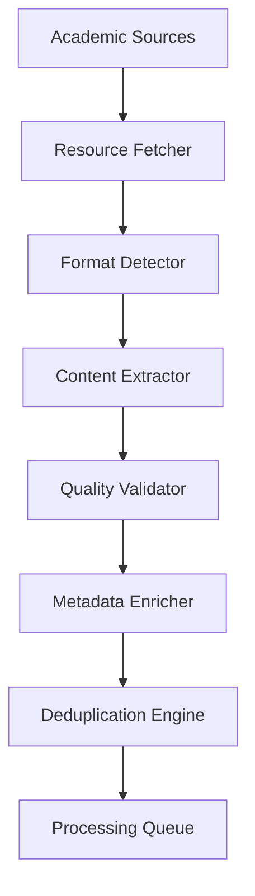
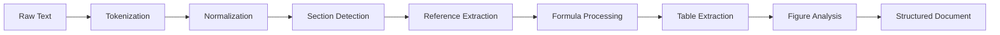
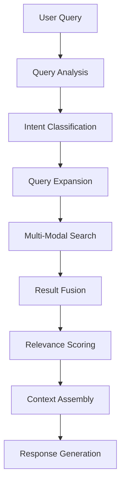

# Data Flow Architecture

The StudyAssistant system implements a sophisticated data flow architecture that manages the ingestion, processing, storage, and retrieval of academic research data. This document provides a comprehensive overview of how data flows through the system from initial collection to final query response.

## Overview

The data flow architecture follows a pipeline pattern with distinct stages:

1. **Data Ingestion** - Collection from various academic sources
2. **Processing Pipeline** - Text extraction, cleaning, and enrichment
3. **Storage Layer** - Structured data persistence and indexing
4. **Retrieval System** - Multi-modal search and ranking
5. **Response Generation** - RAG-based answer synthesis

## Data Ingestion Flow

### Source Integration Pipeline



#### Source Collection

The system collects data from multiple academic sources:

- **ArXiv Papers**: Real-time API polling and bulk downloads
- **PubMed Articles**: Medical research literature via E-utilities
- **Semantic Scholar**: Citation networks and paper metadata
- **Local PDFs**: User-uploaded research documents
- **Web Crawling**: Targeted academic website crawling

#### Content Extraction

Each source type requires specialized extraction:

```python
class ContentExtractor:
    def extract_content(self, source_type: str, raw_data: bytes) -> Document:
        extractors = {
            'pdf': self.pdf_extractor,
            'xml': self.xml_extractor,
            'html': self.html_extractor,
            'bibtex': self.bibtex_extractor
        }
        
        extractor = extractors.get(source_type, self.default_extractor)
        return extractor.process(raw_data)
```

### Quality Assurance Pipeline

Quality validation ensures data integrity:

1. **Format Validation**: Verify document structure and completeness
2. **Content Quality**: Academic relevance scoring
3. **Metadata Completeness**: Required field validation
4. **Duplicate Detection**: Cross-source deduplication
5. **Language Detection**: Multi-language support filtering

## Processing Pipeline

### Text Processing Workflow



#### Document Segmentation

Academic documents are segmented into structured components:

```python
class DocumentSegmenter:
    def segment_document(self, document: Document) -> SegmentedDocument:
        segments = {
            'title': self.extract_title(document),
            'abstract': self.extract_abstract(document),
            'introduction': self.extract_introduction(document),
            'methodology': self.extract_methodology(document),
            'results': self.extract_results(document),
            'discussion': self.extract_discussion(document),
            'conclusion': self.extract_conclusion(document),
            'references': self.extract_references(document)
        }
        
        return SegmentedDocument(**segments)
```

#### Metadata Enrichment

The system enriches documents with additional metadata:

- **Citation Analysis**: Reference parsing and link creation
- **Topic Classification**: Automated subject categorization
- **Author Disambiguation**: Researcher identity resolution
- **Impact Metrics**: Citation count and h-index integration
- **Temporal Analysis**: Publication trends and recency scoring

### Embedding Generation

Vector embeddings are generated for semantic search:

```python
class EmbeddingGenerator:
    def __init__(self):
        self.text_encoder = SentenceTransformer('all-MiniLM-L6-v2')
        self.scientific_encoder = SciBERT()
        
    def generate_embeddings(self, document: Document) -> DocumentEmbeddings:
        return DocumentEmbeddings(
            title_embedding=self.text_encoder.encode(document.title),
            abstract_embedding=self.scientific_encoder.encode(document.abstract),
            content_embeddings=self.chunk_and_embed(document.content),
            metadata_embedding=self.encode_metadata(document.metadata)
        )
```

## Storage Architecture

### Database Schema

The storage layer uses a hybrid approach:

#### Primary Storage (PostgreSQL)

```sql
-- Documents table
CREATE TABLE documents (
    id UUID PRIMARY KEY,
    title TEXT NOT NULL,
    abstract TEXT,
    content TEXT,
    metadata JSONB,
    source_type VARCHAR(50),
    created_at TIMESTAMP WITH TIME ZONE DEFAULT NOW(),
    updated_at TIMESTAMP WITH TIME ZONE DEFAULT NOW()
);

-- Authors table
CREATE TABLE authors (
    id UUID PRIMARY KEY,
    name VARCHAR(255) NOT NULL,
    affiliation TEXT,
    orcid_id VARCHAR(50),
    h_index INTEGER
);

-- Document-Author relationships
CREATE TABLE document_authors (
    document_id UUID REFERENCES documents(id),
    author_id UUID REFERENCES authors(id),
    author_order INTEGER,
    PRIMARY KEY (document_id, author_id)
);
```

#### Vector Storage (Elasticsearch)

```json
{
  "mappings": {
    "properties": {
      "document_id": {"type": "keyword"},
      "title_vector": {
        "type": "dense_vector",
        "dims": 384
      },
      "abstract_vector": {
        "type": "dense_vector",
        "dims": 768
      },
      "content_chunks": {
        "type": "nested",
        "properties": {
          "text": {"type": "text"},
          "vector": {
            "type": "dense_vector",
            "dims": 384
          }
        }
      }
    }
  }
}
```

### Indexing Strategy

Multi-level indexing optimizes retrieval performance:

1. **Full-text Search**: Elasticsearch with academic-specific analyzers
2. **Semantic Search**: Dense vector similarity using FAISS
3. **Metadata Indexing**: Structured queries on PostgreSQL
4. **Citation Network**: Graph database for relationship queries

## Retrieval Flow

### Query Processing Pipeline



#### Query Understanding

The system analyzes user queries to determine search strategy:

```python
class QueryProcessor:
    def process_query(self, query: str) -> ProcessedQuery:
        return ProcessedQuery(
            original_query=query,
            intent=self.classify_intent(query),
            entities=self.extract_entities(query),
            expanded_terms=self.expand_query(query),
            search_filters=self.detect_filters(query),
            complexity_score=self.assess_complexity(query)
        )
```

#### Multi-Modal Retrieval

Different search modalities are combined:

1. **Lexical Search**: BM25 scoring with domain-specific terms
2. **Semantic Search**: Vector similarity using document embeddings
3. **Citation Search**: Reference network traversal
4. **Metadata Search**: Structured field matching
5. **Hybrid Ranking**: Machine learning-based result fusion

### Result Fusion Algorithm

```python
class ResultFusion:
    def fuse_results(self, search_results: Dict[str, List[Document]]) -> List[Document]:
        # Combine results from different search modalities
        combined_scores = {}
        
        for modality, results in search_results.items():
            weight = self.get_modality_weight(modality)
            
            for doc in results:
                doc_id = doc.id
                if doc_id not in combined_scores:
                    combined_scores[doc_id] = {'document': doc, 'score': 0}
                
                combined_scores[doc_id]['score'] += doc.relevance_score * weight
        
        # Sort by combined score
        return sorted(combined_scores.values(), 
                     key=lambda x: x['score'], 
                     reverse=True)
```

## Context Assembly

### Document Chunking Strategy

For RAG processing, documents are intelligently chunked:

```python
class ContextAssembler:
    def assemble_context(self, query: str, documents: List[Document]) -> str:
        context_chunks = []
        token_budget = 4000  # Reserve tokens for query and response
        
        for doc in documents:
            relevant_chunks = self.extract_relevant_chunks(query, doc)
            
            for chunk in relevant_chunks:
                if self.estimate_tokens(context_chunks + [chunk]) < token_budget:
                    context_chunks.append(chunk)
                else:
                    break
        
        return self.format_context(context_chunks)
```

### Context Optimization

Context assembly is optimized for relevance and diversity:

1. **Relevance Ranking**: Chunks scored by query similarity
2. **Diversity Injection**: Prevent redundant information
3. **Source Attribution**: Maintain document provenance
4. **Temporal Ordering**: Recent findings prioritized
5. **Citation Context**: Include surrounding reference context

## Performance Monitoring

### Data Flow Metrics

Key performance indicators track system health:

```python
class DataFlowMonitor:
    def track_ingestion_metrics(self):
        return {
            'documents_processed_per_hour': self.get_processing_rate(),
            'processing_latency_p95': self.get_latency_percentile(95),
            'quality_score_average': self.get_average_quality(),
            'duplicate_detection_rate': self.get_deduplication_rate(),
            'storage_utilization': self.get_storage_usage()
        }
    
    def track_retrieval_metrics(self):
        return {
            'query_latency_p95': self.get_query_latency_percentile(95),
            'search_accuracy': self.get_search_accuracy(),
            'result_relevance_score': self.get_relevance_metrics(),
            'context_assembly_time': self.get_context_timing(),
            'cache_hit_rate': self.get_cache_performance()
        }
```

## Scalability Considerations

### Horizontal Scaling

The architecture supports horizontal scaling:

1. **Microservices**: Independent scaling of components
2. **Load Balancing**: Request distribution across instances
3. **Database Sharding**: Partition data across multiple databases
4. **Caching Layers**: Redis for frequently accessed data
5. **Async Processing**: Queue-based background processing

### Data Partitioning

Large datasets are partitioned for performance:

```python
class DataPartitioner:
    def partition_documents(self, documents: List[Document]) -> Dict[str, List[Document]]:
        partitions = {
            'recent': [],      # Last 2 years
            'classic': [],     # 2-10 years old
            'archive': []      # Older than 10 years
        }
        
        for doc in documents:
            age = self.calculate_document_age(doc)
            if age <= 2:
                partitions['recent'].append(doc)
            elif age <= 10:
                partitions['classic'].append(doc)
            else:
                partitions['archive'].append(doc)
        
        return partitions
```

## Error Handling and Recovery

### Data Integrity

Robust error handling ensures data consistency:

1. **Transaction Management**: ACID compliance for critical operations
2. **Checkpointing**: Regular state snapshots for recovery
3. **Dead Letter Queues**: Failed processing job handling
4. **Data Validation**: Continuous integrity checks
5. **Backup Strategies**: Regular data backups and versioning

### Fault Tolerance

The system implements multiple fault tolerance mechanisms:

```python
class FaultTolerantProcessor:
    def process_with_retry(self, operation: Callable, max_retries: int = 3):
        for attempt in range(max_retries):
            try:
                return operation()
            except Exception as e:
                if attempt == max_retries - 1:
                    self.handle_permanent_failure(operation, e)
                    raise
                else:
                    self.handle_transient_failure(operation, e, attempt)
                    time.sleep(2 ** attempt)  # Exponential backoff
```

## Security and Privacy

### Data Protection

Security measures protect sensitive academic data:

1. **Encryption**: At-rest and in-transit data encryption
2. **Access Control**: Role-based permissions
3. **Audit Logging**: Comprehensive operation tracking
4. **Data Anonymization**: PII removal from public datasets
5. **Compliance**: GDPR and academic ethics adherence

This data flow architecture ensures reliable, scalable, and secure processing of academic research data while maintaining high performance and accuracy in information retrieval and generation.
