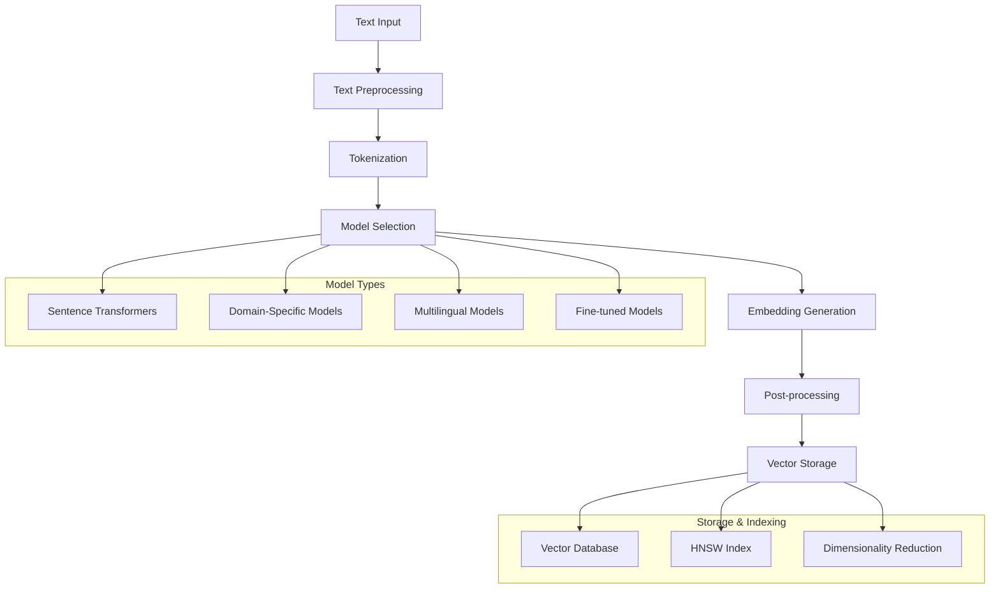

# Embeddings and Vector Representations

StudyAssistant uses advanced embedding techniques to create high-quality vector representations of academic content, enabling semantic search and similarity analysis across research documents.

## Embedding Architecture Overview



## Core Components

### 1. Embedding Model Manager

Manages multiple embedding models optimized for different content types and use cases.

```python
class EmbeddingModelManager:
    def __init__(self):
        self.models = {
            'general': SentenceTransformer('all-MiniLM-L6-v2'),
            'scientific': SentenceTransformer('allenai/specter'),
            'multilingual': SentenceTransformer('paraphrase-multilingual-MiniLM-L12-v2'),
            'long_documents': SentenceTransformer('sentence-transformers/all-mpnet-base-v2'),
            'biomedical': SentenceTransformer('microsoft/BiomedNLP-PubMedBERT-base-uncased-abstract')
        }
        self.model_cache = {}
        self.default_model = 'general'
    
    def get_model(self, model_type: str = None, domain: str = None) -> SentenceTransformer:
        """Get appropriate embedding model based on content type and domain"""
        
        # Domain-specific model selection
        if domain:
            if domain in ['biology', 'medicine', 'chemistry']:
                model_key = 'biomedical'
            elif domain in ['physics', 'computer_science', 'mathematics']:
                model_key = 'scientific'
            else:
                model_key = 'general'
        else:
            model_key = model_type or self.default_model
        
        return self.models.get(model_key, self.models[self.default_model])
    
    def load_custom_model(self, model_path: str, model_name: str):
        """Load custom fine-tuned model"""
        try:
            custom_model = SentenceTransformer(model_path)
            self.models[model_name] = custom_model
            logger.info(f"Loaded custom model: {model_name}")
        except Exception as e:
            logger.error(f"Failed to load custom model {model_name}: {e}")
            raise ModelLoadError(f"Cannot load model from {model_path}")
```

### 2. Text Chunk Embedding Generator

Generates embeddings for text chunks with optimization for academic content.

```python
class ChunkEmbeddingGenerator:
    def __init__(self, model_manager: EmbeddingModelManager):
        self.model_manager = model_manager
        self.batch_size = 32
        self.max_sequence_length = 512
        
    async def generate_embeddings(self, 
                                chunks: List[TextChunk], 
                                model_type: str = 'general') -> List[Embedding]:
        """Generate embeddings for text chunks with batching"""
        
        model = self.model_manager.get_model(model_type, chunks[0].domain if chunks else None)
        embeddings = []
        
        # Process in batches for memory efficiency
        for i in range(0, len(chunks), self.batch_size):
            batch_chunks = chunks[i:i + self.batch_size]
            batch_texts = [self.prepare_text_for_embedding(chunk) for chunk in batch_chunks]
            
            # Generate batch embeddings
            batch_embeddings = model.encode(
                batch_texts,
                batch_size=len(batch_texts),
                show_progress_bar=False,
                convert_to_numpy=True
            )
            
            # Create embedding objects
            for j, embedding_vector in enumerate(batch_embeddings):
                chunk = batch_chunks[j]
                embedding = Embedding(
                    chunk_id=chunk.id,
                    vector=embedding_vector,
                    model_type=model_type,
                    dimensions=len(embedding_vector),
                    metadata={
                        'text_length': len(chunk.text),
                        'domain': chunk.domain,
                        'document_id': chunk.document_id
                    }
                )
                embeddings.append(embedding)
        
        return embeddings
    
    def prepare_text_for_embedding(self, chunk: TextChunk) -> str:
        """Prepare text chunk for optimal embedding generation"""
        text = chunk.text
        
        # Truncate if too long
        if len(text) > self.max_sequence_length * 4:  # Rough token estimate
            text = text[:self.max_sequence_length * 4]
        
        # Add context from metadata for better embeddings
        if chunk.metadata.get('title'):
            text = f"Title: {chunk.metadata['title']}\n\n{text}"
        
        if chunk.metadata.get('abstract'):
            text = f"Abstract: {chunk.metadata['abstract'][:200]}...\n\n{text}"
        
        return text
```

### 3. Document-Level Embedding System

Creates document-level embeddings by aggregating chunk embeddings.

```python
class DocumentEmbeddingSystem:
    def __init__(self, chunk_generator: ChunkEmbeddingGenerator):
        self.chunk_generator = chunk_generator
        self.aggregation_strategies = {
            'mean': self.mean_aggregation,
            'weighted_mean': self.weighted_mean_aggregation,
            'attention_pooling': self.attention_pooling,
            'hierarchical': self.hierarchical_aggregation
        }
    
    async def generate_document_embedding(self, 
                                        document: ProcessedDocument,
                                        strategy: str = 'weighted_mean') -> DocumentEmbedding:
        """Generate document-level embedding from chunks"""
        
        # Generate chunk embeddings
        chunk_embeddings = await self.chunk_generator.generate_embeddings(
            document.chunks, 
            model_type=self.select_model_for_document(document)
        )
        
        # Aggregate chunk embeddings
        aggregation_func = self.aggregation_strategies.get(strategy, self.weighted_mean_aggregation)
        document_vector = aggregation_func(chunk_embeddings, document)
        
        return DocumentEmbedding(
            document_id=document.id,
            vector=document_vector,
            chunk_embeddings=chunk_embeddings,
            aggregation_strategy=strategy,
            metadata={
                'num_chunks': len(chunk_embeddings),
                'document_length': len(document.content),
                'domain': document.metadata.domain
            }
        )
    
    def weighted_mean_aggregation(self, 
                                chunk_embeddings: List[Embedding], 
                                document: ProcessedDocument) -> np.ndarray:
        """Weight chunks by importance for aggregation"""
        vectors = np.array([emb.vector for emb in chunk_embeddings])
        
        # Calculate weights based on chunk importance
        weights = []
        for i, chunk in enumerate(document.chunks):
            weight = self.calculate_chunk_importance(chunk, document)
            weights.append(weight)
        
        weights = np.array(weights)
        weights = weights / np.sum(weights)  # Normalize
        
        # Weighted average
        weighted_vector = np.average(vectors, axis=0, weights=weights)
        return weighted_vector
    
    def calculate_chunk_importance(self, chunk: TextChunk, document: ProcessedDocument) -> float:
        """Calculate importance weight for a chunk"""
        importance = 1.0
        
        # Title/abstract chunks are more important
        if 'title' in chunk.metadata.get('section', '').lower():
            importance *= 2.0
        elif 'abstract' in chunk.metadata.get('section', '').lower():
            importance *= 1.8
        elif 'introduction' in chunk.metadata.get('section', '').lower():
            importance *= 1.5
        elif 'conclusion' in chunk.metadata.get('section', '').lower():
            importance *= 1.3
        
        # Chunks with entities are more important
        if chunk.entities:
            importance *= (1 + 0.1 * len(chunk.entities))
        
        # Adjust for chunk length
        if len(chunk.text) < 50:  # Very short chunks
            importance *= 0.5
        elif len(chunk.text) > 1000:  # Very long chunks
            importance *= 0.8
        
        return importance
    
    def attention_pooling(self, 
                        chunk_embeddings: List[Embedding], 
                        document: ProcessedDocument) -> np.ndarray:
        """Use attention mechanism for aggregation"""
        vectors = np.array([emb.vector for emb in chunk_embeddings])
        
        # Simple attention mechanism
        # Query vector is the mean of all chunk vectors
        query = np.mean(vectors, axis=0)
        
        # Calculate attention scores
        attention_scores = np.dot(vectors, query)
        attention_weights = softmax(attention_scores)
        
        # Weighted sum
        attended_vector = np.sum(vectors * attention_weights.reshape(-1, 1), axis=0)
        return attended_vector
```

### 4. Similarity Search Engine

Efficient similarity search using vector indices.

```python
class VectorSimilaritySearch:
    def __init__(self, index_config: IndexConfig):
        self.index_type = index_config.type
        self.index = self.initialize_index(index_config)
        self.similarity_metric = index_config.metric
        
    def initialize_index(self, config: IndexConfig) -> VectorIndex:
        """Initialize vector index based on configuration"""
        if config.type == 'faiss':
            return self.initialize_faiss_index(config)
        elif config.type == 'pinecone':
            return self.initialize_pinecone_index(config)
        elif config.type == 'weaviate':
            return self.initialize_weaviate_index(config)
        else:
            raise UnsupportedIndexError(f"Index type {config.type} not supported")
    
    async def search_similar(self, 
                           query_embedding: np.ndarray, 
                           top_k: int = 100,
                           filters: Dict = None) -> List[SimilarityResult]:
        """Search for similar vectors"""
        
        try:
            # Normalize query vector if using cosine similarity
            if self.similarity_metric == 'cosine':
                query_embedding = query_embedding / np.linalg.norm(query_embedding)
            
            # Execute search
            if self.index_type == 'faiss':
                results = await self.faiss_search(query_embedding, top_k, filters)
            elif self.index_type == 'pinecone':
                results = await self.pinecone_search(query_embedding, top_k, filters)
            else:
                results = await self.generic_search(query_embedding, top_k, filters)
            
            return results
            
        except Exception as e:
            logger.error(f"Similarity search failed: {e}")
            raise SearchException(f"Vector search error: {e}")
    
    async def faiss_search(self, 
                         query_vector: np.ndarray, 
                         top_k: int,
                         filters: Dict = None) -> List[SimilarityResult]:
        """FAISS-specific search implementation"""
        
        # Reshape for FAISS
        query_vector = query_vector.reshape(1, -1).astype(np.float32)
        
        # Search
        distances, indices = self.index.search(query_vector, top_k)
        
        # Convert to results
        results = []
        for i, (distance, idx) in enumerate(zip(distances[0], indices[0])):
            if idx != -1:  # Valid result
                similarity_score = self.distance_to_similarity(distance)
                result = SimilarityResult(
                    index=idx,
                    similarity_score=similarity_score,
                    distance=distance,
                    metadata=self.get_metadata_for_index(idx)
                )
                results.append(result)
        
        return results
    
    def distance_to_similarity(self, distance: float) -> float:
        """Convert distance to similarity score [0, 1]"""
        if self.similarity_metric == 'cosine':
            return 1.0 - distance  # Cosine distance to similarity
        elif self.similarity_metric == 'euclidean':
            return 1.0 / (1.0 + distance)  # Euclidean distance to similarity
        else:
            return max(0.0, 1.0 - distance)
```

### 5. Embedding Quality Assessment

Evaluates and monitors embedding quality.

```python
class EmbeddingQualityAssessor:
    def __init__(self):
        self.quality_metrics = {
            'coherence': self.calculate_coherence,
            'discriminability': self.calculate_discriminability,
            'stability': self.calculate_stability
        }
    
    def assess_embedding_quality(self, 
                               embeddings: List[Embedding],
                               ground_truth: Dict = None) -> QualityAssessment:
        """Comprehensive embedding quality assessment"""
        
        # Extract vectors
        vectors = np.array([emb.vector for emb in embeddings])
        
        # Calculate intrinsic quality metrics
        coherence_score = self.calculate_coherence(vectors)
        discriminability_score = self.calculate_discriminability(vectors, embeddings)
        stability_score = self.calculate_stability(vectors)
        
        # Calculate extrinsic metrics if ground truth available
        extrinsic_scores = {}
        if ground_truth:
            extrinsic_scores = self.calculate_extrinsic_metrics(embeddings, ground_truth)
        
        overall_score = self.calculate_overall_quality_score(
            coherence_score,
            discriminability_score,
            stability_score,
            extrinsic_scores
        )
        
        return QualityAssessment(
            overall_score=overall_score,
            coherence=coherence_score,
            discriminability=discriminability_score,
            stability=stability_score,
            extrinsic_metrics=extrinsic_scores
        )
    
    def calculate_coherence(self, vectors: np.ndarray) -> float:
        """Calculate embedding space coherence"""
        # Calculate pairwise similarities
        similarities = cosine_similarity(vectors)
        
        # Remove diagonal (self-similarities)
        mask = ~np.eye(similarities.shape[0], dtype=bool)
        similarities_flat = similarities[mask]
        
        # Coherence is inverse of similarity variance
        coherence = 1.0 / (1.0 + np.var(similarities_flat))
        return coherence
    
    def calculate_discriminability(self, 
                                 vectors: np.ndarray, 
                                 embeddings: List[Embedding]) -> float:
        """Calculate ability to discriminate between different content"""
        
        # Group embeddings by domain/document
        domain_groups = defaultdict(list)
        for i, emb in enumerate(embeddings):
            domain = emb.metadata.get('domain', 'unknown')
            domain_groups[domain].append(vectors[i])
        
        if len(domain_groups) < 2:
            return 0.5  # Cannot assess discriminability
        
        # Calculate inter-domain vs intra-domain similarities
        intra_similarities = []
        inter_similarities = []
        
        for domain, domain_vectors in domain_groups.items():
            if len(domain_vectors) > 1:
                domain_vectors = np.array(domain_vectors)
                domain_sims = cosine_similarity(domain_vectors)
                mask = ~np.eye(domain_sims.shape[0], dtype=bool)
                intra_similarities.extend(domain_sims[mask])
        
        # Inter-domain similarities
        domains = list(domain_groups.keys())
        for i in range(len(domains)):
            for j in range(i + 1, len(domains)):
                vectors1 = np.array(domain_groups[domains[i]])
                vectors2 = np.array(domain_groups[domains[j]])
                inter_sims = cosine_similarity(vectors1, vectors2)
                inter_similarities.extend(inter_sims.flatten())
        
        # Discriminability = difference between intra and inter similarities
        if intra_similarities and inter_similarities:
            intra_mean = np.mean(intra_similarities)
            inter_mean = np.mean(inter_similarities)
            discriminability = max(0.0, intra_mean - inter_mean)
        else:
            discriminability = 0.5
        
        return discriminability
```

### 6. Model Fine-tuning System

Fine-tune embedding models for domain-specific content.

```python
class EmbeddingFineTuner:
    def __init__(self, base_model: str):
        self.base_model = SentenceTransformer(base_model)
        self.training_config = TrainingConfig()
        
    def fine_tune_on_domain(self, 
                          training_data: List[TrainingExample],
                          domain: str,
                          output_path: str) -> FineTuningResult:
        """Fine-tune model on domain-specific data"""
        
        # Prepare training data
        train_examples = self.prepare_training_examples(training_data)
        
        # Create data loader
        train_dataloader = DataLoader(train_examples, shuffle=True, batch_size=16)
        
        # Define training objective (e.g., MultipleNegativesRankingLoss)
        train_loss = losses.MultipleNegativesRankingLoss(self.base_model)
        
        # Training
        self.base_model.fit(
            train_objectives=[(train_dataloader, train_loss)],
            epochs=self.training_config.epochs,
            warmup_steps=self.training_config.warmup_steps,
            output_path=output_path,
            checkpoint_path=f"{output_path}/checkpoints",
            show_progress_bar=True
        )
        
        # Evaluate fine-tuned model
        evaluation_results = self.evaluate_fine_tuned_model(
            output_path, 
            training_data
        )
        
        return FineTuningResult(
            model_path=output_path,
            training_loss=evaluation_results['training_loss'],
            validation_metrics=evaluation_results['validation_metrics'],
            domain=domain
        )
    
    def prepare_training_examples(self, data: List[TrainingExample]) -> List[InputExample]:
        """Convert training data to SentenceTransformers format"""
        examples = []
        
        for item in data:
            # Create positive pairs
            if item.positive_pairs:
                for pos_pair in item.positive_pairs:
                    examples.append(InputExample(
                        texts=[item.query, pos_pair],
                        label=1.0
                    ))
            
            # Create negative pairs
            if item.negative_pairs:
                for neg_pair in item.negative_pairs:
                    examples.append(InputExample(
                        texts=[item.query, neg_pair],
                        label=0.0
                    ))
        
        return examples
```

## Performance Optimization

### Batch Processing and Caching
```python
class EmbeddingCache:
    def __init__(self, cache_backend: CacheBackend):
        self.cache = cache_backend
        self.cache_ttl = 3600  # 1 hour
    
    async def get_cached_embedding(self, text_hash: str, model_type: str) -> Optional[np.ndarray]:
        """Retrieve cached embedding"""
        cache_key = f"embedding:{model_type}:{text_hash}"
        cached_data = await self.cache.get(cache_key)
        if cached_data:
            return np.frombuffer(cached_data, dtype=np.float32)
        return None
    
    async def cache_embedding(self, text_hash: str, model_type: str, embedding: np.ndarray):
        """Cache embedding vector"""
        cache_key = f"embedding:{model_type}:{text_hash}"
        embedding_bytes = embedding.astype(np.float32).tobytes()
        await self.cache.set(cache_key, embedding_bytes, ttl=self.cache_ttl)
```

## Configuration

```yaml
embeddings:
  models:
    general:
      name: "all-MiniLM-L6-v2"
      dimensions: 384
      max_sequence_length: 512
    
    scientific:
      name: "allenai/specter"
      dimensions: 768
      max_sequence_length: 512
    
    biomedical:
      name: "microsoft/BiomedNLP-PubMedBERT-base-uncased-abstract"
      dimensions: 768
      max_sequence_length: 512
  
  processing:
    batch_size: 32
    cache_embeddings: true
    cache_ttl: 3600
    
  similarity_search:
    index_type: "faiss"
    similarity_metric: "cosine"
    dimension: 384
    
  quality_assessment:
    enabled: true
    coherence_threshold: 0.7
    discriminability_threshold: 0.5
```

## Monitoring and Metrics

```python
class EmbeddingMetrics:
    def __init__(self):
        self.metrics = {
            'embedding_generation_time': Histogram(),
            'embedding_quality_score': Gauge(),
            'cache_hit_rate': Gauge(),
            'similarity_search_latency': Histogram()
        }
    
    def record_embedding_generation(self, duration: float, batch_size: int):
        """Record embedding generation metrics"""
        self.metrics['embedding_generation_time'].observe(duration)
    
    def record_quality_score(self, score: float):
        """Record embedding quality score"""
        self.metrics['embedding_quality_score'].set(score)
```

## Next Steps

- [Search Engine Integration →](../components/search-engine.md)
- [Vector Database Setup →](../components/data-management.md)
- [Performance Optimization →](../../development/performance.md)
