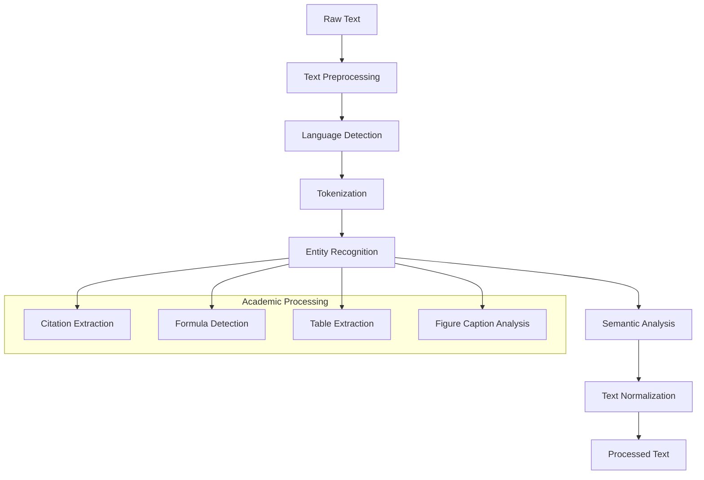

# Text Processing Pipeline

StudyAssistant's NLP pipeline provides sophisticated text processing capabilities for academic content, including preprocessing, entity extraction, and semantic analysis optimized for research documents.

## Processing Pipeline Overview



## Core Components

### 1. Text Preprocessor

Handles cleaning and normalization of academic text with specialized processing for research documents.

```python
class AcademicTextPreprocessor:
    def __init__(self):
        self.citation_patterns = self.load_citation_patterns()
        self.formula_detector = FormulaDetector()
        self.encoding_fixer = TextEncodingFixer()
    
    def preprocess(self, raw_text: str, document_type: str = "academic") -> PreprocessedText:
        """Comprehensive text preprocessing for academic content"""
        
        # Fix encoding issues
        text = self.encoding_fixer.fix_encoding(raw_text)
        
        # Clean academic-specific artifacts
        text = self.clean_academic_artifacts(text)
        
        # Handle citations specially (preserve structure)
        citations, text = self.extract_and_mark_citations(text)
        
        # Detect and preserve mathematical formulas
        formulas, text = self.formula_detector.extract_formulas(text)
        
        # Normalize whitespace and formatting
        text = self.normalize_formatting(text)
        
        # Clean up common PDF artifacts
        text = self.fix_pdf_artifacts(text)
        
        return PreprocessedText(
            text=text,
            citations=citations,
            formulas=formulas,
            metadata={
                'original_length': len(raw_text),
                'processed_length': len(text),
                'document_type': document_type
            }
        )
    
    def clean_academic_artifacts(self, text: str) -> str:
        """Remove common academic document artifacts"""
        # Remove page numbers
        text = re.sub(r'\n\s*\d+\s*\n', '\n', text)
        
        # Remove headers/footers
        text = re.sub(r'\n[A-Z\s]{5,}\n', '\n', text)
        
        # Clean up figure/table references
        text = re.sub(r'(Figure|Table|Fig\.)\s+\d+[^\n]*\n', '', text)
        
        # Remove excessive dots (from table of contents)
        text = re.sub(r'\.{3,}', ' ', text)
        
        return text
    
    def extract_and_mark_citations(self, text: str) -> Tuple[List[Citation], str]:
        """Extract citations while preserving text flow"""
        citations = []
        citation_id = 0
        
        def replace_citation(match):
            nonlocal citation_id
            citation_text = match.group(0)
            citation = Citation(
                id=citation_id,
                text=citation_text,
                type=self.classify_citation(citation_text)
            )
            citations.append(citation)
            placeholder = f"[CITATION_{citation_id}]"
            citation_id += 1
            return placeholder
        
        # Replace various citation formats
        for pattern in self.citation_patterns:
            text = re.sub(pattern, replace_citation, text)
        
        return citations, text
```

### 2. Language Detection and Processing

Advanced language detection with confidence scoring and multi-language support.

```python
class LanguageProcessor:
    def __init__(self):
        self.detector = LanguageDetector()
        self.language_models = {
            'en': spacy.load('en_core_web_sm'),
            'de': spacy.load('de_core_news_sm'),
            'fr': spacy.load('fr_core_news_sm'),
            'es': spacy.load('es_core_news_sm')
        }
    
    def detect_and_process(self, text: str) -> LanguageProcessingResult:
        """Detect language and apply appropriate processing"""
        
        # Detect primary language
        detection_result = self.detector.detect(text)
        primary_lang = detection_result.language
        confidence = detection_result.confidence
        
        # Handle low confidence or mixed languages
        if confidence < 0.8:
            lang_segments = self.detect_language_segments(text)
            return self.process_multilingual(text, lang_segments)
        
        # Process with appropriate language model
        nlp = self.language_models.get(primary_lang, self.language_models['en'])
        doc = nlp(text)
        
        return LanguageProcessingResult(
            primary_language=primary_lang,
            confidence=confidence,
            processed_doc=doc,
            segments=[]
        )
    
    def detect_language_segments(self, text: str) -> List[LanguageSegment]:
        """Detect language changes within text"""
        segments = []
        sentences = sent_tokenize(text)
        
        current_lang = None
        current_text = []
        
        for sentence in sentences:
            sent_lang = self.detector.detect(sentence).language
            
            if sent_lang != current_lang:
                if current_text:
                    segments.append(LanguageSegment(
                        language=current_lang,
                        text=' '.join(current_text)
                    ))
                current_lang = sent_lang
                current_text = [sentence]
            else:
                current_text.append(sentence)
        
        # Add final segment
        if current_text:
            segments.append(LanguageSegment(
                language=current_lang,
                text=' '.join(current_text)
            ))
        
        return segments
```

### 3. Academic Entity Recognition

Specialized named entity recognition for academic content.

```python
class AcademicEntityRecognizer:
    def __init__(self):
        self.base_ner = spacy.load("en_core_web_sm")
        self.academic_patterns = self.load_academic_patterns()
        self.author_detector = AuthorDetector()
        self.institution_detector = InstitutionDetector()
        self.concept_extractor = ConceptExtractor()
    
    def extract_entities(self, text: str) -> AcademicEntities:
        """Extract academic-specific entities"""
        
        # Standard NER
        doc = self.base_ner(text)
        standard_entities = [(ent.text, ent.label_) for ent in doc.ents]
        
        # Academic-specific entity extraction
        authors = self.author_detector.extract_authors(text)
        institutions = self.institution_detector.extract_institutions(text)
        concepts = self.concept_extractor.extract_concepts(text)
        methodologies = self.extract_methodologies(text)
        datasets = self.extract_datasets(text)
        
        return AcademicEntities(
            standard_entities=standard_entities,
            authors=authors,
            institutions=institutions,
            concepts=concepts,
            methodologies=methodologies,
            datasets=datasets
        )
    
    def extract_methodologies(self, text: str) -> List[Methodology]:
        """Extract research methodologies and techniques"""
        methodologies = []
        
        # Pattern-based extraction
        method_patterns = [
            r'(?i)(machine learning|deep learning|neural network|random forest)',
            r'(?i)(regression analysis|correlation analysis|statistical analysis)',
            r'(?i)(qualitative analysis|quantitative analysis|mixed methods)',
            r'(?i)(survey|interview|experiment|case study|meta-analysis)'
        ]
        
        for pattern in method_patterns:
            matches = re.finditer(pattern, text)
            for match in matches:
                methodology = Methodology(
                    name=match.group(1),
                    context=self.extract_context(text, match.span()),
                    confidence=0.8
                )
                methodologies.append(methodology)
        
        return methodologies
    
    def extract_datasets(self, text: str) -> List[Dataset]:
        """Extract dataset references"""
        datasets = []
        
        # Common dataset patterns
        dataset_patterns = [
            r'(?i)(ImageNet|CIFAR-\d+|MNIST|CoNLL|WikiText)',
            r'(?i)(\w+\s+dataset|\w+\s+corpus|\w+\s+benchmark)',
            r'(?i)(dataset\s+of\s+[^.]+|corpus\s+of\s+[^.]+)'
        ]
        
        for pattern in dataset_patterns:
            matches = re.finditer(pattern, text)
            for match in matches:
                dataset = Dataset(
                    name=match.group(0),
                    context=self.extract_context(text, match.span()),
                    type=self.classify_dataset_type(match.group(0))
                )
                datasets.append(dataset)
        
        return datasets
```

### 4. Semantic Analysis Engine

Advanced semantic understanding for research content.

```python
class SemanticAnalyzer:
    def __init__(self):
        self.sentence_transformer = SentenceTransformer('all-MiniLM-L6-v2')
        self.topic_model = TopicModel()
        self.sentiment_analyzer = SentimentAnalyzer()
        self.coherence_analyzer = CoherenceAnalyzer()
    
    def analyze_semantics(self, text: str, entities: AcademicEntities) -> SemanticAnalysis:
        """Comprehensive semantic analysis of academic text"""
        
        # Generate sentence embeddings
        sentences = sent_tokenize(text)
        sentence_embeddings = self.sentence_transformer.encode(sentences)
        
        # Topic modeling
        topics = self.topic_model.extract_topics(text, num_topics=5)
        
        # Sentiment analysis (adapted for academic content)
        sentiment = self.sentiment_analyzer.analyze_academic_sentiment(text)
        
        # Text coherence analysis
        coherence_score = self.coherence_analyzer.calculate_coherence(sentences)
        
        # Concept relationship analysis
        concept_graph = self.build_concept_graph(entities.concepts, text)
        
        # Research contribution analysis
        contributions = self.extract_contributions(text)
        
        return SemanticAnalysis(
            sentence_embeddings=sentence_embeddings,
            topics=topics,
            sentiment=sentiment,
            coherence_score=coherence_score,
            concept_graph=concept_graph,
            contributions=contributions
        )
    
    def extract_contributions(self, text: str) -> List[ResearchContribution]:
        """Extract research contributions and claims"""
        contributions = []
        
        # Pattern-based contribution detection
        contribution_patterns = [
            r'(?i)(we propose|we introduce|we present|we develop)',
            r'(?i)(our contribution|our approach|our method|our findings)',
            r'(?i)(we show that|we demonstrate that|we prove that)',
            r'(?i)(in this paper, we|this work presents|this study shows)'
        ]
        
        sentences = sent_tokenize(text)
        
        for sentence in sentences:
            for pattern in contribution_patterns:
                if re.search(pattern, sentence):
                    contribution = ResearchContribution(
                        text=sentence,
                        type=self.classify_contribution_type(sentence),
                        confidence=self.calculate_contribution_confidence(sentence)
                    )
                    contributions.append(contribution)
                    break
        
        return contributions
    
    def build_concept_graph(self, concepts: List[Concept], text: str) -> ConceptGraph:
        """Build graph of concept relationships"""
        graph = ConceptGraph()
        
        # Add concepts as nodes
        for concept in concepts:
            graph.add_node(concept.name, attributes=concept.attributes)
        
        # Find relationships between concepts
        for i, concept1 in enumerate(concepts):
            for j, concept2 in enumerate(concepts[i+1:], i+1):
                relationship = self.find_concept_relationship(concept1, concept2, text)
                if relationship:
                    graph.add_edge(concept1.name, concept2.name, relationship=relationship)
        
        return graph
```

### 5. Text Normalization and Quality Assessment

Ensures high-quality processed text suitable for downstream tasks.

```python
class TextQualityAssessor:
    def __init__(self):
        self.readability_analyzer = ReadabilityAnalyzer()
        self.completeness_checker = CompletenessChecker()
        self.quality_metrics = QualityMetrics()
    
    def assess_quality(self, processed_text: PreprocessedText) -> QualityAssessment:
        """Comprehensive text quality assessment"""
        
        # Readability analysis
        readability_scores = self.readability_analyzer.analyze(processed_text.text)
        
        # Completeness check
        completeness_score = self.completeness_checker.check(processed_text)
        
        # Technical quality metrics
        quality_metrics = self.quality_metrics.calculate(processed_text)
        
        # Overall quality score
        overall_score = self.calculate_overall_quality(
            readability_scores,
            completeness_score,
            quality_metrics
        )
        
        return QualityAssessment(
            overall_score=overall_score,
            readability=readability_scores,
            completeness=completeness_score,
            technical_metrics=quality_metrics,
            recommendations=self.generate_recommendations(overall_score)
        )
    
    def calculate_overall_quality(self, 
                                readability: ReadabilityScores,
                                completeness: float,
                                technical: TechnicalMetrics) -> float:
        """Calculate weighted overall quality score"""
        weights = {
            'readability': 0.3,
            'completeness': 0.4,
            'technical': 0.3
        }
        
        readability_score = (readability.flesch_kincaid + readability.gunning_fog) / 2
        technical_score = (technical.coherence + technical.informativeness) / 2
        
        overall = (
            weights['readability'] * readability_score +
            weights['completeness'] * completeness +
            weights['technical'] * technical_score
        )
        
        return min(max(overall, 0.0), 1.0)  # Clamp to [0, 1]
```

### 6. Specialized Academic Processors

Additional processors for specific academic content types.

```python
class CitationProcessor:
    def __init__(self):
        self.citation_styles = ['apa', 'mla', 'chicago', 'ieee']
        self.parsers = {style: self.load_parser(style) for style in self.citation_styles}
    
    def process_citations(self, citations: List[Citation]) -> List[ParsedCitation]:
        """Parse and normalize citations"""
        parsed_citations = []
        
        for citation in citations:
            # Detect citation style
            style = self.detect_citation_style(citation.text)
            
            # Parse with appropriate parser
            parser = self.parsers.get(style, self.parsers['apa'])
            parsed = parser.parse(citation.text)
            
            # Normalize and validate
            normalized = self.normalize_citation(parsed)
            
            parsed_citations.append(ParsedCitation(
                original=citation,
                parsed=parsed,
                normalized=normalized,
                style=style
            ))
        
        return parsed_citations

class FormulaProcessor:
    def __init__(self):
        self.latex_parser = LatexParser()
        self.mathml_converter = MathMLConverter()
    
    def process_formulas(self, formulas: List[Formula]) -> List[ProcessedFormula]:
        """Process mathematical formulas and equations"""
        processed_formulas = []
        
        for formula in formulas:
            try:
                # Parse LaTeX notation
                parsed_latex = self.latex_parser.parse(formula.text)
                
                # Convert to MathML for standardization
                mathml = self.mathml_converter.convert(parsed_latex)
                
                # Extract mathematical concepts
                concepts = self.extract_math_concepts(parsed_latex)
                
                processed_formulas.append(ProcessedFormula(
                    original=formula,
                    latex=parsed_latex,
                    mathml=mathml,
                    concepts=concepts
                ))
                
            except Exception as e:
                logger.warning(f"Failed to process formula: {formula.text[:50]}... Error: {e}")
                # Add unprocessed formula
                processed_formulas.append(ProcessedFormula(
                    original=formula,
                    latex=None,
                    mathml=None,
                    concepts=[]
                ))
        
        return processed_formulas
```

## Performance Optimization

### Batch Processing
```python
class BatchProcessor:
    def __init__(self, batch_size: int = 32):
        self.batch_size = batch_size
        self.processor_pool = ProcessorPool()
    
    async def process_batch(self, texts: List[str]) -> List[ProcessedText]:
        """Process multiple texts in parallel"""
        tasks = []
        
        for i in range(0, len(texts), self.batch_size):
            batch = texts[i:i + self.batch_size]
            task = self.processor_pool.submit(self.process_text_batch, batch)
            tasks.append(task)
        
        results = await asyncio.gather(*tasks)
        return [item for sublist in results for item in sublist]
```

### Caching Strategy
```python
class ProcessingCache:
    def __init__(self, cache_backend: CacheBackend):
        self.cache = cache_backend
        self.ttl = {
            'entity_extraction': 3600,  # 1 hour
            'semantic_analysis': 1800,  # 30 minutes
            'text_preprocessing': 7200  # 2 hours
        }
    
    async def get_cached_result(self, text_hash: str, operation: str) -> Optional[Any]:
        """Retrieve cached processing result"""
        cache_key = f"{operation}:{text_hash}"
        return await self.cache.get(cache_key)
    
    async def cache_result(self, text_hash: str, operation: str, result: Any):
        """Cache processing result"""
        cache_key = f"{operation}:{text_hash}"
        ttl = self.ttl.get(operation, 1800)
        await self.cache.set(cache_key, result, ttl=ttl)
```

## Configuration

```yaml
nlp_processing:
  preprocessing:
    language_detection_threshold: 0.8
    max_text_length: 1000000
    preserve_formatting: true
    
  entity_recognition:
    confidence_threshold: 0.7
    academic_entities: true
    custom_patterns: true
    
  semantic_analysis:
    embedding_model: "all-MiniLM-L6-v2"
    topic_modeling: true
    coherence_analysis: true
    
  performance:
    batch_size: 32
    cache_ttl: 1800
    max_concurrent_processes: 4
```

## Quality Metrics and Monitoring

```python
class NLPMetrics:
    def __init__(self):
        self.metrics = {
            'processing_time': Histogram(),
            'quality_scores': Histogram(),
            'entity_extraction_accuracy': Gauge(),
            'error_rate': Counter()
        }
    
    def record_processing_metrics(self, 
                                processing_time: float,
                                quality_score: float,
                                text_length: int):
        """Record processing performance metrics"""
        self.metrics['processing_time'].observe(processing_time)
        self.metrics['quality_scores'].observe(quality_score)
```

## Next Steps

- [Embeddings and Vectors →](./embeddings.md)
- [Search Engine Integration →](../components/search-engine.md)
- [API Documentation →](../../api/core-apis.md)
