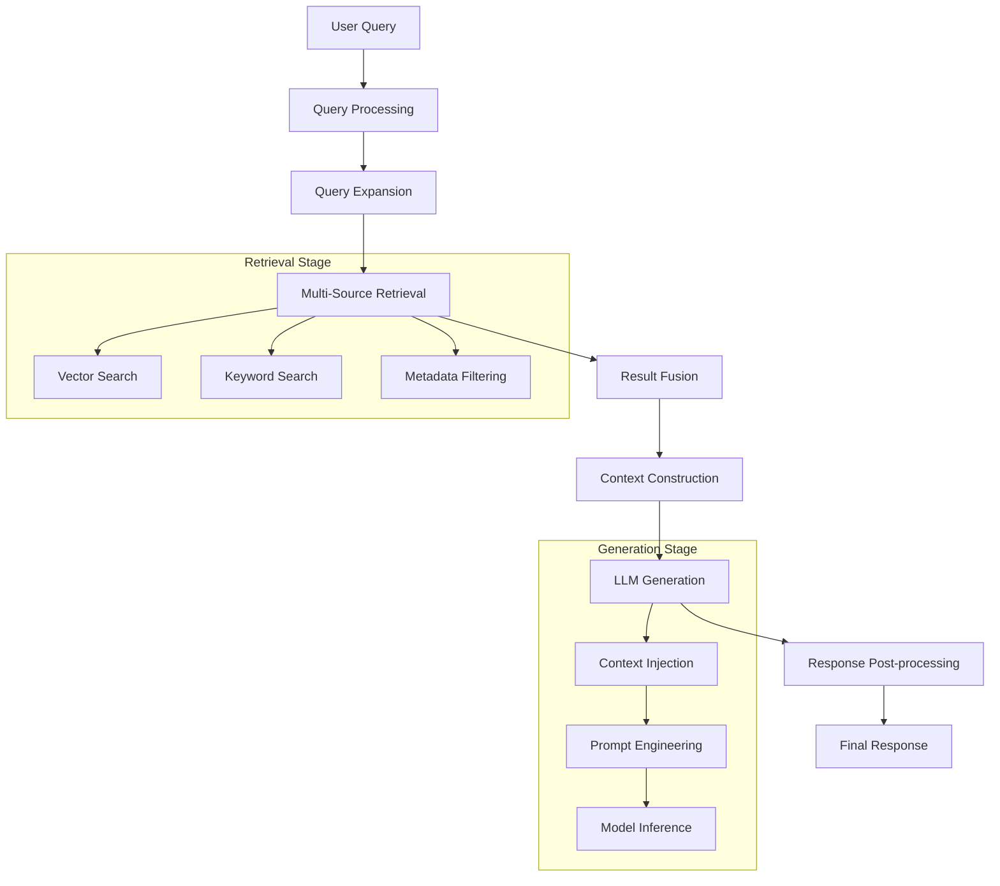

# RAG Pipeline

The Retrieval Augmented Generation (RAG) pipeline is the core architecture that enables StudyAssistant to combine information retrieval with large language model generation for enhanced academic research assistance.

## Pipeline Overview

The RAG pipeline consists of several interconnected stages that work together to process queries, retrieve relevant information, and generate comprehensive responses.



## Core Components

### 1. Query Processing

The query processing component handles incoming user queries and prepares them for retrieval.

```python
from dataclasses import dataclass
from typing import List, Dict, Optional
import spacy
from transformers import AutoTokenizer

@dataclass
class ProcessedQuery:
    original: str
    normalized: str
    entities: List[Dict]
    keywords: List[str]
    intent: str
    domain: Optional[str]

class QueryProcessor:
    def __init__(self, model_name: str = "en_core_web_sm"):
        self.nlp = spacy.load(model_name)
        self.tokenizer = AutoTokenizer.from_pretrained("bert-base-uncased")
        
    def process(self, query: str) -> ProcessedQuery:
        """Process raw query into structured format"""
        # Normalize query text
        normalized = self._normalize_text(query)
        
        # Extract entities and keywords
        doc = self.nlp(normalized)
        entities = self._extract_entities(doc)
        keywords = self._extract_keywords(doc)
        
        # Determine query intent and domain
        intent = self._classify_intent(normalized)
        domain = self._identify_domain(normalized, entities)
        
        return ProcessedQuery(
            original=query,
            normalized=normalized,
            entities=entities,
            keywords=keywords,
            intent=intent,
            domain=domain
        )
    
    def _normalize_text(self, text: str) -> str:
        """Normalize text for processing"""
        # Remove extra whitespace
        text = " ".join(text.split())
        
        # Handle academic abbreviations
        abbreviations = {
            "ML": "machine learning",
            "AI": "artificial intelligence",
            "NLP": "natural language processing",
            "CV": "computer vision"
        }
        
        for abbr, full in abbreviations.items():
            text = text.replace(abbr, full)
            
        return text.lower()
    
    def _extract_entities(self, doc) -> List[Dict]:
        """Extract named entities from query"""
        entities = []
        for ent in doc.ents:
            entities.append({
                "text": ent.text,
                "label": ent.label_,
                "start": ent.start_char,
                "end": ent.end_char
            })
        return entities
    
    def _extract_keywords(self, doc) -> List[str]:
        """Extract important keywords"""
        keywords = []
        for token in doc:
            if (token.pos_ in ["NOUN", "ADJ", "VERB"] and 
                not token.is_stop and 
                not token.is_punct and 
                len(token.text) > 2):
                keywords.append(token.lemma_.lower())
        return list(set(keywords))
    
    def _classify_intent(self, query: str) -> str:
        """Classify query intent"""
        intent_patterns = {
            "definition": ["what is", "define", "definition of"],
            "comparison": ["compare", "difference", "versus", "vs"],
            "methodology": ["how to", "method", "approach", "technique"],
            "survey": ["survey", "review", "overview", "state of art"],
            "implementation": ["implementation", "code", "algorithm"]
        }
        
        query_lower = query.lower()
        for intent, patterns in intent_patterns.items():
            if any(pattern in query_lower for pattern in patterns):
                return intent
        
        return "general_search"
    
    def _identify_domain(self, query: str, entities: List[Dict]) -> Optional[str]:
        """Identify academic domain"""
        domain_keywords = {
            "computer_science": ["algorithm", "programming", "software", "computer"],
            "machine_learning": ["neural", "learning", "training", "model"],
            "biology": ["gene", "protein", "cell", "organism"],
            "physics": ["quantum", "particle", "energy", "force"],
            "medicine": ["patient", "treatment", "disease", "clinical"]
        }
        
        query_lower = query.lower()
        for domain, keywords in domain_keywords.items():
            if any(keyword in query_lower for keyword in keywords):
                return domain
        
        return None
```

### 2. Query Expansion

Query expansion enhances the original query with related terms and concepts to improve retrieval coverage.

```python
from typing import Set
import numpy as np
from sentence_transformers import SentenceTransformer

class QueryExpander:
    def __init__(self, 
                 embedding_model: str = "all-MiniLM-L6-v2",
                 concept_db_path: str = "concepts.db"):
        self.embedding_model = SentenceTransformer(embedding_model)
        self.concept_db = self._load_concept_database(concept_db_path)
        
    def expand_query(self, processed_query: ProcessedQuery, 
                    max_expansions: int = 5) -> List[str]:
        """Expand query with related terms"""
        expansions = set()
        
        # Semantic expansion using embeddings
        semantic_expansions = self._semantic_expansion(
            processed_query.normalized, max_expansions
        )
        expansions.update(semantic_expansions)
        
        # Domain-specific expansion
        if processed_query.domain:
            domain_expansions = self._domain_expansion(
                processed_query, max_expansions
            )
            expansions.update(domain_expansions)
        
        # Entity-based expansion
        entity_expansions = self._entity_expansion(
            processed_query.entities, max_expansions
        )
        expansions.update(entity_expansions)
        
        return list(expansions)[:max_expansions]
    
    def _semantic_expansion(self, query: str, max_terms: int) -> List[str]:
        """Find semantically similar terms"""
        query_embedding = self.embedding_model.encode([query])
        
        # Find similar concepts in database
        similar_concepts = self._find_similar_concepts(
            query_embedding[0], max_terms
        )
        
        return similar_concepts
    
    def _domain_expansion(self, processed_query: ProcessedQuery, 
                         max_terms: int) -> List[str]:
        """Expand based on domain knowledge"""
        domain = processed_query.domain
        domain_terms = self.concept_db.get(domain, [])
        
        # Filter relevant domain terms
        relevant_terms = []
        for term in domain_terms:
            if any(keyword in term for keyword in processed_query.keywords):
                relevant_terms.append(term)
        
        return relevant_terms[:max_terms]
    
    def _entity_expansion(self, entities: List[Dict], 
                         max_terms: int) -> List[str]:
        """Expand based on named entities"""
        expansions = []
        
        for entity in entities:
            entity_text = entity["text"]
            entity_type = entity["label"]
            
            # Look up related terms for this entity
            related_terms = self._find_related_entities(
                entity_text, entity_type
            )
            expansions.extend(related_terms)
        
        return expansions[:max_terms]
```

### 3. Multi-Source Retrieval

The retrieval component searches multiple data sources and combines results.

```python
from abc import ABC, abstractmethod
from concurrent.futures import ThreadPoolExecutor, as_completed
import asyncio

class RetrievalResult:
    def __init__(self, document_id: str, content: str, 
                 metadata: Dict, score: float, source: str):
        self.document_id = document_id
        self.content = content
        self.metadata = metadata
        self.score = score
        self.source = source

class BaseRetriever(ABC):
    @abstractmethod
    def retrieve(self, query: str, max_results: int = 10) -> List[RetrievalResult]:
        pass

class MultiSourceRetriever:
    def __init__(self, retrievers: Dict[str, BaseRetriever]):
        self.retrievers = retrievers
        
    async def retrieve_all(self, processed_query: ProcessedQuery,
                          expanded_queries: List[str],
                          max_results_per_source: int = 20) -> List[RetrievalResult]:
        """Retrieve from all sources in parallel"""
        
        all_results = []
        
        # Combine original and expanded queries
        all_queries = [processed_query.normalized] + expanded_queries
        
        # Parallel retrieval from all sources
        tasks = []
        for source_name, retriever in self.retrievers.items():
            for query in all_queries:
                task = self._retrieve_from_source(
                    retriever, query, max_results_per_source, source_name
                )
                tasks.append(task)
        
        # Execute all retrieval tasks
        completed_tasks = await asyncio.gather(*tasks, return_exceptions=True)
        
        # Collect successful results
        for result in completed_tasks:
            if isinstance(result, list):
                all_results.extend(result)
            elif isinstance(result, Exception):
                # Log error but continue
                print(f"Retrieval error: {result}")
        
        return all_results
    
    async def _retrieve_from_source(self, retriever: BaseRetriever,
                                   query: str, max_results: int,
                                   source_name: str) -> List[RetrievalResult]:
        """Retrieve from a single source"""
        try:
            results = retriever.retrieve(query, max_results)
            # Add source information
            for result in results:
                result.source = source_name
            return results
        except Exception as e:
            print(f"Error retrieving from {source_name}: {e}")
            return []

class VectorRetriever(BaseRetriever):
    def __init__(self, vector_db, embedding_model):
        self.vector_db = vector_db
        self.embedding_model = embedding_model
        
    def retrieve(self, query: str, max_results: int = 10) -> List[RetrievalResult]:
        """Vector similarity search"""
        # Generate query embedding
        query_embedding = self.embedding_model.encode([query])[0]
        
        # Search vector database
        search_results = self.vector_db.similarity_search(
            query_embedding, top_k=max_results
        )
        
        # Convert to RetrievalResult objects
        results = []
        for result in search_results:
            results.append(RetrievalResult(
                document_id=result["id"],
                content=result["content"],
                metadata=result["metadata"],
                score=result["score"],
                source="vector"
            ))
        
        return results

class KeywordRetriever(BaseRetriever):
    def __init__(self, search_index):
        self.search_index = search_index
        
    def retrieve(self, query: str, max_results: int = 10) -> List[RetrievalResult]:
        """Keyword-based search using BM25"""
        search_results = self.search_index.search(
            query, limit=max_results
        )
        
        results = []
        for result in search_results:
            results.append(RetrievalResult(
                document_id=result["doc_id"],
                content=result["content"],
                metadata=result["metadata"],
                score=result["bm25_score"],
                source="keyword"
            ))
        
        return results
```

### 4. Result Fusion and Ranking

Combine and rank results from multiple retrieval sources.

```python
from typing import List, Dict
import numpy as np
from sklearn.preprocessing import MinMaxScaler

class ResultFusion:
    def __init__(self, fusion_method: str = "rrf"):
        self.fusion_method = fusion_method
        self.scaler = MinMaxScaler()
        
    def fuse_results(self, all_results: List[RetrievalResult],
                    max_final_results: int = 50) -> List[RetrievalResult]:
        """Fuse and rank results from multiple sources"""
        
        if self.fusion_method == "rrf":
            return self._reciprocal_rank_fusion(all_results, max_final_results)
        elif self.fusion_method == "weighted":
            return self._weighted_fusion(all_results, max_final_results)
        elif self.fusion_method == "late_fusion":
            return self._late_fusion(all_results, max_final_results)
        else:
            raise ValueError(f"Unknown fusion method: {self.fusion_method}")
    
    def _reciprocal_rank_fusion(self, results: List[RetrievalResult],
                               max_results: int, k: int = 60) -> List[RetrievalResult]:
        """Reciprocal Rank Fusion (RRF)"""
        
        # Group results by source
        source_results = {}
        for result in results:
            if result.source not in source_results:
                source_results[result.source] = []
            source_results[result.source].append(result)
        
        # Calculate RRF scores
        doc_scores = {}
        for source, source_results_list in source_results.items():
            # Sort by original score
            sorted_results = sorted(source_results_list, 
                                  key=lambda x: x.score, reverse=True)
            
            for rank, result in enumerate(sorted_results):
                doc_id = result.document_id
                rrf_score = 1.0 / (k + rank + 1)
                
                if doc_id not in doc_scores:
                    doc_scores[doc_id] = {
                        "result": result,
                        "rrf_score": 0.0,
                        "sources": set()
                    }
                
                doc_scores[doc_id]["rrf_score"] += rrf_score
                doc_scores[doc_id]["sources"].add(source)
        
        # Sort by RRF score and return top results
        ranked_docs = sorted(doc_scores.items(), 
                           key=lambda x: x[1]["rrf_score"], reverse=True)
        
        final_results = []
        for doc_id, doc_info in ranked_docs[:max_results]:
            result = doc_info["result"]
            result.score = doc_info["rrf_score"]
            result.metadata["fusion_sources"] = list(doc_info["sources"])
            final_results.append(result)
        
        return final_results
    
    def _weighted_fusion(self, results: List[RetrievalResult],
                        max_results: int) -> List[RetrievalResult]:
        """Weighted fusion based on source reliability"""
        
        source_weights = {
            "vector": 0.4,
            "keyword": 0.3,
            "metadata": 0.2,
            "citation": 0.1
        }
        
        # Normalize scores within each source
        source_results = {}
        for result in results:
            if result.source not in source_results:
                source_results[result.source] = []
            source_results[result.source].append(result)
        
        # Normalize scores
        for source, source_results_list in source_results.items():
            scores = [r.score for r in source_results_list]
            if scores:
                normalized_scores = self.scaler.fit_transform(
                    np.array(scores).reshape(-1, 1)
                ).flatten()
                
                for i, result in enumerate(source_results_list):
                    result.score = normalized_scores[i]
        
        # Calculate weighted scores
        doc_scores = {}
        for result in results:
            doc_id = result.document_id
            weight = source_weights.get(result.source, 0.1)
            weighted_score = result.score * weight
            
            if doc_id not in doc_scores:
                doc_scores[doc_id] = {
                    "result": result,
                    "total_score": 0.0,
                    "sources": set()
                }
            
            doc_scores[doc_id]["total_score"] += weighted_score
            doc_scores[doc_id]["sources"].add(result.source)
        
        # Sort and return top results
        ranked_docs = sorted(doc_scores.items(),
                           key=lambda x: x[1]["total_score"], reverse=True)
        
        final_results = []
        for doc_id, doc_info in ranked_docs[:max_results]:
            result = doc_info["result"]
            result.score = doc_info["total_score"]
            result.metadata["fusion_sources"] = list(doc_info["sources"])
            final_results.append(result)
        
        return final_results

    def _late_fusion(self, results: List[RetrievalResult],
                    max_results: int) -> List[RetrievalResult]:
        """Late fusion with feature-based ranking"""
        
        # Extract features for each document
        doc_features = {}
        for result in results:
            doc_id = result.document_id
            
            if doc_id not in doc_features:
                doc_features[doc_id] = {
                    "result": result,
                    "features": self._extract_features(result),
                    "sources": set()
                }
            
            doc_features[doc_id]["sources"].add(result.source)
        
        # Calculate final scores using learned weights
        feature_weights = {
            "relevance_score": 0.4,
            "citation_count": 0.2,
            "recency": 0.2,
            "source_diversity": 0.1,
            "content_quality": 0.1
        }
        
        for doc_id, doc_info in doc_features.items():
            features = doc_info["features"]
            final_score = sum(
                features.get(feature, 0) * weight
                for feature, weight in feature_weights.items()
            )
            doc_info["final_score"] = final_score
        
        # Sort and return results
        ranked_docs = sorted(doc_features.items(),
                           key=lambda x: x[1]["final_score"], reverse=True)
        
        final_results = []
        for doc_id, doc_info in ranked_docs[:max_results]:
            result = doc_info["result"]
            result.score = doc_info["final_score"]
            result.metadata["fusion_sources"] = list(doc_info["sources"])
            result.metadata["features"] = doc_info["features"]
            final_results.append(result)
        
        return final_results
    
    def _extract_features(self, result: RetrievalResult) -> Dict[str, float]:
        """Extract ranking features from result"""
        features = {}
        
        # Relevance score (normalized)
        features["relevance_score"] = min(result.score, 1.0)
        
        # Citation count (log-normalized)
        citation_count = result.metadata.get("citation_count", 0)
        features["citation_count"] = np.log1p(citation_count) / 10.0
        
        # Recency (years since publication)
        pub_year = result.metadata.get("publication_year", 2000)
        current_year = 2024
        years_old = current_year - pub_year
        features["recency"] = max(0, 1.0 - years_old / 20.0)
        
        # Content quality (length, completeness)
        content_length = len(result.content)
        features["content_quality"] = min(content_length / 1000.0, 1.0)
        
        return features
```

### 5. Context Construction

Build context for the language model from retrieved results.

```python
class ContextBuilder:
    def __init__(self, max_context_length: int = 4000,
                 include_metadata: bool = True):
        self.max_context_length = max_context_length
        self.include_metadata = include_metadata
        
    def build_context(self, query: ProcessedQuery,
                     retrieved_results: List[RetrievalResult]) -> str:
        """Build context string for LLM"""
        
        context_parts = []
        current_length = 0
        
        # Add query context
        query_context = f"Query: {query.original}\n"
        if query.intent != "general_search":
            query_context += f"Intent: {query.intent}\n"
        if query.domain:
            query_context += f"Domain: {query.domain}\n"
        
        context_parts.append(query_context)
        current_length += len(query_context)
        
        # Add retrieved documents
        context_parts.append("Relevant Documents:\n")
        current_length += len("Relevant Documents:\n")
        
        for i, result in enumerate(retrieved_results):
            # Build document entry
            doc_entry = self._build_document_entry(result, i + 1)
            
            # Check if adding this document exceeds limit
            if current_length + len(doc_entry) > self.max_context_length:
                break
            
            context_parts.append(doc_entry)
            current_length += len(doc_entry)
        
        return "\n".join(context_parts)
    
    def _build_document_entry(self, result: RetrievalResult,
                             doc_number: int) -> str:
        """Build a single document entry for context"""
        
        entry_parts = [f"\n[Document {doc_number}]"]
        
        # Add metadata if requested
        if self.include_metadata:
            metadata = result.metadata
            
            if "title" in metadata:
                entry_parts.append(f"Title: {metadata['title']}")
            
            if "authors" in metadata:
                authors = metadata["authors"]
                if isinstance(authors, list):
                    authors = ", ".join(authors[:3])  # Limit to 3 authors
                entry_parts.append(f"Authors: {authors}")
            
            if "publication_year" in metadata:
                entry_parts.append(f"Year: {metadata['publication_year']}")
            
            if "citation_count" in metadata:
                entry_parts.append(f"Citations: {metadata['citation_count']}")
            
            entry_parts.append(f"Relevance Score: {result.score:.3f}")
        
        # Add content (truncate if necessary)
        content = result.content
        if len(content) > 500:  # Truncate long content
            content = content[:500] + "..."
        
        entry_parts.append(f"Content: {content}")
        
        return "\n".join(entry_parts)
```

### 6. LLM Generation

Generate responses using the constructed context.

```python
from typing import Optional
import openai
from anthropic import Anthropic

class LLMGenerator:
    def __init__(self, provider: str = "openai",
                 model: str = "gpt-4",
                 api_key: Optional[str] = None):
        self.provider = provider
        self.model = model
        
        if provider == "openai":
            self.client = openai.OpenAI(api_key=api_key)
        elif provider == "anthropic":
            self.client = Anthropic(api_key=api_key)
        else:
            raise ValueError(f"Unsupported provider: {provider}")
    
    def generate_response(self, context: str,
                         query: ProcessedQuery,
                         temperature: float = 0.7,
                         max_tokens: int = 1000) -> str:
        """Generate response using LLM"""
        
        # Build prompt based on query intent
        prompt = self._build_prompt(context, query)
        
        if self.provider == "openai":
            return self._generate_openai(prompt, temperature, max_tokens)
        elif self.provider == "anthropic":
            return self._generate_anthropic(prompt, temperature, max_tokens)
    
    def _build_prompt(self, context: str, query: ProcessedQuery) -> str:
        """Build prompt based on query intent"""
        
        base_prompt = f"""You are an AI research assistant specializing in academic literature analysis. 
Your task is to provide comprehensive, accurate, and well-structured responses based on the provided research context.

{context}

Query: {query.original}

"""
        
        # Add intent-specific instructions
        if query.intent == "definition":
            base_prompt += """Please provide a clear definition of the requested concept, including:
1. A concise definition
2. Key characteristics or components
3. Examples or applications
4. Related concepts

"""
        elif query.intent == "comparison":
            base_prompt += """Please provide a detailed comparison including:
1. Key similarities between the concepts/methods
2. Important differences
3. Advantages and disadvantages of each
4. Use cases where each is preferred

"""
        elif query.intent == "methodology":
            base_prompt += """Please explain the methodology including:
1. Step-by-step process or procedure
2. Required tools or techniques
3. Expected outcomes
4. Common challenges and solutions

"""
        elif query.intent == "survey":
            base_prompt += """Please provide a comprehensive overview including:
1. Current state of the field
2. Major approaches or schools of thought
3. Recent advances and trends
4. Open challenges and future directions

"""
        else:
            base_prompt += """Please provide a comprehensive response that addresses the query thoroughly, including relevant background, current research, and implications.

"""
        
        base_prompt += """Format your response with clear sections and cite specific documents from the provided context where appropriate. Use [Document X] notation to reference sources."""
        
        return base_prompt
    
    def _generate_openai(self, prompt: str, temperature: float,
                        max_tokens: int) -> str:
        """Generate response using OpenAI"""
        
        response = self.client.chat.completions.create(
            model=self.model,
            messages=[{"role": "user", "content": prompt}],
            temperature=temperature,
            max_tokens=max_tokens
        )
        
        return response.choices[0].message.content
    
    def _generate_anthropic(self, prompt: str, temperature: float,
                           max_tokens: int) -> str:
        """Generate response using Anthropic"""
        
        response = self.client.messages.create(
            model=self.model,
            max_tokens=max_tokens,
            temperature=temperature,
            messages=[{"role": "user", "content": prompt}]
        )
        
        return response.content[0].text
```

## Pipeline Orchestration

The main pipeline orchestrator coordinates all components:

```python
class RAGPipeline:
    def __init__(self, config: Dict):
        self.query_processor = QueryProcessor()
        self.query_expander = QueryExpander()
        self.retriever = MultiSourceRetriever(config["retrievers"])
        self.result_fusion = ResultFusion(config.get("fusion_method", "rrf"))
        self.context_builder = ContextBuilder(
            max_context_length=config.get("max_context_length", 4000)
        )
        self.llm_generator = LLMGenerator(
            provider=config["llm"]["provider"],
            model=config["llm"]["model"],
            api_key=config["llm"]["api_key"]
        )
    
    async def process_query(self, query: str) -> Dict:
        """Process query through complete RAG pipeline"""
        
        # 1. Process query
        processed_query = self.query_processor.process(query)
        
        # 2. Expand query
        expanded_queries = self.query_expander.expand_query(processed_query)
        
        # 3. Retrieve from multiple sources
        all_results = await self.retriever.retrieve_all(
            processed_query, expanded_queries
        )
        
        # 4. Fuse and rank results
        fused_results = self.result_fusion.fuse_results(all_results)
        
        # 5. Build context
        context = self.context_builder.build_context(
            processed_query, fused_results
        )
        
        # 6. Generate response
        response = self.llm_generator.generate_response(
            context, processed_query
        )
        
        return {
            "query": query,
            "processed_query": processed_query,
            "expanded_queries": expanded_queries,
            "retrieved_documents": len(all_results),
            "context_documents": len(fused_results),
            "response": response,
            "sources": [r.source for r in fused_results]
        }

# Example usage
config = {
    "retrievers": {
        "vector": VectorRetriever(vector_db, embedding_model),
        "keyword": KeywordRetriever(search_index)
    },
    "fusion_method": "rrf",
    "max_context_length": 4000,
    "llm": {
        "provider": "openai",
        "model": "gpt-4",
        "api_key": "your-api-key"
    }
}

pipeline = RAGPipeline(config)
result = await pipeline.process_query("What are the latest advances in transformer architectures?")
```

## Performance Optimization

### Caching Strategies

```python
import asyncio
from functools import lru_cache
import redis

class CachedRAGPipeline(RAGPipeline):
    def __init__(self, config: Dict, redis_client: redis.Redis):
        super().__init__(config)
        self.redis_client = redis_client
        self.cache_ttl = config.get("cache_ttl", 3600)  # 1 hour
    
    async def process_query(self, query: str) -> Dict:
        """Process query with caching"""
        
        # Check cache first
        cache_key = f"rag_pipeline:{hash(query)}"
        cached_result = self.redis_client.get(cache_key)
        
        if cached_result:
            return json.loads(cached_result)
        
        # Process query normally
        result = await super().process_query(query)
        
        # Cache result
        self.redis_client.setex(
            cache_key, 
            self.cache_ttl, 
            json.dumps(result, default=str)
        )
        
        return result
```

### Parallel Processing

```python
class ParallelRAGPipeline(RAGPipeline):
    def __init__(self, config: Dict):
        super().__init__(config)
        self.max_workers = config.get("max_workers", 4)
    
    async def process_batch_queries(self, queries: List[str]) -> List[Dict]:
        """Process multiple queries in parallel"""
        
        semaphore = asyncio.Semaphore(self.max_workers)
        
        async def process_single_query(query: str) -> Dict:
            async with semaphore:
                return await self.process_query(query)
        
        tasks = [process_single_query(query) for query in queries]
        results = await asyncio.gather(*tasks)
        
        return results
```

## Next Steps

- Learn about [Data Management](data-management.md) for the retrieval components
- Explore [Search Engine](search-engine.md) architecture details
- Review [Text Processing](../nlp/text-processing.md) for NLP components
- Study [Embeddings](../nlp/embeddings.md) for vector search implementation
