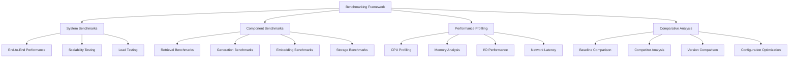

# Benchmarking and Performance Analysis

StudyAssistant's benchmarking framework provides comprehensive performance analysis, comparison with baseline systems, and detailed performance profiling across all system components.

## Benchmarking Architecture



## Performance Benchmarking Suite

### 1. System-Level Benchmarks

#### End-to-End Performance Testing

```python
from benchmarking import SystemBenchmark, BenchmarkConfig
from benchmarking.datasets import BenchmarkDataset
from benchmarking.profilers import PerformanceProfiler

class StudyAssistantBenchmark:
    """Comprehensive system benchmarking"""
    
    def __init__(self, config: BenchmarkConfig):
        self.config = config
        self.profiler = PerformanceProfiler()
        self.datasets = self._load_benchmark_datasets()
        
    def run_system_benchmark(self) -> SystemBenchmarkResult:
        """Run complete system performance benchmark"""
        
        results = {}
        
        # 1. Throughput benchmarks
        results['throughput'] = self._benchmark_throughput()
        
        # 2. Latency benchmarks
        results['latency'] = self._benchmark_latency()
        
        # 3. Scalability benchmarks
        results['scalability'] = self._benchmark_scalability()
        
        # 4. Resource utilization
        results['resource_usage'] = self._benchmark_resource_usage()
        
        # 5. Memory efficiency
        results['memory_efficiency'] = self._benchmark_memory_usage()
        
        return SystemBenchmarkResult(**results)
    
    def _benchmark_throughput(self) -> ThroughputBenchmarkResult:
        """Benchmark query processing throughput"""
        
        throughput_results = {}
        
        for dataset_name, dataset in self.datasets.items():
            print(f"Benchmarking throughput on {dataset_name}...")
            
            # Measure queries per second
            start_time = time.time()
            processed_queries = 0
            
            with ThreadPoolExecutor(max_workers=self.config.max_workers) as executor:
                # Submit all queries
                futures = []
                for query in dataset.queries:
                    future = executor.submit(self._process_single_query, query)
                    futures.append(future)
                
                # Wait for completion
                for future in as_completed(futures):
                    try:
                        result = future.result(timeout=self.config.query_timeout)
                        processed_queries += 1
                    except TimeoutError:
                        print(f"Query timed out: {future}")
                    except Exception as e:
                        print(f"Query failed: {e}")
            
            total_time = time.time() - start_time
            throughput_qps = processed_queries / total_time
            
            throughput_results[dataset_name] = {
                'queries_per_second': throughput_qps,
                'total_queries': len(dataset.queries),
                'successful_queries': processed_queries,
                'total_time': total_time,
                'success_rate': processed_queries / len(dataset.queries)
            }
        
        return ThroughputBenchmarkResult(throughput_results)
    
    def _benchmark_latency(self) -> LatencyBenchmarkResult:
        """Benchmark query processing latency"""
        
        latency_results = {}
        
        for dataset_name, dataset in self.datasets.items():
            print(f"Benchmarking latency on {dataset_name}...")
            
            latencies = []
            component_latencies = {
                'retrieval': [],
                'generation': [],
                'preprocessing': [],
                'postprocessing': []
            }
            
            for query in dataset.queries[:self.config.latency_sample_size]:
                # Measure total latency
                start_time = time.time()
                
                with self.profiler.profile_query(query.id):
                    result = self._process_single_query_with_profiling(query)
                
                total_latency = time.time() - start_time
                latencies.append(total_latency)
                
                # Extract component latencies
                if result.profiling_data:
                    for component, duration in result.profiling_data.items():
                        if component in component_latencies:
                            component_latencies[component].append(duration)
            
            # Calculate latency statistics
            latency_stats = {
                'mean': np.mean(latencies),
                'median': np.median(latencies),
                'p95': np.percentile(latencies, 95),
                'p99': np.percentile(latencies, 99),
                'min': np.min(latencies),
                'max': np.max(latencies),
                'std': np.std(latencies)
            }
            
            # Component latency breakdown
            component_stats = {}
            for component, durations in component_latencies.items():
                if durations:
                    component_stats[component] = {
                        'mean': np.mean(durations),
                        'median': np.median(durations),
                        'p95': np.percentile(durations, 95)
                    }
            
            latency_results[dataset_name] = {
                'overall_latency': latency_stats,
                'component_latency': component_stats,
                'sample_size': len(latencies)
            }
        
        return LatencyBenchmarkResult(latency_results)
    
    def _benchmark_scalability(self) -> ScalabilityBenchmarkResult:
        """Benchmark system scalability under load"""
        
        scalability_results = {}
        
        # Test different load levels
        load_levels = [1, 2, 4, 8, 16, 32, 64]
        
        for load_level in load_levels:
            print(f"Testing scalability at {load_level} concurrent users...")
            
            # Configure system for load level
            self._configure_for_load_level(load_level)
            
            # Run load test
            load_test_result = self._run_load_test(
                concurrent_users=load_level,
                duration_seconds=self.config.load_test_duration,
                ramp_up_seconds=self.config.ramp_up_duration
            )
            
            scalability_results[load_level] = {
                'throughput_qps': load_test_result.throughput,
                'avg_latency': load_test_result.avg_latency,
                'p95_latency': load_test_result.p95_latency,
                'error_rate': load_test_result.error_rate,
                'cpu_utilization': load_test_result.avg_cpu_usage,
                'memory_utilization': load_test_result.avg_memory_usage,
                'response_time_distribution': load_test_result.latency_distribution
            }
        
        # Analyze scalability metrics
        scalability_analysis = self._analyze_scalability_trends(scalability_results)
        
        return ScalabilityBenchmarkResult(
            load_test_results=scalability_results,
            scalability_analysis=scalability_analysis
        )
```

### 2. Component-Level Benchmarks

#### Retrieval System Benchmarks

```python
class RetrievalBenchmark:
    """Benchmark retrieval system performance"""
    
    def __init__(self, retrieval_system: HybridRecommender):
        self.retrieval_system = retrieval_system
        self.profiler = RetrievalProfiler()
        
    def benchmark_retrieval_performance(self, 
                                     queries: List[str],
                                     document_collections: List[str]) -> RetrievalBenchmarkResult:
        """Comprehensive retrieval performance benchmark"""
        
        results = {}
        
        # Test different collection sizes
        for collection_name in document_collections:
            print(f"Benchmarking on {collection_name}...")
            
            # Load document collection
            self.retrieval_system.load_collection(collection_name)
            collection_stats = self.retrieval_system.get_collection_stats()
            
            # Benchmark different aspects
            results[collection_name] = {
                'collection_stats': collection_stats,
                'search_performance': self._benchmark_search_performance(queries),
                'index_performance': self._benchmark_index_performance(),
                'memory_usage': self._benchmark_retrieval_memory(),
                'accuracy_vs_speed': self._benchmark_accuracy_speed_tradeoff(queries)
            }
        
        return RetrievalBenchmarkResult(results)
    
    def _benchmark_search_performance(self, queries: List[str]) -> Dict:
        """Benchmark search operation performance"""
        
        search_times = []
        result_counts = []
        
        for query in queries:
            # Time search operation
            start_time = time.time()
            
            with self.profiler.profile_search():
                results = self.retrieval_system.search(
                    query=query,
                    top_k=20,
                    include_scores=True
                )
            
            search_time = time.time() - start_time
            search_times.append(search_time)
            result_counts.append(len(results))
        
        # Analyze different search strategies
        strategy_performance = {}
        for strategy in ['bm25_only', 'semantic_only', 'hybrid']:
            strategy_times = []
            
            for query in queries[:50]:  # Sample for strategy comparison
                start_time = time.time()
                
                results = self.retrieval_system.search(
                    query=query,
                    strategy=strategy,
                    top_k=20
                )
                
                strategy_time = time.time() - start_time
                strategy_times.append(strategy_time)
            
            strategy_performance[strategy] = {
                'avg_time': np.mean(strategy_times),
                'median_time': np.median(strategy_times),
                'p95_time': np.percentile(strategy_times, 95)
            }
        
        return {
            'overall_performance': {
                'avg_search_time': np.mean(search_times),
                'median_search_time': np.median(search_times),
                'p95_search_time': np.percentile(search_times, 95),
                'avg_results_returned': np.mean(result_counts)
            },
            'strategy_comparison': strategy_performance,
            'search_time_distribution': search_times
        }
    
    def _benchmark_accuracy_speed_tradeoff(self, queries: List[str]) -> Dict:
        """Benchmark accuracy vs speed tradeoffs"""
        
        # Test different top_k values
        k_values = [5, 10, 20, 50, 100]
        tradeoff_results = {}
        
        for k in k_values:
            search_times = []
            relevance_scores = []
            
            for query in queries[:100]:  # Sample for tradeoff analysis
                start_time = time.time()
                
                results = self.retrieval_system.search(
                    query=query,
                    top_k=k,
                    include_scores=True
                )
                
                search_time = time.time() - start_time
                search_times.append(search_time)
                
                # Calculate relevance score (simplified)
                avg_relevance = np.mean([r.score for r in results]) if results else 0
                relevance_scores.append(avg_relevance)
            
            tradeoff_results[k] = {
                'avg_search_time': np.mean(search_times),
                'avg_relevance_score': np.mean(relevance_scores),
                'efficiency_ratio': np.mean(relevance_scores) / np.mean(search_times)
            }
        
        return tradeoff_results
```

#### Generation System Benchmarks

```python
class GenerationBenchmark:
    """Benchmark generation system performance"""
    
    def __init__(self, generation_system: LLMInterface):
        self.generation_system = generation_system
        self.profiler = GenerationProfiler()
    
    def benchmark_generation_performance(self,
                                       queries: List[str],
                                       contexts: List[str]) -> GenerationBenchmarkResult:
        """Comprehensive generation performance benchmark"""
        
        results = {}
        
        # Test different generation parameters
        parameter_sets = [
            {'max_tokens': 256, 'temperature': 0.7, 'top_p': 0.9},
            {'max_tokens': 512, 'temperature': 0.7, 'top_p': 0.9},
            {'max_tokens': 1024, 'temperature': 0.7, 'top_p': 0.9},
            {'max_tokens': 512, 'temperature': 0.3, 'top_p': 0.9},
            {'max_tokens': 512, 'temperature': 1.0, 'top_p': 0.9},
        ]
        
        for i, params in enumerate(parameter_sets):
            print(f"Benchmarking generation with parameter set {i+1}...")
            
            results[f"params_{i+1}"] = self._benchmark_parameter_set(
                queries, contexts, params
            )
        
        # Benchmark different model sizes/types
        if hasattr(self.generation_system, 'available_models'):
            model_results = {}
            
            for model_name in self.generation_system.available_models:
                print(f"Benchmarking model: {model_name}")
                
                self.generation_system.set_model(model_name)
                model_results[model_name] = self._benchmark_model_performance(
                    queries[:50], contexts[:50]  # Smaller sample for model comparison
                )
            
            results['model_comparison'] = model_results
        
        return GenerationBenchmarkResult(results)
    
    def _benchmark_parameter_set(self, 
                               queries: List[str], 
                               contexts: List[str], 
                               params: Dict) -> Dict:
        """Benchmark specific generation parameters"""
        
        generation_times = []
        token_counts = []
        quality_scores = []
        
        for query, context in zip(queries, contexts):
            start_time = time.time()
            
            with self.profiler.profile_generation():
                response = self.generation_system.generate_response(
                    query=query,
                    context=context,
                    **params
                )
            
            generation_time = time.time() - start_time
            generation_times.append(generation_time)
            
            # Token count analysis
            token_count = len(response.text.split())  # Simplified token counting
            token_counts.append(token_count)
            
            # Quality estimation (simplified)
            quality_score = self._estimate_response_quality(query, response.text, context)
            quality_scores.append(quality_score)
        
        return {
            'performance_metrics': {
                'avg_generation_time': np.mean(generation_times),
                'median_generation_time': np.median(generation_times),
                'p95_generation_time': np.percentile(generation_times, 95),
                'tokens_per_second': np.mean(token_counts) / np.mean(generation_times)
            },
            'quality_metrics': {
                'avg_quality_score': np.mean(quality_scores),
                'quality_consistency': np.std(quality_scores)
            },
            'efficiency_metrics': {
                'quality_per_second': np.mean(quality_scores) / np.mean(generation_times),
                'tokens_per_quality_point': np.mean(token_counts) / np.mean(quality_scores)
            },
            'parameters': params,
            'sample_size': len(queries)
        }
```

### 3. Performance Profiling

#### Deep Performance Analysis

```python
class PerformanceProfiler:
    """Deep performance profiling and analysis"""
    
    def __init__(self):
        self.cpu_profiler = CPUProfiler()
        self.memory_profiler = MemoryProfiler()
        self.io_profiler = IOProfiler()
        self.db_profiler = DatabaseProfiler()
        
    def run_comprehensive_profiling(self, 
                                  workload: Workload) -> ProfilingResult:
        """Run comprehensive performance profiling"""
        
        profiling_results = {}
        
        # CPU profiling
        with self.cpu_profiler.profile():
            workload_result = self._execute_workload(workload)
        
        cpu_profile = self.cpu_profiler.get_profile()
        profiling_results['cpu_analysis'] = self._analyze_cpu_profile(cpu_profile)
        
        # Memory profiling
        memory_profile = self.memory_profiler.profile_workload(workload)
        profiling_results['memory_analysis'] = self._analyze_memory_profile(memory_profile)
        
        # I/O profiling
        io_profile = self.io_profiler.profile_workload(workload)
        profiling_results['io_analysis'] = self._analyze_io_profile(io_profile)
        
        # Database profiling
        db_profile = self.db_profiler.profile_workload(workload)
        profiling_results['database_analysis'] = self._analyze_db_profile(db_profile)
        
        # Generate optimization recommendations
        recommendations = self._generate_optimization_recommendations(profiling_results)
        
        return ProfilingResult(
            workload_result=workload_result,
            profiling_data=profiling_results,
            optimization_recommendations=recommendations
        )
    
    def _analyze_cpu_profile(self, cpu_profile) -> Dict:
        """Analyze CPU profiling data"""
        
        # Function-level analysis
        function_stats = cpu_profile.get_function_stats()
        
        # Identify CPU hotspots
        hotspots = sorted(
            function_stats.items(),
            key=lambda x: x[1]['cumulative_time'],
            reverse=True
        )[:20]
        
        # Call graph analysis
        call_graph = cpu_profile.get_call_graph()
        
        return {
            'total_cpu_time': cpu_profile.total_time,
            'function_count': len(function_stats),
            'top_functions': hotspots,
            'call_graph_depth': call_graph.max_depth,
            'recursive_calls': call_graph.recursive_functions,
            'optimization_opportunities': self._identify_cpu_optimizations(hotspots)
        }
    
    def _analyze_memory_profile(self, memory_profile) -> Dict:
        """Analyze memory usage patterns"""
        
        peak_usage = memory_profile.peak_memory_usage
        allocation_patterns = memory_profile.allocation_patterns
        
        # Memory leak detection
        potential_leaks = self._detect_memory_leaks(memory_profile)
        
        # Large object analysis
        large_objects = memory_profile.get_large_objects(threshold_mb=10)
        
        return {
            'peak_memory_usage_mb': peak_usage / (1024 * 1024),
            'total_allocations': len(allocation_patterns),
            'avg_allocation_size': np.mean([a.size for a in allocation_patterns]),
            'potential_memory_leaks': potential_leaks,
            'large_objects': large_objects,
            'memory_efficiency_score': self._calculate_memory_efficiency(memory_profile)
        }
    
    def _analyze_io_profile(self, io_profile) -> Dict:
        """Analyze I/O performance patterns"""
        
        disk_operations = io_profile.disk_operations
        network_operations = io_profile.network_operations
        
        return {
            'disk_io': {
                'total_reads': len([op for op in disk_operations if op.type == 'read']),
                'total_writes': len([op for op in disk_operations if op.type == 'write']),
                'avg_read_time': np.mean([op.duration for op in disk_operations if op.type == 'read']),
                'avg_write_time': np.mean([op.duration for op in disk_operations if op.type == 'write']),
                'total_bytes_read': sum([op.size for op in disk_operations if op.type == 'read']),
                'total_bytes_written': sum([op.size for op in disk_operations if op.type == 'write'])
            },
            'network_io': {
                'total_requests': len(network_operations),
                'avg_request_time': np.mean([op.duration for op in network_operations]),
                'p95_request_time': np.percentile([op.duration for op in network_operations], 95),
                'error_rate': len([op for op in network_operations if op.error]) / len(network_operations)
            }
        }
```

### 4. Comparative Benchmarking

#### Baseline Comparison Framework

```python
class BaselineComparison:
    """Compare current performance with baselines"""
    
    def __init__(self, baseline_db_path: str):
        self.baseline_db = BaselineDatabase(baseline_db_path)
        
    def compare_with_baselines(self, 
                             current_results: BenchmarkResult) -> ComparisonResult:
        """Compare current results with historical baselines"""
        
        # Load relevant baselines
        baselines = self.baseline_db.get_baselines(
            system_version=current_results.system_version,
            configuration=current_results.configuration,
            dataset=current_results.dataset_name
        )
        
        comparisons = {}
        
        for baseline_name, baseline in baselines.items():
            comparison = self._compare_benchmark_results(current_results, baseline)
            comparisons[baseline_name] = comparison
        
        # Generate regression analysis
        regression_analysis = self._analyze_regressions(comparisons)
        
        # Generate improvement analysis
        improvement_analysis = self._analyze_improvements(comparisons)
        
        return ComparisonResult(
            current_results=current_results,
            baseline_comparisons=comparisons,
            regression_analysis=regression_analysis,
            improvement_analysis=improvement_analysis,
            overall_assessment=self._generate_overall_assessment(comparisons)
        )
    
    def _compare_benchmark_results(self, 
                                 current: BenchmarkResult, 
                                 baseline: BenchmarkResult) -> BenchmarkComparison:
        """Compare two benchmark results"""
        
        metric_comparisons = {}
        
        for metric_name in current.metrics.keys():
            if metric_name in baseline.metrics:
                current_value = current.metrics[metric_name]
                baseline_value = baseline.metrics[metric_name]
                
                # Calculate percentage change
                if baseline_value != 0:
                    percent_change = ((current_value - baseline_value) / baseline_value) * 100
                else:
                    percent_change = float('inf') if current_value > 0 else 0
                
                # Determine if change is significant
                is_significant = abs(percent_change) > 5.0  # 5% threshold
                
                # Determine if change is improvement or regression
                is_improvement = self._is_metric_improvement(
                    metric_name, current_value, baseline_value
                )
                
                metric_comparisons[metric_name] = MetricComparison(
                    current_value=current_value,
                    baseline_value=baseline_value,
                    absolute_change=current_value - baseline_value,
                    percent_change=percent_change,
                    is_significant=is_significant,
                    is_improvement=is_improvement
                )
        
        return BenchmarkComparison(
            baseline_info=baseline.metadata,
            metric_comparisons=metric_comparisons,
            overall_score_change=self._calculate_overall_score_change(metric_comparisons)
        )
    
    def update_baselines(self, results: BenchmarkResult):
        """Update baseline database with new results"""
        
        # Determine if results should become new baseline
        if self._should_update_baseline(results):
            self.baseline_db.save_baseline(
                name=f"baseline_{datetime.now().strftime('%Y%m%d_%H%M%S')}",
                results=results,
                metadata={
                    'created_at': datetime.now().isoformat(),
                    'system_version': results.system_version,
                    'configuration_hash': results.configuration_hash,
                    'performance_score': results.overall_performance_score
                }
            )
```

### 5. Load Testing and Stress Testing

#### Comprehensive Load Testing

```python
class LoadTestFramework:
    """Comprehensive load testing framework"""
    
    def __init__(self, config: LoadTestConfig):
        self.config = config
        self.metrics_collector = MetricsCollector()
        
    def run_load_test_suite(self) -> LoadTestSuiteResult:
        """Run comprehensive load testing suite"""
        
        suite_results = {}
        
        # 1. Baseline load test
        suite_results['baseline'] = self._run_baseline_load_test()
        
        # 2. Spike load test
        suite_results['spike'] = self._run_spike_load_test()
        
        # 3. Sustained load test
        suite_results['sustained'] = self._run_sustained_load_test()
        
        # 4. Stress test (beyond capacity)
        suite_results['stress'] = self._run_stress_test()
        
        # 5. Volume test (large datasets)
        suite_results['volume'] = self._run_volume_test()
        
        # Analyze results
        analysis = self._analyze_load_test_results(suite_results)
        
        return LoadTestSuiteResult(
            test_results=suite_results,
            analysis=analysis,
            recommendations=self._generate_load_test_recommendations(analysis)
        )
    
    def _run_baseline_load_test(self) -> LoadTestResult:
        """Run baseline load test with normal traffic patterns"""
        
        test_config = LoadTestConfig(
            concurrent_users=self.config.baseline_users,
            duration_seconds=self.config.baseline_duration,
            ramp_up_seconds=30,
            query_distribution=self.config.realistic_query_distribution
        )
        
        return self._execute_load_test(test_config)
    
    def _run_spike_load_test(self) -> LoadTestResult:
        """Run spike load test with sudden traffic increases"""
        
        results = []
        
        # Baseline traffic
        baseline_users = self.config.baseline_users
        spike_users = self.config.spike_users
        
        # Start with baseline
        print("Starting with baseline load...")
        baseline_result = self._execute_load_test(LoadTestConfig(
            concurrent_users=baseline_users,
            duration_seconds=120,
            ramp_up_seconds=30
        ))
        
        # Introduce spike
        print(f"Introducing spike to {spike_users} users...")
        spike_result = self._execute_load_test(LoadTestConfig(
            concurrent_users=spike_users,
            duration_seconds=180,
            ramp_up_seconds=10  # Quick ramp-up for spike
        ))
        
        # Return to baseline
        print("Returning to baseline...")
        recovery_result = self._execute_load_test(LoadTestConfig(
            concurrent_users=baseline_users,
            duration_seconds=120,
            ramp_up_seconds=30
        ))
        
        return SpikeLoadTestResult(
            baseline_phase=baseline_result,
            spike_phase=spike_result,
            recovery_phase=recovery_result,
            spike_recovery_time=self._calculate_recovery_time(spike_result, recovery_result)
        )
    
    def _execute_load_test(self, config: LoadTestConfig) -> LoadTestResult:
        """Execute individual load test"""
        
        print(f"Executing load test: {config.concurrent_users} users for {config.duration_seconds}s")
        
        # Initialize metrics collection
        self.metrics_collector.start_collection()
        
        # Generate load
        load_generator = LoadGenerator(config)
        test_results = load_generator.execute_test()
        
        # Collect metrics
        system_metrics = self.metrics_collector.stop_collection()
        
        # Analyze results
        performance_analysis = self._analyze_load_test_performance(
            test_results, system_metrics
        )
        
        return LoadTestResult(
            config=config,
            test_results=test_results,
            system_metrics=system_metrics,
            performance_analysis=performance_analysis
        )
```

## Benchmarking Configuration

### Configuration Management

```yaml
# benchmarks/config.yaml
benchmarking:
  # System configuration
  system:
    target_host: "http://localhost:8000"
    api_version: "v1"
    authentication:
      method: "bearer_token"
      token_env: "BENCHMARK_API_TOKEN"
  
  # Dataset configuration
  datasets:
    small_dataset:
      name: "benchmark_queries_small"
      size: 100
      file: "data/benchmark_small.json"
    
    medium_dataset:
      name: "benchmark_queries_medium" 
      size: 1000
      file: "data/benchmark_medium.json"
      
    large_dataset:
      name: "benchmark_queries_large"
      size: 10000
      file: "data/benchmark_large.json"
  
  # Performance thresholds
  thresholds:
    latency:
      p50_ms: 500
      p95_ms: 2000
      p99_ms: 5000
    
    throughput:
      min_qps: 10
      target_qps: 50
      
    resource_usage:
      max_cpu_percent: 80
      max_memory_mb: 4096
      
    error_rates:
      max_error_rate: 0.01  # 1%
      max_timeout_rate: 0.005  # 0.5%
  
  # Load testing configuration
  load_testing:
    baseline_users: 10
    spike_users: 100
    max_stress_users: 200
    
    test_duration:
      baseline_seconds: 300
      spike_seconds: 180
      sustained_seconds: 1800
      stress_seconds: 600
    
    ramp_up:
      normal_seconds: 60
      spike_seconds: 10
      
  # Profiling configuration
  profiling:
    enable_cpu_profiling: true
    enable_memory_profiling: true
    enable_io_profiling: true
    
    sampling_rate: 0.01  # 1% sampling
    max_profile_duration: 3600  # 1 hour
    
  # Comparison settings
  baselines:
    database_path: "benchmarks/baselines.db"
    retention_days: 90
    comparison_threshold_percent: 5.0
    
  # Output configuration
  output:
    results_directory: "benchmarks/results"
    report_formats: ["html", "json", "csv"]
    include_raw_data: true
    generate_charts: true
```

### Running Benchmarks

```python
# Complete benchmarking pipeline
from benchmarking import BenchmarkRunner

# Initialize benchmark runner
runner = BenchmarkRunner(
    config_path="benchmarks/config.yaml",
    system_config_path="config/production.yaml"
)

# Run comprehensive benchmark suite
results = runner.run_comprehensive_benchmark(
    benchmark_types=[
        'system_performance',
        'component_benchmarks', 
        'load_testing',
        'scalability_analysis'
    ],
    datasets=['small_dataset', 'medium_dataset'],
    comparison_baselines=['v1.0.0', 'v1.1.0'],
    output_dir="benchmarks/results/run_20241201"
)

# Generate benchmark reports
runner.generate_benchmark_reports(
    results=results,
    formats=['html', 'json'],
    include_charts=True,
    include_recommendations=True
)

# Update baselines if performance improved
if results.should_update_baseline():
    runner.update_baseline_database(results)

# Schedule continuous benchmarking
runner.schedule_continuous_benchmarking(
    interval_hours=6,
    alert_on_regression=True,
    slack_webhook=os.getenv('BENCHMARK_SLACK_WEBHOOK')
)
```

## Performance Analysis and Optimization

### Automated Performance Analysis

```python
class PerformanceAnalyzer:
    """Automated performance analysis and optimization recommendations"""
    
    def analyze_benchmark_results(self, 
                                results: BenchmarkResult) -> PerformanceAnalysis:
        """Analyze benchmark results and generate insights"""
        
        analysis = {}
        
        # Bottleneck identification
        analysis['bottlenecks'] = self._identify_bottlenecks(results)
        
        # Resource utilization analysis
        analysis['resource_analysis'] = self._analyze_resource_utilization(results)
        
        # Performance pattern analysis
        analysis['patterns'] = self._analyze_performance_patterns(results)
        
        # Scaling analysis
        analysis['scaling'] = self._analyze_scaling_characteristics(results)
        
        # Optimization opportunities
        analysis['optimizations'] = self._identify_optimization_opportunities(results)
        
        return PerformanceAnalysis(**analysis)
    
    def _identify_bottlenecks(self, results: BenchmarkResult) -> List[Bottleneck]:
        """Identify performance bottlenecks"""
        
        bottlenecks = []
        
        # CPU bottlenecks
        if results.cpu_utilization > 0.8:
            bottlenecks.append(Bottleneck(
                type='cpu',
                severity='high',
                description='High CPU utilization detected',
                affected_components=self._identify_cpu_intensive_components(results),
                recommendations=['Optimize algorithms', 'Add CPU capacity', 'Implement caching']
            ))
        
        # Memory bottlenecks
        if results.memory_utilization > 0.9:
            bottlenecks.append(Bottleneck(
                type='memory',
                severity='critical',
                description='High memory utilization detected',
                affected_components=self._identify_memory_intensive_components(results),
                recommendations=['Optimize memory usage', 'Implement object pooling', 'Add memory capacity']
            ))
        
        # I/O bottlenecks
        if results.io_wait_time > 0.3:
            bottlenecks.append(Bottleneck(
                type='io',
                severity='medium',
                description='High I/O wait time detected',
                affected_components=self._identify_io_intensive_components(results),
                recommendations=['Optimize database queries', 'Implement async I/O', 'Add SSD storage']
            ))
        
        return bottlenecks
    
    def generate_optimization_plan(self, 
                                 analysis: PerformanceAnalysis) -> OptimizationPlan:
        """Generate concrete optimization plan"""
        
        plan = OptimizationPlan()
        
        # Prioritize optimizations by impact and effort
        optimizations = sorted(
            analysis.optimizations,
            key=lambda x: (x.impact_score, -x.effort_score),
            reverse=True
        )
        
        for optimization in optimizations:
            plan.add_optimization(
                priority=self._calculate_priority(optimization),
                optimization=optimization,
                estimated_impact=optimization.impact_score,
                estimated_effort=optimization.effort_score,
                implementation_steps=self._generate_implementation_steps(optimization)
            )
        
        return plan
```

## Continuous Benchmarking

### CI/CD Integration

```yaml
# .github/workflows/benchmark.yml
name: Performance Benchmarks

on:
  push:
    branches: [main, develop]
  pull_request:
    branches: [main]
  schedule:
    - cron: '0 6 * * *'  # Daily at 6 AM

jobs:
  benchmark:
    runs-on: ubuntu-latest
    
    steps:
    - uses: actions/checkout@v3
    
    - name: Setup Python
      uses: actions/setup-python@v4
      with:
        python-version: '3.9'
    
    - name: Install dependencies
      run: |
        pip install -r requirements.txt
        pip install -r requirements-benchmark.txt
    
    - name: Setup test environment
      run: |
        python scripts/setup_test_env.py
        python scripts/load_test_data.py
    
    - name: Run performance benchmarks
      run: |
        python -m benchmarking.runner \
          --config benchmarks/ci_config.yaml \
          --output-dir benchmark_results \
          --baseline-comparison \
          --generate-reports
    
    - name: Check performance regressions
      run: |
        python -m benchmarking.regression_check \
          --results-dir benchmark_results \
          --threshold 10.0 \
          --fail-on-regression
    
    - name: Upload benchmark results
      uses: actions/upload-artifact@v3
      with:
        name: benchmark-results
        path: benchmark_results/
    
    - name: Comment PR with results
      if: github.event_name == 'pull_request'
      uses: actions/github-script@v6
      with:
        script: |
          const fs = require('fs');
          const results = JSON.parse(fs.readFileSync('benchmark_results/summary.json'));
          
          const comment = `
          ## 📊 Performance Benchmark Results
          
          **Overall Score:** ${results.overall_score}/100
          **Comparison:** ${results.comparison_summary}
          
          ### Key Metrics
          - **Latency (P95):** ${results.p95_latency}ms
          - **Throughput:** ${results.throughput} queries/sec
          - **Memory Usage:** ${results.memory_usage}MB
          
          ${results.has_regressions ? '⚠️ Performance regressions detected' : '✅ No performance regressions'}
          
          [View detailed results](${results.report_url})
          `;
          
          github.rest.issues.createComment({
            issue_number: context.issue.number,
            owner: context.repo.owner,
            repo: context.repo.repo,
            body: comment
          });
```

## Best Practices

### 1. Benchmarking Methodology

- **Consistent Environment**: Use identical hardware and software configurations
- **Warm-up Periods**: Allow system warm-up before collecting metrics
- **Multiple Runs**: Execute multiple benchmark runs and report statistics
- **Realistic Workloads**: Use workloads that represent actual usage patterns
- **Baseline Management**: Maintain and update performance baselines regularly

### 2. Performance Monitoring

- **Continuous Monitoring**: Implement ongoing performance monitoring
- **Alerting**: Set up alerts for performance regressions
- **Trend Analysis**: Track performance trends over time
- **Resource Correlation**: Correlate performance with resource utilization

### 3. Optimization Process

- **Data-Driven Decisions**: Base optimizations on benchmark data
- **Incremental Changes**: Make small, measurable improvements
- **A/B Testing**: Test optimizations against current baselines
- **Documentation**: Document optimization decisions and results

## Related Documentation

- [Evaluation Framework →](./framework.md) - Complete evaluation system overview
- [Evaluation Metrics →](./metrics.md) - Detailed metric definitions
- [Performance Optimization →](../performance-optimization.md) - Optimization strategies
- [Scalability →](../scalability.md) - System scaling guidelines
