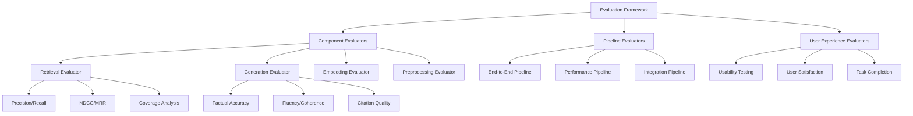

# Evaluation Framework

StudyAssistant's evaluation framework provides a comprehensive system for assessing and improving the performance of all RAG pipeline components. This framework enables systematic evaluation of retrieval accuracy, generation quality, and overall system effectiveness.

## Framework Architecture



## Core Framework Components

### 1. Evaluation Infrastructure

The evaluation framework is built around a modular architecture that allows independent testing of each system component while also supporting end-to-end evaluation.

```python
from evaluation.framework import EvaluationFramework
from evaluation.datasets import EvaluationDataset
from evaluation.metrics import MetricCalculator

# Initialize evaluation framework
framework = EvaluationFramework(
    config_path="evaluation/config.yaml",
    output_dir="evaluation/results",
    logging_level="INFO"
)

# Load evaluation dataset
dataset = EvaluationDataset.from_file("data/evaluation_queries.json")

# Run comprehensive evaluation
results = framework.evaluate_system(
    dataset=dataset,
    components=['retrieval', 'generation', 'end_to_end'],
    metrics=['accuracy', 'relevance', 'latency', 'user_satisfaction']
)

# Generate evaluation report
framework.generate_report(results, format='html')
```

### 2. Dataset Management

#### Evaluation Query Structure

```python
@dataclass
class EvaluationQuery:
    """Structured evaluation query with metadata"""
    
    id: str
    text: str
    type: QueryType  # FACTUAL, COMPARATIVE, SYNTHESIS, EXPLORATORY
    difficulty: DifficultyLevel  # EASY, MEDIUM, HARD, EXPERT
    domain: str  # e.g., "machine_learning", "biology", "physics"
    expected_sources: List[str]  # Expected relevant documents
    ground_truth_answer: Optional[str]
    evaluation_criteria: Dict[str, Any]
    
    # Metadata for analysis
    keywords: List[str]
    concepts: List[str]
    complexity_score: float
    human_rating: Optional[float]

class QueryType(Enum):
    FACTUAL = "factual"           # Direct fact retrieval
    COMPARATIVE = "comparative"   # Compare multiple concepts
    SYNTHESIS = "synthesis"       # Combine multiple sources
    EXPLORATORY = "exploratory"   # Open-ended research
    ANALYTICAL = "analytical"     # Deep analysis required
```

#### Ground Truth Management

```python
@dataclass
class GroundTruth:
    """Ground truth data for evaluation"""
    
    query_id: str
    relevant_documents: List[str]  # Document IDs
    relevance_scores: Dict[str, float]  # Doc ID -> relevance score
    reference_answer: Optional[str]
    key_facts: List[str]
    required_citations: List[str]
    quality_indicators: Dict[str, Any]
    
    # Human evaluation data
    human_annotations: List[HumanAnnotation]
    inter_annotator_agreement: float
    confidence_score: float

@dataclass
class HumanAnnotation:
    """Human evaluation annotation"""
    
    annotator_id: str
    relevance_rating: float  # 1-5 scale
    completeness_rating: float
    accuracy_rating: float
    clarity_rating: float
    comments: str
    time_spent: float  # seconds
```

### 3. Component Evaluation

#### Retrieval System Evaluation

```python
class RetrievalEvaluationFramework:
    """Comprehensive retrieval evaluation"""
    
    def __init__(self, config: EvaluationConfig):
        self.config = config
        self.metrics = self._initialize_metrics()
        self.analyzers = self._initialize_analyzers()
    
    def evaluate_retrieval_system(self, 
                                system: HybridRecommender,
                                dataset: EvaluationDataset) -> RetrievalEvaluationResult:
        """Evaluate retrieval system performance"""
        
        results = {}
        
        # Standard IR metrics
        results['precision_recall'] = self._evaluate_precision_recall(system, dataset)
        results['ranking_quality'] = self._evaluate_ranking_quality(system, dataset)
        results['diversity_analysis'] = self._evaluate_diversity(system, dataset)
        
        # RAG-specific metrics
        results['source_coverage'] = self._evaluate_source_coverage(system, dataset)
        results['context_relevance'] = self._evaluate_context_relevance(system, dataset)
        results['factual_support'] = self._evaluate_factual_support(system, dataset)
        
        # Performance metrics
        results['latency_analysis'] = self._evaluate_latency(system, dataset)
        results['scalability_metrics'] = self._evaluate_scalability(system, dataset)
        
        return RetrievalEvaluationResult(**results)
    
    def _evaluate_precision_recall(self, system, dataset):
        """Evaluate precision and recall at different k values"""
        
        precision_scores = defaultdict(list)
        recall_scores = defaultdict(list)
        
        for query in dataset.queries:
            # Get retrieval results
            results = system.search(
                query.text,
                top_k=self.config.max_k,
                include_scores=True
            )
            
            retrieved_docs = [r.doc_id for r in results]
            relevant_docs = query.expected_sources
            
            # Calculate metrics for different k values
            for k in self.config.k_values:
                precision_k = self._precision_at_k(retrieved_docs, relevant_docs, k)
                recall_k = self._recall_at_k(retrieved_docs, relevant_docs, k)
                
                precision_scores[k].append(precision_k)
                recall_scores[k].append(recall_k)
        
        return {
            'precision_at_k': {k: np.mean(scores) for k, scores in precision_scores.items()},
            'recall_at_k': {k: np.mean(scores) for k, scores in recall_scores.items()},
            'f1_at_k': self._calculate_f1_scores(precision_scores, recall_scores)
        }
    
    def _evaluate_diversity(self, system, dataset):
        """Evaluate result diversity and coverage"""
        
        diversity_metrics = {
            'intra_list_diversity': [],
            'topic_coverage': [],
            'temporal_diversity': [],
            'source_diversity': []
        }
        
        for query in dataset.queries:
            results = system.search(query.text, top_k=20)
            
            # Intra-list diversity (semantic similarity between results)
            embeddings = [r.embedding for r in results if r.embedding is not None]
            if len(embeddings) > 1:
                similarity_matrix = cosine_similarity(embeddings)
                avg_similarity = (similarity_matrix.sum() - len(embeddings)) / (len(embeddings) * (len(embeddings) - 1))
                diversity = 1 - avg_similarity
                diversity_metrics['intra_list_diversity'].append(diversity)
            
            # Topic coverage
            topics = set()
            for result in results:
                if hasattr(result, 'topics'):
                    topics.update(result.topics)
            diversity_metrics['topic_coverage'].append(len(topics))
            
            # Source diversity
            sources = set(r.source for r in results)
            diversity_metrics['source_diversity'].append(len(sources))
        
        return {k: np.mean(v) for k, v in diversity_metrics.items()}
```

#### Generation System Evaluation

```python
class GenerationEvaluationFramework:
    """Comprehensive generation evaluation"""
    
    def __init__(self, config: EvaluationConfig):
        self.config = config
        self.factual_checker = FactualAccuracyChecker()
        self.fluency_evaluator = FluencyEvaluator()
        self.citation_validator = CitationValidator()
    
    def evaluate_generation_system(self,
                                 system: LLMInterface,
                                 dataset: EvaluationDataset) -> GenerationEvaluationResult:
        """Evaluate generation system performance"""
        
        results = {}
        
        # Core generation quality
        results['content_quality'] = self._evaluate_content_quality(system, dataset)
        results['factual_accuracy'] = self._evaluate_factual_accuracy(system, dataset)
        results['citation_quality'] = self._evaluate_citation_quality(system, dataset)
        
        # Language quality
        results['fluency_coherence'] = self._evaluate_fluency_coherence(system, dataset)
        results['style_consistency'] = self._evaluate_style_consistency(system, dataset)
        
        # RAG-specific evaluation
        results['source_utilization'] = self._evaluate_source_utilization(system, dataset)
        results['information_synthesis'] = self._evaluate_synthesis_quality(system, dataset)
        
        return GenerationEvaluationResult(**results)
    
    def _evaluate_factual_accuracy(self, system, dataset):
        """Evaluate factual accuracy of generated responses"""
        
        accuracy_scores = []
        
        for query in dataset.queries:
            # Generate response
            context_docs = self._get_context_documents(query)
            response = system.generate_response(
                query=query.text,
                context=context_docs,
                max_tokens=self.config.max_response_tokens
            )
            
            # Check factual accuracy
            fact_claims = self._extract_factual_claims(response.text)
            accuracy_score = 0.0
            
            for claim in fact_claims:
                # Verify against source documents
                is_supported = self.factual_checker.verify_claim(
                    claim=claim,
                    sources=context_docs,
                    confidence_threshold=0.8
                )
                accuracy_score += int(is_supported)
            
            if fact_claims:
                accuracy_score /= len(fact_claims)
            
            accuracy_scores.append(accuracy_score)
        
        return {
            'overall_accuracy': np.mean(accuracy_scores),
            'accuracy_distribution': accuracy_scores,
            'high_accuracy_queries': sum(1 for s in accuracy_scores if s > 0.8),
            'low_accuracy_queries': sum(1 for s in accuracy_scores if s < 0.5)
        }
```

### 4. End-to-End Pipeline Evaluation

```python
class PipelineEvaluationFramework:
    """End-to-end system evaluation"""
    
    def __init__(self, config: EvaluationConfig):
        self.config = config
        self.system_components = self._initialize_components()
        
    def evaluate_complete_pipeline(self,
                                 dataset: EvaluationDataset) -> PipelineEvaluationResult:
        """Evaluate complete RAG pipeline"""
        
        pipeline_results = []
        performance_metrics = []
        
        for query in dataset.queries:
            start_time = time.time()
            
            try:
                # Full pipeline execution
                result = self._execute_pipeline(query)
                
                # Measure performance
                execution_time = time.time() - start_time
                performance_metrics.append({
                    'query_id': query.id,
                    'execution_time': execution_time,
                    'retrieval_time': result.retrieval_time,
                    'generation_time': result.generation_time,
                    'total_tokens': result.total_tokens,
                    'memory_usage': result.memory_usage
                })
                
                # Evaluate result quality
                quality_score = self._evaluate_result_quality(query, result)
                pipeline_results.append({
                    'query_id': query.id,
                    'quality_score': quality_score,
                    'retrieval_quality': result.retrieval_metrics,
                    'generation_quality': result.generation_metrics,
                    'user_satisfaction_score': self._estimate_user_satisfaction(query, result)
                })
                
            except Exception as e:
                pipeline_results.append({
                    'query_id': query.id,
                    'error': str(e),
                    'quality_score': 0.0
                })
        
        return PipelineEvaluationResult(
            overall_performance=self._aggregate_performance_metrics(performance_metrics),
            quality_analysis=self._analyze_quality_results(pipeline_results),
            error_analysis=self._analyze_errors(pipeline_results),
            recommendations=self._generate_improvement_recommendations(pipeline_results)
        )
    
    def _execute_pipeline(self, query: EvaluationQuery) -> PipelineResult:
        """Execute complete pipeline for a single query"""
        
        result = PipelineResult(query_id=query.id)
        
        # 1. Query preprocessing
        processed_query = self.system_components['preprocessor'].process(query.text)
        
        # 2. Retrieval
        retrieval_start = time.time()
        retrieved_docs = self.system_components['retriever'].search(
            processed_query,
            top_k=self.config.retrieval_k
        )
        result.retrieval_time = time.time() - retrieval_start
        result.retrieved_documents = retrieved_docs
        
        # 3. Context preparation
        context = self.system_components['context_builder'].build_context(
            query=processed_query,
            documents=retrieved_docs
        )
        
        # 4. Generation
        generation_start = time.time()
        response = self.system_components['generator'].generate(
            query=processed_query,
            context=context
        )
        result.generation_time = time.time() - generation_start
        result.generated_response = response
        
        # 5. Post-processing
        final_response = self.system_components['postprocessor'].process(
            response=response,
            context=context
        )
        result.final_response = final_response
        
        return result
```

### 5. Human Evaluation Integration

```python
class HumanEvaluationFramework:
    """Framework for collecting and analyzing human evaluations"""
    
    def __init__(self, config: EvaluationConfig):
        self.config = config
        self.annotation_interface = AnnotationInterface()
        
    def setup_human_evaluation(self,
                             queries: List[EvaluationQuery],
                             system_responses: List[str]) -> HumanEvaluationTask:
        """Setup human evaluation task"""
        
        # Create evaluation tasks
        tasks = []
        for query, response in zip(queries, system_responses):
            task = HumanEvaluationTask(
                id=f"eval_{query.id}",
                query=query.text,
                response=response,
                evaluation_criteria=[
                    'relevance',
                    'accuracy',
                    'completeness',
                    'clarity',
                    'helpfulness'
                ],
                rating_scale=(1, 5),
                allow_comments=True
            )
            tasks.append(task)
        
        # Deploy to annotation interface
        evaluation_campaign = self.annotation_interface.create_campaign(
            name=f"StudyAssistant_Eval_{datetime.now().strftime('%Y%m%d')}",
            tasks=tasks,
            instructions=self._generate_evaluation_instructions(),
            quality_control=self._setup_quality_control()
        )
        
        return evaluation_campaign
    
    def analyze_human_evaluations(self,
                                evaluation_results: List[HumanAnnotation]) -> HumanEvaluationAnalysis:
        """Analyze collected human evaluation data"""
        
        # Inter-annotator agreement
        agreement_scores = self._calculate_inter_annotator_agreement(evaluation_results)
        
        # Quality distribution analysis
        quality_analysis = self._analyze_quality_distributions(evaluation_results)
        
        # Correlation analysis
        correlation_analysis = self._analyze_metric_correlations(evaluation_results)
        
        # Qualitative analysis
        qualitative_insights = self._analyze_qualitative_feedback(evaluation_results)
        
        return HumanEvaluationAnalysis(
            agreement_scores=agreement_scores,
            quality_distributions=quality_analysis,
            correlations=correlation_analysis,
            qualitative_insights=qualitative_insights,
            recommendations=self._generate_human_eval_recommendations(evaluation_results)
        )
```

## Evaluation Configuration

### Configuration Structure

```yaml
# evaluation/config.yaml
evaluation:
  # Dataset configuration
  datasets:
    primary: "data/evaluation_queries.json"
    supplementary: "data/domain_specific_queries.json"
    human_annotations: "data/human_evaluations.json"
  
  # Metrics configuration
  metrics:
    retrieval:
      - precision_at_k: [1, 5, 10, 20]
      - recall_at_k: [1, 5, 10, 20]
      - ndcg_at_k: [1, 5, 10, 20]
      - mrr: true
      - map: true
    
    generation:
      - factual_accuracy: true
      - fluency: true
      - relevance: true
      - citation_quality: true
      - bleu: true
      - rouge: [1, 2, L]
    
    pipeline:
      - end_to_end_quality: true
      - user_satisfaction: true
      - task_completion: true
      - efficiency: true
  
  # Performance configuration
  performance:
    max_concurrent_evaluations: 5
    timeout_seconds: 300
    memory_limit_gb: 8
    
  # Output configuration
  output:
    formats: ['json', 'html', 'csv']
    include_raw_data: true
    generate_visualizations: true
    
  # Human evaluation
  human_evaluation:
    platform: "custom"  # or "mturk", "prolific"
    num_annotators: 3
    qualification_test: true
    payment_per_task: 0.50
```

### Running Evaluations

```python
# Complete evaluation pipeline
from evaluation import EvaluationRunner

# Initialize evaluation runner
runner = EvaluationRunner(
    config_path="evaluation/config.yaml",
    system_config_path="config/production.yaml"
)

# Load evaluation dataset
dataset = runner.load_dataset("primary")

# Run comprehensive evaluation
results = runner.run_evaluation(
    dataset=dataset,
    evaluation_types=[
        'retrieval',
        'generation', 
        'end_to_end',
        'performance'
    ],
    output_dir="evaluation/results/run_20241201"
)

# Generate reports
runner.generate_reports(
    results=results,
    formats=['html', 'json'],
    include_comparisons=True
)

# Schedule continuous evaluation
runner.schedule_continuous_evaluation(
    interval_hours=24,
    dataset_refresh=True,
    alert_threshold=0.1  # Alert if performance drops by 10%
)
```

## Integration with Development Workflow

### Continuous Evaluation

```python
# .github/workflows/evaluation.yml integration
class ContinuousEvaluation:
    """Continuous evaluation in CI/CD pipeline"""
    
    def run_regression_tests(self):
        """Run evaluation regression tests"""
        
        # Load baseline results
        baseline = self.load_baseline_results()
        
        # Run current evaluation
        current = self.run_current_evaluation()
        
        # Compare results
        regression_analysis = self.compare_results(baseline, current)
        
        # Generate alerts if performance degrades
        if regression_analysis.has_regressions:
            self.generate_performance_alerts(regression_analysis)
            return False  # Fail CI if significant regression
        
        return True
    
    def update_performance_baselines(self, results):
        """Update performance baselines after successful evaluation"""
        
        if results.overall_score > self.current_baseline.overall_score:
            self.save_new_baseline(results)
            self.notify_team_of_improvement(results)
```

### A/B Testing Framework

```python
class ABTestingFramework:
    """A/B testing for system improvements"""
    
    def setup_ab_test(self,
                     variant_a: SystemConfig,
                     variant_b: SystemConfig,
                     test_queries: List[EvaluationQuery]) -> ABTest:
        """Setup A/B test between system variants"""
        
        test = ABTest(
            id=f"ab_test_{uuid.uuid4()}",
            variant_a_config=variant_a,
            variant_b_config=variant_b,
            test_queries=test_queries,
            success_metrics=[
                'user_satisfaction',
                'task_completion_rate',
                'response_quality'
            ]
        )
        
        return test
    
    def run_ab_test(self, test: ABTest) -> ABTestResults:
        """Execute A/B test and collect results"""
        
        # Run variant A
        results_a = self.evaluate_variant(test.variant_a_config, test.test_queries)
        
        # Run variant B  
        results_b = self.evaluate_variant(test.variant_b_config, test.test_queries)
        
        # Statistical analysis
        statistical_analysis = self.perform_statistical_tests(results_a, results_b)
        
        return ABTestResults(
            variant_a_results=results_a,
            variant_b_results=results_b,
            statistical_significance=statistical_analysis.p_value < 0.05,
            effect_size=statistical_analysis.effect_size,
            recommendation=self.generate_recommendation(statistical_analysis)
        )
```

## Best Practices

### 1. Evaluation Design Principles

- **Comprehensive Coverage**: Evaluate all system components and their interactions
- **Realistic Test Cases**: Use queries and scenarios that reflect real user needs
- **Statistical Rigor**: Ensure adequate sample sizes and proper statistical analysis
- **Reproducibility**: Version control evaluation datasets and maintain consistent environments
- **Continuous Monitoring**: Implement ongoing evaluation to catch performance regressions

### 2. Data Quality Management

- **Ground Truth Validation**: Regularly review and update ground truth annotations
- **Inter-Annotator Agreement**: Maintain high agreement scores for human evaluations
- **Bias Detection**: Monitor for and mitigate evaluation biases
- **Dataset Evolution**: Keep evaluation datasets current with system improvements

### 3. Performance Monitoring

- **Baseline Tracking**: Maintain performance baselines for regression detection
- **Automated Alerts**: Set up alerts for significant performance changes
- **Trend Analysis**: Monitor performance trends over time
- **Resource Utilization**: Track computational resource usage during evaluation

## Related Documentation

- [Evaluation Metrics →](./metrics.md) - Detailed metric definitions and calculations
- [Benchmarking →](./benchmarking.md) - Performance benchmarking and comparison
- [Testing →](../testing.md) - Automated testing framework
- [Performance Optimization →](../performance-optimization.md) - System optimization strategies
