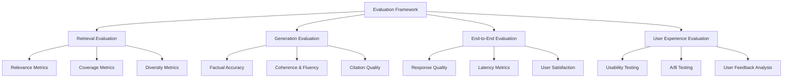

# Evaluation and Metrics Framework

StudyAssistant includes a comprehensive evaluation framework for assessing system performance, accuracy, and quality across all components of the RAG pipeline.

## Evaluation Architecture



## Core Evaluation Components

### 1. Retrieval Evaluation Framework

Evaluates the effectiveness of document retrieval and ranking.

```python
class RetrievalEvaluator:
    def __init__(self):
        self.metrics = {
            'precision_at_k': self.precision_at_k,
            'recall_at_k': self.recall_at_k,
            'ndcg_at_k': self.ndcg_at_k,
            'mean_reciprocal_rank': self.mean_reciprocal_rank,
            'map_score': self.mean_average_precision
        }
        
    def evaluate_retrieval(self, 
                         queries: List[EvaluationQuery], 
                         retrieval_results: List[RetrievalResult],
                         ground_truth: List[GroundTruth]) -> RetrievalEvaluationResult:
        """Comprehensive retrieval evaluation"""
        
        results = {}
        
        for metric_name, metric_func in self.metrics.items():
            scores = []
            
            for query, result, truth in zip(queries, retrieval_results, ground_truth):
                score = metric_func(result.retrieved_docs, truth.relevant_docs)
                scores.append(score)
            
            results[metric_name] = {
                'mean': np.mean(scores),
                'std': np.std(scores),
                'scores': scores
            }
        
        # Additional analysis
        results['retrieval_latency'] = self.calculate_latency_metrics(retrieval_results)
        results['coverage_analysis'] = self.analyze_coverage(queries, retrieval_results, ground_truth)
        
        return RetrievalEvaluationResult(**results)
    
    def precision_at_k(self, retrieved_docs: List[str], relevant_docs: List[str], k: int = 10) -> float:
        """Calculate Precision@K"""
        if not retrieved_docs:
            return 0.0
        
        retrieved_k = retrieved_docs[:k]
        relevant_retrieved = len(set(retrieved_k) & set(relevant_docs))
        return relevant_retrieved / min(len(retrieved_k), k)
    
    def recall_at_k(self, retrieved_docs: List[str], relevant_docs: List[str], k: int = 10) -> float:
        """Calculate Recall@K"""
        if not relevant_docs:
            return 0.0
        
        retrieved_k = retrieved_docs[:k]
        relevant_retrieved = len(set(retrieved_k) & set(relevant_docs))
        return relevant_retrieved / len(relevant_docs)
    
    def ndcg_at_k(self, retrieved_docs: List[str], relevant_docs: List[str], k: int = 10) -> float:
        """Calculate Normalized Discounted Cumulative Gain@K"""
        retrieved_k = retrieved_docs[:k]
        
        # Calculate DCG
        dcg = 0.0
        for i, doc in enumerate(retrieved_k):
            if doc in relevant_docs:
                dcg += 1.0 / np.log2(i + 2)  # +2 because log2(1) = 0
        
        # Calculate IDCG (perfect ranking)
        idcg = 0.0
        for i in range(min(len(relevant_docs), k)):
            idcg += 1.0 / np.log2(i + 2)
        
        return dcg / idcg if idcg > 0 else 0.0
    
    def mean_reciprocal_rank(self, retrieved_docs: List[str], relevant_docs: List[str]) -> float:
        """Calculate Mean Reciprocal Rank"""
        for i, doc in enumerate(retrieved_docs):
            if doc in relevant_docs:
                return 1.0 / (i + 1)
        return 0.0
    
    def analyze_coverage(self, 
                        queries: List[EvaluationQuery],
                        results: List[RetrievalResult],
                        ground_truth: List[GroundTruth]) -> CoverageAnalysis:
        """Analyze retrieval coverage across different query types"""
        
        coverage_by_type = defaultdict(list)
        coverage_by_difficulty = defaultdict(list)
        
        for query, result, truth in zip(queries, results, ground_truth):
            # Coverage by query type
            coverage = len(set(result.retrieved_docs) & set(truth.relevant_docs)) / len(truth.relevant_docs)
            coverage_by_type[query.type].append(coverage)
            coverage_by_difficulty[query.difficulty].append(coverage)
        
        return CoverageAnalysis(
            by_type={k: np.mean(v) for k, v in coverage_by_type.items()},
            by_difficulty={k: np.mean(v) for k, v in coverage_by_difficulty.items()}
        )
```

### 2. Generation Evaluation Framework

Evaluates the quality of generated responses.

```python
class GenerationEvaluator:
    def __init__(self):
        self.factual_evaluator = FactualAccuracyEvaluator()
        self.fluency_evaluator = FluencyEvaluator()
        self.citation_evaluator = CitationEvaluator()
        self.relevance_evaluator = RelevanceEvaluator()
        
    def evaluate_generation(self, 
                          queries: List[str],
                          generated_responses: List[str],
                          reference_responses: List[str],
                          source_documents: List[List[str]]) -> GenerationEvaluationResult:
        """Comprehensive generation evaluation"""
        
        # Factual accuracy
        factual_scores = []
        for response, sources in zip(generated_responses, source_documents):
            score = self.factual_evaluator.evaluate(response, sources)
            factual_scores.append(score)
        
        # Fluency and coherence
        fluency_scores = []
        for response in generated_responses:
            score = self.fluency_evaluator.evaluate(response)
            fluency_scores.append(score)
        
        # Citation quality
        citation_scores = []
        for response, sources in zip(generated_responses, source_documents):
            score = self.citation_evaluator.evaluate(response, sources)
            citation_scores.append(score)
        
        # Relevance to query
        relevance_scores = []
        for query, response in zip(queries, generated_responses):
            score = self.relevance_evaluator.evaluate(query, response)
            relevance_scores.append(score)
        
        # BLEU/ROUGE scores against references if available
        automatic_scores = {}
        if reference_responses:
            automatic_scores = self.calculate_automatic_metrics(
                generated_responses, 
                reference_responses
            )
        
        return GenerationEvaluationResult(
            factual_accuracy=np.mean(factual_scores),
            fluency=np.mean(fluency_scores),
            citation_quality=np.mean(citation_scores),
            relevance=np.mean(relevance_scores),
            automatic_metrics=automatic_scores,
            detailed_scores={
                'factual_accuracy': factual_scores,
                'fluency': fluency_scores,
                'citation_quality': citation_scores,
                'relevance': relevance_scores
            }
        )
    
    def calculate_automatic_metrics(self, 
                                  generated: List[str], 
                                  references: List[str]) -> Dict[str, float]:
        """Calculate BLEU, ROUGE, and other automatic metrics"""
        
        # BLEU scores
        bleu_scores = []
        for gen, ref in zip(generated, references):
            bleu = sentence_bleu([ref.split()], gen.split())
            bleu_scores.append(bleu)
        
        # ROUGE scores
        rouge = Rouge()
        rouge_scores = rouge.get_scores(generated, references, avg=True)
        
        # BERTScore for semantic similarity
        bert_scores = self.calculate_bert_score(generated, references)
        
        return {
            'bleu': np.mean(bleu_scores),
            'rouge_1_f': rouge_scores['rouge-1']['f'],
            'rouge_2_f': rouge_scores['rouge-2']['f'],
            'rouge_l_f': rouge_scores['rouge-l']['f'],
            'bert_score_f1': np.mean(bert_scores['f1'])
        }

class FactualAccuracyEvaluator:
    def __init__(self):
        self.fact_checker = FactChecker()
        self.nlp = spacy.load("en_core_web_sm")
        
    def evaluate(self, response: str, source_documents: List[str]) -> float:
        """Evaluate factual accuracy of response against sources"""
        
        # Extract claims from response
        claims = self.extract_claims(response)
        
        if not claims:
            return 0.5  # No claims to verify
        
        # Verify each claim against sources
        verified_claims = 0
        total_claims = len(claims)
        
        for claim in claims:
            is_supported = self.verify_claim_against_sources(claim, source_documents)
            if is_supported:
                verified_claims += 1
        
        return verified_claims / total_claims
    
    def extract_claims(self, text: str) -> List[str]:
        """Extract factual claims from text"""
        doc = self.nlp(text)
        claims = []
        
        for sent in doc.sents:
            # Simple heuristic: sentences with specific entities or numbers
            if any(ent.label_ in ["PERSON", "ORG", "DATE", "MONEY", "PERCENT"] for ent in sent.ents):
                claims.append(sent.text)
            elif any(token.like_num for token in sent):
                claims.append(sent.text)
        
        return claims
    
    def verify_claim_against_sources(self, claim: str, sources: List[str]) -> bool:
        """Verify if claim is supported by source documents"""
        return self.fact_checker.verify(claim, sources)
```

### 3. End-to-End System Evaluation

Evaluates the complete system performance.

```python
class SystemEvaluator:
    def __init__(self):
        self.retrieval_evaluator = RetrievalEvaluator()
        self.generation_evaluator = GenerationEvaluator()
        self.latency_evaluator = LatencyEvaluator()
        
    def evaluate_system(self, 
                       evaluation_dataset: EvaluationDataset,
                       system_config: SystemConfig) -> SystemEvaluationResult:
        """End-to-end system evaluation"""
        
        results = []
        latencies = []
        
        for eval_item in evaluation_dataset.items:
            start_time = time.time()
            
            # Run complete pipeline
            system_response = self.run_system_pipeline(eval_item.query, system_config)
            
            end_time = time.time()
            latency = end_time - start_time
            latencies.append(latency)
            
            # Evaluate retrieval
            retrieval_metrics = self.retrieval_evaluator.evaluate_single(
                eval_item.query,
                system_response.retrieved_documents,
                eval_item.ground_truth.relevant_documents
            )
            
            # Evaluate generation
            generation_metrics = self.generation_evaluator.evaluate_single(
                eval_item.query,
                system_response.generated_answer,
                eval_item.ground_truth.reference_answer,
                system_response.retrieved_documents
            )
            
            results.append(SystemEvaluationItem(
                query=eval_item.query,
                retrieval_metrics=retrieval_metrics,
                generation_metrics=generation_metrics,
                latency=latency,
                system_response=system_response
            ))
        
        # Aggregate results
        aggregated_metrics = self.aggregate_evaluation_results(results)
        
        # Performance analysis
        performance_analysis = self.analyze_system_performance(results, latencies)
        
        return SystemEvaluationResult(
            aggregated_metrics=aggregated_metrics,
            performance_analysis=performance_analysis,
            individual_results=results,
            dataset_info=evaluation_dataset.metadata
        )
    
    def run_system_pipeline(self, query: str, config: SystemConfig) -> SystemResponse:
        """Run complete system pipeline for evaluation"""
        # This would integrate with the actual StudyAssistant system
        pass
    
    def aggregate_evaluation_results(self, results: List[SystemEvaluationItem]) -> AggregatedMetrics:
        """Aggregate individual evaluation results"""
        
        # Retrieval metrics
        retrieval_metrics = {
            'precision_at_10': np.mean([r.retrieval_metrics.precision_at_10 for r in results]),
            'recall_at_10': np.mean([r.retrieval_metrics.recall_at_10 for r in results]),
            'ndcg_at_10': np.mean([r.retrieval_metrics.ndcg_at_10 for r in results]),
            'mrr': np.mean([r.retrieval_metrics.mrr for r in results])
        }
        
        # Generation metrics
        generation_metrics = {
            'factual_accuracy': np.mean([r.generation_metrics.factual_accuracy for r in results]),
            'fluency': np.mean([r.generation_metrics.fluency for r in results]),
            'relevance': np.mean([r.generation_metrics.relevance for r in results]),
            'citation_quality': np.mean([r.generation_metrics.citation_quality for r in results])
        }
        
        # System metrics
        system_metrics = {
            'average_latency': np.mean([r.latency for r in results]),
            'p95_latency': np.percentile([r.latency for r in results], 95),
            'p99_latency': np.percentile([r.latency for r in results], 99)
        }
        
        return AggregatedMetrics(
            retrieval=retrieval_metrics,
            generation=generation_metrics,
            system=system_metrics
        )
```

### 4. Benchmark Datasets and Ground Truth

Creates and manages evaluation datasets.

```python
class BenchmarkDatasetManager:
    def __init__(self):
        self.datasets = {
            'academic_qa': self.load_academic_qa_dataset,
            'fact_verification': self.load_fact_verification_dataset,
            'summarization': self.load_summarization_dataset,
            'citation_analysis': self.load_citation_dataset
        }
    
    def create_evaluation_dataset(self, 
                                 dataset_type: str,
                                 size: int = 100,
                                 difficulty_levels: List[str] = None) -> EvaluationDataset:
        """Create evaluation dataset for specific task"""
        
        if dataset_type not in self.datasets:
            raise ValueError(f"Unknown dataset type: {dataset_type}")
        
        dataset_loader = self.datasets[dataset_type]
        raw_dataset = dataset_loader()
        
        # Filter by difficulty if specified
        if difficulty_levels:
            raw_dataset = [item for item in raw_dataset if item.difficulty in difficulty_levels]
        
        # Sample dataset
        if len(raw_dataset) > size:
            raw_dataset = random.sample(raw_dataset, size)
        
        # Create evaluation items with ground truth
        evaluation_items = []
        for item in raw_dataset:
            eval_item = EvaluationItem(
                query=item.question,
                ground_truth=GroundTruth(
                    relevant_documents=item.relevant_docs,
                    reference_answer=item.answer,
                    key_facts=item.key_facts
                ),
                metadata={
                    'difficulty': item.difficulty,
                    'domain': item.domain,
                    'question_type': item.question_type
                }
            )
            evaluation_items.append(eval_item)
        
        return EvaluationDataset(
            items=evaluation_items,
            metadata={
                'dataset_type': dataset_type,
                'size': len(evaluation_items),
                'created_at': datetime.now().isoformat()
            }
        )
    
    def create_human_evaluation_dataset(self, 
                                       system_responses: List[SystemResponse],
                                       annotation_guidelines: str) -> HumanEvaluationDataset:
        """Create dataset for human evaluation"""
        
        # Sample responses for human evaluation
        sampled_responses = random.sample(system_responses, min(50, len(system_responses)))
        
        evaluation_items = []
        for response in sampled_responses:
            item = HumanEvaluationItem(
                query=response.query,
                system_response=response.generated_answer,
                retrieved_sources=response.retrieved_documents,
                evaluation_criteria=[
                    'factual_accuracy',
                    'completeness',
                    'clarity',
                    'citation_quality',
                    'overall_helpfulness'
                ]
            )
            evaluation_items.append(item)
        
        return HumanEvaluationDataset(
            items=evaluation_items,
            annotation_guidelines=annotation_guidelines,
            metadata={'created_at': datetime.now().isoformat()}
        )
```

### 5. A/B Testing Framework

Framework for conducting A/B tests on system improvements.

```python
class ABTestFramework:
    def __init__(self):
        self.test_manager = TestManager()
        self.statistical_analyzer = StatisticalAnalyzer()
        
    def create_ab_test(self, 
                      test_name: str,
                      control_config: SystemConfig,
                      treatment_config: SystemConfig,
                      evaluation_dataset: EvaluationDataset,
                      success_metrics: List[str]) -> ABTest:
        """Create A/B test comparing two system configurations"""
        
        test = ABTest(
            name=test_name,
            control_config=control_config,
            treatment_config=treatment_config,
            dataset=evaluation_dataset,
            success_metrics=success_metrics,
            created_at=datetime.now()
        )
        
        return test
    
    def run_ab_test(self, test: ABTest) -> ABTestResult:
        """Execute A/B test and collect results"""
        
        # Randomly assign test items to control/treatment
        control_items = []
        treatment_items = []
        
        for item in test.dataset.items:
            if random.random() < 0.5:
                control_items.append(item)
            else:
                treatment_items.append(item)
        
        # Run control group
        control_results = self.run_evaluation_group(control_items, test.control_config)
        
        # Run treatment group
        treatment_results = self.run_evaluation_group(treatment_items, test.treatment_config)
        
        # Statistical analysis
        statistical_results = self.statistical_analyzer.analyze_ab_test(
            control_results,
            treatment_results,
            test.success_metrics
        )
        
        return ABTestResult(
            test_info=test,
            control_results=control_results,
            treatment_results=treatment_results,
            statistical_analysis=statistical_results,
            completed_at=datetime.now()
        )
    
    def analyze_statistical_significance(self, 
                                       control_metrics: Dict[str, List[float]],
                                       treatment_metrics: Dict[str, List[float]],
                                       alpha: float = 0.05) -> StatisticalAnalysis:
        """Analyze statistical significance of A/B test results"""
        
        results = {}
        
        for metric_name in control_metrics:
            control_values = control_metrics[metric_name]
            treatment_values = treatment_metrics[metric_name]
            
            # Perform t-test
            t_stat, p_value = stats.ttest_ind(treatment_values, control_values)
            
            # Calculate effect size (Cohen's d)
            pooled_std = np.sqrt(((len(control_values) - 1) * np.var(control_values, ddof=1) + 
                                 (len(treatment_values) - 1) * np.var(treatment_values, ddof=1)) / 
                                (len(control_values) + len(treatment_values) - 2))
            
            cohens_d = (np.mean(treatment_values) - np.mean(control_values)) / pooled_std
            
            # Determine significance
            is_significant = p_value < alpha
            improvement = (np.mean(treatment_values) - np.mean(control_values)) / np.mean(control_values) * 100
            
            results[metric_name] = MetricAnalysis(
                t_statistic=t_stat,
                p_value=p_value,
                cohens_d=cohens_d,
                is_significant=is_significant,
                improvement_percentage=improvement,
                control_mean=np.mean(control_values),
                treatment_mean=np.mean(treatment_values)
            )
        
        return StatisticalAnalysis(metric_analyses=results)
```

### 6. Continuous Evaluation Pipeline

Automated evaluation pipeline for continuous monitoring.

```python
class ContinuousEvaluationPipeline:
    def __init__(self, config: EvaluationConfig):
        self.config = config
        self.evaluators = {
            'retrieval': RetrievalEvaluator(),
            'generation': GenerationEvaluator(),
            'system': SystemEvaluator()
        }
        self.alert_manager = AlertManager()
        
    async def run_continuous_evaluation(self):
        """Run continuous evaluation pipeline"""
        
        while True:
            try:
                # Load latest test dataset
                test_dataset = self.load_current_test_dataset()
                
                # Run evaluation
                evaluation_results = await self.run_evaluation_suite(test_dataset)
                
                # Store results
                await self.store_evaluation_results(evaluation_results)
                
                # Check for performance degradation
                await self.check_performance_alerts(evaluation_results)
                
                # Wait for next evaluation cycle
                await asyncio.sleep(self.config.evaluation_interval)
                
            except Exception as e:
                logger.error(f"Continuous evaluation failed: {e}")
                await asyncio.sleep(60)  # Wait before retry
    
    async def check_performance_alerts(self, results: SystemEvaluationResult):
        """Check for performance degradation and send alerts"""
        
        # Compare with baseline metrics
        baseline_metrics = await self.load_baseline_metrics()
        
        for metric_name, current_value in results.aggregated_metrics.items():
            baseline_value = baseline_metrics.get(metric_name)
            
            if baseline_value and current_value < baseline_value * self.config.degradation_threshold:
                alert = PerformanceAlert(
                    metric_name=metric_name,
                    current_value=current_value,
                    baseline_value=baseline_value,
                    degradation_percentage=((baseline_value - current_value) / baseline_value) * 100,
                    timestamp=datetime.now()
                )
                
                await self.alert_manager.send_alert(alert)
```

## Configuration

```yaml
evaluation:
  # Evaluation datasets
  datasets:
    academic_qa:
      path: "data/evaluation/academic_qa.json"
      size: 500
    fact_verification:
      path: "data/evaluation/fact_check.json"
      size: 200
      
  # Continuous evaluation
  continuous:
    enabled: true
    interval_hours: 24
    degradation_threshold: 0.05  # 5% degradation triggers alert
    
  # A/B testing
  ab_testing:
    enabled: true
    min_sample_size: 100
    significance_level: 0.05
    
  # Metrics configuration
  metrics:
    retrieval:
      - precision_at_10
      - recall_at_10
      - ndcg_at_10
      - mrr
    generation:
      - factual_accuracy
      - fluency
      - relevance
      - citation_quality
    system:
      - end_to_end_latency
      - user_satisfaction
      
  # Human evaluation
  human_evaluation:
    sample_size: 50
    annotation_budget: 1000  # USD
    inter_annotator_agreement_threshold: 0.8
```

## Usage Examples

### Running System Evaluation

```python
# Create evaluation dataset
dataset_manager = BenchmarkDatasetManager()
eval_dataset = dataset_manager.create_evaluation_dataset(
    dataset_type='academic_qa',
    size=200,
    difficulty_levels=['medium', 'hard']
)

# Run system evaluation
system_evaluator = SystemEvaluator()
results = system_evaluator.evaluate_system(
    evaluation_dataset=eval_dataset,
    system_config=current_system_config
)

# Print results
print(f"Retrieval Precision@10: {results.aggregated_metrics.retrieval.precision_at_10:.3f}")
print(f"Generation Factual Accuracy: {results.aggregated_metrics.generation.factual_accuracy:.3f}")
print(f"Average Latency: {results.aggregated_metrics.system.average_latency:.2f}s")
```

### Conducting A/B Test

```python
# Create A/B test
ab_framework = ABTestFramework()
test = ab_framework.create_ab_test(
    test_name="improved_retrieval_v2",
    control_config=current_config,
    treatment_config=new_retrieval_config,
    evaluation_dataset=eval_dataset,
    success_metrics=['precision_at_10', 'ndcg_at_10', 'user_satisfaction']
)

# Run test
test_results = ab_framework.run_ab_test(test)

# Check if improvement is significant
for metric, analysis in test_results.statistical_analysis.metric_analyses.items():
    if analysis.is_significant:
        print(f"{metric}: {analysis.improvement_percentage:.1f}% improvement (p={analysis.p_value:.4f})")
```

## Next Steps

- [Performance Optimization →](./performance.md)
- [Contributing Guidelines →](./contributing.md)
- [Monitoring Setup →](./monitoring.md)
