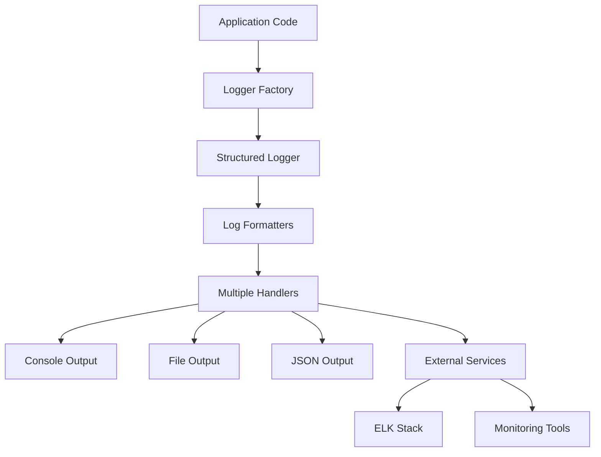

# Logging

Comprehensive logging strategy and implementation guide for the StudyAssistant project.

## Overview

StudyAssistant implements structured, centralized logging with multiple output formats, log levels, and contextual information to support debugging, monitoring, and audit requirements.

## Logging Architecture

### Core Components



## Logger Configuration

### Main Logger Setup

```python
import logging
import logging.config
import json
import sys
from datetime import datetime
from pathlib import Path
from typing import Dict, Any, Optional
import structlog
from pythonjsonlogger import jsonlogger

class StudyAssistantLogger:
    """Centralized logger configuration for StudyAssistant."""
    
    def __init__(self, config_path: Optional[Path] = None):
        self.config_path = config_path or Path("config/logging.yaml")
        self.setup_logging()
        
    def setup_logging(self):
        """Setup structured logging configuration."""
        
        # Configure structlog
        structlog.configure(
            processors=[
                structlog.contextvars.merge_contextvars,
                structlog.processors.add_log_level,
                structlog.processors.TimeStamper(fmt="iso"),
                structlog.dev.ConsoleRenderer(colors=True)
            ],
            wrapper_class=structlog.make_filtering_bound_logger(logging.INFO),
            logger_factory=structlog.WriteLoggerFactory(),
            cache_logger_on_first_use=True,
        )
        
        # Configure standard logging
        logging.basicConfig(
            level=logging.INFO,
            format='%(asctime)s - %(name)s - %(levelname)s - %(message)s',
            handlers=[
                logging.StreamHandler(sys.stdout),
                logging.FileHandler('logs/studyassistant.log'),
            ]
        )

# Global logger instance
logger_manager = StudyAssistantLogger()

def get_logger(name: str):
    """Get a structured logger instance."""
    return structlog.get_logger(name)
```

### JSON Formatter for Structured Logging

```python
import json
import logging
from datetime import datetime
from typing import Dict, Any

class StudyAssistantJSONFormatter(jsonlogger.JsonFormatter):
    """Custom JSON formatter for StudyAssistant logs."""
    
    def add_fields(self, log_record: Dict[str, Any], record: logging.LogRecord, message_dict: Dict[str, Any]):
        """Add custom fields to log record."""
        super().add_fields(log_record, record, message_dict)
        
        # Add timestamp
        if not log_record.get('timestamp'):
            log_record['timestamp'] = datetime.utcnow().isoformat()
            
        # Add service information
        log_record['service'] = 'studyassistant'
        log_record['version'] = self._get_version()
        
        # Add level name
        if log_record.get('level'):
            log_record['level'] = log_record['level'].upper()
        else:
            log_record['level'] = record.levelname
            
        # Add correlation ID if available
        correlation_id = getattr(record, 'correlation_id', None)
        if correlation_id:
            log_record['correlation_id'] = correlation_id
            
        # Add user context if available
        user_id = getattr(record, 'user_id', None)
        if user_id:
            log_record['user_id'] = user_id
            
    def _get_version(self) -> str:
        """Get application version."""
        try:
            from studyassistant import __version__
            return __version__
        except ImportError:
            return "unknown"

# Custom log handler with rotation
class RotatingJSONHandler(logging.handlers.RotatingFileHandler):
    """Rotating file handler with JSON formatting."""
    
    def __init__(self, filename: str, max_bytes: int = 10485760, backup_count: int = 5):
        super().__init__(filename, maxBytes=max_bytes, backupCount=backup_count)
        self.setFormatter(StudyAssistantJSONFormatter())
```

## Contextual Logging

### Context Variables

```python
import contextvars
from typing import Dict, Any, Optional
from uuid import uuid4

# Context variables for request tracking
correlation_id: contextvars.ContextVar[str] = contextvars.ContextVar('correlation_id')
user_id: contextvars.ContextVar[str] = contextvars.ContextVar('user_id')
operation_context: contextvars.ContextVar[Dict[str, Any]] = contextvars.ContextVar('operation_context', default={})

class LoggingContextManager:
    """Manage logging context across operations."""
    
    def __init__(self):
        self.context_stack = []
        
    def set_correlation_id(self, corr_id: Optional[str] = None) -> str:
        """Set correlation ID for request tracking."""
        corr_id = corr_id or str(uuid4())
        correlation_id.set(corr_id)
        return corr_id
        
    def set_user_context(self, user_id_val: str):
        """Set user context for request tracking."""
        user_id.set(user_id_val)
        
    def add_operation_context(self, **context):
        """Add operation-specific context."""
        current_context = operation_context.get({})
        updated_context = {**current_context, **context}
        operation_context.set(updated_context)

# Global context manager
logging_context = LoggingContextManager()

# Context-aware logger
class ContextualLogger:
    """Logger that automatically includes context variables."""
    
    def __init__(self, name: str):
        self.logger = structlog.get_logger(name)
        
    def _get_context(self) -> Dict[str, Any]:
        """Get current logging context."""
        context = {}
        
        try:
            context['correlation_id'] = correlation_id.get()
        except LookupError:
            pass
            
        try:
            context['user_id'] = user_id.get()
        except LookupError:
            pass
            
        try:
            context.update(operation_context.get())
        except LookupError:
            pass
            
        return context
        
    def info(self, message: str, **kwargs):
        """Log info message with context."""
        context = self._get_context()
        self.logger.info(message, **context, **kwargs)
        
    def warning(self, message: str, **kwargs):
        """Log warning message with context."""
        context = self._get_context()
        self.logger.warning(message, **context, **kwargs)
        
    def error(self, message: str, **kwargs):
        """Log error message with context."""
        context = self._get_context()
        self.logger.error(message, **context, **kwargs)
        
    def debug(self, message: str, **kwargs):
        """Log debug message with context."""
        context = self._get_context()
        self.logger.debug(message, **context, **kwargs)

def get_contextual_logger(name: str) -> ContextualLogger:
    """Get a contextual logger instance."""
    return ContextualLogger(name)
```

### Context Decorators

```python
from functools import wraps
from typing import Callable, Any

def with_logging_context(**context_kwargs):
    """Decorator to add logging context to function calls."""
    
    def decorator(func: Callable) -> Callable:
        @wraps(func)
        async def async_wrapper(*args, **kwargs):
            # Set context
            for key, value in context_kwargs.items():
                logging_context.add_operation_context(**{key: value})
            
            # Add function name to context
            logging_context.add_operation_context(
                function=func.__name__,
                module=func.__module__
            )
            
            logger = get_contextual_logger(func.__module__)
            
            try:
                logger.info(f"Starting {func.__name__}")
                result = await func(*args, **kwargs)
                logger.info(f"Completed {func.__name__}")
                return result
                
            except Exception as e:
                logger.error(f"Error in {func.__name__}: {str(e)}", error=str(e))
                raise
                
        @wraps(func)
        def sync_wrapper(*args, **kwargs):
            # Set context
            for key, value in context_kwargs.items():
                logging_context.add_operation_context(**{key: value})
            
            logging_context.add_operation_context(
                function=func.__name__,
                module=func.__module__
            )
            
            logger = get_contextual_logger(func.__module__)
            
            try:
                logger.info(f"Starting {func.__name__}")
                result = func(*args, **kwargs)
                logger.info(f"Completed {func.__name__}")
                return result
                
            except Exception as e:
                logger.error(f"Error in {func.__name__}: {str(e)}", error=str(e))
                raise
        
        # Return appropriate wrapper based on function type
        if asyncio.iscoroutinefunction(func):
            return async_wrapper
        else:
            return sync_wrapper
            
    return decorator

# Usage examples
@with_logging_context(component="data_fetcher")
async def fetch_arxiv_paper(paper_id: str):
    """Fetch paper with logging context."""
    logger = get_contextual_logger(__name__)
    logger.info("Fetching ArXiv paper", paper_id=paper_id)
    
    # Fetch logic here
    return paper_data
```

## Performance Logging

### Timing Decorator

```python
import time
import asyncio
from functools import wraps
from typing import Callable

def log_performance(threshold_seconds: float = 1.0):
    """Decorator to log function performance metrics."""
    
    def decorator(func: Callable) -> Callable:
        @wraps(func)
        async def async_wrapper(*args, **kwargs):
            start_time = time.time()
            logger = get_contextual_logger(func.__module__)
            
            try:
                result = await func(*args, **kwargs)
                execution_time = time.time() - start_time
                
                if execution_time > threshold_seconds:
                    logger.warning(
                        f"Slow execution: {func.__name__}",
                        execution_time=execution_time,
                        threshold=threshold_seconds
                    )
                else:
                    logger.debug(
                        f"Performance: {func.__name__}",
                        execution_time=execution_time
                    )
                    
                return result
                
            except Exception as e:
                execution_time = time.time() - start_time
                logger.error(
                    f"Error in {func.__name__} after {execution_time:.2f}s",
                    execution_time=execution_time,
                    error=str(e)
                )
                raise
                
        @wraps(func)
        def sync_wrapper(*args, **kwargs):
            start_time = time.time()
            logger = get_contextual_logger(func.__module__)
            
            try:
                result = func(*args, **kwargs)
                execution_time = time.time() - start_time
                
                if execution_time > threshold_seconds:
                    logger.warning(
                        f"Slow execution: {func.__name__}",
                        execution_time=execution_time,
                        threshold=threshold_seconds
                    )
                else:
                    logger.debug(
                        f"Performance: {func.__name__}",
                        execution_time=execution_time
                    )
                    
                return result
                
            except Exception as e:
                execution_time = time.time() - start_time
                logger.error(
                    f"Error in {func.__name__} after {execution_time:.2f}s",
                    execution_time=execution_time,
                    error=str(e)
                )
                raise
        
        if asyncio.iscoroutinefunction(func):
            return async_wrapper
        else:
            return sync_wrapper
            
    return decorator

# Usage
@log_performance(threshold_seconds=2.0)
async def expensive_operation(data: Dict[str, Any]):
    """Example of expensive operation with performance logging."""
    # Simulate work
    await asyncio.sleep(1.5)
    return processed_data
```

### Resource Usage Logging

```python
import psutil
import threading
import time
from dataclasses import dataclass
from typing import Dict, Any

@dataclass
class ResourceMetrics:
    """Resource usage metrics."""
    cpu_percent: float
    memory_mb: float
    memory_percent: float
    disk_io_read: int
    disk_io_write: int
    network_io_sent: int
    network_io_recv: int
    timestamp: float

class ResourceMonitor:
    """Monitor and log resource usage."""
    
    def __init__(self, log_interval: int = 60):
        self.log_interval = log_interval
        self.logger = get_contextual_logger(__name__)
        self.monitoring = False
        self.monitor_thread = None
        
    def start_monitoring(self):
        """Start resource monitoring in background thread."""
        if self.monitoring:
            return
            
        self.monitoring = True
        self.monitor_thread = threading.Thread(target=self._monitor_loop)
        self.monitor_thread.daemon = True
        self.monitor_thread.start()
        
    def stop_monitoring(self):
        """Stop resource monitoring."""
        self.monitoring = False
        if self.monitor_thread:
            self.monitor_thread.join()
            
    def _monitor_loop(self):
        """Background monitoring loop."""
        process = psutil.Process()
        
        while self.monitoring:
            try:
                metrics = self._collect_metrics(process)
                self._log_metrics(metrics)
                time.sleep(self.log_interval)
                
            except Exception as e:
                self.logger.error(f"Error in resource monitoring: {str(e)}")
                
    def _collect_metrics(self, process: psutil.Process) -> ResourceMetrics:
        """Collect current resource metrics."""
        cpu_percent = process.cpu_percent()
        memory_info = process.memory_info()
        memory_percent = process.memory_percent()
        
        # Get I/O counters if available
        try:
            io_counters = process.io_counters()
            disk_io_read = io_counters.read_bytes
            disk_io_write = io_counters.write_bytes
        except (psutil.AccessDenied, AttributeError):
            disk_io_read = disk_io_write = 0
            
        # Get network I/O if available
        try:
            net_io = psutil.net_io_counters()
            network_io_sent = net_io.bytes_sent
            network_io_recv = net_io.bytes_recv
        except (psutil.AccessDenied, AttributeError):
            network_io_sent = network_io_recv = 0
            
        return ResourceMetrics(
            cpu_percent=cpu_percent,
            memory_mb=memory_info.rss / 1024 / 1024,
            memory_percent=memory_percent,
            disk_io_read=disk_io_read,
            disk_io_write=disk_io_write,
            network_io_sent=network_io_sent,
            network_io_recv=network_io_recv,
            timestamp=time.time()
        )
        
    def _log_metrics(self, metrics: ResourceMetrics):
        """Log resource metrics."""
        self.logger.info(
            "Resource usage metrics",
            cpu_percent=metrics.cpu_percent,
            memory_mb=metrics.memory_mb,
            memory_percent=metrics.memory_percent,
            disk_io_read_mb=metrics.disk_io_read / 1024 / 1024,
            disk_io_write_mb=metrics.disk_io_write / 1024 / 1024,
            network_io_sent_mb=metrics.network_io_sent / 1024 / 1024,
            network_io_recv_mb=metrics.network_io_recv / 1024 / 1024
        )

# Global resource monitor
resource_monitor = ResourceMonitor()
```

## Database Query Logging

### Database Logger

```python
import time
from typing import Dict, Any, Optional
from sqlalchemy.engine import Engine
from sqlalchemy import event

class DatabaseLogger:
    """Log database queries and performance."""
    
    def __init__(self):
        self.logger = get_contextual_logger(__name__)
        self.slow_query_threshold = 1.0  # seconds
        
    def setup_query_logging(self, engine: Engine):
        """Setup SQLAlchemy query logging."""
        
        @event.listens_for(engine, "before_cursor_execute")
        def before_cursor_execute(conn, cursor, statement, parameters, context, executemany):
            context._query_start_time = time.time()
            
        @event.listens_for(engine, "after_cursor_execute")
        def after_cursor_execute(conn, cursor, statement, parameters, context, executemany):
            total_time = time.time() - context._query_start_time
            
            # Log slow queries
            if total_time > self.slow_query_threshold:
                self.logger.warning(
                    "Slow database query",
                    query=statement[:200],  # Truncate long queries
                    execution_time=total_time,
                    parameters=str(parameters)[:100] if parameters else None
                )
            else:
                self.logger.debug(
                    "Database query",
                    execution_time=total_time,
                    query=statement[:100]
                )

# Usage
db_logger = DatabaseLogger()
db_logger.setup_query_logging(database_engine)
```

## Log Aggregation and Analysis

### Log Analysis Tools

```python
import json
import re
from collections import defaultdict, Counter
from datetime import datetime, timedelta
from pathlib import Path
from typing import Dict, List, Any, Optional

class LogAnalyzer:
    """Analyze application logs for patterns and issues."""
    
    def __init__(self, log_file: Path):
        self.log_file = log_file
        self.logger = get_contextual_logger(__name__)
        
    def analyze_error_patterns(self, hours_back: int = 24) -> Dict[str, Any]:
        """Analyze error patterns in recent logs."""
        cutoff_time = datetime.now() - timedelta(hours=hours_back)
        error_patterns = defaultdict(int)
        error_details = []
        
        with open(self.log_file, 'r') as f:
            for line in f:
                try:
                    log_entry = json.loads(line)
                    log_time = datetime.fromisoformat(log_entry.get('timestamp', ''))
                    
                    if log_time < cutoff_time:
                        continue
                        
                    if log_entry.get('level') in ['ERROR', 'CRITICAL']:
                        error_type = log_entry.get('error', 'unknown')
                        error_patterns[error_type] += 1
                        error_details.append({
                            'timestamp': log_entry['timestamp'],
                            'error': error_type,
                            'message': log_entry.get('message', ''),
                            'context': log_entry.get('context', {})
                        })
                        
                except (json.JSONDecodeError, ValueError):
                    continue
                    
        return {
            'error_patterns': dict(error_patterns),
            'total_errors': sum(error_patterns.values()),
            'recent_errors': error_details[-10:],  # Last 10 errors
            'analysis_period': f"{hours_back} hours"
        }
        
    def analyze_performance_trends(self, hours_back: int = 24) -> Dict[str, Any]:
        """Analyze performance trends in logs."""
        cutoff_time = datetime.now() - timedelta(hours=hours_back)
        execution_times = defaultdict(list)
        slow_operations = []
        
        with open(self.log_file, 'r') as f:
            for line in f:
                try:
                    log_entry = json.loads(line)
                    log_time = datetime.fromisoformat(log_entry.get('timestamp', ''))
                    
                    if log_time < cutoff_time:
                        continue
                        
                    if 'execution_time' in log_entry:
                        function_name = log_entry.get('function', 'unknown')
                        exec_time = log_entry['execution_time']
                        execution_times[function_name].append(exec_time)
                        
                        if exec_time > 2.0:  # Slow operation threshold
                            slow_operations.append({
                                'timestamp': log_entry['timestamp'],
                                'function': function_name,
                                'execution_time': exec_time
                            })
                            
                except (json.JSONDecodeError, ValueError):
                    continue
        
        # Calculate statistics
        performance_stats = {}
        for function, times in execution_times.items():
            if times:
                performance_stats[function] = {
                    'avg_time': sum(times) / len(times),
                    'max_time': max(times),
                    'min_time': min(times),
                    'call_count': len(times)
                }
                
        return {
            'performance_stats': performance_stats,
            'slow_operations': slow_operations,
            'analysis_period': f"{hours_back} hours"
        }

# Usage
log_analyzer = LogAnalyzer(Path("logs/studyassistant.log"))
error_analysis = log_analyzer.analyze_error_patterns(hours_back=6)
performance_analysis = log_analyzer.analyze_performance_trends(hours_back=6)
```

### Log Rotation and Cleanup

```python
import gzip
import shutil
from datetime import datetime, timedelta
from pathlib import Path
import schedule
import time

class LogRotationManager:
    """Manage log file rotation and cleanup."""
    
    def __init__(self, log_dir: Path, max_age_days: int = 30):
        self.log_dir = log_dir
        self.max_age_days = max_age_days
        self.logger = get_contextual_logger(__name__)
        
    def rotate_logs(self):
        """Rotate and compress old log files."""
        cutoff_date = datetime.now() - timedelta(days=1)
        
        for log_file in self.log_dir.glob("*.log"):
            if log_file.stat().st_mtime < cutoff_date.timestamp():
                self._compress_log_file(log_file)
                
    def _compress_log_file(self, log_file: Path):
        """Compress a log file."""
        compressed_file = log_file.with_suffix(f".log.{datetime.now().strftime('%Y%m%d')}.gz")
        
        try:
            with open(log_file, 'rb') as f_in:
                with gzip.open(compressed_file, 'wb') as f_out:
                    shutil.copyfileobj(f_in, f_out)
                    
            log_file.unlink()  # Remove original file
            self.logger.info(f"Compressed log file: {log_file} -> {compressed_file}")
            
        except Exception as e:
            self.logger.error(f"Failed to compress log file {log_file}: {str(e)}")
            
    def cleanup_old_logs(self):
        """Remove old compressed log files."""
        cutoff_date = datetime.now() - timedelta(days=self.max_age_days)
        
        for log_file in self.log_dir.glob("*.log.*.gz"):
            if log_file.stat().st_mtime < cutoff_date.timestamp():
                try:
                    log_file.unlink()
                    self.logger.info(f"Removed old log file: {log_file}")
                except Exception as e:
                    self.logger.error(f"Failed to remove old log file {log_file}: {str(e)}")
                    
    def schedule_maintenance(self):
        """Schedule regular log maintenance."""
        schedule.every().day.at("02:00").do(self.rotate_logs)
        schedule.every().week.do(self.cleanup_old_logs)
        
        while True:
            schedule.run_pending()
            time.sleep(60)  # Check every minute

# Usage
log_manager = LogRotationManager(Path("logs"))
```

## Security and Sensitive Data

### Sensitive Data Filtering

```python
import re
from typing import Any, Dict

class SensitiveDataFilter:
    """Filter sensitive data from log messages."""
    
    def __init__(self):
        self.patterns = {
            'email': re.compile(r'\b[A-Za-z0-9._%+-]+@[A-Za-z0-9.-]+\.[A-Z|a-z]{2,}\b'),
            'phone': re.compile(r'\b\d{3}-?\d{3}-?\d{4}\b'),
            'ssn': re.compile(r'\b\d{3}-?\d{2}-?\d{4}\b'),
            'credit_card': re.compile(r'\b\d{4}[- ]?\d{4}[- ]?\d{4}[- ]?\d{4}\b'),
            'ip_address': re.compile(r'\b\d{1,3}\.\d{1,3}\.\d{1,3}\.\d{1,3}\b'),
            'api_key': re.compile(r'\b[A-Za-z0-9]{32,}\b'),
        }
        
    def filter_message(self, message: str) -> str:
        """Filter sensitive data from log message."""
        filtered_message = message
        
        for data_type, pattern in self.patterns.items():
            filtered_message = pattern.sub(f'[{data_type.upper()}_REDACTED]', filtered_message)
            
        return filtered_message
        
    def filter_context(self, context: Dict[str, Any]) -> Dict[str, Any]:
        """Filter sensitive data from context dictionary."""
        filtered_context = {}
        
        for key, value in context.items():
            if key.lower() in ['password', 'token', 'secret', 'key', 'auth']:
                filtered_context[key] = '[REDACTED]'
            elif isinstance(value, str):
                filtered_context[key] = self.filter_message(value)
            else:
                filtered_context[key] = value
                
        return filtered_context

# Global filter instance
sensitive_filter = SensitiveDataFilter()

class SecureLogger(ContextualLogger):
    """Logger with automatic sensitive data filtering."""
    
    def __init__(self, name: str):
        super().__init__(name)
        self.filter = sensitive_filter
        
    def _filter_args(self, message: str, **kwargs) -> tuple:
        """Filter message and keyword arguments."""
        filtered_message = self.filter.filter_message(message)
        filtered_kwargs = self.filter.filter_context(kwargs)
        return filtered_message, filtered_kwargs
        
    def info(self, message: str, **kwargs):
        filtered_message, filtered_kwargs = self._filter_args(message, **kwargs)
        super().info(filtered_message, **filtered_kwargs)
        
    def warning(self, message: str, **kwargs):
        filtered_message, filtered_kwargs = self._filter_args(message, **kwargs)
        super().warning(filtered_message, **filtered_kwargs)
        
    def error(self, message: str, **kwargs):
        filtered_message, filtered_kwargs = self._filter_args(message, **kwargs)
        super().error(filtered_message, **filtered_kwargs)

def get_secure_logger(name: str) -> SecureLogger:
    """Get a secure logger instance."""
    return SecureLogger(name)
```

## Configuration

### Logging Configuration File

```yaml
# config/logging.yaml
version: 1
disable_existing_loggers: false

formatters:
  simple:
    format: '%(asctime)s - %(name)s - %(levelname)s - %(message)s'
  
  detailed:
    format: '%(asctime)s - %(name)s - %(levelname)s - %(module)s - %(funcName)s - %(message)s'
  
  json:
    '()': 'studyassistant.logging.StudyAssistantJSONFormatter'
    format: '%(timestamp)s %(level)s %(name)s %(message)s'

handlers:
  console:
    class: logging.StreamHandler
    level: INFO
    formatter: simple
    stream: ext://sys.stdout
  
  file:
    class: logging.handlers.RotatingFileHandler
    level: DEBUG
    formatter: detailed
    filename: logs/studyassistant.log
    maxBytes: 10485760  # 10MB
    backupCount: 5
  
  json_file:
    class: logging.handlers.RotatingFileHandler
    level: INFO
    formatter: json
    filename: logs/studyassistant.json
    maxBytes: 10485760  # 10MB
    backupCount: 5
  
  error_file:
    class: logging.handlers.RotatingFileHandler
    level: ERROR
    formatter: detailed
    filename: logs/errors.log
    maxBytes: 10485760  # 10MB
    backupCount: 10

loggers:
  studyassistant:
    level: DEBUG
    handlers: [console, file, json_file]
    propagate: false
  
  studyassistant.errors:
    level: ERROR
    handlers: [error_file]
    propagate: false
  
  sqlalchemy.engine:
    level: WARNING
    handlers: [file]
    propagate: false

root:
  level: WARNING
  handlers: [console]

# Application-specific settings
app_logging:
  enable_performance_logging: true
  enable_resource_monitoring: true
  performance_threshold: 1.0
  resource_log_interval: 60
  
  # Sensitive data filtering
  enable_sensitive_filtering: true
  custom_sensitive_patterns:
    - 'password'
    - 'token'
    - 'secret'
    - 'api_key'
  
  # Log retention
  max_log_age_days: 30
  compress_old_logs: true
  
  # External integrations
  external_logging:
    enable_elk_stack: false
    elk_host: 'localhost'
    elk_port: 9200
    
    enable_syslog: false
    syslog_host: 'localhost'
    syslog_port: 514
```

## Integration Examples

### Flask Integration

```python
from flask import Flask, request, g
import uuid

app = Flask(__name__)

@app.before_request
def before_request():
    """Set up logging context for each request."""
    g.correlation_id = request.headers.get('X-Correlation-ID', str(uuid.uuid4()))
    logging_context.set_correlation_id(g.correlation_id)
    
    # Add request context
    logging_context.add_operation_context(
        method=request.method,
        url=request.url,
        remote_addr=request.remote_addr,
        user_agent=request.headers.get('User-Agent', 'unknown')
    )

@app.after_request
def after_request(response):
    """Log request completion."""
    logger = get_contextual_logger(__name__)
    logger.info(
        "Request completed",
        status_code=response.status_code,
        content_length=response.content_length
    )
    return response
```

### Async Context Manager

```python
import asyncio
from contextlib import asynccontextmanager

@asynccontextmanager
async def logging_operation_context(operation_name: str, **context):
    """Async context manager for logging operations."""
    logger = get_contextual_logger(__name__)
    start_time = time.time()
    
    # Set context
    logging_context.add_operation_context(
        operation=operation_name,
        **context
    )
    
    try:
        logger.info(f"Starting operation: {operation_name}")
        yield
        execution_time = time.time() - start_time
        logger.info(
            f"Completed operation: {operation_name}",
            execution_time=execution_time
        )
        
    except Exception as e:
        execution_time = time.time() - start_time
        logger.error(
            f"Failed operation: {operation_name}",
            execution_time=execution_time,
            error=str(e)
        )
        raise

# Usage
async def process_documents(doc_ids: List[str]):
    """Process documents with logging context."""
    async with logging_operation_context("document_processing", doc_count=len(doc_ids)):
        results = []
        for doc_id in doc_ids:
            async with logging_operation_context("single_document", doc_id=doc_id):
                result = await process_single_document(doc_id)
                results.append(result)
        return results
```

## Best Practices Summary

1. **Use Structured Logging**: Implement JSON formatting for machine readability
2. **Include Context**: Add correlation IDs and operation context
3. **Filter Sensitive Data**: Automatically redact sensitive information
4. **Monitor Performance**: Log execution times and resource usage
5. **Implement Log Rotation**: Manage log file sizes and retention
6. **Use Appropriate Levels**: Follow logging level conventions
7. **Centralize Configuration**: Use configuration files for log settings
8. **Enable Async Logging**: Use async handlers for high-throughput applications
9. **Implement Log Analysis**: Build tools to analyze log patterns
10. **Test Logging**: Include logging verification in tests

## Related Documentation

- [Error Handling](./error-handling.md)
- [Performance Optimization](./performance-optimization.md)
- [Security Guidelines](./security.md)
- [Testing Strategies](./testing.md)
