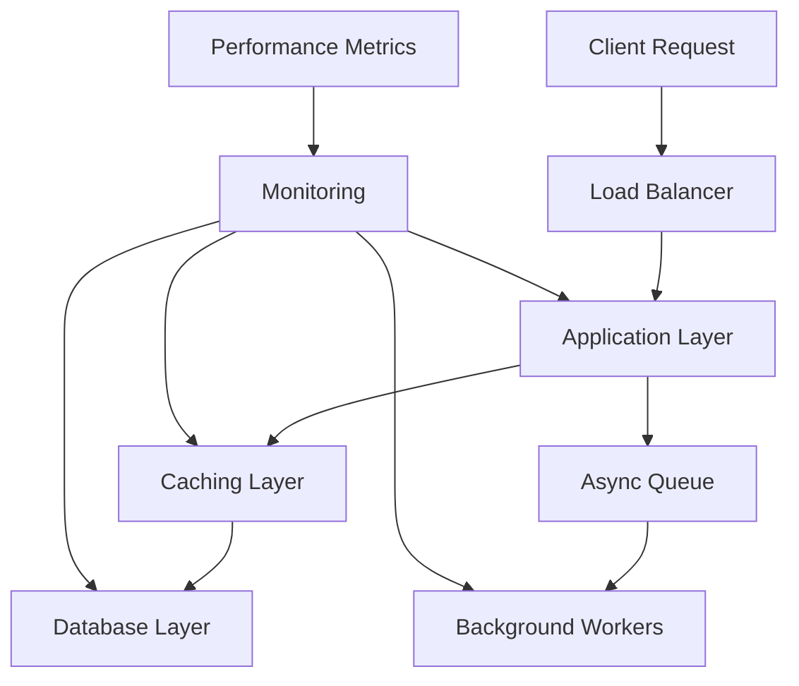

# Performance Optimization

Comprehensive guide to performance optimization strategies and techniques for the StudyAssistant project.

## Overview

StudyAssistant implements multi-layered performance optimization strategies covering database optimization, caching, async processing, memory management, and system-level optimizations to ensure high throughput and low latency.

## Performance Architecture

### System Performance Overview



## Database Optimization

### Query Optimization

```python
import asyncio
from typing import List, Dict, Any, Optional
from sqlalchemy import text, select, func
from sqlalchemy.ext.asyncio import AsyncSession
from sqlalchemy.orm import selectinload, joinedload

class OptimizedPaperRepository:
    """Optimized paper repository with performance enhancements."""
    
    def __init__(self, session: AsyncSession):
        self.session = session
        
    async def get_papers_with_embeddings(
        self, 
        limit: int = 100,
        offset: int = 0
    ) -> List[Paper]:
        """Optimized query to fetch papers with embeddings."""
        
        # Use selective loading to avoid N+1 queries
        query = (
            select(Paper)
            .options(
                selectinload(Paper.embeddings),
                selectinload(Paper.authors),
                joinedload(Paper.categories)
            )
            .limit(limit)
            .offset(offset)
        )
        
        result = await self.session.execute(query)
        return result.scalars().all()
    
    async def search_papers_optimized(
        self, 
        query_text: str,
        category_filters: Optional[List[str]] = None,
        limit: int = 50
    ) -> List[Paper]:
        """Optimized full-text search with filters."""
        
        # Use PostgreSQL full-text search for better performance
        base_query = (
            select(Paper)
            .where(
                func.to_tsvector('english', Paper.title + ' ' + Paper.abstract)
                .match(func.plainto_tsquery('english', query_text))
            )
        )
        
        # Add category filters if provided
        if category_filters:
            base_query = base_query.where(Paper.categories.any(name.in_(category_filters)))
        
        # Order by relevance score
        query = (
            base_query
            .order_by(
                func.ts_rank(
                    func.to_tsvector('english', Paper.title + ' ' + Paper.abstract),
                    func.plainto_tsquery('english', query_text)
                ).desc()
            )
            .limit(limit)
        )
        
        result = await self.session.execute(query)
        return result.scalars().all()
    
    async def bulk_insert_papers(self, papers: List[Dict[str, Any]]) -> None:
        """Optimized bulk insert using raw SQL."""
        
        if not papers:
            return
            
        # Use raw SQL for maximum performance
        insert_query = text("""
            INSERT INTO papers (arxiv_id, title, abstract, authors, published_date, categories)
            VALUES (:arxiv_id, :title, :abstract, :authors, :published_date, :categories)
            ON CONFLICT (arxiv_id) DO UPDATE SET
                title = EXCLUDED.title,
                abstract = EXCLUDED.abstract,
                updated_at = CURRENT_TIMESTAMP
        """)
        
        # Execute in batches for optimal memory usage
        batch_size = 1000
        for i in range(0, len(papers), batch_size):
            batch = papers[i:i + batch_size]
            await self.session.execute(insert_query, batch)
        
        await self.session.commit()
    
    async def get_paper_statistics(self) -> Dict[str, Any]:
        """Get paper statistics with optimized aggregation."""
        
        # Use single query for multiple aggregations
        query = text("""
            SELECT 
                COUNT(*) as total_papers,
                COUNT(DISTINCT UNNEST(string_to_array(authors, ','))) as total_authors,
                COUNT(DISTINCT UNNEST(string_to_array(categories, ','))) as total_categories,
                AVG(LENGTH(abstract)) as avg_abstract_length,
                MIN(published_date) as earliest_paper,
                MAX(published_date) as latest_paper
            FROM papers
        """)
        
        result = await self.session.execute(query)
        row = result.fetchone()
        
        return {
            "total_papers": row.total_papers,
            "total_authors": row.total_authors,
            "total_categories": row.total_categories,
            "avg_abstract_length": float(row.avg_abstract_length or 0),
            "earliest_paper": row.earliest_paper,
            "latest_paper": row.latest_paper
        }
```

### Database Indexing Strategy

```sql
-- Performance-oriented database indexes

-- Full-text search indexes
CREATE INDEX CONCURRENTLY idx_papers_fts 
ON papers USING gin(to_tsvector('english', title || ' ' || abstract));

-- Category filtering index
CREATE INDEX CONCURRENTLY idx_papers_categories_gin 
ON papers USING gin(string_to_array(categories, ','));

-- Date range queries
CREATE INDEX CONCURRENTLY idx_papers_published_date 
ON papers (published_date DESC);

-- Author searches
CREATE INDEX CONCURRENTLY idx_papers_authors_gin 
ON papers USING gin(string_to_array(authors, ','));

-- Composite index for common query patterns
CREATE INDEX CONCURRENTLY idx_papers_category_date 
ON papers (categories, published_date DESC);

-- Embeddings optimization
CREATE INDEX CONCURRENTLY idx_embeddings_paper_id 
ON embeddings (paper_id);

-- Vector similarity search (for pgvector)
CREATE INDEX CONCURRENTLY idx_embeddings_vector_cosine 
ON embeddings USING ivfflat (embedding vector_cosine_ops) 
WITH (lists = 100);
```

### Connection Pool Optimization

```python
import asyncio
from sqlalchemy.ext.asyncio import create_async_engine, AsyncSession
from sqlalchemy.pool import QueuePool
import asyncpg

class OptimizedDatabaseManager:
    """Database manager with optimized connection pooling."""
    
    def __init__(self, database_url: str):
        self.database_url = database_url
        self.engine = None
        
    def create_optimized_engine(self):
        """Create engine with optimized pool settings."""
        
        return create_async_engine(
            self.database_url,
            # Connection pool settings
            poolclass=QueuePool,
            pool_size=20,  # Base number of connections
            max_overflow=30,  # Additional connections under load
            pool_pre_ping=True,  # Validate connections
            pool_recycle=3600,  # Recycle connections every hour
            
            # Performance settings
            echo=False,  # Disable SQL logging in production
            future=True,
            
            # asyncpg-specific optimizations
            connect_args={
                "server_settings": {
                    "jit": "off",  # Disable JIT for consistent latency
                    "application_name": "studyassistant",
                },
                "command_timeout": 30,
                "statement_cache_size": 1024,
                "prepared_statement_cache_size": 512,
            }
        )
    
    async def execute_with_retry(
        self, 
        session: AsyncSession, 
        query, 
        max_retries: int = 3
    ):
        """Execute query with connection retry logic."""
        
        for attempt in range(max_retries):
            try:
                return await session.execute(query)
            except (asyncpg.exceptions.ConnectionDoesNotExistError, 
                    asyncpg.exceptions.InterfaceError) as e:
                if attempt == max_retries - 1:
                    raise
                await asyncio.sleep(0.1 * (2 ** attempt))  # Exponential backoff
                continue
```

## Caching Strategies

### Multi-Level Caching

```python
import asyncio
import json
import hashlib
from typing import Any, Optional, Union, Dict
from datetime import datetime, timedelta
import redis.asyncio as redis
from dataclasses import dataclass

@dataclass
class CacheConfig:
    """Cache configuration settings."""
    default_ttl: int = 3600
    max_memory_cache_size: int = 1000
    redis_url: str = "redis://localhost:6379"
    enable_compression: bool = True

class MultiLevelCache:
    """Multi-level caching system with memory and Redis backends."""
    
    def __init__(self, config: CacheConfig):
        self.config = config
        self.memory_cache: Dict[str, Dict[str, Any]] = {}
        self.memory_access_times: Dict[str, datetime] = {}
        self.redis_client = None
        
    async def initialize(self):
        """Initialize Redis connection."""
        self.redis_client = redis.from_url(
            self.config.redis_url,
            encoding="utf-8",
            decode_responses=True,
            max_connections=20,
            retry_on_timeout=True
        )
    
    def _generate_cache_key(self, key: str, namespace: str = "default") -> str:
        """Generate cache key with namespace."""
        return f"{namespace}:{hashlib.md5(key.encode()).hexdigest()}"
    
    async def get(
        self, 
        key: str, 
        namespace: str = "default"
    ) -> Optional[Any]:
        """Get value from cache with multi-level fallback."""
        cache_key = self._generate_cache_key(key, namespace)
        
        # Level 1: Memory cache
        if cache_key in self.memory_cache:
            self.memory_access_times[cache_key] = datetime.now()
            cached_data = self.memory_cache[cache_key]
            
            # Check expiration
            if datetime.now() < cached_data["expires_at"]:
                return cached_data["value"]
            else:
                # Expired, remove from memory
                del self.memory_cache[cache_key]
                del self.memory_access_times[cache_key]
        
        # Level 2: Redis cache
        if self.redis_client:
            try:
                cached_value = await self.redis_client.get(cache_key)
                if cached_value:
                    value = json.loads(cached_value)
                    # Store in memory cache for faster future access
                    await self._store_in_memory(cache_key, value, self.config.default_ttl)
                    return value
            except Exception as e:
                # Log error but don't fail
                print(f"Redis cache error: {e}")
        
        return None
    
    async def set(
        self, 
        key: str, 
        value: Any, 
        ttl: int = None,
        namespace: str = "default"
    ) -> None:
        """Set value in multi-level cache."""
        cache_key = self._generate_cache_key(key, namespace)
        ttl = ttl or self.config.default_ttl
        
        # Store in memory cache
        await self._store_in_memory(cache_key, value, ttl)
        
        # Store in Redis cache
        if self.redis_client:
            try:
                serialized_value = json.dumps(value, default=str)
                await self.redis_client.setex(cache_key, ttl, serialized_value)
            except Exception as e:
                print(f"Redis cache set error: {e}")
    
    async def _store_in_memory(self, key: str, value: Any, ttl: int):
        """Store value in memory cache with LRU eviction."""
        
        # Check if we need to evict items
        if len(self.memory_cache) >= self.config.max_memory_cache_size:
            await self._evict_lru_items()
        
        expires_at = datetime.now() + timedelta(seconds=ttl)
        self.memory_cache[key] = {
            "value": value,
            "expires_at": expires_at
        }
        self.memory_access_times[key] = datetime.now()
    
    async def _evict_lru_items(self, evict_count: int = 100):
        """Evict least recently used items from memory cache."""
        
        # Sort by access time and remove oldest items
        sorted_items = sorted(
            self.memory_access_times.items(), 
            key=lambda x: x[1]
        )
        
        for key, _ in sorted_items[:evict_count]:
            self.memory_cache.pop(key, None)
            self.memory_access_times.pop(key, None)
    
    async def invalidate(self, key: str, namespace: str = "default"):
        """Invalidate cache entry at all levels."""
        cache_key = self._generate_cache_key(key, namespace)
        
        # Remove from memory
        self.memory_cache.pop(cache_key, None)
        self.memory_access_times.pop(cache_key, None)
        
        # Remove from Redis
        if self.redis_client:
            try:
                await self.redis_client.delete(cache_key)
            except Exception as e:
                print(f"Redis cache delete error: {e}")

# Caching decorators
def cached(ttl: int = 3600, namespace: str = "default"):
    """Decorator for caching function results."""
    
    def decorator(func):
        async def wrapper(*args, **kwargs):
            # Generate cache key from function name and arguments
            key_data = {
                "func": func.__name__,
                "args": args,
                "kwargs": kwargs
            }
            cache_key = json.dumps(key_data, sort_keys=True, default=str)
            
            # Try to get from cache
            cached_result = await cache_manager.get(cache_key, namespace)
            if cached_result is not None:
                return cached_result
            
            # Execute function and cache result
            result = await func(*args, **kwargs)
            await cache_manager.set(cache_key, result, ttl, namespace)
            
            return result
        return wrapper
    return decorator

# Global cache manager instance
cache_manager = MultiLevelCache(CacheConfig())
```

### Embedding Cache Optimization

```python
import numpy as np
import pickle
import zlib
from typing import List, Optional

class EmbeddingCache:
    """Specialized cache for embedding vectors with compression."""
    
    def __init__(self, cache_manager: MultiLevelCache):
        self.cache_manager = cache_manager
        self.namespace = "embeddings"
    
    async def get_embedding(self, text: str) -> Optional[np.ndarray]:
        """Get cached embedding for text."""
        cache_key = f"embed:{hashlib.md5(text.encode()).hexdigest()}"
        
        cached_data = await self.cache_manager.get(cache_key, self.namespace)
        if cached_data:
            # Decompress and deserialize
            compressed_data = bytes.fromhex(cached_data)
            pickled_data = zlib.decompress(compressed_data)
            return pickle.loads(pickled_data)
        
        return None
    
    async def store_embedding(
        self, 
        text: str, 
        embedding: np.ndarray,
        ttl: int = 86400  # 24 hours
    ):
        """Store embedding with compression."""
        cache_key = f"embed:{hashlib.md5(text.encode()).hexdigest()}"
        
        # Serialize and compress embedding
        pickled_data = pickle.dumps(embedding)
        compressed_data = zlib.compress(pickled_data, level=6)
        hex_data = compressed_data.hex()
        
        await self.cache_manager.set(cache_key, hex_data, ttl, self.namespace)
    
    async def get_batch_embeddings(
        self, 
        texts: List[str]
    ) -> Dict[str, Optional[np.ndarray]]:
        """Get multiple embeddings efficiently."""
        results = {}
        
        # Use asyncio.gather for concurrent cache lookups
        tasks = [self.get_embedding(text) for text in texts]
        embeddings = await asyncio.gather(*tasks)
        
        for text, embedding in zip(texts, embeddings):
            results[text] = embedding
        
        return results

# Usage with caching decorator
@cached(ttl=3600, namespace="papers")
async def get_paper_with_cache(paper_id: str) -> Optional[Dict[str, Any]]:
    """Get paper with automatic caching."""
    # This function result will be automatically cached
    return await paper_repository.fetch_paper(paper_id)
```

## Async Processing Optimization

### Concurrent Processing Patterns

```python
import asyncio
import aiohttp
from asyncio import Semaphore, Queue
from typing import List, Callable, Any, AsyncIterator
from dataclasses import dataclass
import time

@dataclass
class ProcessingConfig:
    """Configuration for async processing."""
    max_concurrent_tasks: int = 50
    batch_size: int = 100
    timeout_seconds: float = 30.0
    retry_attempts: int = 3
    backoff_factor: float = 1.5

class AsyncTaskProcessor:
    """High-performance async task processor with batching and rate limiting."""
    
    def __init__(self, config: ProcessingConfig):
        self.config = config
        self.semaphore = Semaphore(config.max_concurrent_tasks)
        self.rate_limiter = AsyncRateLimiter(calls_per_second=100)
        
    async def process_batch(
        self, 
        items: List[Any], 
        processor_func: Callable,
        progress_callback: Optional[Callable] = None
    ) -> List[Any]:
        """Process items in optimized batches."""
        
        results = []
        total_items = len(items)
        
        # Process in batches to manage memory and connection limits
        for i in range(0, total_items, self.config.batch_size):
            batch = items[i:i + self.config.batch_size]
            
            # Create tasks with semaphore control
            tasks = [
                self._process_with_semaphore(item, processor_func)
                for item in batch
            ]
            
            # Execute batch concurrently
            batch_results = await asyncio.gather(*tasks, return_exceptions=True)
            
            # Filter successful results and handle errors
            for result in batch_results:
                if not isinstance(result, Exception):
                    results.append(result)
                else:
                    # Log error but continue processing
                    print(f"Processing error: {result}")
            
            # Report progress
            if progress_callback:
                progress = min(i + self.config.batch_size, total_items)
                await progress_callback(progress, total_items)
        
        return results
    
    async def _process_with_semaphore(self, item: Any, processor_func: Callable):
        """Process single item with semaphore and rate limiting."""
        async with self.semaphore:
            await self.rate_limiter.acquire()
            
            for attempt in range(self.config.retry_attempts):
                try:
                    result = await asyncio.wait_for(
                        processor_func(item),
                        timeout=self.config.timeout_seconds
                    )
                    return result
                    
                except asyncio.TimeoutError:
                    if attempt == self.config.retry_attempts - 1:
                        raise
                    await asyncio.sleep(self.config.backoff_factor ** attempt)
                    
                except Exception as e:
                    if attempt == self.config.retry_attempts - 1:
                        raise
                    await asyncio.sleep(self.config.backoff_factor ** attempt)

class AsyncRateLimiter:
    """Async rate limiter with token bucket algorithm."""
    
    def __init__(self, calls_per_second: float):
        self.calls_per_second = calls_per_second
        self.tokens = calls_per_second
        self.last_update = time.time()
        self.lock = asyncio.Lock()
    
    async def acquire(self):
        """Acquire a token for rate limiting."""
        async with self.lock:
            now = time.time()
            time_passed = now - self.last_update
            
            # Add tokens based on time passed
            self.tokens = min(
                self.calls_per_second,
                self.tokens + time_passed * self.calls_per_second
            )
            self.last_update = now
            
            if self.tokens >= 1:
                self.tokens -= 1
                return
            else:
                # Wait until we can get a token
                wait_time = (1 - self.tokens) / self.calls_per_second
                await asyncio.sleep(wait_time)
                self.tokens = 0

# Streaming processor for large datasets
class StreamingProcessor:
    """Process large datasets with streaming and backpressure control."""
    
    def __init__(self, max_queue_size: int = 1000):
        self.input_queue = Queue(maxsize=max_queue_size)
        self.output_queue = Queue(maxsize=max_queue_size)
        self.workers = []
        
    async def start_workers(self, worker_count: int, processor_func: Callable):
        """Start worker tasks for processing."""
        
        async def worker():
            while True:
                try:
                    item = await self.input_queue.get()
                    if item is None:  # Shutdown signal
                        break
                        
                    result = await processor_func(item)
                    await self.output_queue.put(result)
                    self.input_queue.task_done()
                    
                except Exception as e:
                    print(f"Worker error: {e}")
                    self.input_queue.task_done()
        
        self.workers = [asyncio.create_task(worker()) for _ in range(worker_count)]
    
    async def add_item(self, item: Any):
        """Add item for processing."""
        await self.input_queue.put(item)
    
    async def get_result(self) -> Any:
        """Get processed result."""
        return await self.output_queue.get()
    
    async def process_stream(
        self, 
        items: AsyncIterator[Any],
        processor_func: Callable,
        worker_count: int = 10
    ) -> AsyncIterator[Any]:
        """Process stream of items with backpressure control."""
        
        await self.start_workers(worker_count, processor_func)
        
        # Producer task
        async def producer():
            async for item in items:
                await self.add_item(item)
            
            # Send shutdown signals
            for _ in range(worker_count):
                await self.input_queue.put(None)
        
        producer_task = asyncio.create_task(producer())
        
        # Yield results as they become available
        processed_count = 0
        try:
            async for item in items:
                processed_count += 1
                
            while processed_count > 0:
                result = await self.get_result()
                yield result
                processed_count -= 1
                
        finally:
            # Clean up workers
            await producer_task
            await asyncio.gather(*self.workers, return_exceptions=True)
```

### Memory Management

```python
import gc
import psutil
import asyncio
from typing import Dict, Any, Optional
from dataclasses import dataclass
import weakref

@dataclass
class MemoryConfig:
    """Memory management configuration."""
    max_memory_mb: int = 4096
    gc_threshold_mb: int = 1024
    cache_cleanup_interval: int = 300  # 5 minutes

class MemoryManager:
    """Advanced memory management for optimal performance."""
    
    def __init__(self, config: MemoryConfig):
        self.config = config
        self.process = psutil.Process()
        self.object_registry = weakref.WeakSet()
        self.cleanup_task = None
        
    async def start_monitoring(self):
        """Start memory monitoring task."""
        self.cleanup_task = asyncio.create_task(self._memory_monitor_loop())
    
    async def stop_monitoring(self):
        """Stop memory monitoring."""
        if self.cleanup_task:
            self.cleanup_task.cancel()
            try:
                await self.cleanup_task
            except asyncio.CancelledError:
                pass
    
    async def _memory_monitor_loop(self):
        """Background memory monitoring and cleanup."""
        while True:
            try:
                await asyncio.sleep(self.config.cache_cleanup_interval)
                await self.check_memory_usage()
            except asyncio.CancelledError:
                break
            except Exception as e:
                print(f"Memory monitor error: {e}")
    
    async def check_memory_usage(self) -> Dict[str, Any]:
        """Check current memory usage and trigger cleanup if needed."""
        memory_info = self.process.memory_info()
        memory_mb = memory_info.rss / 1024 / 1024
        
        memory_stats = {
            "memory_mb": memory_mb,
            "memory_percent": self.process.memory_percent(),
            "max_memory_mb": self.config.max_memory_mb,
            "gc_threshold_mb": self.config.gc_threshold_mb
        }
        
        if memory_mb > self.config.gc_threshold_mb:
            await self.force_cleanup()
            
        if memory_mb > self.config.max_memory_mb:
            print(f"Memory usage critical: {memory_mb:.1f}MB")
            await self.aggressive_cleanup()
        
        return memory_stats
    
    async def force_cleanup(self):
        """Force garbage collection and cache cleanup."""
        # Force garbage collection
        collected = gc.collect()
        
        # Clear weak references to unused objects
        self.object_registry.clear()
        
        # Clear module-level caches if available
        await self._clear_caches()
        
        print(f"Memory cleanup: collected {collected} objects")
    
    async def aggressive_cleanup(self):
        """Aggressive memory cleanup for critical situations."""
        await self.force_cleanup()
        
        # Clear all caches
        if hasattr(cache_manager, 'memory_cache'):
            cache_manager.memory_cache.clear()
            cache_manager.memory_access_times.clear()
        
        # Force additional GC passes
        for _ in range(3):
            gc.collect()
        
        print("Aggressive memory cleanup completed")
    
    async def _clear_caches(self):
        """Clear various application caches."""
        # Clear function caches
        for obj in gc.get_objects():
            if hasattr(obj, 'cache_clear'):
                try:
                    obj.cache_clear()
                except:
                    pass
    
    def register_object(self, obj: Any):
        """Register object for memory tracking."""
        self.object_registry.add(obj)
    
    def get_memory_profile(self) -> Dict[str, Any]:
        """Get detailed memory profile."""
        memory_info = self.process.memory_info()
        
        return {
            "rss_mb": memory_info.rss / 1024 / 1024,
            "vms_mb": memory_info.vms / 1024 / 1024,
            "percent": self.process.memory_percent(),
            "available_mb": psutil.virtual_memory().available / 1024 / 1024,
            "gc_stats": {
                "gen0": gc.get_count()[0],
                "gen1": gc.get_count()[1], 
                "gen2": gc.get_count()[2],
            },
            "registered_objects": len(self.object_registry)
        }

# Context manager for memory-aware processing
class MemoryAwareProcessor:
    """Context manager for memory-aware processing."""
    
    def __init__(self, memory_manager: MemoryManager, max_items: int = 1000):
        self.memory_manager = memory_manager
        self.max_items = max_items
        self.processed_items = 0
        
    async def __aenter__(self):
        await self.memory_manager.check_memory_usage()
        return self
        
    async def __aexit__(self, exc_type, exc_val, exc_tb):
        if self.processed_items > self.max_items:
            await self.memory_manager.force_cleanup()
    
    async def process_item(self, item: Any, processor_func: Callable):
        """Process item with memory monitoring."""
        self.processed_items += 1
        
        # Check memory every 100 items
        if self.processed_items % 100 == 0:
            memory_stats = await self.memory_manager.check_memory_usage()
            if memory_stats["memory_mb"] > self.memory_manager.config.gc_threshold_mb:
                await self.memory_manager.force_cleanup()
        
        return await processor_func(item)

# Global memory manager
memory_manager = MemoryManager(MemoryConfig())
```

## HTTP Client Optimization

### Optimized HTTP Session Management

```python
import aiohttp
import asyncio
from typing import Optional, Dict, Any
import ssl
from aiohttp import TCPConnector, ClientTimeout, TraceConfig

class OptimizedHTTPClient:
    """High-performance HTTP client with connection pooling and optimization."""
    
    def __init__(self):
        self.session: Optional[aiohttp.ClientSession] = None
        self.connector: Optional[TCPConnector] = None
        
    async def initialize(self):
        """Initialize optimized HTTP session."""
        
        # Create SSL context with optimizations
        ssl_context = ssl.create_default_context()
        ssl_context.check_hostname = False
        ssl_context.verify_mode = ssl.CERT_NONE
        
        # Configure connector with performance settings
        self.connector = TCPConnector(
            limit=200,  # Total connection pool size
            limit_per_host=50,  # Connections per host
            ttl_dns_cache=300,  # DNS cache TTL
            use_dns_cache=True,
            keepalive_timeout=60,
            enable_cleanup_closed=True,
            ssl=ssl_context
        )
        
        # Configure timeout settings
        timeout = ClientTimeout(
            total=30,  # Total timeout
            connect=10,  # Connection timeout
            sock_read=10  # Socket read timeout
        )
        
        # Create session with optimizations
        self.session = aiohttp.ClientSession(
            connector=self.connector,
            timeout=timeout,
            headers={
                'User-Agent': 'StudyAssistant/1.0 (High-Performance Client)',
                'Connection': 'keep-alive'
            },
            trace_configs=[self._create_trace_config()]
        )
    
    def _create_trace_config(self) -> TraceConfig:
        """Create trace configuration for monitoring."""
        trace_config = TraceConfig()
        
        async def on_request_start(session, trace_config_ctx, params):
            trace_config_ctx.start_time = asyncio.get_event_loop().time()
        
        async def on_request_end(session, trace_config_ctx, params):
            elapsed = asyncio.get_event_loop().time() - trace_config_ctx.start_time
            if elapsed > 5.0:  # Log slow requests
                print(f"Slow request: {params.url} took {elapsed:.2f}s")
        
        trace_config.on_request_start.append(on_request_start)
        trace_config.on_request_end.append(on_request_end)
        
        return trace_config
    
    async def fetch_with_retry(
        self, 
        url: str, 
        max_retries: int = 3,
        **kwargs
    ) -> Optional[aiohttp.ClientResponse]:
        """Fetch URL with automatic retry and backoff."""
        
        for attempt in range(max_retries):
            try:
                async with self.session.get(url, **kwargs) as response:
                    if response.status == 200:
                        return response
                    elif response.status == 429:  # Rate limited
                        retry_after = int(response.headers.get('Retry-After', 60))
                        await asyncio.sleep(retry_after)
                        continue
                    else:
                        response.raise_for_status()
                        
            except (aiohttp.ClientError, asyncio.TimeoutError) as e:
                if attempt == max_retries - 1:
                    raise
                await asyncio.sleep(2 ** attempt)  # Exponential backoff
        
        return None
    
    async def fetch_multiple(
        self, 
        urls: List[str], 
        max_concurrent: int = 50
    ) -> List[Dict[str, Any]]:
        """Fetch multiple URLs concurrently with rate limiting."""
        
        semaphore = asyncio.Semaphore(max_concurrent)
        
        async def fetch_single(url: str) -> Dict[str, Any]:
            async with semaphore:
                try:
                    start_time = asyncio.get_event_loop().time()
                    async with self.session.get(url) as response:
                        content = await response.text()
                        elapsed = asyncio.get_event_loop().time() - start_time
                        
                        return {
                            "url": url,
                            "status": response.status,
                            "content": content,
                            "elapsed": elapsed,
                            "success": True
                        }
                except Exception as e:
                    return {
                        "url": url,
                        "error": str(e),
                        "success": False
                    }
        
        tasks = [fetch_single(url) for url in urls]
        results = await asyncio.gather(*tasks, return_exceptions=True)
        
        return [r for r in results if isinstance(r, dict)]
    
    async def close(self):
        """Clean up HTTP session."""
        if self.session:
            await self.session.close()
        if self.connector:
            await self.connector.close()

# Global HTTP client instance
http_client = OptimizedHTTPClient()
```

## Performance Monitoring

### Metrics Collection

```python
import time
import asyncio
from typing import Dict, Any, List
from dataclasses import dataclass, field
from collections import defaultdict, deque
import statistics

@dataclass
class PerformanceMetrics:
    """Performance metrics data structure."""
    request_count: int = 0
    total_response_time: float = 0.0
    error_count: int = 0
    min_response_time: float = float('inf')
    max_response_time: float = 0.0
    response_times: deque = field(default_factory=lambda: deque(maxlen=1000))
    
    def add_timing(self, response_time: float, success: bool = True):
        """Add timing measurement."""
        self.request_count += 1
        self.total_response_time += response_time
        self.response_times.append(response_time)
        
        if success:
            self.min_response_time = min(self.min_response_time, response_time)
            self.max_response_time = max(self.max_response_time, response_time)
        else:
            self.error_count += 1
    
    def get_stats(self) -> Dict[str, Any]:
        """Get performance statistics."""
        if not self.response_times:
            return {}
        
        times = list(self.response_times)
        return {
            "request_count": self.request_count,
            "error_count": self.error_count,
            "error_rate": self.error_count / self.request_count if self.request_count > 0 else 0,
            "avg_response_time": statistics.mean(times),
            "median_response_time": statistics.median(times),
            "p95_response_time": statistics.quantiles(times, n=20)[18] if len(times) > 20 else max(times),
            "p99_response_time": statistics.quantiles(times, n=100)[98] if len(times) > 100 else max(times),
            "min_response_time": min(times),
            "max_response_time": max(times)
        }

class PerformanceMonitor:
    """Advanced performance monitoring system."""
    
    def __init__(self):
        self.metrics: Dict[str, PerformanceMetrics] = defaultdict(PerformanceMetrics)
        self.monitoring_active = False
        self.monitor_task = None
        
    async def start_monitoring(self, report_interval: int = 60):
        """Start performance monitoring."""
        self.monitoring_active = True
        self.monitor_task = asyncio.create_task(
            self._monitoring_loop(report_interval)
        )
    
    async def stop_monitoring(self):
        """Stop performance monitoring."""
        self.monitoring_active = False
        if self.monitor_task:
            self.monitor_task.cancel()
    
    async def _monitoring_loop(self, report_interval: int):
        """Background monitoring loop."""
        while self.monitoring_active:
            try:
                await asyncio.sleep(report_interval)
                await self._generate_performance_report()
            except asyncio.CancelledError:
                break
            except Exception as e:
                print(f"Monitoring error: {e}")
    
    async def _generate_performance_report(self):
        """Generate performance report."""
        report = {
            "timestamp": time.time(),
            "metrics": {}
        }
        
        for endpoint, metrics in self.metrics.items():
            stats = metrics.get_stats()
            if stats:
                report["metrics"][endpoint] = stats
        
        # Log performance report
        print(f"Performance Report: {report}")
        
        # Send to monitoring system (e.g., Prometheus, DataDog)
        await self._send_metrics(report)
    
    async def _send_metrics(self, report: Dict[str, Any]):
        """Send metrics to external monitoring system."""
        # Implementation for external metrics system
        pass
    
    def record_timing(self, endpoint: str, response_time: float, success: bool = True):
        """Record timing for an endpoint."""
        self.metrics[endpoint].add_timing(response_time, success)
    
    def get_metrics_summary(self) -> Dict[str, Any]:
        """Get summary of all metrics."""
        summary = {}
        for endpoint, metrics in self.metrics.items():
            summary[endpoint] = metrics.get_stats()
        return summary

# Performance monitoring decorator
def monitor_performance(endpoint_name: str = None):
    """Decorator to monitor function performance."""
    
    def decorator(func):
        async def wrapper(*args, **kwargs):
            name = endpoint_name or f"{func.__module__}.{func.__name__}"
            start_time = time.time()
            success = True
            
            try:
                result = await func(*args, **kwargs)
                return result
            except Exception as e:
                success = False
                raise
            finally:
                elapsed = time.time() - start_time
                performance_monitor.record_timing(name, elapsed, success)
        
        return wrapper
    return decorator

# Global performance monitor
performance_monitor = PerformanceMonitor()
```

## Configuration and Deployment Optimization

### Production Configuration

```yaml
# config/performance.yaml
performance:
  # Database settings
  database:
    pool_size: 20
    max_overflow: 30
    pool_recycle: 3600
    echo: false
    
  # Cache settings
  cache:
    redis_url: "redis://redis-cluster:6379"
    default_ttl: 3600
    max_memory_cache_size: 10000
    enable_compression: true
    
  # HTTP client settings
  http_client:
    total_connections: 200
    connections_per_host: 50
    timeout_seconds: 30
    retry_attempts: 3
    
  # Async processing
  async_processing:
    max_concurrent_tasks: 100
    batch_size: 500
    worker_count: 20
    
  # Memory management
  memory:
    max_memory_mb: 8192
    gc_threshold_mb: 2048
    cleanup_interval: 300
    
  # Monitoring
  monitoring:
    enable_metrics: true
    report_interval: 60
    slow_query_threshold: 1.0
```

### Performance Best Practices Summary

1. **Database Optimization**
   - Use connection pooling
   - Implement proper indexing
   - Optimize queries with EXPLAIN
   - Use bulk operations for large datasets

2. **Caching Strategy**
   - Multi-level caching (memory + Redis)
   - Intelligent cache invalidation
   - Compression for large objects
   - Cache warming strategies

3. **Async Processing**
   - Use semaphores for concurrency control
   - Implement proper rate limiting
   - Batch processing for efficiency
   - Streaming for large datasets

4. **Memory Management**
   - Monitor memory usage continuously
   - Implement garbage collection strategies
   - Use weak references where appropriate
   - Clear caches under memory pressure

5. **HTTP Optimization**
   - Connection pooling and reuse
   - Proper timeout configuration
   - Retry logic with backoff
   - Request batching

6. **Monitoring and Metrics**
   - Track key performance indicators
   - Set up alerting for anomalies
   - Regular performance profiling
   - Continuous optimization

## Related Documentation

- [Scalability](./scalability.md)
- [Database Management](../architecture/components/data-manager.md)
- [Async Programming](./async-programming.md)
- [Deployment](./deployment.md)
