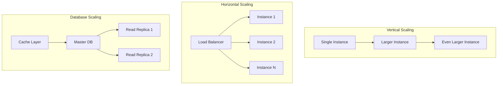

# Scalability Guide

## Overview

This guide covers scaling strategies for the StudyAssistant RAG system to handle increasing loads, data volumes, and user demands while maintaining performance and reliability.

## Scaling Architecture

### Horizontal vs Vertical Scaling



### Microservices Architecture

```python
# services/base_service.py
from abc import ABC, abstractmethod
from typing import Dict, Any, Optional
import asyncio
import aiohttp
from dataclasses import dataclass
from contextlib import asynccontextmanager

@dataclass
class ServiceConfig:
    """Service configuration."""
    name: str
    host: str
    port: int
    max_connections: int = 100
    timeout: float = 30.0
    health_check_interval: int = 30

class BaseService(ABC):
    """Base class for microservices."""
    
    def __init__(self, config: ServiceConfig):
        self.config = config
        self.session: Optional[aiohttp.ClientSession] = None
        self._health_status = True
    
    async def initialize(self):
        """Initialize service dependencies."""
        connector = aiohttp.TCPConnector(
            limit=self.config.max_connections,
            keepalive_timeout=30,
            enable_cleanup_closed=True
        )
        
        timeout = aiohttp.ClientTimeout(total=self.config.timeout)
        self.session = aiohttp.ClientSession(
            connector=connector,
            timeout=timeout
        )
        
        # Start health check task
        asyncio.create_task(self._health_check_loop())
    
    async def cleanup(self):
        """Cleanup service resources."""
        if self.session:
            await self.session.close()
    
    @abstractmethod
    async def process_request(self, request: Dict[str, Any]) -> Dict[str, Any]:
        """Process incoming request."""
        pass
    
    async def _health_check_loop(self):
        """Periodic health check."""
        while True:
            try:
                await self.health_check()
                self._health_status = True
            except Exception as e:
                logger.error(f"Health check failed: {e}")
                self._health_status = False
            
            await asyncio.sleep(self.config.health_check_interval)
    
    @abstractmethod
    async def health_check(self):
        """Check service health."""
        pass
```

### Service Registry Pattern

```python
# services/registry.py
from typing import Dict, List, Optional
import asyncio
import aiohttp
from dataclasses import dataclass, asdict
import json
import time

@dataclass
class ServiceInstance:
    """Service instance information."""
    service_name: str
    instance_id: str
    host: str
    port: int
    health_endpoint: str
    last_heartbeat: float
    metadata: Dict[str, Any]

class ServiceRegistry:
    """Service discovery and registration."""
    
    def __init__(self, consul_url: Optional[str] = None):
        self.consul_url = consul_url
        self.local_registry: Dict[str, List[ServiceInstance]] = {}
        self.session: Optional[aiohttp.ClientSession] = None
    
    async def initialize(self):
        """Initialize registry client."""
        if self.consul_url:
            self.session = aiohttp.ClientSession()
    
    async def register_service(self, instance: ServiceInstance):
        """Register service instance."""
        if self.consul_url:
            await self._register_with_consul(instance)
        else:
            await self._register_locally(instance)
    
    async def discover_service(self, service_name: str) -> List[ServiceInstance]:
        """Discover healthy service instances."""
        if self.consul_url:
            return await self._discover_from_consul(service_name)
        else:
            return await self._discover_locally(service_name)
    
    async def _register_with_consul(self, instance: ServiceInstance):
        """Register with Consul."""
        service_def = {
            "ID": instance.instance_id,
            "Name": instance.service_name,
            "Address": instance.host,
            "Port": instance.port,
            "Check": {
                "HTTP": f"http://{instance.host}:{instance.port}{instance.health_endpoint}",
                "Interval": "10s",
                "Timeout": "5s"
            },
            "Meta": instance.metadata
        }
        
        async with self.session.put(
            f"{self.consul_url}/v1/agent/service/register",
            json=service_def
        ) as response:
            if response.status != 200:
                raise Exception(f"Failed to register service: {response.status}")
    
    async def _discover_from_consul(self, service_name: str) -> List[ServiceInstance]:
        """Discover services from Consul."""
        async with self.session.get(
            f"{self.consul_url}/v1/health/service/{service_name}?passing"
        ) as response:
            if response.status == 200:
                services = await response.json()
                return [
                    ServiceInstance(
                        service_name=service["Service"]["Service"],
                        instance_id=service["Service"]["ID"],
                        host=service["Service"]["Address"],
                        port=service["Service"]["Port"],
                        health_endpoint="/health",
                        last_heartbeat=time.time(),
                        metadata=service["Service"]["Meta"] or {}
                    )
                    for service in services
                ]
        return []
```

## Load Balancing Strategies

### Application Load Balancer

```python
# load_balancer/strategies.py
from abc import ABC, abstractmethod
from typing import List, Optional
import random
import time
from collections import defaultdict

class LoadBalancingStrategy(ABC):
    """Base class for load balancing strategies."""
    
    @abstractmethod
    async def select_instance(self, instances: List[ServiceInstance]) -> Optional[ServiceInstance]:
        """Select service instance."""
        pass

class RoundRobinStrategy(LoadBalancingStrategy):
    """Round-robin load balancing."""
    
    def __init__(self):
        self.counters = defaultdict(int)
    
    async def select_instance(self, instances: List[ServiceInstance]) -> Optional[ServiceInstance]:
        if not instances:
            return None
        
        service_name = instances[0].service_name
        index = self.counters[service_name] % len(instances)
        self.counters[service_name] += 1
        
        return instances[index]

class WeightedRandowStrategy(LoadBalancingStrategy):
    """Weighted random load balancing."""
    
    async def select_instance(self, instances: List[ServiceInstance]) -> Optional[ServiceInstance]:
        if not instances:
            return None
        
        # Use CPU/memory metrics for weights
        weights = []
        for instance in instances:
            cpu_weight = 1.0 - instance.metadata.get('cpu_usage', 0.5)
            memory_weight = 1.0 - instance.metadata.get('memory_usage', 0.5)
            weights.append(cpu_weight * memory_weight)
        
        return random.choices(instances, weights=weights)[0]

class LeastConnectionsStrategy(LoadBalancingStrategy):
    """Least connections load balancing."""
    
    def __init__(self):
        self.connections = defaultdict(int)
    
    async def select_instance(self, instances: List[ServiceInstance]) -> Optional[ServiceInstance]:
        if not instances:
            return None
        
        # Select instance with fewest connections
        selected = min(instances, key=lambda x: self.connections[x.instance_id])
        self.connections[selected.instance_id] += 1
        
        return selected
    
    def release_connection(self, instance_id: str):
        """Release connection when request completes."""
        if instance_id in self.connections:
            self.connections[instance_id] = max(0, self.connections[instance_id] - 1)
```

### Circuit Breaker for Services

```python
# load_balancer/circuit_breaker.py
from enum import Enum
from typing import Dict, Callable, Any
import time
import asyncio
from dataclasses import dataclass

class CircuitState(Enum):
    CLOSED = "closed"      # Normal operation
    OPEN = "open"          # Failing, reject requests
    HALF_OPEN = "half_open"  # Testing if service recovered

@dataclass
class CircuitBreakerConfig:
    failure_threshold: int = 5
    recovery_timeout: float = 60.0
    success_threshold: int = 3
    timeout: float = 30.0

class ServiceCircuitBreaker:
    """Circuit breaker for service calls."""
    
    def __init__(self, service_id: str, config: CircuitBreakerConfig):
        self.service_id = service_id
        self.config = config
        self.state = CircuitState.CLOSED
        self.failure_count = 0
        self.success_count = 0
        self.last_failure_time = 0
        self._lock = asyncio.Lock()
    
    async def call(self, func: Callable, *args, **kwargs) -> Any:
        """Execute function with circuit breaker protection."""
        async with self._lock:
            if self.state == CircuitState.OPEN:
                if time.time() - self.last_failure_time > self.config.recovery_timeout:
                    self.state = CircuitState.HALF_OPEN
                    self.success_count = 0
                else:
                    raise CircuitBreakerOpenError(f"Circuit breaker open for {self.service_id}")
        
        try:
            # Execute with timeout
            result = await asyncio.wait_for(
                func(*args, **kwargs),
                timeout=self.config.timeout
            )
            
            await self._on_success()
            return result
            
        except Exception as e:
            await self._on_failure()
            raise
    
    async def _on_success(self):
        """Handle successful call."""
        async with self._lock:
            if self.state == CircuitState.HALF_OPEN:
                self.success_count += 1
                if self.success_count >= self.config.success_threshold:
                    self.state = CircuitState.CLOSED
                    self.failure_count = 0
            elif self.state == CircuitState.CLOSED:
                self.failure_count = 0
    
    async def _on_failure(self):
        """Handle failed call."""
        async with self._lock:
            self.failure_count += 1
            self.last_failure_time = time.time()
            
            if self.failure_count >= self.config.failure_threshold:
                self.state = CircuitState.OPEN
```

## Database Scaling

### Read Replicas Configuration

```python
# database/scaling.py
from typing import List, Optional, Dict, Any
import asyncio
import asyncpg
from contextlib import asynccontextmanager
import random

class DatabaseCluster:
    """Database cluster with read replicas."""
    
    def __init__(self, master_dsn: str, replica_dsns: List[str]):
        self.master_dsn = master_dsn
        self.replica_dsns = replica_dsns
        self.master_pool: Optional[asyncpg.Pool] = None
        self.replica_pools: List[asyncpg.Pool] = []
    
    async def initialize(self):
        """Initialize connection pools."""
        # Master pool for writes
        self.master_pool = await asyncpg.create_pool(
            self.master_dsn,
            min_size=5,
            max_size=20,
            command_timeout=30
        )
        
        # Replica pools for reads
        for replica_dsn in self.replica_dsns:
            pool = await asyncpg.create_pool(
                replica_dsn,
                min_size=5,
                max_size=20,
                command_timeout=30
            )
            self.replica_pools.append(pool)
    
    @asynccontextmanager
    async def get_connection(self, read_only: bool = False):
        """Get database connection."""
        if read_only and self.replica_pools:
            # Use random replica for read operations
            pool = random.choice(self.replica_pools)
        else:
            # Use master for writes or when no replicas available
            pool = self.master_pool
        
        async with pool.acquire() as connection:
            yield connection
    
    async def execute_query(self, query: str, *args, read_only: bool = False) -> List[Dict[str, Any]]:
        """Execute query with automatic routing."""
        async with self.get_connection(read_only=read_only) as conn:
            if read_only:
                return await conn.fetch(query, *args)
            else:
                return await conn.fetch(query, *args)
    
    async def execute_write(self, query: str, *args) -> str:
        """Execute write operation on master."""
        async with self.get_connection(read_only=False) as conn:
            return await conn.execute(query, *args)
```

### Database Sharding

```python
# database/sharding.py
from typing import Dict, Any, List, Optional
import hashlib
import asyncpg
from dataclasses import dataclass

@dataclass
class ShardConfig:
    shard_id: str
    dsn: str
    weight: float = 1.0

class DatabaseShards:
    """Database sharding implementation."""
    
    def __init__(self, shards: List[ShardConfig]):
        self.shards = shards
        self.pools: Dict[str, asyncpg.Pool] = {}
    
    async def initialize(self):
        """Initialize shard connections."""
        for shard in self.shards:
            self.pools[shard.shard_id] = await asyncpg.create_pool(
                shard.dsn,
                min_size=5,
                max_size=20
            )
    
    def get_shard_key(self, user_id: str) -> str:
        """Determine shard based on user ID."""
        hash_value = int(hashlib.md5(user_id.encode()).hexdigest(), 16)
        shard_index = hash_value % len(self.shards)
        return self.shards[shard_index].shard_id
    
    async def execute_on_shard(self, shard_key: str, query: str, *args) -> List[Dict[str, Any]]:
        """Execute query on specific shard."""
        pool = self.pools[shard_key]
        async with pool.acquire() as conn:
            return await conn.fetch(query, *args)
    
    async def execute_on_all_shards(self, query: str, *args) -> Dict[str, List[Dict[str, Any]]]:
        """Execute query on all shards."""
        results = {}
        tasks = []
        
        for shard_id, pool in self.pools.items():
            task = asyncio.create_task(
                self._execute_on_pool(pool, query, *args)
            )
            tasks.append((shard_id, task))
        
        for shard_id, task in tasks:
            results[shard_id] = await task
        
        return results
    
    async def _execute_on_pool(self, pool: asyncpg.Pool, query: str, *args):
        """Execute query on a pool."""
        async with pool.acquire() as conn:
            return await conn.fetch(query, *args)
```

## Caching Strategies

### Multi-Level Caching

```python
# caching/multi_level.py
from typing import Any, Optional, Dict, List
import asyncio
import pickle
import time
from abc import ABC, abstractmethod
import redis.asyncio as redis

class CacheBackend(ABC):
    """Abstract cache backend."""
    
    @abstractmethod
    async def get(self, key: str) -> Optional[Any]:
        pass
    
    @abstractmethod
    async def set(self, key: str, value: Any, ttl: Optional[int] = None):
        pass
    
    @abstractmethod
    async def delete(self, key: str):
        pass

class MemoryCache(CacheBackend):
    """In-memory cache backend."""
    
    def __init__(self, max_size: int = 1000):
        self.max_size = max_size
        self.cache: Dict[str, tuple] = {}  # (value, expiry)
        self._lock = asyncio.Lock()
    
    async def get(self, key: str) -> Optional[Any]:
        async with self._lock:
            if key in self.cache:
                value, expiry = self.cache[key]
                if expiry is None or time.time() < expiry:
                    return value
                else:
                    del self.cache[key]
        return None
    
    async def set(self, key: str, value: Any, ttl: Optional[int] = None):
        async with self._lock:
            expiry = time.time() + ttl if ttl else None
            
            # Evict oldest if at capacity
            if len(self.cache) >= self.max_size and key not in self.cache:
                oldest_key = next(iter(self.cache))
                del self.cache[oldest_key]
            
            self.cache[key] = (value, expiry)
    
    async def delete(self, key: str):
        async with self._lock:
            self.cache.pop(key, None)

class RedisCache(CacheBackend):
    """Redis cache backend."""
    
    def __init__(self, redis_url: str):
        self.redis_url = redis_url
        self.client: Optional[redis.Redis] = None
    
    async def initialize(self):
        """Initialize Redis connection."""
        self.client = await redis.from_url(self.redis_url)
    
    async def get(self, key: str) -> Optional[Any]:
        if not self.client:
            return None
        
        data = await self.client.get(key)
        if data:
            return pickle.loads(data)
        return None
    
    async def set(self, key: str, value: Any, ttl: Optional[int] = None):
        if not self.client:
            return
        
        data = pickle.dumps(value)
        await self.client.set(key, data, ex=ttl)
    
    async def delete(self, key: str):
        if self.client:
            await self.client.delete(key)

class MultiLevelCache:
    """Multi-level cache with L1 (memory) and L2 (Redis)."""
    
    def __init__(self, l1_cache: CacheBackend, l2_cache: CacheBackend):
        self.l1_cache = l1_cache
        self.l2_cache = l2_cache
    
    async def get(self, key: str) -> Optional[Any]:
        """Get value from cache, checking L1 first, then L2."""
        # Try L1 cache first
        value = await self.l1_cache.get(key)
        if value is not None:
            return value
        
        # Try L2 cache
        value = await self.l2_cache.get(key)
        if value is not None:
            # Promote to L1 cache
            await self.l1_cache.set(key, value, ttl=300)  # 5 min in L1
            return value
        
        return None
    
    async def set(self, key: str, value: Any, ttl: Optional[int] = None):
        """Set value in both cache levels."""
        # Set in both caches
        await asyncio.gather(
            self.l1_cache.set(key, value, ttl=min(ttl or 300, 300)),  # Max 5 min in L1
            self.l2_cache.set(key, value, ttl=ttl)
        )
    
    async def delete(self, key: str):
        """Delete from both cache levels."""
        await asyncio.gather(
            self.l1_cache.delete(key),
            self.l2_cache.delete(key)
        )
```

## Auto-Scaling Configuration

### Kubernetes Horizontal Pod Autoscaler

```yaml
# k8s/hpa.yaml
apiVersion: autoscaling/v2
kind: HorizontalPodAutoscaler
metadata:
  name: studyassistant-hpa
  namespace: default
spec:
  scaleTargetRef:
    apiVersion: apps/v1
    kind: Deployment
    name: studyassistant-api
  minReplicas: 3
  maxReplicas: 20
  metrics:
  - type: Resource
    resource:
      name: cpu
      target:
        type: Utilization
        averageUtilization: 70
  - type: Resource
    resource:
      name: memory
      target:
        type: Utilization
        averageUtilization: 80
  - type: Pods
    pods:
      metric:
        name: http_requests_per_second
      target:
        type: AverageValue
        averageValue: "100"
  behavior:
    scaleDown:
      stabilizationWindowSeconds: 300
      policies:
      - type: Percent
        value: 10
        periodSeconds: 60
    scaleUp:
      stabilizationWindowSeconds: 60
      policies:
      - type: Percent
        value: 50
        periodSeconds: 60
      - type: Pods
        value: 2
        periodSeconds: 60
      selectPolicy: Max
```

### Custom Metrics for Scaling

```python
# monitoring/custom_metrics.py
from typing import Dict, List
import asyncio
import time
from dataclasses import dataclass
from prometheus_client import Counter, Histogram, Gauge

@dataclass
class ScalingMetrics:
    """Scaling decision metrics."""
    cpu_utilization: float
    memory_utilization: float
    request_rate: float
    response_time_p95: float
    error_rate: float
    queue_depth: int

class MetricsCollector:
    """Collect metrics for scaling decisions."""
    
    def __init__(self):
        # Prometheus metrics
        self.request_counter = Counter('http_requests_total', 'Total HTTP requests', ['method', 'endpoint'])
        self.request_duration = Histogram('http_request_duration_seconds', 'HTTP request duration')
        self.queue_depth_gauge = Gauge('processing_queue_depth', 'Processing queue depth')
        self.cpu_usage_gauge = Gauge('cpu_usage_percent', 'CPU usage percentage')
        self.memory_usage_gauge = Gauge('memory_usage_percent', 'Memory usage percentage')
        
        # Internal tracking
        self.request_times: List[float] = []
        self.error_count = 0
        self.total_requests = 0
    
    async def record_request(self, method: str, endpoint: str, duration: float, error: bool = False):
        """Record request metrics."""
        self.request_counter.labels(method=method, endpoint=endpoint).inc()
        self.request_duration.observe(duration)
        
        # Track for scaling decisions
        self.request_times.append(time.time())
        self.total_requests += 1
        if error:
            self.error_count += 1
        
        # Keep only last 5 minutes of data
        cutoff = time.time() - 300
        self.request_times = [t for t in self.request_times if t > cutoff]
    
    async def get_scaling_metrics(self) -> ScalingMetrics:
        """Get current metrics for scaling decisions."""
        now = time.time()
        recent_requests = len([t for t in self.request_times if t > now - 60])  # Last minute
        
        return ScalingMetrics(
            cpu_utilization=await self._get_cpu_usage(),
            memory_utilization=await self._get_memory_usage(),
            request_rate=recent_requests / 60.0,
            response_time_p95=await self._get_p95_response_time(),
            error_rate=self.error_count / max(self.total_requests, 1),
            queue_depth=await self._get_queue_depth()
        )
    
    async def _get_cpu_usage(self) -> float:
        """Get current CPU usage."""
        # Implement CPU monitoring
        return 0.0
    
    async def _get_memory_usage(self) -> float:
        """Get current memory usage."""
        # Implement memory monitoring
        return 0.0
    
    async def _get_p95_response_time(self) -> float:
        """Get 95th percentile response time."""
        # Implement from stored response times
        return 0.0
    
    async def _get_queue_depth(self) -> int:
        """Get current processing queue depth."""
        # Implement queue monitoring
        return 0
```

## Performance Monitoring

### Resource Usage Monitoring

```python
# monitoring/resources.py
import psutil
import asyncio
from typing import Dict, Any
from dataclasses import dataclass
import time

@dataclass
class ResourceMetrics:
    """System resource metrics."""
    cpu_percent: float
    memory_percent: float
    disk_usage_percent: float
    network_io: Dict[str, int]
    disk_io: Dict[str, int]
    load_average: tuple
    open_file_descriptors: int

class ResourceMonitor:
    """Monitor system resources for scaling decisions."""
    
    def __init__(self, interval: int = 30):
        self.interval = interval
        self.metrics_history: List[ResourceMetrics] = []
        self._running = False
    
    async def start_monitoring(self):
        """Start resource monitoring loop."""
        self._running = True
        while self._running:
            metrics = await self._collect_metrics()
            self.metrics_history.append(metrics)
            
            # Keep only last hour of metrics
            if len(self.metrics_history) > 120:  # 30s * 120 = 1 hour
                self.metrics_history = self.metrics_history[-120:]
            
            await asyncio.sleep(self.interval)
    
    def stop_monitoring(self):
        """Stop resource monitoring."""
        self._running = False
    
    async def _collect_metrics(self) -> ResourceMetrics:
        """Collect current resource metrics."""
        # CPU usage
        cpu_percent = psutil.cpu_percent(interval=1)
        
        # Memory usage
        memory = psutil.virtual_memory()
        memory_percent = memory.percent
        
        # Disk usage
        disk = psutil.disk_usage('/')
        disk_usage_percent = (disk.used / disk.total) * 100
        
        # Network I/O
        network_io = psutil.net_io_counters()._asdict()
        
        # Disk I/O
        disk_io = psutil.disk_io_counters()._asdict()
        
        # Load average
        load_average = psutil.getloadavg()
        
        # Open file descriptors
        process = psutil.Process()
        open_fds = process.num_fds()
        
        return ResourceMetrics(
            cpu_percent=cpu_percent,
            memory_percent=memory_percent,
            disk_usage_percent=disk_usage_percent,
            network_io=network_io,
            disk_io=disk_io,
            load_average=load_average,
            open_file_descriptors=open_fds
        )
    
    def get_average_metrics(self, minutes: int = 5) -> Optional[ResourceMetrics]:
        """Get average metrics over specified time period."""
        if not self.metrics_history:
            return None
        
        # Get metrics from last N minutes
        cutoff_time = time.time() - (minutes * 60)
        recent_metrics = [
            m for m in self.metrics_history[-minutes*2:]  # Approximate
        ]
        
        if not recent_metrics:
            return None
        
        # Calculate averages
        avg_cpu = sum(m.cpu_percent for m in recent_metrics) / len(recent_metrics)
        avg_memory = sum(m.memory_percent for m in recent_metrics) / len(recent_metrics)
        avg_disk = sum(m.disk_usage_percent for m in recent_metrics) / len(recent_metrics)
        
        return ResourceMetrics(
            cpu_percent=avg_cpu,
            memory_percent=avg_memory,
            disk_usage_percent=avg_disk,
            network_io=recent_metrics[-1].network_io,
            disk_io=recent_metrics[-1].disk_io,
            load_average=recent_metrics[-1].load_average,
            open_file_descriptors=recent_metrics[-1].open_file_descriptors
        )
```

## Configuration Examples

### Docker Compose for Scaling

```yaml
# docker-compose.scale.yml
version: '3.8'

services:
  nginx:
    image: nginx:alpine
    ports:
      - "80:80"
      - "443:443"
    volumes:
      - ./nginx/nginx.conf:/etc/nginx/nginx.conf
      - ./nginx/ssl:/etc/nginx/ssl
    depends_on:
      - studyassistant-api
    networks:
      - studyassistant-network

  studyassistant-api:
    build: .
    environment:
      - DATABASE_URL=${DATABASE_URL}
      - REDIS_URL=${REDIS_URL}
      - ELASTICSEARCH_URL=${ELASTICSEARCH_URL}
    depends_on:
      - postgres
      - redis
      - elasticsearch
    networks:
      - studyassistant-network
    deploy:
      replicas: 3
      resources:
        limits:
          memory: 1G
          cpus: '0.5'
        reservations:
          memory: 512M
          cpus: '0.25'

  postgres:
    image: postgres:15
    environment:
      POSTGRES_DB: studyassistant
      POSTGRES_USER: ${DB_USER}
      POSTGRES_PASSWORD: ${DB_PASSWORD}
    volumes:
      - postgres_data:/var/lib/postgresql/data
    networks:
      - studyassistant-network
    deploy:
      resources:
        limits:
          memory: 2G
          cpus: '1.0'

  redis:
    image: redis:7-alpine
    volumes:
      - redis_data:/data
    networks:
      - studyassistant-network
    deploy:
      resources:
        limits:
          memory: 512M
          cpus: '0.25'

  elasticsearch:
    image: docker.elastic.co/elasticsearch/elasticsearch:8.11.0
    environment:
      - discovery.type=single-node
      - xpack.security.enabled=false
      - "ES_JAVA_OPTS=-Xms1g -Xmx1g"
    volumes:
      - es_data:/usr/share/elasticsearch/data
    networks:
      - studyassistant-network
    deploy:
      resources:
        limits:
          memory: 2G
          cpus: '1.0'

volumes:
  postgres_data:
  redis_data:
  es_data:

networks:
  studyassistant-network:
    driver: bridge
```

### Nginx Load Balancer Configuration

```nginx
# nginx/nginx.conf
upstream studyassistant_backend {
    least_conn;
    server studyassistant-api:8000 weight=1 max_fails=3 fail_timeout=30s;
    server studyassistant-api:8001 weight=1 max_fails=3 fail_timeout=30s;
    server studyassistant-api:8002 weight=1 max_fails=3 fail_timeout=30s;
}

server {
    listen 80;
    server_name your-domain.com;
    
    # Security headers
    add_header X-Frame-Options DENY;
    add_header X-Content-Type-Options nosniff;
    add_header X-XSS-Protection "1; mode=block";
    
    # Rate limiting
    limit_req_zone $binary_remote_addr zone=api:10m rate=10r/s;
    limit_req_zone $binary_remote_addr zone=auth:10m rate=1r/s;
    
    # Main API routes
    location /api/ {
        limit_req zone=api burst=20 nodelay;
        
        proxy_pass http://studyassistant_backend;
        proxy_set_header Host $host;
        proxy_set_header X-Real-IP $remote_addr;
        proxy_set_header X-Forwarded-For $proxy_add_x_forwarded_for;
        proxy_set_header X-Forwarded-Proto $scheme;
        
        # Timeouts
        proxy_connect_timeout 30s;
        proxy_send_timeout 30s;
        proxy_read_timeout 30s;
        
        # Health check
        proxy_next_upstream error timeout invalid_header http_500 http_502 http_503;
    }
    
    # Authentication endpoints with stricter limits
    location /api/auth/ {
        limit_req zone=auth burst=5 nodelay;
        
        proxy_pass http://studyassistant_backend;
        proxy_set_header Host $host;
        proxy_set_header X-Real-IP $remote_addr;
        proxy_set_header X-Forwarded-For $proxy_add_x_forwarded_for;
        proxy_set_header X-Forwarded-Proto $scheme;
    }
    
    # Health check endpoint
    location /health {
        access_log off;
        return 200 "healthy\n";
        add_header Content-Type text/plain;
    }
}
```

## Best Practices

### Scaling Checklist

1. **Horizontal Scaling Prerequisites**
   - Stateless application design
   - Externalized configuration
   - Database connections via connection pooling
   - Session storage in Redis/database
   - File uploads to shared storage (S3, etc.)

2. **Database Scaling**
   - Read replicas for read-heavy workloads
   - Connection pooling with appropriate limits
   - Query optimization and indexing
   - Caching frequently accessed data
   - Consider sharding for very large datasets

3. **Monitoring and Alerting**
   - Resource utilization metrics
   - Application performance metrics
   - Error rates and response times
   - Queue depths and processing delays
   - Custom business metrics

4. **Testing Scaling**
   - Load testing with realistic traffic patterns
   - Chaos engineering for resilience testing
   - Database failover testing
   - Auto-scaling trigger testing
   - Performance regression testing

### Common Pitfalls

1. **Premature Optimization**
   - Scale when you have actual performance problems
   - Monitor first, then optimize
   - Avoid over-engineering for hypothetical load

2. **Single Points of Failure**
   - Avoid single database instances
   - Use load balancers with multiple instances
   - Implement circuit breakers
   - Plan for component failures

3. **State Management**
   - Avoid storing state in application instances
   - Use external session storage
   - Design for stateless operations
   - Handle distributed state carefully

4. **Resource Limits**
   - Set appropriate resource limits
   - Monitor resource utilization
   - Plan for traffic spikes
   - Use auto-scaling policies

## Related Documentation

- [Performance Optimization](performance-optimization.md) - Performance tuning strategies
- [Deployment Guide](deployment.md) - Production deployment configurations
- [Security Guide](security.md) - Security considerations for scaled systems
- [Monitoring](../architecture/monitoring.md) - System monitoring and observability
