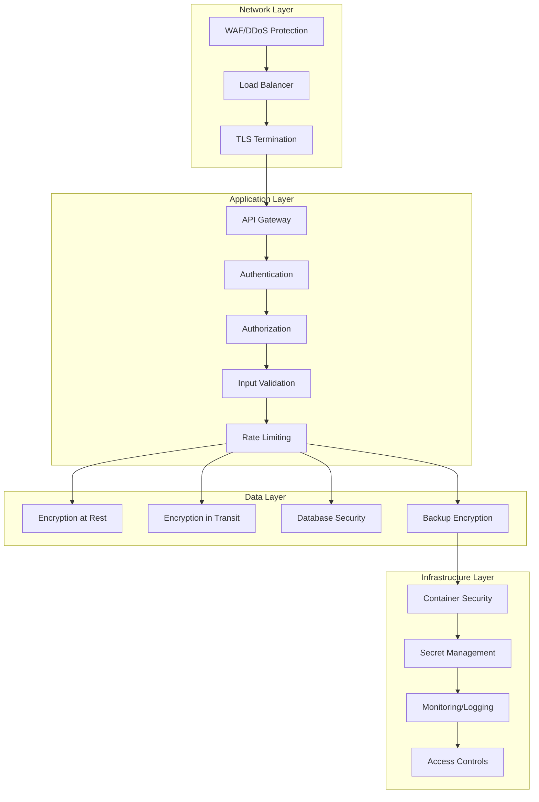

# Security Guide

## Overview

This guide covers comprehensive security practices for the StudyAssistant RAG system, including authentication, authorization, data protection, API security, and infrastructure security.

## Security Architecture

### Defense in Depth



## Authentication & Authorization

### JWT-Based Authentication

```python
# auth/jwt_auth.py
from typing import Optional, Dict, Any, List
import jwt
import bcrypt
from datetime import datetime, timedelta
from dataclasses import dataclass
from enum import Enum
import secrets
import asyncio
import redis.asyncio as redis

class UserRole(Enum):
    ADMIN = "admin"
    RESEARCHER = "researcher"
    STUDENT = "student"
    GUEST = "guest"

@dataclass
class UserClaims:
    """JWT token claims."""
    user_id: str
    email: str
    roles: List[UserRole]
    permissions: List[str]
    session_id: str
    issued_at: datetime
    expires_at: datetime

class SecurityConfig:
    """Security configuration."""
    def __init__(self):
        self.jwt_secret = self._get_jwt_secret()
        self.jwt_algorithm = "HS256"
        self.access_token_expire_minutes = 30
        self.refresh_token_expire_days = 7
        self.password_min_length = 12
        self.max_login_attempts = 5
        self.lockout_duration_minutes = 15
        self.session_timeout_minutes = 60

    def _get_jwt_secret(self) -> str:
        """Get JWT secret from environment or generate."""
        import os
        secret = os.getenv('JWT_SECRET')
        if not secret:
            # Generate secure secret in production
            secret = secrets.token_urlsafe(64)
        return secret

class AuthenticationService:
    """JWT authentication service."""
    
    def __init__(self, config: SecurityConfig, redis_client: redis.Redis):
        self.config = config
        self.redis = redis_client
        self._failed_attempts = {}  # user_id -> attempt_count
    
    async def authenticate_user(self, email: str, password: str) -> Optional[UserClaims]:
        """Authenticate user with email/password."""
        # Check for account lockout
        if await self._is_account_locked(email):
            raise AccountLockedError("Account temporarily locked")
        
        try:
            # Get user from database
            user = await self._get_user_by_email(email)
            if not user:
                await self._record_failed_attempt(email)
                raise AuthenticationError("Invalid credentials")
            
            # Verify password
            if not self._verify_password(password, user['password_hash']):
                await self._record_failed_attempt(email)
                raise AuthenticationError("Invalid credentials")
            
            # Check if account is active
            if not user.get('is_active', True):
                raise AuthenticationError("Account disabled")
            
            # Reset failed attempts on successful login
            await self._reset_failed_attempts(email)
            
            # Create session
            session_id = secrets.token_urlsafe(32)
            await self._create_session(user['id'], session_id)
            
            # Generate claims
            return UserClaims(
                user_id=user['id'],
                email=user['email'],
                roles=[UserRole(role) for role in user.get('roles', ['student'])],
                permissions=await self._get_user_permissions(user['id']),
                session_id=session_id,
                issued_at=datetime.utcnow(),
                expires_at=datetime.utcnow() + timedelta(minutes=self.config.access_token_expire_minutes)
            )
            
        except Exception as e:
            await self._record_failed_attempt(email)
            raise
    
    def generate_access_token(self, claims: UserClaims) -> str:
        """Generate JWT access token."""
        payload = {
            'user_id': claims.user_id,
            'email': claims.email,
            'roles': [role.value for role in claims.roles],
            'permissions': claims.permissions,
            'session_id': claims.session_id,
            'iat': claims.issued_at.timestamp(),
            'exp': claims.expires_at.timestamp(),
            'type': 'access'
        }
        
        return jwt.encode(
            payload,
            self.config.jwt_secret,
            algorithm=self.config.jwt_algorithm
        )
    
    def generate_refresh_token(self, user_id: str, session_id: str) -> str:
        """Generate JWT refresh token."""
        payload = {
            'user_id': user_id,
            'session_id': session_id,
            'iat': datetime.utcnow().timestamp(),
            'exp': (datetime.utcnow() + timedelta(days=self.config.refresh_token_expire_days)).timestamp(),
            'type': 'refresh'
        }
        
        return jwt.encode(
            payload,
            self.config.jwt_secret,
            algorithm=self.config.jwt_algorithm
        )
    
    async def verify_token(self, token: str) -> UserClaims:
        """Verify and decode JWT token."""
        try:
            payload = jwt.decode(
                token,
                self.config.jwt_secret,
                algorithms=[self.config.jwt_algorithm]
            )
            
            # Verify token type
            if payload.get('type') != 'access':
                raise InvalidTokenError("Invalid token type")
            
            # Check session validity
            if not await self._is_session_valid(payload['user_id'], payload['session_id']):
                raise InvalidTokenError("Session expired or invalid")
            
            # Update session activity
            await self._update_session_activity(payload['user_id'], payload['session_id'])
            
            return UserClaims(
                user_id=payload['user_id'],
                email=payload['email'],
                roles=[UserRole(role) for role in payload['roles']],
                permissions=payload['permissions'],
                session_id=payload['session_id'],
                issued_at=datetime.fromtimestamp(payload['iat']),
                expires_at=datetime.fromtimestamp(payload['exp'])
            )
            
        except jwt.ExpiredSignatureError:
            raise TokenExpiredError("Token has expired")
        except jwt.InvalidTokenError as e:
            raise InvalidTokenError(f"Invalid token: {e}")
    
    async def refresh_access_token(self, refresh_token: str) -> tuple[str, str]:
        """Refresh access token using refresh token."""
        try:
            payload = jwt.decode(
                refresh_token,
                self.config.jwt_secret,
                algorithms=[self.config.jwt_algorithm]
            )
            
            if payload.get('type') != 'refresh':
                raise InvalidTokenError("Invalid token type")
            
            # Check session validity
            user_id = payload['user_id']
            session_id = payload['session_id']
            
            if not await self._is_session_valid(user_id, session_id):
                raise InvalidTokenError("Session expired")
            
            # Get fresh user data
            user = await self._get_user_by_id(user_id)
            if not user or not user.get('is_active', True):
                raise AuthenticationError("User account disabled")
            
            # Generate new tokens
            claims = UserClaims(
                user_id=user['id'],
                email=user['email'],
                roles=[UserRole(role) for role in user.get('roles', ['student'])],
                permissions=await self._get_user_permissions(user['id']),
                session_id=session_id,
                issued_at=datetime.utcnow(),
                expires_at=datetime.utcnow() + timedelta(minutes=self.config.access_token_expire_minutes)
            )
            
            new_access_token = self.generate_access_token(claims)
            new_refresh_token = self.generate_refresh_token(user_id, session_id)
            
            return new_access_token, new_refresh_token
            
        except jwt.ExpiredSignatureError:
            raise TokenExpiredError("Refresh token has expired")
        except jwt.InvalidTokenError as e:
            raise InvalidTokenError(f"Invalid refresh token: {e}")
    
    def _hash_password(self, password: str) -> str:
        """Hash password using bcrypt."""
        salt = bcrypt.gensalt()
        return bcrypt.hashpw(password.encode('utf-8'), salt).decode('utf-8')
    
    def _verify_password(self, password: str, password_hash: str) -> bool:
        """Verify password against hash."""
        return bcrypt.checkpw(password.encode('utf-8'), password_hash.encode('utf-8'))
```

### Role-Based Access Control (RBAC)

```python
# auth/rbac.py
from typing import Set, Dict, List, Optional
from enum import Enum
from dataclasses import dataclass
import functools

class Permission(Enum):
    # Data permissions
    READ_DOCUMENTS = "read_documents"
    WRITE_DOCUMENTS = "write_documents"
    DELETE_DOCUMENTS = "delete_documents"
    
    # Search permissions
    BASIC_SEARCH = "basic_search"
    ADVANCED_SEARCH = "advanced_search"
    BULK_SEARCH = "bulk_search"
    
    # User management
    MANAGE_USERS = "manage_users"
    VIEW_USERS = "view_users"
    
    # System administration
    ADMIN_ACCESS = "admin_access"
    VIEW_METRICS = "view_metrics"
    MANAGE_SYSTEM = "manage_system"
    
    # API access
    API_ACCESS = "api_access"
    EXTERNAL_API_ACCESS = "external_api_access"

@dataclass
class RoleDefinition:
    """Role definition with permissions."""
    name: str
    permissions: Set[Permission]
    description: str
    max_requests_per_hour: int = 1000
    max_documents_per_request: int = 10

class RBACService:
    """Role-Based Access Control service."""
    
    def __init__(self):
        self.roles = self._initialize_roles()
        self.user_roles: Dict[str, List[UserRole]] = {}
    
    def _initialize_roles(self) -> Dict[UserRole, RoleDefinition]:
        """Initialize default roles and permissions."""
        return {
            UserRole.GUEST: RoleDefinition(
                name="Guest",
                permissions={Permission.BASIC_SEARCH},
                description="Limited read-only access",
                max_requests_per_hour=100,
                max_documents_per_request=5
            ),
            UserRole.STUDENT: RoleDefinition(
                name="Student",
                permissions={
                    Permission.READ_DOCUMENTS,
                    Permission.BASIC_SEARCH,
                    Permission.ADVANCED_SEARCH,
                    Permission.API_ACCESS
                },
                description="Standard user access",
                max_requests_per_hour=500,
                max_documents_per_request=10
            ),
            UserRole.RESEARCHER: RoleDefinition(
                name="Researcher",
                permissions={
                    Permission.READ_DOCUMENTS,
                    Permission.WRITE_DOCUMENTS,
                    Permission.BASIC_SEARCH,
                    Permission.ADVANCED_SEARCH,
                    Permission.BULK_SEARCH,
                    Permission.API_ACCESS,
                    Permission.EXTERNAL_API_ACCESS
                },
                description="Extended research capabilities",
                max_requests_per_hour=2000,
                max_documents_per_request=50
            ),
            UserRole.ADMIN: RoleDefinition(
                name="Administrator",
                permissions=set(Permission),  # All permissions
                description="Full system access",
                max_requests_per_hour=10000,
                max_documents_per_request=1000
            )
        }
    
    def has_permission(self, user_roles: List[UserRole], permission: Permission) -> bool:
        """Check if user has specific permission."""
        user_permissions = set()
        for role in user_roles:
            if role in self.roles:
                user_permissions.update(self.roles[role].permissions)
        
        return permission in user_permissions
    
    def get_user_permissions(self, user_roles: List[UserRole]) -> Set[Permission]:
        """Get all permissions for user roles."""
        permissions = set()
        for role in user_roles:
            if role in self.roles:
                permissions.update(self.roles[role].permissions)
        return permissions
    
    def get_rate_limit(self, user_roles: List[UserRole]) -> tuple[int, int]:
        """Get rate limits for user roles (requests_per_hour, max_documents)."""
        max_requests = 0
        max_documents = 0
        
        for role in user_roles:
            if role in self.roles:
                role_def = self.roles[role]
                max_requests = max(max_requests, role_def.max_requests_per_hour)
                max_documents = max(max_documents, role_def.max_documents_per_request)
        
        return max_requests, max_documents

def require_permission(permission: Permission):
    """Decorator to require specific permission."""
    def decorator(func):
        @functools.wraps(func)
        async def wrapper(*args, **kwargs):
            # Get user claims from request context
            user_claims = kwargs.get('user_claims') or getattr(args[0], 'user_claims', None)
            if not user_claims:
                raise AuthorizationError("Authentication required")
            
            rbac = RBACService()
            if not rbac.has_permission(user_claims.roles, permission):
                raise AuthorizationError(f"Permission denied: {permission.value}")
            
            return await func(*args, **kwargs)
        return wrapper
    return decorator

def require_role(required_role: UserRole):
    """Decorator to require specific role."""
    def decorator(func):
        @functools.wraps(func)
        async def wrapper(*args, **kwargs):
            user_claims = kwargs.get('user_claims') or getattr(args[0], 'user_claims', None)
            if not user_claims:
                raise AuthorizationError("Authentication required")
            
            if required_role not in user_claims.roles:
                raise AuthorizationError(f"Role required: {required_role.value}")
            
            return await func(*args, **kwargs)
        return wrapper
    return decorator
```

## Input Validation & Sanitization

### Request Validation

```python
# security/validation.py
from typing import Any, Dict, List, Optional, Union
import re
import html
import bleach
from pydantic import BaseModel, validator, Field
from datetime import datetime
import json

class SecurityConfig:
    """Security validation configuration."""
    MAX_STRING_LENGTH = 10000
    MAX_LIST_LENGTH = 1000
    MAX_JSON_SIZE = 1024 * 1024  # 1MB
    
    ALLOWED_HTML_TAGS = [
        'p', 'br', 'strong', 'em', 'u', 'ol', 'ul', 'li',
        'h1', 'h2', 'h3', 'h4', 'h5', 'h6', 'blockquote'
    ]
    
    ALLOWED_HTML_ATTRIBUTES = {
        '*': ['class'],
        'a': ['href', 'title'],
        'img': ['src', 'alt', 'width', 'height']
    }

class BaseValidatedModel(BaseModel):
    """Base model with security validations."""
    
    class Config:
        # Prevent extra fields
        extra = "forbid"
        # Validate on assignment
        validate_assignment = True
        # Use enum values
        use_enum_values = True

class SearchRequest(BaseValidatedModel):
    """Validated search request."""
    query: str = Field(..., min_length=1, max_length=SecurityConfig.MAX_STRING_LENGTH)
    filters: Optional[Dict[str, Any]] = Field(default_factory=dict)
    limit: int = Field(default=10, ge=1, le=100)
    offset: int = Field(default=0, ge=0)
    
    @validator('query')
    def validate_query(cls, v):
        """Validate and sanitize search query."""
        if not v or not v.strip():
            raise ValueError("Query cannot be empty")
        
        # Remove potential injection patterns
        sanitized = sanitize_input(v)
        
        # Check for suspicious patterns
        suspicious_patterns = [
            r'<script',
            r'javascript:',
            r'vbscript:',
            r'onload=',
            r'onerror=',
            r'eval\(',
            r'exec\(',
        ]
        
        for pattern in suspicious_patterns:
            if re.search(pattern, sanitized, re.IGNORECASE):
                raise ValueError("Invalid characters in query")
        
        return sanitized
    
    @validator('filters')
    def validate_filters(cls, v):
        """Validate search filters."""
        if not v:
            return {}
        
        if len(str(v)) > SecurityConfig.MAX_JSON_SIZE:
            raise ValueError("Filters too large")
        
        # Validate filter structure
        allowed_filter_keys = {
            'date_range', 'authors', 'categories', 'source',
            'language', 'document_type', 'keywords'
        }
        
        for key in v.keys():
            if key not in allowed_filter_keys:
                raise ValueError(f"Invalid filter key: {key}")
        
        return v

class DocumentUploadRequest(BaseValidatedModel):
    """Validated document upload request."""
    title: str = Field(..., min_length=1, max_length=500)
    content: str = Field(..., min_length=1, max_length=SecurityConfig.MAX_STRING_LENGTH)
    authors: List[str] = Field(default_factory=list, max_items=20)
    tags: List[str] = Field(default_factory=list, max_items=50)
    metadata: Optional[Dict[str, Any]] = Field(default_factory=dict)
    
    @validator('title', 'content')
    def sanitize_text_fields(cls, v):
        """Sanitize text fields."""
        return sanitize_input(v)
    
    @validator('authors', 'tags')
    def validate_string_lists(cls, v):
        """Validate string lists."""
        if len(v) > SecurityConfig.MAX_LIST_LENGTH:
            raise ValueError("List too long")
        
        sanitized = []
        for item in v:
            if isinstance(item, str):
                sanitized_item = sanitize_input(item)
                if len(sanitized_item) > 200:
                    raise ValueError("List item too long")
                sanitized.append(sanitized_item)
            else:
                raise ValueError("List items must be strings")
        
        return sanitized

def sanitize_input(text: str) -> str:
    """Sanitize user input."""
    if not isinstance(text, str):
        raise ValueError("Input must be string")
    
    # HTML escape
    sanitized = html.escape(text)
    
    # Remove null bytes and control characters
    sanitized = ''.join(char for char in sanitized if ord(char) >= 32 or char in '\n\r\t')
    
    # Normalize whitespace
    sanitized = re.sub(r'\s+', ' ', sanitized).strip()
    
    return sanitized

def sanitize_html(html_content: str) -> str:
    """Sanitize HTML content."""
    return bleach.clean(
        html_content,
        tags=SecurityConfig.ALLOWED_HTML_TAGS,
        attributes=SecurityConfig.ALLOWED_HTML_ATTRIBUTES,
        strip=True
    )

class InputValidator:
    """Advanced input validation."""
    
    @staticmethod
    def validate_email(email: str) -> bool:
        """Validate email format."""
        pattern = r'^[a-zA-Z0-9._%+-]+@[a-zA-Z0-9.-]+\.[a-zA-Z]{2,}$'
        return bool(re.match(pattern, email)) and len(email) <= 320
    
    @staticmethod
    def validate_password_strength(password: str) -> tuple[bool, List[str]]:
        """Validate password strength."""
        errors = []
        
        if len(password) < 12:
            errors.append("Password must be at least 12 characters")
        
        if not re.search(r'[A-Z]', password):
            errors.append("Password must contain uppercase letters")
        
        if not re.search(r'[a-z]', password):
            errors.append("Password must contain lowercase letters")
        
        if not re.search(r'\d', password):
            errors.append("Password must contain numbers")
        
        if not re.search(r'[!@#$%^&*()_+\-=\[\]{};\':"\\|,.<>\?]', password):
            errors.append("Password must contain special characters")
        
        # Check for common patterns
        common_patterns = [
            r'123456', r'password', r'qwerty', r'admin',
            r'(.)\1{3,}',  # Repeated characters
        ]
        
        for pattern in common_patterns:
            if re.search(pattern, password, re.IGNORECASE):
                errors.append("Password contains common patterns")
                break
        
        return len(errors) == 0, errors
    
    @staticmethod
    def validate_url(url: str) -> bool:
        """Validate URL format and safety."""
        if not url or len(url) > 2048:
            return False
        
        # Basic URL pattern
        url_pattern = r'^https?://[^\s/$.?#].[^\s]*$'
        if not re.match(url_pattern, url, re.IGNORECASE):
            return False
        
        # Check for dangerous protocols
        dangerous_protocols = ['javascript:', 'vbscript:', 'data:', 'file:']
        url_lower = url.lower()
        for protocol in dangerous_protocols:
            if url_lower.startswith(protocol):
                return False
        
        return True
    
    @staticmethod
    def validate_filename(filename: str) -> bool:
        """Validate filename safety."""
        if not filename or len(filename) > 255:
            return False
        
        # Check for dangerous characters
        dangerous_chars = ['..', '/', '\\', ':', '*', '?', '"', '<', '>', '|']
        for char in dangerous_chars:
            if char in filename:
                return False
        
        # Check for reserved names (Windows)
        reserved_names = [
            'CON', 'PRN', 'AUX', 'NUL',
            'COM1', 'COM2', 'COM3', 'COM4', 'COM5', 'COM6', 'COM7', 'COM8', 'COM9',
            'LPT1', 'LPT2', 'LPT3', 'LPT4', 'LPT5', 'LPT6', 'LPT7', 'LPT8', 'LPT9'
        ]
        
        name_without_ext = filename.split('.')[0].upper()
        if name_without_ext in reserved_names:
            return False
        
        return True
```

## API Security

### Rate Limiting

```python
# security/rate_limiting.py
from typing import Dict, Optional, Tuple
import time
import asyncio
import redis.asyncio as redis
from dataclasses import dataclass
from enum import Enum
import hashlib
import json

class RateLimitType(Enum):
    REQUESTS_PER_MINUTE = "rpm"
    REQUESTS_PER_HOUR = "rph"
    REQUESTS_PER_DAY = "rpd"
    CONCURRENT_REQUESTS = "concurrent"

@dataclass
class RateLimitConfig:
    """Rate limit configuration."""
    requests_per_minute: int = 60
    requests_per_hour: int = 1000
    requests_per_day: int = 10000
    concurrent_requests: int = 5
    burst_allowance: int = 10
    
class RateLimiter:
    """Redis-based rate limiter with sliding window."""
    
    def __init__(self, redis_client: redis.Redis):
        self.redis = redis_client
        self.scripts = self._load_lua_scripts()
    
    def _load_lua_scripts(self) -> Dict[str, str]:
        """Load Lua scripts for atomic operations."""
        sliding_window_script = """
        local key = KEYS[1]
        local window = tonumber(ARGV[1])
        local limit = tonumber(ARGV[2])
        local now = tonumber(ARGV[3])
        
        -- Remove expired entries
        redis.call('ZREMRANGEBYSCORE', key, 0, now - window)
        
        -- Count current requests
        local current = redis.call('ZCARD', key)
        
        if current < limit then
            -- Add current request
            redis.call('ZADD', key, now, now)
            redis.call('EXPIRE', key, window)
            return {1, limit - current - 1}
        else
            return {0, 0}
        end
        """
        
        return {
            'sliding_window': sliding_window_script
        }
    
    async def check_rate_limit(
        self,
        identifier: str,
        limit_type: RateLimitType,
        limit: int,
        window_seconds: int
    ) -> Tuple[bool, int]:
        """Check if request is within rate limit."""
        key = f"rate_limit:{limit_type.value}:{identifier}"
        now = time.time()
        
        try:
            result = await self.redis.eval(
                self.scripts['sliding_window'],
                1,
                key,
                window_seconds,
                limit,
                int(now * 1000)  # Millisecond precision
            )
            
            allowed = bool(result[0])
            remaining = int(result[1])
            
            return allowed, remaining
            
        except Exception as e:
            # Fail open on Redis errors
            logger.error(f"Rate limit check failed: {e}")
            return True, limit
    
    async def get_rate_limit_info(
        self,
        identifier: str,
        limit_type: RateLimitType,
        window_seconds: int
    ) -> Dict[str, int]:
        """Get current rate limit information."""
        key = f"rate_limit:{limit_type.value}:{identifier}"
        now = time.time()
        
        # Remove expired entries
        await self.redis.zremrangebyscore(
            key,
            0,
            (now - window_seconds) * 1000
        )
        
        # Get current count
        current_count = await self.redis.zcard(key)
        
        # Get oldest entry for reset time calculation
        oldest_entries = await self.redis.zrange(key, 0, 0, withscores=True)
        reset_time = 0
        if oldest_entries:
            reset_time = int(oldest_entries[0][1] / 1000) + window_seconds
        
        return {
            'current': current_count,
            'reset_time': reset_time,
            'window_seconds': window_seconds
        }

class APISecurityMiddleware:
    """API security middleware with rate limiting and request validation."""
    
    def __init__(self, rate_limiter: RateLimiter, rbac_service: RBACService):
        self.rate_limiter = rate_limiter
        self.rbac_service = rbac_service
    
    async def process_request(self, request, user_claims: Optional[UserClaims] = None):
        """Process incoming request with security checks."""
        # Get client identifier
        client_id = self._get_client_identifier(request)
        
        # Determine rate limits based on user role
        if user_claims:
            rate_config = self._get_user_rate_limits(user_claims.roles)
        else:
            rate_config = RateLimitConfig()  # Default limits for unauthenticated
        
        # Check rate limits
        await self._check_all_rate_limits(client_id, rate_config)
        
        # Validate request size
        await self._validate_request_size(request)
        
        # Check for suspicious patterns
        await self._check_suspicious_patterns(request)
    
    def _get_client_identifier(self, request) -> str:
        """Get unique client identifier."""
        # Try to get user ID first
        if hasattr(request, 'user_claims') and request.user_claims:
            return f"user:{request.user_claims.user_id}"
        
        # Fall back to IP address
        forwarded_for = request.headers.get('X-Forwarded-For')
        if forwarded_for:
            ip = forwarded_for.split(',')[0].strip()
        else:
            ip = request.client.host
        
        return f"ip:{ip}"
    
    def _get_user_rate_limits(self, roles: List[UserRole]) -> RateLimitConfig:
        """Get rate limits for user roles."""
        max_rpm, max_rph = self.rbac_service.get_rate_limit(roles)
        
        return RateLimitConfig(
            requests_per_minute=min(max_rpm // 60, 120),  # Conservative per-minute limit
            requests_per_hour=max_rph,
            requests_per_day=max_rph * 24,
            concurrent_requests=10 if UserRole.ADMIN in roles else 5
        )
    
    async def _check_all_rate_limits(self, client_id: str, config: RateLimitConfig):
        """Check all configured rate limits."""
        checks = [
            (RateLimitType.REQUESTS_PER_MINUTE, config.requests_per_minute, 60),
            (RateLimitType.REQUESTS_PER_HOUR, config.requests_per_hour, 3600),
            (RateLimitType.REQUESTS_PER_DAY, config.requests_per_day, 86400),
        ]
        
        for limit_type, limit, window in checks:
            allowed, remaining = await self.rate_limiter.check_rate_limit(
                client_id, limit_type, limit, window
            )
            
            if not allowed:
                raise RateLimitExceededError(
                    f"Rate limit exceeded: {limit_type.value}",
                    limit_type=limit_type,
                    limit=limit,
                    window=window
                )
    
    async def _validate_request_size(self, request):
        """Validate request size limits."""
        content_length = request.headers.get('content-length')
        if content_length:
            size = int(content_length)
            max_size = 10 * 1024 * 1024  # 10MB
            
            if size > max_size:
                raise RequestTooLargeError(f"Request size {size} exceeds limit {max_size}")
    
    async def _check_suspicious_patterns(self, request):
        """Check for suspicious request patterns."""
        # Check User-Agent
        user_agent = request.headers.get('user-agent', '').lower()
        suspicious_agents = [
            'sqlmap', 'nikto', 'nmap', 'masscan', 'gobuster',
            'dirbuster', 'burpsuite', 'owasp', 'w3af'
        ]
        
        for agent in suspicious_agents:
            if agent in user_agent:
                raise SuspiciousRequestError(f"Suspicious user agent: {user_agent}")
        
        # Check for common attack patterns in URL
        url_path = str(request.url.path).lower()
        attack_patterns = [
            '../', '..\\', '/etc/passwd', '/proc/', 'cmd=',
            '<script', 'javascript:', 'union select', 'drop table'
        ]
        
        for pattern in attack_patterns:
            if pattern in url_path:
                raise SuspiciousRequestError(f"Suspicious URL pattern: {pattern}")
```

## Data Protection

### Encryption at Rest

```python
# security/encryption.py
from typing import Union, Optional
import os
import base64
from cryptography.fernet import Fernet
from cryptography.hazmat.primitives import hashes
from cryptography.hazmat.primitives.kdf.pbkdf2 import PBKDF2HMAC
import secrets

class EncryptionManager:
    """Manage encryption keys and operations."""
    
    def __init__(self, master_key: Optional[str] = None):
        self.master_key = master_key or self._get_master_key()
        self.fernet = self._create_fernet()
    
    def _get_master_key(self) -> str:
        """Get master encryption key from environment."""
        key = os.getenv('ENCRYPTION_MASTER_KEY')
        if not key:
            # Generate new key for development
            key = base64.urlsafe_b64encode(secrets.token_bytes(32)).decode()
            logger.warning("Generated new encryption key - set ENCRYPTION_MASTER_KEY in production")
        return key
    
    def _create_fernet(self) -> Fernet:
        """Create Fernet encryption instance."""
        # Derive key from master key
        key_bytes = base64.urlsafe_b64decode(self.master_key.encode())
        return Fernet(base64.urlsafe_b64encode(key_bytes[:32]))
    
    def encrypt(self, data: Union[str, bytes]) -> str:
        """Encrypt data and return base64 encoded string."""
        if isinstance(data, str):
            data = data.encode('utf-8')
        
        encrypted = self.fernet.encrypt(data)
        return base64.urlsafe_b64encode(encrypted).decode('utf-8')
    
    def decrypt(self, encrypted_data: str) -> str:
        """Decrypt base64 encoded encrypted data."""
        try:
            encrypted_bytes = base64.urlsafe_b64decode(encrypted_data.encode('utf-8'))
            decrypted = self.fernet.decrypt(encrypted_bytes)
            return decrypted.decode('utf-8')
        except Exception as e:
            raise DecryptionError(f"Failed to decrypt data: {e}")
    
    def encrypt_sensitive_fields(self, data: dict, sensitive_fields: list) -> dict:
        """Encrypt specified sensitive fields in dictionary."""
        encrypted_data = data.copy()
        
        for field in sensitive_fields:
            if field in encrypted_data and encrypted_data[field]:
                encrypted_data[field] = self.encrypt(str(encrypted_data[field]))
        
        return encrypted_data
    
    def decrypt_sensitive_fields(self, data: dict, sensitive_fields: list) -> dict:
        """Decrypt specified sensitive fields in dictionary."""
        decrypted_data = data.copy()
        
        for field in sensitive_fields:
            if field in decrypted_data and decrypted_data[field]:
                try:
                    decrypted_data[field] = self.decrypt(decrypted_data[field])
                except DecryptionError:
                    # Field might not be encrypted
                    pass
        
        return decrypted_data

# Database column encryption
class EncryptedField:
    """Database field that automatically encrypts/decrypts."""
    
    def __init__(self, encryption_manager: EncryptionManager):
        self.encryption_manager = encryption_manager
    
    def __set_name__(self, owner, name):
        self.name = name
        self.private_name = f'_{name}'
    
    def __get__(self, obj, objtype=None):
        if obj is None:
            return self
        
        encrypted_value = getattr(obj, self.private_name, None)
        if encrypted_value:
            return self.encryption_manager.decrypt(encrypted_value)
        return None
    
    def __set__(self, obj, value):
        if value is not None:
            encrypted_value = self.encryption_manager.encrypt(str(value))
            setattr(obj, self.private_name, encrypted_value)
        else:
            setattr(obj, self.private_name, None)
```

## Security Monitoring

### Security Event Logging

```python
# security/monitoring.py
from typing import Dict, Any, Optional
import asyncio
import json
import time
from datetime import datetime
from enum import Enum
from dataclasses import dataclass
import structlog

class SecurityEventType(Enum):
    LOGIN_SUCCESS = "login_success"
    LOGIN_FAILURE = "login_failure"
    LOGOUT = "logout"
    PASSWORD_CHANGE = "password_change"
    ACCOUNT_LOCKED = "account_locked"
    PERMISSION_DENIED = "permission_denied"
    RATE_LIMIT_EXCEEDED = "rate_limit_exceeded"
    SUSPICIOUS_ACTIVITY = "suspicious_activity"
    DATA_ACCESS = "data_access"
    DATA_MODIFICATION = "data_modification"
    ADMIN_ACTION = "admin_action"
    SECURITY_VIOLATION = "security_violation"

@dataclass
class SecurityEvent:
    """Security event data."""
    event_type: SecurityEventType
    user_id: Optional[str]
    ip_address: str
    user_agent: str
    timestamp: datetime
    details: Dict[str, Any]
    risk_level: str = "low"  # low, medium, high, critical
    session_id: Optional[str] = None
    endpoint: Optional[str] = None

class SecurityMonitor:
    """Security event monitoring and alerting."""
    
    def __init__(self, redis_client, alert_thresholds: Optional[Dict] = None):
        self.redis = redis_client
        self.logger = structlog.get_logger("security")
        self.alert_thresholds = alert_thresholds or self._default_thresholds()
        self._running_tasks = set()
    
    def _default_thresholds(self) -> Dict[str, Dict[str, Any]]:
        """Default alert thresholds."""
        return {
            'failed_logins': {
                'count': 5,
                'window_minutes': 5,
                'risk_level': 'medium'
            },
            'rate_limit_violations': {
                'count': 10,
                'window_minutes': 10,
                'risk_level': 'medium'
            },
            'permission_denials': {
                'count': 20,
                'window_minutes': 15,
                'risk_level': 'high'
            },
            'suspicious_activity': {
                'count': 1,
                'window_minutes': 1,
                'risk_level': 'critical'
            }
        }
    
    async def log_security_event(self, event: SecurityEvent):
        """Log security event and check for alerts."""
        # Log structured event
        await self._log_event(event)
        
        # Store in Redis for real-time monitoring
        await self._store_event_in_redis(event)
        
        # Check alert conditions
        task = asyncio.create_task(self._check_alert_conditions(event))
        self._running_tasks.add(task)
        task.add_done_callback(self._running_tasks.discard)
    
    async def _log_event(self, event: SecurityEvent):
        """Log security event with structured logging."""
        log_data = {
            'event_type': event.event_type.value,
            'user_id': event.user_id,
            'ip_address': event.ip_address,
            'user_agent': event.user_agent,
            'timestamp': event.timestamp.isoformat(),
            'risk_level': event.risk_level,
            'session_id': event.session_id,
            'endpoint': event.endpoint,
            'details': event.details
        }
        
        if event.risk_level in ['high', 'critical']:
            self.logger.warning("Security event", **log_data)
        else:
            self.logger.info("Security event", **log_data)
    
    async def _store_event_in_redis(self, event: SecurityEvent):
        """Store event in Redis for real-time analysis."""
        # Store individual event
        event_key = f"security_event:{event.timestamp.timestamp()}"
        event_data = {
            'type': event.event_type.value,
            'user_id': event.user_id,
            'ip': event.ip_address,
            'risk': event.risk_level,
            'details': json.dumps(event.details)
        }
        
        await self.redis.hset(event_key, mapping=event_data)
        await self.redis.expire(event_key, 86400)  # Keep for 24 hours
        
        # Add to time-series for pattern detection
        ts_key = f"security_ts:{event.event_type.value}"
        await self.redis.zadd(
            ts_key,
            {f"{event.user_id or event.ip_address}:{time.time()}": time.time()}
        )
        await self.redis.expire(ts_key, 86400)
    
    async def _check_alert_conditions(self, event: SecurityEvent):
        """Check if event triggers any alert conditions."""
        event_type_key = event.event_type.value
        
        # Check if we have thresholds for this event type
        threshold_key = self._get_threshold_key(event_type_key)
        if threshold_key not in self.alert_thresholds:
            return
        
        threshold = self.alert_thresholds[threshold_key]
        window_seconds = threshold['window_minutes'] * 60
        
        # Count recent events of this type from same source
        identifier = event.user_id or event.ip_address
        recent_count = await self._count_recent_events(
            event.event_type, identifier, window_seconds
        )
        
        if recent_count >= threshold['count']:
            await self._trigger_alert(event, threshold, recent_count)
    
    def _get_threshold_key(self, event_type: str) -> str:
        """Map event type to threshold key."""
        mapping = {
            'login_failure': 'failed_logins',
            'rate_limit_exceeded': 'rate_limit_violations',
            'permission_denied': 'permission_denials',
            'suspicious_activity': 'suspicious_activity',
            'security_violation': 'suspicious_activity'
        }
        return mapping.get(event_type, 'default')
    
    async def _count_recent_events(
        self,
        event_type: SecurityEventType,
        identifier: str,
        window_seconds: int
    ) -> int:
        """Count recent events of specific type from identifier."""
        ts_key = f"security_ts:{event_type.value}"
        min_score = time.time() - window_seconds
        
        # Count events from this identifier in the time window
        pattern = f"{identifier}:*"
        all_recent = await self.redis.zrangebyscore(ts_key, min_score, '+inf')
        
        count = 0
        for event_key in all_recent:
            if event_key.decode().startswith(f"{identifier}:"):
                count += 1
        
        return count
    
    async def _trigger_alert(self, event: SecurityEvent, threshold: Dict, count: int):
        """Trigger security alert."""
        alert_data = {
            'alert_type': 'security_threshold_exceeded',
            'event_type': event.event_type.value,
            'identifier': event.user_id or event.ip_address,
            'count': count,
            'threshold': threshold['count'],
            'window_minutes': threshold['window_minutes'],
            'risk_level': threshold['risk_level'],
            'timestamp': datetime.utcnow().isoformat(),
            'sample_event': {
                'ip_address': event.ip_address,
                'user_agent': event.user_agent,
                'endpoint': event.endpoint,
                'details': event.details
            }
        }
        
        # Log critical alert
        self.logger.critical("Security alert triggered", **alert_data)
        
        # Store alert for dashboard
        alert_key = f"security_alert:{time.time()}"
        await self.redis.set(alert_key, json.dumps(alert_data), ex=604800)  # Keep for 7 days
        
        # Add to alerts list
        await self.redis.lpush("security_alerts", alert_key)
        await self.redis.ltrim("security_alerts", 0, 999)  # Keep last 1000 alerts
        
        # Trigger additional actions based on risk level
        if threshold['risk_level'] == 'critical':
            await self._handle_critical_alert(event, alert_data)
    
    async def _handle_critical_alert(self, event: SecurityEvent, alert_data: Dict):
        """Handle critical security alerts."""
        # Auto-block IP for suspicious activity
        if event.event_type in [SecurityEventType.SUSPICIOUS_ACTIVITY, SecurityEventType.SECURITY_VIOLATION]:
            await self._auto_block_ip(event.ip_address, duration_minutes=60)
        
        # Lock user account for repeated failed logins
        if event.event_type == SecurityEventType.LOGIN_FAILURE and event.user_id:
            await self._auto_lock_account(event.user_id, duration_minutes=30)
        
        # Send immediate notification (implement based on your notification system)
        await self._send_security_notification(alert_data)
    
    async def _auto_block_ip(self, ip_address: str, duration_minutes: int):
        """Automatically block IP address."""
        block_key = f"blocked_ip:{ip_address}"
        await self.redis.set(block_key, "auto_blocked", ex=duration_minutes * 60)
        
        self.logger.warning(f"Auto-blocked IP {ip_address} for {duration_minutes} minutes")
    
    async def _auto_lock_account(self, user_id: str, duration_minutes: int):
        """Automatically lock user account."""
        lock_key = f"locked_account:{user_id}"
        await self.redis.set(lock_key, "auto_locked", ex=duration_minutes * 60)
        
        self.logger.warning(f"Auto-locked account {user_id} for {duration_minutes} minutes")
    
    async def _send_security_notification(self, alert_data: Dict):
        """Send security notification to administrators."""
        # Implement notification logic (email, Slack, etc.)
        pass

# Middleware to log security events
class SecurityLoggingMiddleware:
    """Middleware to automatically log security events."""
    
    def __init__(self, security_monitor: SecurityMonitor):
        self.security_monitor = security_monitor
    
    async def __call__(self, request, call_next):
        """Process request and log security events."""
        start_time = time.time()
        
        try:
            response = await call_next(request)
            
            # Log successful access to sensitive endpoints
            if self._is_sensitive_endpoint(request.url.path):
                await self._log_data_access(request, response.status_code)
            
            return response
            
        except Exception as e:
            # Log security-related exceptions
            await self._log_security_exception(request, e)
            raise
    
    def _is_sensitive_endpoint(self, path: str) -> bool:
        """Check if endpoint accesses sensitive data."""
        sensitive_patterns = [
            '/api/documents/',
            '/api/users/',
            '/api/admin/',
            '/api/search/',
        ]
        return any(pattern in path for pattern in sensitive_patterns)
    
    async def _log_data_access(self, request, status_code: int):
        """Log data access event."""
        user_claims = getattr(request.state, 'user_claims', None)
        
        event = SecurityEvent(
            event_type=SecurityEventType.DATA_ACCESS,
            user_id=user_claims.user_id if user_claims else None,
            ip_address=self._get_client_ip(request),
            user_agent=request.headers.get('user-agent', ''),
            timestamp=datetime.utcnow(),
            endpoint=str(request.url.path),
            details={
                'method': request.method,
                'status_code': status_code,
                'query_params': dict(request.query_params)
            }
        )
        
        await self.security_monitor.log_security_event(event)
    
    def _get_client_ip(self, request) -> str:
        """Get client IP address."""
        forwarded_for = request.headers.get('x-forwarded-for')
        if forwarded_for:
            return forwarded_for.split(',')[0].strip()
        return request.client.host
```

## Configuration Examples

### Security Headers Configuration

```python
# security/headers.py
from typing import Dict
from fastapi import FastAPI
from fastapi.middleware.trustedhost import TrustedHostMiddleware
from fastapi.middleware.cors import CORSMiddleware

def configure_security_headers(app: FastAPI):
    """Configure security headers and middleware."""
    
    # Trusted hosts
    app.add_middleware(
        TrustedHostMiddleware,
        allowed_hosts=["yourdomain.com", "*.yourdomain.com"]
    )
    
    # CORS configuration
    app.add_middleware(
        CORSMiddleware,
        allow_origins=["https://yourdomain.com"],
        allow_credentials=True,
        allow_methods=["GET", "POST", "PUT", "DELETE"],
        allow_headers=["*"],
        max_age=3600
    )
    
    @app.middleware("http")
    async def add_security_headers(request, call_next):
        response = await call_next(request)
        
        # Security headers
        security_headers = {
            "X-Content-Type-Options": "nosniff",
            "X-Frame-Options": "DENY",
            "X-XSS-Protection": "1; mode=block",
            "Strict-Transport-Security": "max-age=31536000; includeSubDomains",
            "Content-Security-Policy": (
                "default-src 'self'; "
                "script-src 'self' 'unsafe-inline'; "
                "style-src 'self' 'unsafe-inline'; "
                "img-src 'self' data: https:; "
                "font-src 'self' https:; "
                "connect-src 'self' https:; "
                "frame-ancestors 'none';"
            ),
            "Referrer-Policy": "strict-origin-when-cross-origin",
            "Permissions-Policy": (
                "geolocation=(), microphone=(), camera=(), "
                "magnetometer=(), gyroscope=(), speaker=(), "
                "vibrate=(), fullscreen=()"
            )
        }
        
        for header, value in security_headers.items():
            response.headers[header] = value
        
        # Remove server identification
        if "server" in response.headers:
            del response.headers["server"]
        
        return response
```

### Environment Configuration

```bash
# .env.security (example configuration)
# JWT Configuration
JWT_SECRET=your-super-secret-jwt-key-at-least-64-characters-long
JWT_ALGORITHM=HS256
ACCESS_TOKEN_EXPIRE_MINUTES=30
REFRESH_TOKEN_EXPIRE_DAYS=7

# Encryption
ENCRYPTION_MASTER_KEY=your-base64-encoded-encryption-key

# Rate Limiting
REDIS_URL=redis://localhost:6379/1
DEFAULT_RATE_LIMIT_PER_MINUTE=60
DEFAULT_RATE_LIMIT_PER_HOUR=1000

# Security Monitoring
SECURITY_LOG_LEVEL=INFO
ALERT_EMAIL=security@yourdomain.com
AUTO_BLOCK_ENABLED=true
AUTO_LOCK_ENABLED=true

# Database Security
DB_CONNECTION_TIMEOUT=30
DB_MAX_CONNECTIONS=20
DB_SSL_MODE=require

# HTTPS Configuration
FORCE_HTTPS=true
HSTS_MAX_AGE=31536000
CSP_REPORT_URI=https://yourdomain.com/api/csp-report
```

## Best Practices

### Security Checklist

1. **Authentication & Authorization**
   - ✅ Strong password requirements (12+ chars, complexity)
   - ✅ Multi-factor authentication for admin accounts
   - ✅ JWT tokens with short expiration times
   - ✅ Role-based access control (RBAC)
   - ✅ Session management with Redis
   - ✅ Account lockout after failed attempts

2. **Input Validation**
   - ✅ Server-side validation for all inputs
   - ✅ SQL injection prevention (parameterized queries)
   - ✅ XSS prevention (input sanitization, CSP)
   - ✅ File upload restrictions and validation
   - ✅ Request size limits

3. **Data Protection**
   - ✅ Encryption at rest for sensitive data
   - ✅ TLS 1.3 for data in transit
   - ✅ Secure key management
   - ✅ Regular key rotation
   - ✅ Backup encryption

4. **API Security**
   - ✅ Rate limiting with Redis
   - ✅ API versioning and deprecation
   - ✅ Input/output validation
   - ✅ Authentication for all endpoints
   - ✅ CORS configuration

5. **Infrastructure Security**
   - ✅ Container security scanning
   - ✅ Secret management (not in code)
   - ✅ Network segmentation
   - ✅ Regular security updates
   - ✅ Monitoring and alerting

### Common Vulnerabilities Prevention

1. **OWASP Top 10 Mitigations**
   - Injection: Parameterized queries, input validation
   - Broken Authentication: Strong auth, session management
   - Sensitive Data Exposure: Encryption, secure transmission
   - XML External Entities: Disable XML external entity processing
   - Broken Access Control: RBAC, principle of least privilege
   - Security Misconfiguration: Secure defaults, regular audits
   - Cross-Site Scripting: Input validation, CSP headers
   - Insecure Deserialization: Avoid untrusted deserialization
   - Components with Known Vulnerabilities: Regular updates
   - Insufficient Logging: Comprehensive security logging

2. **Additional Security Measures**
   - Security headers (HSTS, CSP, X-Frame-Options)
   - Regular penetration testing
   - Dependency vulnerability scanning
   - Code security analysis
   - Security awareness training

## Related Documentation

- [Deployment Guide](deployment.md) - Secure deployment configurations
- [Performance Optimization](performance-optimization.md) - Security-aware optimization
- [Logging Guide](logging.md) - Security event logging
- [Error Handling](error-handling.md) - Secure error handling
